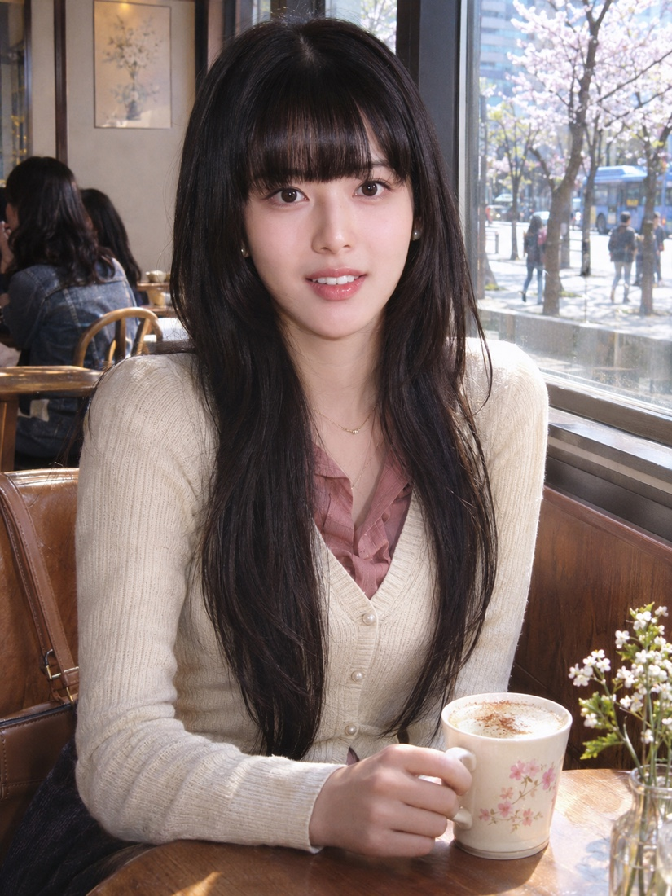

# P002 · 장윤정

## 프로필 기준

이름과 164cm의 키, 슬림한 체형, 예쁜 인상과 2007년 12월 교제 시작은 사용자 설정이다. 대학 입학 뒤에는 화장과 옷차림을 즐기며 한층 슬림해진 모습도 사용자 방향에 맞춰 반영했다. 새로 받은 참고 사진에서 긴 검은 생머리, 눈썹을 스치는 반듯한 앞머리와 눈매, 부드러운 턱선을 참고했다. 세부 이목구비와 습관은 작품의 창작 시안이다. 생일, 체중, 학교, 가족과 성적은 미정이다.

## 얼굴 윤곽 · 차분한 첫인상

얼굴은 길이감이 약간 있는 부드러운 타원형이다. 관자놀이에서 광대로 내려오는 선이 완만하고, 볼 아래에서 작고 둥근 턱끝으로 이어진다. 정면에서는 머리카락이 양쪽 볼의 바깥선을 감싼다. 눈을 맞출 때 또렷하게 예쁜 인상이 남고, 가볍게 미소를 지으면 입가에 힘이 풀리면서 표정이 한결 편안해진다.

## 눈과 눈썹 · 말을 들을 때의 시선

눈은 가로로 부드럽게 열린 아몬드형이다. 짙은 갈색 눈동자 위에 얇은 쌍꺼풀 선이 있고, 눈꼬리는 수평에 가깝게 이어진다. 눈썹은 대체로 곧고 끝이 살짝 가늘다. 앞머리 아래에 눈썹 윗선이 부분적으로 보이고, 고개를 조금 기울이면 한쪽 눈썹이 더 잘 드러난다.

상대의 말을 듣는 동안은 눈을 잘 맞춘다. 대답을 고를 때 잠깐 옆을 보고, 자기 생각을 말할 때 다시 상대를 본다는 창작안이다. 큰 표정이 없어도 상대가 이야기를 따라오고 있다는 느낌을 준다.

## 코와 입 · 미소가 번지는 순간

콧대는 눈 사이에서 얕게 시작해 작게 모인 둥근 코끝으로 이어진다. 옆에서 보면 이마에서 콧대로 넘어가는 굴곡이 부드럽다. 입은 얼굴 양쪽에 여백을 남기는 크기고, 아랫입술이 조금 더 도톰하다. 말없이 듣고 있다가 웃을 때는 입꼬리가 올라간 뒤 눈가가 천천히 좁아진다.

## 머리와 옷차림 · 긴 생머리와 반듯한 앞머리

짙은 검은색의 곧은 머리카락이 양쪽 어깨를 지나 가슴께까지 내려온다. 앞머리는 이마를 덮고 눈썹 가까이에서 반듯하게 떨어진다. 겨울 외투를 벗으며 옷깃에 끼인 긴 머리를 손으로 꺼내 정리하는 동작이 어울린다. 겨울에는 옅은 파란색 니트를 입는다. 대학에 들어간 뒤에는 외출할 때 속눈썹을 올리고 가는 아이라인과 장밋빛 립글로스로 눈매와 입술을 살린다. 몸에 맞는 밝은 카디건과 차분한 분홍색 블라우스를 즐겨 입고, 작은 진주 귀걸이처럼 옷에 어울리는 장신구도 고른다.

## 체형과 자세 · 164cm의 슬림한 실루엣

키는 164cm이며 대학에 들어갈 무렵 한층 슬림해졌다. 목에서 어깨로 이어지는 선이 가볍고, 서 있을 때 시선은 곧게 상대를 향한다. 니트 소매나 외투는 움직일 때 자연스럽게 접힐 정도로 여유를 둔다. 체중과 부위별 치수는 설정하지 않았다.

## 취향과 성격 · 꾸미는 즐거움

화장과 옷을 고르는 일을 즐긴다. 만나는 장소와 그날 기분에 맞춰 옷과 장신구를 고르는 편이다. 평소에는 말을 고르는 시간이 짧게 있고, 재미있는 이야기가 나오면 뒤늦게 웃음이 번지는 편으로 잡았다. 가까운 사람이면 전에 나온 사소한 이야기도 기억해 다음에 만났을 때 이어서 묻는다. 먼저 잡힌 일정이 있으면 가능한 날을 말해 주고, 자신이 가 보고 싶은 곳도 직접 제안한다. 이 성격과 습관은 앞으로의 전개를 위한 초안이다.

## 용식과의 관계 · 2007년 12월

용식은 윤정에게 전부터 관심이 있었다. 2007년 12월 용식이 먼저 마음을 전했고, 윤정이 받아들여 교제를 시작했다. 처음 서로를 알게 된 경위는 미정이다.

## 이미지 시안

대학에 입학한 봄, 가볍게 화장하고 밝은 카디건 차림으로 카페 창가에서 이야기를 나누는 가상 사진이다.
