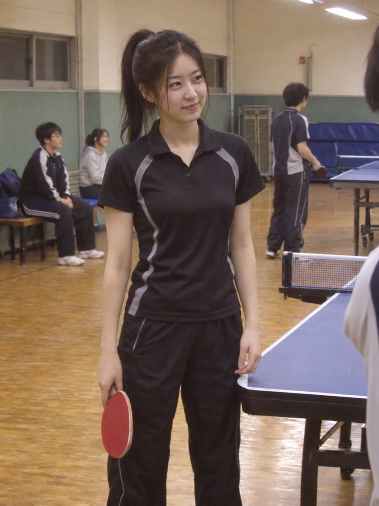

# P003 · 한서연

## 프로필 기준

연세대 탁구 동아리 선배로, 2008년 3월 용식과 혼합복식을 치며 가까워진다. 이름과 2학년 설정, 세부 외형과 성격은 창작 초안이다. 사진은 첨부 이미지의 묶은 머리와 검은 탁구복에서 분위기를 참고한 가상 초상이다.

## 외모와 옷차림

검은 머리를 높게 묶고 관자놀이 옆에 잔머리가 자연스럽게 남는다. 얼굴은 부드러운 타원형이고 상대를 살필 때 눈이 먼저 옆으로 움직인다. 연습할 때는 검은 운동복과 편하게 움직일 수 있는 바지를 입는다. 공을 줍거나 점수를 세는 사이에는 라켓을 가볍게 옆으로 내려 둔다.

## 혼합복식에서 보이는 성격

복식에서는 자기 차례와 상대가 들어올 공간을 함께 본다. 같은 실수가 반복되면 이유를 짧게 짚어 주고 다음 공을 받아 보게 한다. 긴장이 풀린 뒤에는 자기 실수부터 가볍게 웃으며 이야기하는 편이다. 경기 밖에서는 먼저 다음 모임 시간을 물어볼 정도로 관심을 표현한다.

## 용식과의 관계

3월에 혼합복식 파트너로 처음 만나 연습 뒤 신촌역까지 같이 걷기 시작한다. 다음에 함께 칠 날을 먼저 묻고 서로의 수업 일정에도 관심을 보이는 단계다.

## 이미지 시안

