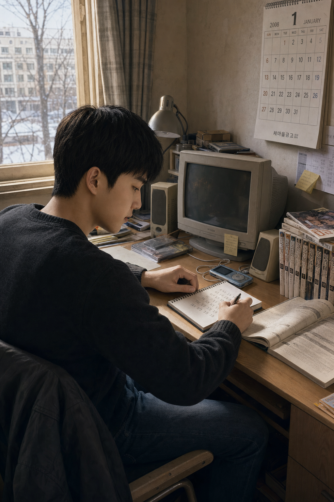

# 001. 2008년 1월 1일

천장이 낮았다.

김용식은 눈을 뜬 채 한참 누워 있었다. 형광등 커버의 먼지. 벽지 끝이 뜬 모서리. 창문 틈으로 들어오는 겨울 냄새.

익숙했다.

문제는, 익숙하면 안 된다는 거였다.

[김용식] "뭐야."

목소리가 젊었다.

덜 닳은 목소리.

그는 벌떡 일어나려다 이불에 발이 걸렸다.

퍽.

침대 옆 바닥에 무릎을 찍었다.

아프다.

꿈치고는 서비스가 불친절했다.

책상 위에는 낡은 스피커와 두꺼운 모니터가 있었다.

김용식은 손을 뻗었다.

휴대폰.

없다.

스마트폰.

당연히 없다.

방 안을 다시 봤다. 문제집. 만화책. 먼지 낀 MP3 플레이어.

그리고 벽에 걸린 달력.

2008년 1월.

첫 칸에 빨간 글씨가 박혀 있었다.

1.

신정.

[김용식] "하."

웃음이 나왔다.

반쯤은 기가 막혀서.

반쯤은 숨이 막혀서.

거울 속 남자는 어려 보였다.

아니.

어렸다.

열여덟.

고등학교 졸업 전.

겨울방학.

검은 머리와 내려온 앞머리. 덜 닳은 얼굴.

그런데 눈만 달랐다.

고3 얼굴에 인생 빚 독촉장이 붙어 있었다.

[김용식] "이건 좀 반칙이지."

그는 뺨을 꼬집었다.

아팠다.

꿈 검사 끝.

방문 밖에서 그릇 부딪히는 소리가 났다.

[어머니] "용식아, 일어났어?"

김용식은 굳었다.

어머니.

2008년의 어머니.

그가 대충 대답해도 한 번 더 불러주는 사람.

[어머니] "밥 식는다?"

김용식은 눈을 감았다가 떴다.

길게 생각하면 안 된다.

길게 생각하면 무너진다.

[김용식] "어. 일어났어."

말은 생각보다 멀쩡했다.

사람은 타임리프를 해도 아침밥 앞에서는 정상인 척할 수 있다.

대단한 생물이다.

거실 TV에서는 새해 특집 방송이 흐르고 있었다.

복.

김용식은 그 단어에서 멈췄다.

복권.

머릿속 한구석이 자동으로 열렸다.

로또 267회.

2008년 1월 12일.

7, 8, 24, 34, 36, 41. 보너스 1.

번호가 너무 선명했다.

누가 칠판에 적어둔 것처럼.

[어머니] "왜 서 있어. 밥 먹어."

[김용식] "어."

밥그릇이 놓였다. 김. 계란말이. 멸치볶음. 김치.

[어머니] "어디 아파?"

[김용식] "아니."

[어머니] "또 밤새 게임했지?"

정답이었다.

어제의 그는 아니었지만, 과거의 그는 분명 그랬을 것이다.

[어머니] "돈 필요해?"

[김용식] "아니라니까."

[어머니] "그럼 왜 사람이 갑자기 착해져."

김용식은 국을 삼키다 사레가 들렸다.

친어머니의 통찰은 수사기관보다 빠르다.

[김용식] "새해니까."

[어머니] "새해가 사람을 그렇게 쉽게 고치면 엄마가 매년 절했지."

말은 가벼웠다.

그래서 더 이상했다.

식사를 마치자 어머니가 앞치마 주머니에서 지폐를 꺼냈다.

[어머니] "친구들이랑 나갈 거면 가져가. 라면만 먹지 말고 밥도 먹고."

[김용식] "나 돈 있는데."

없다.

현재 보유 현금 0원.

말하고 나서 깨달았다.

입이 미래 기준으로 움직였다.

어머니가 눈을 가늘게 떴다.

[어머니] "있어?"

[김용식] "아니. 그러니까... 마음속에."

[어머니] "마음속 돈은 엄마도 많아."

패배했다.

김용식은 얌전히 돈을 받았다.

열하루 뒤의 22억보다, 지금 이 돈이 더 현실 같았다.

방으로 돌아온 그는 책상 서랍을 열었다.

학생증. 버스카드. 구겨진 영수증. 오래된 수첩.

김용식은 빈 페이지를 펼쳤다.

바로 번호를 적으려다 멈췄다.

너무 직접적이다.

누가 보면 끝이다.

그는 펜을 들고 적었다.

`1/12. 7시 8분. 24번 버스. 34분 기다림. 36번 자리. 41쪽. +1`

말도 안 되는 암호였다.

고등학생 수첩에는 원래 말도 안 되는 문장이 많다.

아마도.

김용식은 수첩을 덮었다.

해야 할 일은 정해졌다.

평소처럼 지내고.

아무렇지 않은 척 로또를 산다.

간단하다.

인생에서 간단하다고 생각한 일은 대체로 사고였다.

현관에서 운동화를 신는데, 거실 안쪽 방문이 열렸다.

낮고 무거운 발소리.

김용식의 손이 운동화 끈 위에서 멈췄다.

아버지였다.

아직 설명하지 못할 사람.

[아버지] "어딜 가냐."

짧은 질문이었다.

그런데 등에 얼음물이 닿은 것처럼 차가웠다.

김용식은 천천히 끈을 묶었다.

평소처럼.

아무렇지 않게.

그게 오늘 첫 번째 연기였다.

[김용식] "친구 만나러."

김용식은 문을 열었다.

복도에서 겨울 공기가 밀려왔다.

2008년 1월 1일.

첫날.

그는 아직 아무것도 바꾸지 않았다.

그런데 이미, 보고 싶지 않은 얼굴 하나가 등 뒤에 있었다.
