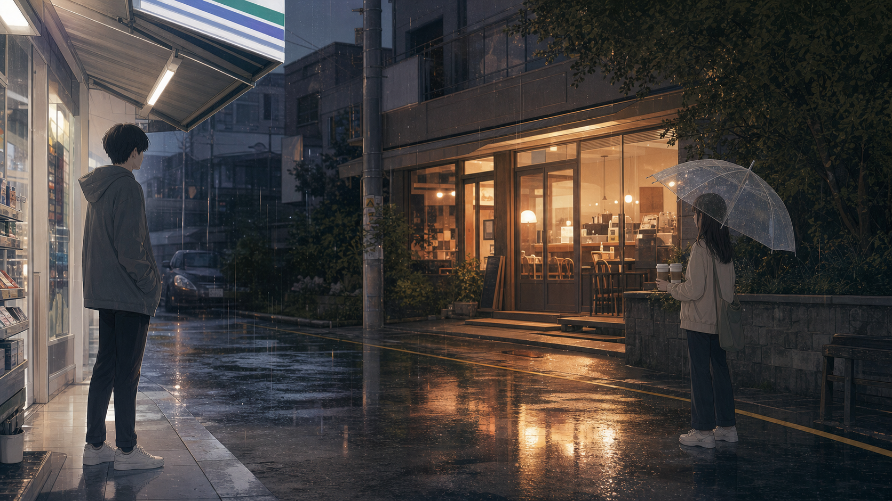

# ep.001 샘플 - 삽화 자동화 테스트

> 이 파일은 정식 원고가 아니라 자동 삽화 워크플로 테스트용 샘플이다.

비는 꼭 우산이 없을 때만 제대로 내린다.

주인공은 편의점 처마 밑에서 휴대폰을 내려다봤다.

[알림] 오늘 오후 6시 면접 스터디 장소가 카페 봄길로 변경되었습니다.

하필이면 길 건너였다.
그리고 하필이면, 거기엔 이미 누군가 서 있었다.

투명 우산 아래.
종이컵 하나.
눈이 마주치자 상대는 먼저 웃었다.

[상대 인물] "혹시 길 건너는 법도 스터디가 필요하세요?"

주인공은 젖은 운동화를 내려다봤다.

필요하다.
몹시.

[주인공] "우산 빌리러 온 건 아닙니다."

[상대 인물] "아직 안 물어봤는데요."

그건 좀 억울했다.
정확히는, 들킨 쪽에 가까웠다.

상대는 종이컵을 하나 더 들어 보였다.

[상대 인물] "커피는 식기 전에 마시는 쪽이 현실적이에요."

현실적.
비 오는 날, 처음 보는 사람에게 듣기엔 이상하게 설득력 있는 단어였다.

주인공은 한 발을 내디뎠다.

그리고 그 순간, 휴대폰이 다시 울렸다.

[스터디장] 오늘 첫 참석자끼리 서로 데려오세요. 지각하면 자기소개 두 배입니다.

길 건너의 상대가 화면을 힐끗 봤다.

[상대 인물] "그럼 저, 데려가지는 쪽인가요?"

비가 더 세졌다.

이건 그냥 카페에 가는 길이었을 텐데.
