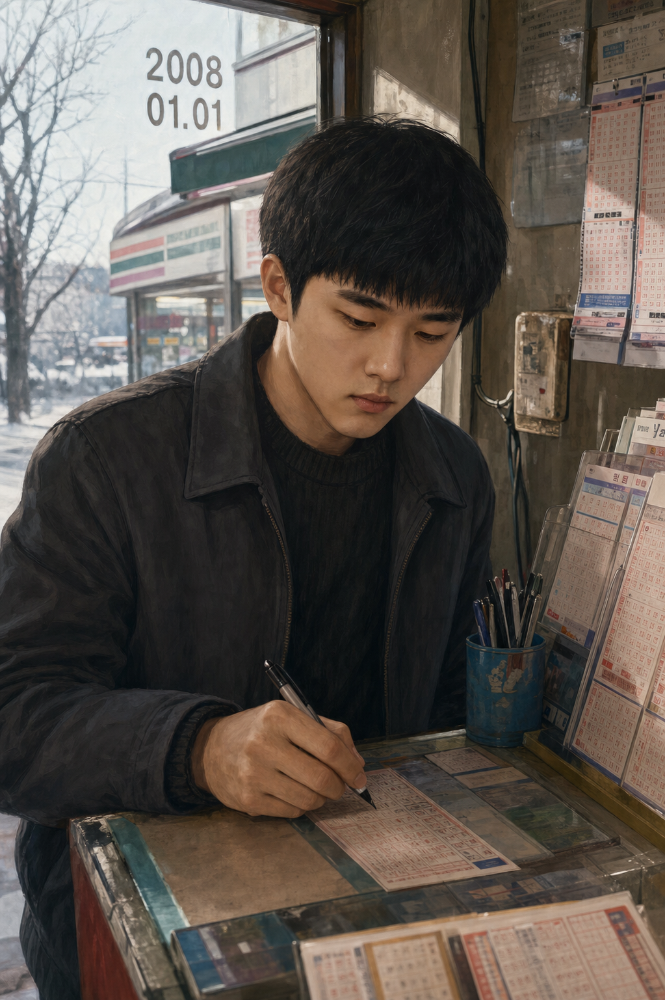

# 002. 천 원짜리 미래

[아버지] "어딜 가냐."

현관 앞에서 김용식은 운동화 끈을 묶었다.

천천히.

너무 빠르면 도망치는 것 같고, 너무 늦으면 겁먹은 것 같다.

둘 다 싫었다.

[김용식] "친구 만나러."

[아버지] "새해 첫날부터?"

[김용식] "새해 첫날이라서."

대답하고 나서 알았다.

아까 어머니에게 써먹은 변명이다.

2008년 새해는 참 바쁘다.

아버지는 더 묻지 않았다. 대신 거실 쪽에서 TV 소리만 커졌다.

김용식은 문을 열었다.

복도 공기가 차가웠다.

그 차가움이 오히려 살 것 같았다.

아파트 단지를 나오자 겨울 햇빛이 눈을 찔렀다.

김용식은 주머니 속 만이천 원을 만졌다.

오늘 쓸 돈.

밥값.

PC방비.

그리고 미래를 사는 데 필요한 최소 비용.

천 원.

정말 웃기는 가격이었다.

인생을 다시 시작하는 데 필요한 첫 결제 금액이 천 원이라니.

큰돈은 늘 가볍게 시작한다.

문제는 그다음부터 무거워진다는 거고.

PC방은 상가 2층에 있었다. 문을 열자 담배 냄새, 컵라면 냄새, 뜨거운 컴퓨터 냄새가 한꺼번에 밀려왔다.

[김종규] "야! 여기!"

김종규가 손을 흔들었다. 옆자리에는 송기훈이 헤드셋을 목에 걸고 있었다.

[송기훈] "늦었으니까 네가 라면."

[김용식] "아직 게임도 안 했는데?"

[김종규] "우린 마음속으로 이미 졌어."

[김용식] "그건 패배 선언 아닌가."

[송기훈] "아니. 청구서."

김용식은 웃으며 자리에 앉았다.

키보드 감촉이 낯익었다. 모니터 속 배틀넷 화면은 느렸고, 채팅창의 글씨는 투박했다.

하지만 손은 기억했다.

단축키.

빌드.

첫 판은 지나치게 쉽게 끝났다.

[김종규] "야, 너 뭐냐?"

[김용식] "왜."

[김종규] "오늘 손 풀렸다?"

[송기훈] "아니, 이건 풀린 게 아니라 남의 손인데."

김용식은 물컵을 들었다.

위험하다.

게임을 너무 잘해도 이상해진다.

지금 그는 실패한 판까지 기억하는 사람이다.

[김용식] "상대가 못했지."

[김종규] "상대 욕으로 겸손 떠는 거 봐라."

[송기훈] "새해부터 재수 없다."

김용식은 자리에서 일어났다.

[김용식] "나 음료수 사 올게."

[김종규] "콜라."

[송기훈] "나는 캔커피."

[김용식] "돈은?"

[김종규] "네가 이겼잖아."

[김용식] "이기면 돈을 내는 스포츠였냐."

[송기훈] "오늘부터."

그는 지갑을 챙겨 밖으로 나왔다.

상가 1층에는 편의점이 있었다. 그 옆 작은 판매점 유리창에 종이가 붙어 있었다.

`로또 판매`

김용식은 걸음을 멈췄다.

심장이 늦게 뛰었다.

그는 편의점에서 콜라와 캔커피를 먼저 샀다. 영수증을 받고, 일부러 동전을 세었다.

평범하게.

느긋하게.

그리고 옆 판매점으로 들어갔다.

[판매점 주인] "뭐 줄까?"

[김용식] "로또 하나요."

[판매점 주인] "자동?"

김용식은 손에 든 펜을 봤다.

자동.

그 말이 오늘따라 잔인하게 웃겼다.

인생은 자동으로 망했는데, 복권은 수동으로 사야 한다.

[김용식] "수동으로 할게요."

그는 번호를 칠했다.

7.

8.

24.

34.

36.

41.

그저 수능 끝난 고등학생이 재미로 복권을 사는 정도.

그 정도 얼굴.

판매점 주인이 용지를 기계에 넣었다. 짧은 인쇄음이 났다.

[판매점 주인] "천 원."

김용식은 천 원짜리를 냈다.

미래가 손바닥에 올라왔다.

너무 얇았다.

그는 복권을 지갑 깊숙이 넣었다. 영수증 사이에 끼우고, 학생증 뒤로 밀었다.

[판매점 주인] "당첨되면 한턱 쏴."

[김용식] "되면요."

[판매점 주인] "말은 다 그렇게 해."

김용식은 콜라와 캔커피를 들고 PC방으로 돌아갔다.

[김종규] "왜 이렇게 늦어?"

[김용식] "줄 섰어."

[송기훈] "새해 첫날부터 콜라 줄이 생겨?"

[김용식] "세상엔 우리가 모르는 일이 많다."

김용식은 캔커피를 던졌다.

송기훈이 간신히 받았다.

[송기훈] "야, 맞으면 죽는다."

[김용식] "살았네."

자리에 앉자 모니터 불빛이 얼굴에 닿았다.

평범한 PC방.

평범한 친구.

평범한 새해 첫날.

그 사이에 지갑 속 종이 한 장만 평범하지 않았다.

김용식은 마우스를 잡았다.

이번 판은 져야겠다.

그런데 게임이 시작되고 7분 뒤.

[김종규] "야! 너 또 왜 이렇게 잘해!"

김용식은 미니맵을 보며 작게 한숨을 쉬었다.

미래를 숨기는 일보다 손버릇 숨기는 일이 먼저였다.

생각보다 인생은 사소한 곳에서 들킨다.
