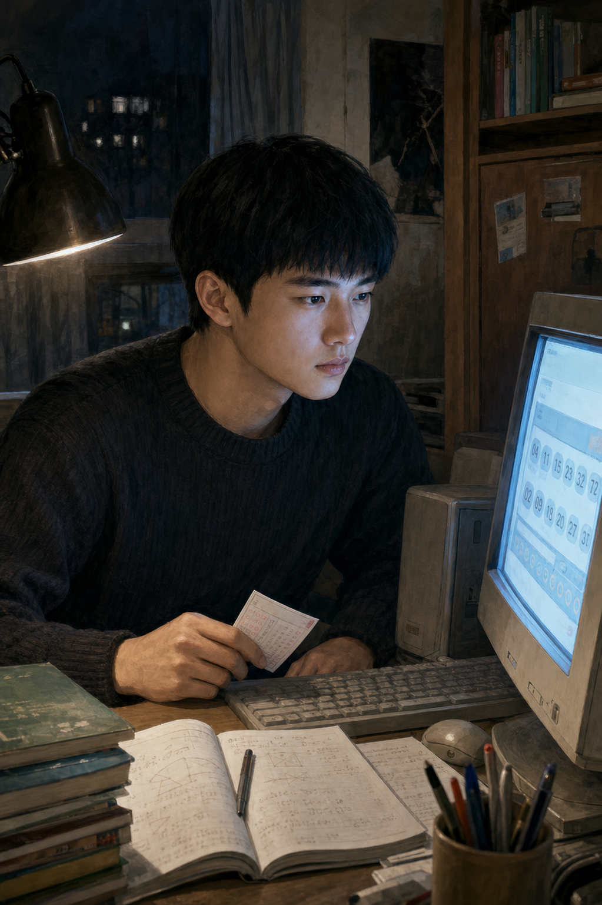

# 003. 맞은 번호

1월 12일 토요일.

김용식은 아침부터 멀쩡한 척했다.

그게 가장 어려웠다.

밥을 먹고, 방을 치우고, 문제집을 펼쳤다. 한 문제도 풀지 않았다.

[어머니] "오늘은 안 나가?"

[김용식] "조금 이따."

[어머니] "요즘 얌전하네."

[김용식] "새해잖아."

[어머니] "그 말 너무 오래 우려먹는다."

들켰다.

김용식은 문제집을 덮었다.

복권은 열한 날 동안 자리를 바꿨다.

지금은 책상 아래 본체 옆 먼지 쌓인 박스 안에 있었다.

미래의 22억이 먼지와 같이 숨었다.

저녁이 가까워질수록 시간이 느려졌다.

당첨된다.

그건 알고 있다.

문제는, 알고 있어도 무섭다는 거였다.

미래 지식은 보험이 아니다.

확정된 사고 예고에 가깝다.

집 안에서는 TV 예능 소리가 흘러나오고 있었다.

김용식은 방에 들어갔다.

문을 닫으려다 멈췄다. 너무 수상하다.

그는 본체 옆 박스에서 복권을 꺼냈다. 종이는 멀쩡했다. 천 원짜리 종이가 사람 심장을 이렇게 쉽게 쥐고 흔든다.

확인은 인터넷으로 해야 한다.

문제는 2008년 인터넷이었다.

컴퓨터 전원 버튼을 눌렀다.

위이잉.

본체가 숨을 쉬었다.

부팅이 느렸다.

아주 느렸다.

김용식은 의자에 앉아 손가락으로 책상을 두드렸다.

그냥 기다렸다.

포털 사이트를 열고, 로또를 검색했다.

마우스 커서가 살짝 떨렸다.

267회.

당첨번호.

화면이 떴다.

7.

8.

24.

34.

36.

41.

보너스 1.

김용식은 숨을 멈췄다.

알고 있던 숫자였다.

그래도 다르게 보였다.

기억 속 숫자는 정보였다.

화면 속 숫자는 현실이었다.

[김용식] "됐다."

목소리가 너무 작았다.

다행이었다.

크게 말했으면 끝났을지도 모른다.

맞았다.

전부.

32억 5천만 원.

세금 떼고 22억 조금 넘게.

고등학교 졸업 전 남자.

부모와 같이 사는 집.

통장.

신분증.

은행.

질문.

돈이 생긴 순간, 돈보다 질문이 먼저 늘었다.

김용식은 방을 둘러봤다.

침대 밑. 책장 뒤. 컴퓨터 본체 안쪽.

그는 결국 문제집 한 권을 꺼냈다.

두꺼운 수학 문제집.

미래에도 지금도 사람을 멀리하게 만드는 훌륭한 물건.

중간 페이지를 벌리고 복권을 끼웠다.

책장 가장 안쪽에 꽂았다.

어머니도 아버지도 수학 문제집은 건드리지 않을 가능성이 높았다.

인류가 수학을 두려워하는 데에는 이유가 있다.

그는 방문을 열었다.

거실 불빛이 눈에 들어왔다.

식탁 위에는 귤이 있었다. 평범한 토요일 밤에 22억짜리 비밀 하나가 생겼다.

[어머니] "왜 땀이 나?"

[김용식] "컴퓨터가 더워서."

[김용식] "본체가 열심히 살아."

어머니는 이상하다는 얼굴로 귤을 내밀었다.

김용식은 받아먹었다.

달았다.

너무 달아서, 잠깐 웃음이 나올 뻔했다.

그때 아버지가 신문 너머로 말했다.

[아버지] "요즘 방에서 뭘 그렇게 하냐."

귤 조각이 목에 걸릴 뻔했다.

김용식은 천천히 씹었다.

시간을 벌었다.

[김용식] "컴퓨터."

[아버지] "대학 가기 전에 헛짓하지 마라."

헛짓.

맞는 말이었다.

지금부터 하는 일은 누가 봐도 헛짓처럼 보일 것이다.

그런데 성공하면 인생이 바뀐다.

김용식은 귤껍질을 접었다.

[김용식] "알았어."

대답은 얌전했다.

속은 전혀 얌전하지 않았다.

그날 밤, 김용식은 수학 문제집이 꽂힌 책장을 오래 봤다.

저 안에 미래가 있다.

그리고 미래는 생각보다 훨씬 얇다.

찢어지면 끝나는 종이 한 장.
