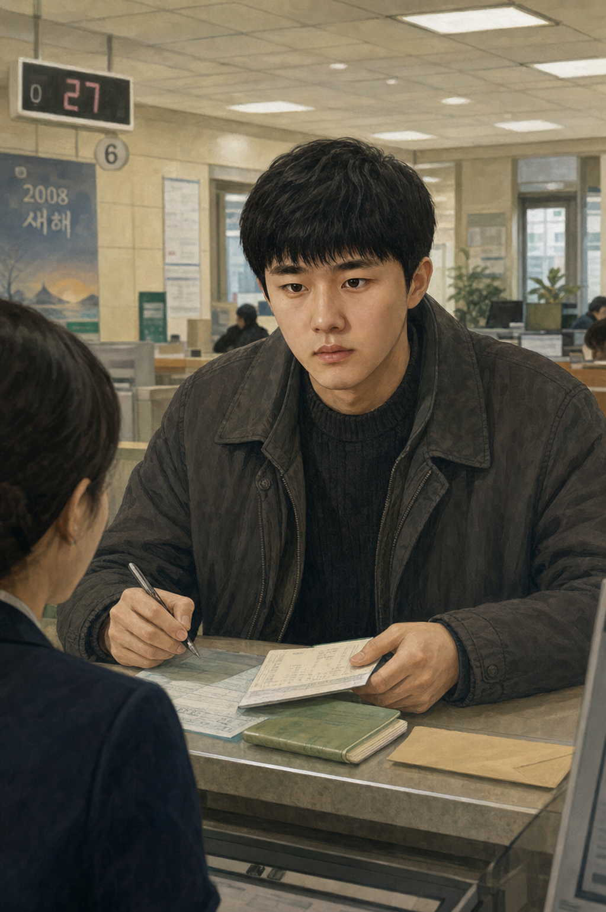

# 004. 은행의 냄새

월요일 아침.

김용식은 교복 대신 단정한 니트와 코트를 입었다.

거울 속 얼굴은 여전히 어렸다.

그래도 눈 밑은 조금 진지했다.

은행에 갈 얼굴.

22억을 받으러 가는 얼굴.

[어머니] "어디 가?"

[김용식] "시내."

[어머니] "친구?"

[김용식] "응."

거짓말은 짧을수록 좋다.

길면 설명이 붙고, 설명이 붙으면 꼬리가 생긴다.

어머니는 그의 옷차림을 봤다.

[어머니] "소개팅 가?"

[김용식] "아니."

[어머니] "그럼 왜 그렇게 멀쩡해."

[김용식] "평소에도 멀쩡했거든."

[어머니] "그건 엄마랑 의견이 다르네."

김용식은 조용히 졌다.

그는 수학 문제집에서 복권을 꺼내 봉투에 넣었다.

버스를 타고 역까지 갔다.

창밖의 겨울 거리는 느렸다.

김용식은 은행 건물 앞에서 멈췄다.

그 안으로 들어가면, 천 원짜리 종이가 이름 달린 돈으로 바뀐다.

이름 달린 돈은 편하다.

그리고 위험하다.

그는 숨을 한 번 고르고 들어갔다.

은행 안에는 번호표 기계와 긴 의자가 있었다.

김용식은 번호표를 뽑았다.

손바닥이 차가웠다.

기다리는 동안 머릿속으로 말을 정리했다.

복권에 당첨됐습니다. 혼자 샀습니다. 계좌는 있습니다.

이 문장들은 모두 정상이다.

[직원] "손님, 이쪽으로 오세요."

김용식은 창구 앞에 앉았다.

직원이 봉투에서 복권을 꺼내 확인했다.

그 순간부터 직원의 표정이 조금 달라졌다.

아주 조금. 하지만 김용식은 봤다.

[직원] "본인 확인 서류 있으세요?"

[김용식] "네."

그는 주민등록증을 내밀었다.

손끝이 떨리지 않았다.

다행이다.

겉은 합격.

속은 재시험.

직원은 서류를 가져오고, 다른 직원을 불렀다. 설명이 이어졌다. 세금. 지급 절차. 계좌. 확인 서명.

김용식은 고개를 끄덕였다.

모르는 척 묻고.

아는 척하지 않고.

너무 침착하지 않게.

너무 들뜨지도 않게.

[직원] "당첨금은 세금 공제 후 이 계좌로 입금됩니다."

숫자가 적힌 종이가 앞에 놓였다.

2,215,634,741원.

김용식은 숫자를 봤다.

쉼표가 많았다.

너무 많아서 오히려 읽기 어려웠다.

그는 잠깐 입술을 다물었다.

그냥 고등학생답게 멍해 보이면 된다.

그건 어렵지 않았다.

진짜로 멍했다.

[직원] "보호자분께는..."

[김용식] "제가 성인입니다."

직원은 주민등록증을 다시 봤다.

1989년 12월생.

그 한 달 차이가 오늘은 목숨 같았다.

[직원] "네. 본인 수령 가능합니다."

김용식은 속으로 길게 숨을 내쉬었다.

겉으로는 서명했다.

이름 석 자가 종이에 남았다.

김용식.

은행을 나오자 겨울 햇빛이 유리벽에 반사됐다.

그는 통장을 펼쳤다.

김용식은 통장을 바로 닫았다.

오래 보면 사람이 이상해진다.

가장 먼저 할 일.

새 컴퓨터?

옷?

차?

집?

아니다.

아무것도 하지 않는다.

고등학교 졸업 전 남자가 갑자기 달라지면, 사람들은 이유를 찾는다.

이유를 찾기 시작하면 돈은 숨어 있지 못한다.

그는 근처 문구점에 들어갔다.

작은 금고 대신, 평범한 파일과 노트를 샀다.

그리고 은행 봉투 하나를 더 받았다.

폼 나는 행동은 대체로 들킨다.

집에 돌아오니 어머니가 반찬가게에서 가져온 재료를 정리하고 있었다.

[어머니] "밥 먹었어?"

[김용식] "응."

[어머니] "뭐 먹었는데?"

김용식은 멈췄다.

큰돈을 숨긴 사람은 의외로 점심 메뉴에서 죽는다.

[김용식] "김밥."

[어머니] "어디 김밥?"

[김용식] "역 앞."

[어머니] "거기 별로던데."

[김용식] "그래서 별로였어."

어머니는 고개를 끄덕였다.

위기 종료.

22억보다 김밥이 더 무서운 순간이었다.

방에 들어온 김용식은 통장을 책상 위에 올렸다.

이 돈은 자유다.

동시에 족쇄다.

그는 노트 첫 장에 짧게 적었다.

`티 내지 않는다. 설명하지 않는다. 급하게 쓰지 않는다.`

그리고 한 줄을 더 썼다.

`어머니는 나중에. 안전해진 뒤에.`

펜끝이 거기서 멈췄다.

아버지는 쓰지 않았다.

쓰지 않는 이름도 계획이었다.
