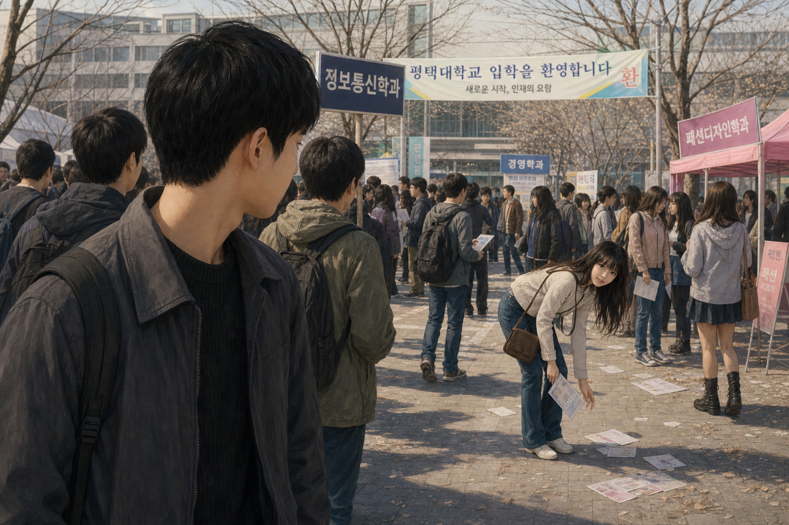

# 005. 입학식의 거리감

3월의 캠퍼스는 생각보다 시끄러웠다.

김용식은 평택대학교 정문 앞에서 멈췄다.

현수막.

동아리 홍보지.

새내기 안내판.

어색하게 멋을 낸 사람들.

그리고 너무 밝은 목소리들.

첫 번째 인생에서는 그냥 흘러들어온 장소였다.

두 번째 인생에서는 선택해서 들어온 척해야 하는 장소가 됐다.

그게 좀 웃겼다.

통장에는 여전히 말도 안 되는 숫자가 있었다.

하지만 오늘 그의 지갑에는 교통카드와 점심값만 있었다.

옷도 평범했다. 검은 니트, 어두운 재킷, 청바지.

[김종규] "야, 대학생 김용식."

뒤에서 김종규가 어깨를 쳤다.

송기훈도 입학식 구경이라는 이름으로 따라왔다.

[송기훈] "캠퍼스가 생각보다 멀다. 너 여기 매일 다녀?"

[김용식] "그러게."

[김종규] "벌써 후회하냐?"

[김용식] "아직 입학도 다 안 했는데 후회하면 성실하지."

운동장 쪽에서는 학과별 줄을 만들고 있었다. 정보통신학과 표지판 앞에는 남학생들이 많이 몰려 있었다. 서로 처음 보는 얼굴인데도 묘하게 같은 냄새가 났다.

밤샘. 게임. 컴퓨터. 어색한 자신감.

김용식은 그 사이에 섰다.

편했다.

동시에 답답했다.

그때 맞은편 줄에서 웃음소리가 튀었다.

패션디자인및브랜딩학과.

여학생들이 안내판 주변에 모여 있었다. 밝은 코트, 작은 가방, 풀린 머리, 새 신발.

그중 한 사람이 바닥에 떨어진 종이를 주우려다 가방끈을 놓쳤다.

종이가 흩어졌다.

[여학생] "아, 진짜."

짧고 빠른 목소리.

얼굴은 작고 맑았다. 긴 흑갈색 머리에 앞머리가 내려와 있었다. 눈은 또렷했고, 입술은 삐친 듯 다물렸다.

김초연.

이름이 머릿속에 먼저 떠올랐다.

아직 만나면 안 되는 사람처럼.

하지만 이미 같은 캠퍼스에 있었다.

김용식은 움직이지 않았다.

미래를 안다고 해서 처음부터 아는 척하면 안 된다.

그건 예언자가 아니라 수상한 사람이다.

그는 떨어진 종이 하나가 발앞까지 밀려오는 것을 봤다.

주워서 건넬 수 있었다.

간단한 첫 만남.

첫 번째 인생의 기억이 먼저 손을 뻗으려 했다.

김용식은 그 손을 붙잡았다.

대신 옆에 있던 다른 학생이 종이를 주워 건넸다.

[남학생] "여기요."

[여학생] "아, 감사합니다."

김초연은 짧게 웃었다.

그 웃음은 기억보다 조금 어렸다.

당연하다.

아직 아무 일도 겪지 않았으니까.

[김종규] "야, 뭐 봐?"

[김용식] "사람."

[김종규] "대학 오니까 철학하냐?"

[송기훈] "여자 봤네."

[김용식] "사람이라니까."

[김종규] "여자도 사람이지."

반박할 말이 없었다.

김용식은 안내지를 접었다.

김초연은 친구들과 웃으며 다른 쪽으로 걸어갔다.

따라가지 않는다.

말 걸지 않는다.

기억으로 앞서가지 않는다.

그는 세 가지를 마음속에 적었다.

입학식은 길었다.

총장의 말은 더 길었다.

김용식은 중간에 두 번 졸았다.

행사가 끝나자 학과 선배들이 새내기를 모았다.

돈이 생겼다.

자유도 생겼다.

그런데 오늘 그는 술자리 하나도 마음대로 빠지면 안 되는 새내기였다.

사회적 위치.

이게 돈보다 질긴 줄은 알고 있었다.

다시 겪으니 더 질겼다.

뒤풀이 장소로 이동하는 길, 그는 한 번 뒤돌아봤다.

패션디자인및브랜딩학과 줄은 반대편 골목으로 사라지고 있었다.

그 끝에 김초연의 긴 머리가 잠깐 보였다.

김용식은 다시 앞을 봤다.

아직은 아니다.

아직은.

그런데 운명이라는 단어는 대체로 사람이 방심할 때 제일 촌스럽게 나타난다.

그날 저녁, 뒤풀이 식당 옆 PC방 간판 아래에 같은 얼굴이 서 있었다.
