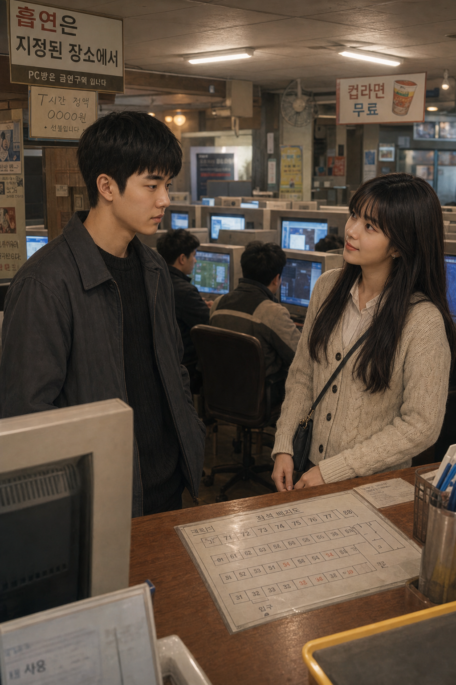

# 006. 한 판만 더

뒤풀이 식당은 고기 냄새와 새내기 목소리로 꽉 차 있었다.

김용식은 종이컵에 든 사이다를 들고 앉아 있었다.

술은 돌았다.

그는 적당히 피했다.

나이는 된다.

하지만 지금 몸은 아직 고등학교 냄새가 빠지지 않았다.

그리고 술 취한 상태로 비밀을 관리할 자신은 없었다.

[선배] "용식이는 술 안 마셔?"

[김용식] "약 먹어서요."

[선배] "어디 아픈데?"

[김용식] "현실감이 좀."

[선배] "뭐?"

[김용식] "감기요."

옆자리 동기가 웃었다.

선배도 그냥 넘어갔다.

뒤풀이가 끝난 뒤, 김용식은 잠깐 빠져나와 골목 입구에 섰다.

찬 공기가 얼굴을 식혔다.

그때 PC방 간판 아래에서 익숙한 얼굴이 보였다.

아니, 익숙하면 안 되는 얼굴.

김초연.

그녀는 친구 둘과 함께 서 있었다. 긴 머리와 흰 니트 가디건.

[김초연] "아, 자리 없으면 진짜 짜증 나는데."

목소리는 기억과 같았다.

조금 더 어리고, 조금 더 날것이고.

김용식은 그대로 지나가려 했다.

아는 척하지 않는다.

기억으로 앞서가지 않는다.

원칙은 반나절 만에 시험받았다.

[김초연 친구] "저기 사람 빠지는지 물어봐."

[김초연] "내가?"

[김초연 친구] "네가 제일 잘 물어보잖아."

[김초연] "내가 잘 물어보는 게 아니라 너희가 못 물어보는 거야."

김초연이 문을 열고 들어갔다.

김용식도 그 뒤를 따라 들어간 건 아니다.

그냥 집에 가는 방향에 PC방 계단이 있었다.

훌륭한 자기합리화였다.

PC방 안은 뜨거웠다. 담배 냄새와 컵라면 냄새. 키보드 소리.

[김초연] "사장님, 세 자리 붙은 데 없어요?"

[사장] "지금은 없는데. 두 자리랑 한 자리 따로는 있어."

[김초연] "아, 그러면 게임을 어떻게 같이 해요."

그녀가 인상을 찌푸렸다.

그 표정도 기억에 있었다.

김용식은 카운터 옆에서 멈췄다.

[사장] "너 혼자 한 자리 앉고 친구 둘은 저쪽 앉든가."

[김초연] "그럼 저만 왕따잖아요."

[사장] "게임에서 만나."

[김초연] "현실적인데 기분 나빠요."

김용식은 웃음을 참았다.

못 참았다.

김초연이 고개를 돌렸다.

눈이 마주쳤다.

끝.

오늘의 원칙이 방금 사망했다.

[김초연] "왜 웃어요?"

첫 대사였다.

미래는 같은 얼굴로 다른 문장을 말한다.

[김용식] "말이 현실적이라서요."

[김초연] "사장님 편이에요?"

[김용식] "아직 입장 정리 중입니다."

[김초연] "그럼 빨리 정리하세요. 저 불리한 쪽 싫어해요."

빠르다.

기억보다 빠르다.

김용식은 카운터 위 좌석표를 봤다.

두 자리 붙은 곳 하나. 그 옆 한 자리.

그는 별것 아닌 척 말했다.

[김용식] "제가 한 자리 쓰면, 세 분 붙을 수 있겠네요."

[김초연] "아는 사람이에요?"

[김용식] "아뇨."

[김초연] "근데 왜요?"

맞다.

왜지.

김용식은 잠깐 대답을 고르다 포기했다.

[김용식] "새내기니까요."

[김초연] "그게 이유가 돼요?"

[김용식] "오늘은 다들 그걸 이유로 쓰던데요."

김초연은 그를 보다가 피식 웃었다.

위험했다.

[김초연] "그럼 고마워요. 이름은요?"

김용식은 한 박자 늦었다.

[김용식] "김용식입니다."

[김초연] "저 김초연이요."

알고 있다.

그 말은 삼켰다.

[김초연] "무슨 과예요?"

[김용식] "정보통신학과."

[김초연] "아, 컴퓨터 잘하겠네."

[김용식] "컴퓨터가 저를 잘 못 따라옵니다."

[김초연] "말은 잘하네."

기억 속 대사 하나가 튀어나왔다.

[김초연] "왜요?"

[김용식] "아니요. 어디서 들어본 말 같아서."

김초연의 친구들이 자리를 잡았다.

[김초연 친구] "초연아! 빨리 와!"

[김초연] "가요."

그녀는 두 걸음 가다 돌아봤다.

[김초연] "근데 우리 혹시 같은 학교예요?"

[김용식] "오늘 입학식이었죠?"

[김초연] "봤어요?"

[김용식] "종이 떨어뜨리던 거요."

[김초연] "그걸 봤으면 주워줬어야죠."

[김용식] "타이밍을 놓쳤습니다."

[김초연] "게임도 그렇게 해요?"

[김용식] "게임은 안 놓칩니다."

[김초연] "그럼 나중에 한 판 해요."

그녀는 자리로 갔다.

김용식은 카운터 앞에 그대로 서 있었다.

나중에.

그 말이 너무 쉽게 나왔다.

미래를 모르는 사람은 늘 그런 식으로 말한다.

김용식은 빈자리로 걸어갔다.

모니터가 켜졌다.

그는 마우스를 잡았다.

한 판만 더.

그 말은 게임에서 제일 흔한 거짓말이다.

그리고 관계에서도, 아마 그랬다.
