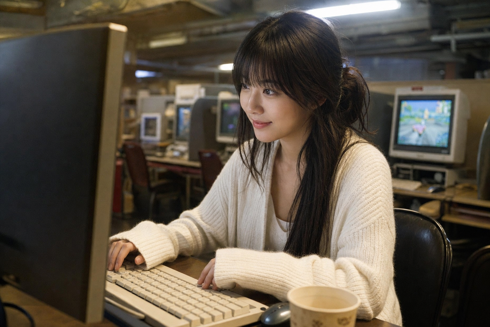
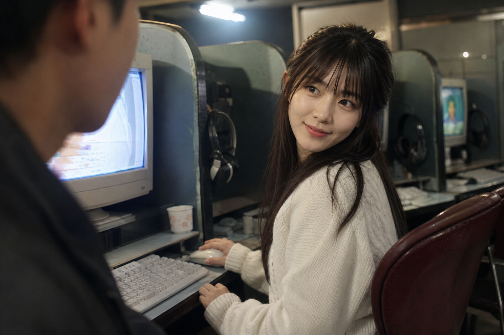

# 007. 게임은 안 놓칩니다

김용식은 모니터 앞에 앉았다.

로그인 화면이 떴다.

그런데 손은 키보드 위에서 멈춰 있었다.

뒤쪽 자리.

김초연이 있었다.

그녀는 친구들 사이에 앉아 머리를 대충 묶었다. 흰 니트 가디건 소매가 손등을 덮고 있었다. 모니터 불빛이 눈에 닿았다.

웃고 있었다.

그게 제일 위험했다.

[김초연] "저기요."

김용식은 천천히 돌아봤다.

너무 빨리 돌아보면 기다린 사람 같다.

실제로 기다린 사람이라 더 문제였다.

[김용식] "네."

[김초연] "게임은 안 놓친다면서요."

[김용식] "그런 말을 한 적은 있습니다."

[김초연] "그럼 한 판 해요."

말이 너무 쉽게 왔다.

나중에 한 판.

그 나중이 오늘이었다.

김용식은 시계를 봤다. 버스 막차까지는 여유가 있었다.

[김용식] "무슨 게임인데요?"

[김초연] "카트."

[김용식] "카트라이더요?"

[김초연] "왜요. 무시해요?"

[김용식] "아뇨. 생존율이 높은 게임이라 다행이라고요."

[김초연] "무슨 게임을 하길래 생존율부터 봐요?"

[김용식] "인생이요."

김초연은 잠깐 그를 봤다.

그리고 피식 웃었다.

[김초연] "말 이상한데 웃기긴 하네."

첫 판은 개인전이었다.

김용식은 일부러 초반 부스터를 늦게 썼다.

너무 잘하면 수상하다.

너무 못하면 자존심이 상한다.

가장 어려운 난이도.

적당히 잘하기.

[김초연] "야, 옆으로 왜 밀어!"

[김용식] "길이 좁았습니다."

[김초연] "길이 좁으면 네가 비켜야지."

[김용식] "도로교통법이 그렇게 되어 있나요?"

[김초연] "게임에 법 들고 오지 마요."

김초연은 게임할 때 얼굴이 달라졌다. 눈이 커지고, 입술이 바로 움직였다. 이기면 웃고, 밀리면 바로 씩씩거렸다.

기억 속 그대로였다.

마지막 코너.

김초연의 카트가 벽에 살짝 긁혔다.

김용식은 앞질러 갈 수 있었다.

손가락이 먼저 반응했다.

브레이크를 아주 살짝 눌렀다.

김초연이 먼저 들어갔다.

1등.

[김초연] "봤죠?"

그녀가 몸을 돌렸다. 눈꼬리가 올라가 있었다. 승리의 표정이었다.

[김용식] "네. 봤습니다."

[김초연] "내가 이겼어요."

[김용식] "공정한 승부였습니다."

[김초연] "방금 봐준 거 아니죠?"

김용식은 물컵을 들었다.

[김용식] "벽이 강했습니다."

[김초연] "말 돌리네."

[김용식] "도로 구조 탓입니다."

[김초연] "아, 진짜."

그녀는 웃으며 다시 모니터를 봤다.

이번에는 입술 끝이 올라가 있었다.

김용식은 그 표정을 보다가 시선을 돌렸다.

두 번째 판은 팀전이었다.

김초연의 친구들이 자연스럽게 끼어들었다. 김용식은 모르는 사람들 사이에 앉았다. 그런데 이상하게 어색하지 않았다.

[김초연 친구] "용식 씨 잘하네요."

[김초연] "잘하는데 얄미워."

[김용식] "좋은 평가네요."

[김초연] "어디가요?"

[김용식] "기억에 남는다는 뜻이라서."

[김초연] "말은 진짜 잘하네."

세 번째 판이 끝났을 때, 김초연이 캔커피를 흔들었다.

[김초연] "이긴 사람이 사는 거죠?"

[김용식] "아까는 이긴 사람이 내는 스포츠라던데."

[김초연] "그건 그쪽 친구들 규칙이고."

[김용식] "김초연 씨 규칙은요?"

[김초연] "제가 이기면 얻어먹고, 제가 지면 한 판 더 해요."

불공정해서 오히려 흔들림이 없었다.

[김용식] "사업하면 잘하시겠네요."

[김초연] "패션디자인과예요."

[김용식] "브랜드 운영도 하잖아요."

패션디자인및브랜딩학과.

너무 정확했다.

김초연이 눈을 가늘게 떴다.

[김초연] "우리 과 이름 알아요?"

이런 작은 것들이 쌓이면 들킨다.

김용식은 카운터 쪽 안내 포스터를 봤다.

[김용식] "입학식 때 표지판 봤습니다."

[김초연] "아."

그녀는 납득했다.

김용식은 속으로 숨을 내쉬었다.

관계보다 기억을 숨기는 게 먼저였다.

그게 생각보다 어렵다.

김초연은 캔커피를 책상 위에 내려놓았다.

[김초연] "그럼 다음엔 안 봐줘요."

[김용식] "안 봐줬습니다."

[김초연] "거짓말."

[김용식] "증거가 없네요."

[김초연] "다음 판에 증거 만들면 되죠."

그녀가 다시 헤드셋을 썼다.

김용식은 마우스를 잡았다.

한 판만 더.

오늘도 그 거짓말이 시작됐다.
