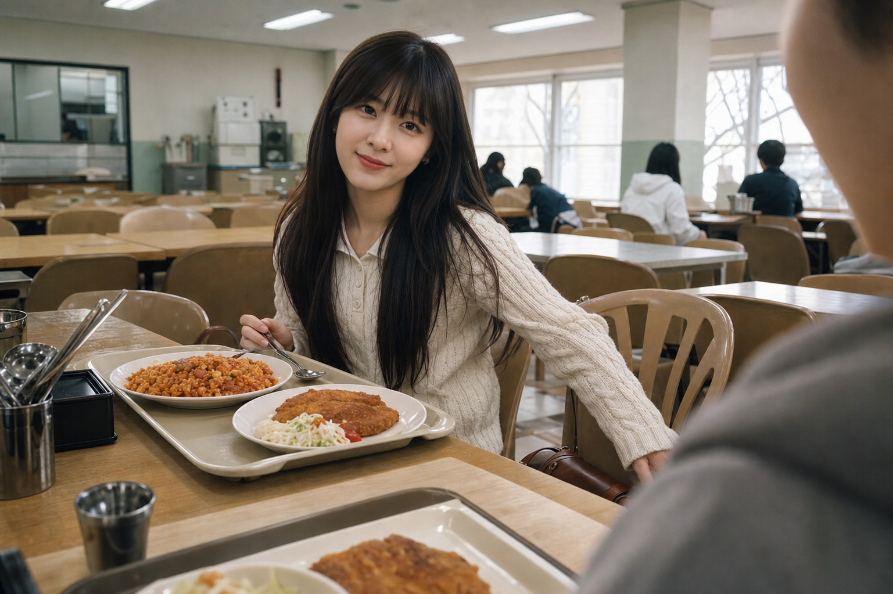

# 008. 점심값의 기준

월요일 캠퍼스는 금요일 PC방보다 더 어색했다.

김용식은 학생식당 줄에 서 있었다.

쟁반.

수저.

국 냄새.

천장에 매달린 형광등.

통장에 22억이 있어도 점심 줄은 서야 한다.

이상하게 공평한 세계였다.

[동기] "너 뭐 먹을 거야?"

[김용식] "제일 안 튀는 거."

[동기] "메뉴가 아니라 인생 태도 같은데."

[김용식] "돈가스."

[동기] "안 튀는 거라며."

실패했다.

돈가스는 언제나 존재감이 강하다.

김용식은 식권을 냈다. 2,800원. 손에 닿는 동전과 지폐가 묘하게 선명했다.

이 돈을 아끼는 척하는 게 맞나.

아니면 그냥 평범하게 쓰는 게 맞나.

큰돈을 숨기면 작은돈 앞에서 사람이 이상해진다.

그는 쟁반을 들고 빈자리를 찾았다.

그때 창가 쪽에서 손이 올라왔다.

[김초연] "어. 게임 안 놓치는 사람."

김용식은 멈췄다.

이름보다 별명이 먼저 생겼다.

관계는 가끔 이상한 순서로 자란다.

[김용식] "안녕하세요."

[김초연] "혼자예요?"

[김용식] "동기랑요."

옆 동기가 바로 고개를 숙였다.

[동기] "저는 투명 인간입니다."

[김용식] "너무 빨리 사라지는데."

[동기] "분위기 파악이 빠른 편."

동기는 빈자리 다른 쪽으로 미끄러졌다.

배신은 생각보다 조용했다.

김초연은 자기 맞은편 의자를 발끝으로 툭 밀었다.

[김초연] "앉아요."

[김용식] "괜찮아요?"

[김초연] "의자한테 물어본 거예요?"

[김용식] "김초연 씨한테요."

[김초연] "그럼 앉으라니까요."

김용식은 앉았다.

거리는 식탁 하나.

멀지도 가깝지도 않았다.

그 거리가 이상하게 선명했다.

김초연의 쟁반에는 김치볶음밥이 있었다. 계란프라이가 살짝 찢어져 있었다. 그녀는 숟가락으로 노른자 끝을 눌렀다.

[김초연] "정보통신학과는 오늘 뭐 해요?"

[김용식] "자기소개요."

[김초연] "싫겠다."

[김용식] "이미 싫습니다."

[김초연] "뭐라고 할 건데요?"

[김용식] "이름은 김용식이고, 조용히 지내고 싶습니다."

[김초연] "망했네요."

[김용식] "왜요."

[김초연] "조용히 지내고 싶은 사람은 보통 제일 안 조용해져요."

김용식은 젓가락을 멈췄다.

이 사람은 가끔 미래를 모르는 채로 정확한 말을 한다.

그게 문제다.

[김초연] "왜 또 그런 표정이에요?"

[김용식] "어떤 표정인데요?"

[김초연] "방금은 좀... 들킨 사람?"

정답.

초연의 통찰도 어머니와 다른 방향으로 빠르다.

이 집안도 아니고 왜 다 빠른가.

[김용식] "돈가스가 맛있어서요."

[김초연] "거짓말 못하네."

[김용식] "들켰네요."

[김초연] "근데 돈가스 한 입 줘요."

너무 자연스러웠다.

김용식은 접시를 봤다.

첫 번째 인생에서도 이랬다.

남의 접시에 거리낌 없이 숟가락을 들이밀고, 대신 자기 것도 아무렇지 않게 나눠주던 사람.

그때는 그게 귀찮을 때도 있었다.

지금은 이상하게 반가웠다.

[김용식] "교환이죠?"

[김초연] "뭐랑요?"

[김용식] "김치볶음밥."

[김초연] "내가 더 손해 같은데."

[김용식] "시장 가격은 그렇죠."

[김초연] "사람 짜증 나게 말 잘하네."

그녀는 그래도 숟가락을 내밀었다.

돈가스 한 조각이 넘어갔다.

김치볶음밥 한 숟가락이 돌아왔다.

아주 작은 거래.

22억보다 훨씬 가벼운 거래.

그런데 김용식은 그쪽이 더 조심스러웠다.

[김초연] "맛있죠?"

[김용식] "네."

[김초연] "진심?"

[김용식] "노른자가 좋네요."

[김초연] "구체적이라 인정."

식탁 아래에서 그녀의 운동화 끝이 가볍게 흔들렸다.

김용식은 그걸 보지 않은 척했다.

실패했다.

눈은 이미 봤다.

[김초연] "오늘 끝나고 PC방 가요?"

[김용식] "갈 수도 있고요."

[김초연] "애매하게 말하네."

[김용식] "확정하면 끌려가는 느낌이라서요."

[김초연] "끌려오면 되죠."

김용식은 물을 마셨다.

위험한 문장이다.

아직 농담이다.

그런데 사람은 농담으로 길을 낸다.

[김용식] "몇 시요?"

김초연이 웃었다.

이겼다는 얼굴.

[김초연] "여섯 시."

김용식은 고개를 끄덕였다.

평범한 점심 약속처럼 보였다.

실제로는 반복 접점이 생긴 순간이었다.

돈은 여전히 숨겨져 있었다.

하지만 오늘은 돈보다 더 숨기기 어려운 게 생겼다.

기대.
