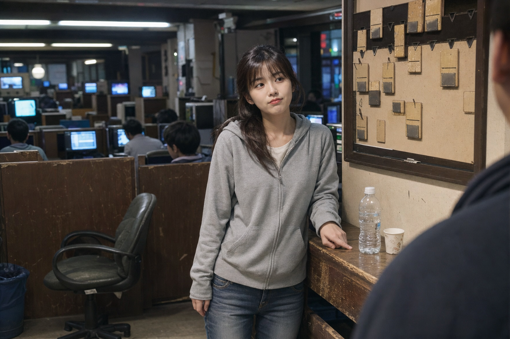

# 009. 여섯 시의 자리

여섯 시 전에는 도착하지 않으려고 했다.

김용식은 PC방 건물 앞에서 시계를 봤다.

5시 47분.

너무 빠르다.

그는 편의점으로 들어가 생수를 샀다. 아무 의미 없는 행동이었다. 의미 없는 행동치고는 가격이 500원이었다.

다시 나왔다.

5시 52분.

이번에는 상가 안내판을 봤다. 이미 아는 층수였다.

사람은 좋아하는 사람 앞에서 바보가 된다.

6시 1분.

김용식은 계단을 올랐다.

PC방 안은 평일 저녁답게 반쯤 찼다.

김초연은 이미 와 있었다.

그녀는 후드티 차림이었다. 긴 머리는 낮게 묶여 있었고, 앞머리는 조금 흐트러져 있었다. 모니터 앞에서 손가락으로 책상 끝을 두드리고 있었다.

[김초연] "늦었어요."

[김용식] "1분인데요."

[김초연] "기다린 사람 기준으로는 10분이에요."

[김용식] "그 기준 너무 주관적입니다."

[김초연] "제가 기다렸으니까 제 기준이죠."

김용식은 할 말을 잃었다.

논리 구조가 단순하다.

그래서 강하다.

[김용식] "죄송합니다."

[김초연] "어?"

[김용식] "기다리게 해서요."

김초연은 눈을 깜빡였다.

[김초연] "아니, 뭐... 진짜 화난 건 아닌데."

[김용식] "그럼 다행이고요."

[김초연] "사과 너무 빨라요."

[김용식] "늦으면 혼날 것 같아서요."

[김초연] "그건 맞아요."

그녀가 먼저 웃었다.

둘은 나란히 앉았다.

이번에는 친구들이 없었다.

[김용식] "친구분들은요?"

[김초연] "오늘 과제."

[김용식] "김초연 씨는요?"

[김초연] "저도 과제."

[김용식] "그럼 여긴..."

[김초연] "하기 싫어서요."

명쾌했다.

첫 판은 카트였다.

둘만 하는 게임은 소리가 다르게 들렸다.

[김초연] "아, 이 맵 싫어."

[김용식] "고르셨잖아요."

[김초연] "싫은지 확인하려고 골랐어요."

[김용식] "연구 정신이네요."

[김초연] "웃지 마요. 아직 안 풀렸어."

김용식은 이번엔 봐주지 않았다.

정확히는, 덜 봐줬다.

결과는 김용식 1등.

김초연은 모니터를 노려봤다.

[김초연] "진짜 안 봐줬네."

[김용식] "요청하셨잖아요."

[김초연] "사람이 융통성이 있어야죠."

[김용식] "이기고 싶으신 건지 배려받고 싶으신 건지."

[김초연] "둘 다요."

김용식은 생수를 열었다.

[김초연] "근데 진짜 잘하네요."

[김용식] "게임을 좀 했습니다."

[김초연] "좀?"

[김용식] "많이."

[김초연] "솔직해서 봐줌."

그녀는 다시 준비 버튼을 눌렀다.

두 번째 판.

세 번째 판.

네 번째 판.

시간이 이상하게 빨리 갔다.

김용식은 그 속도가 무서웠다.

위험한 건 돈이 아니라 이쪽일지도 모른다.

[김초연] "번호 줘요."

김용식의 손이 멈췄다.

[김용식] "무슨 번호요?"

[김초연] "전화번호요. 게임할 때 부르게."

그녀는 아무렇지 않게 말했다.

[김용식] "폰 번호요?"

[김초연] "그럼 주민번호요?"

[김용식] "그건 조금 빠르네요."

[김초연] "아, 진짜."

김용식은 자기 번호를 불렀다.

낡은 휴대폰 번호.

연락 하나의 무게가 훨씬 컸던 시절.

김초연은 자기 폴더폰에 번호를 저장했다.

[김초연] "이름 뭐로 저장하지."

[김용식] "김용식."

[김초연] "너무 재미없어요."

[김용식] "그럼 게임 안 놓침."

[김초연] "길어."

그녀는 잠깐 고민했다.

그리고 웃었다.

[김초연] "안놓침."

김용식은 그 세 글자를 봤다.

이상하게 큰 변화였다.

이름이 아니라 별명으로 저장되는 일.

이번에는 확실히 남았다.

[김초연] "저장했어요."

[김용식] "네."

[김초연] "왜 그렇게 봐요?"

[김용식] "별명 생긴 게 오랜만이라서요."

[김초연] "많이 생기게 해줄까요?"

김용식은 대답하지 못했다.

[김초연] "한 판만 더."

김용식은 웃었다.

오늘도 거짓말이 늘었다.
