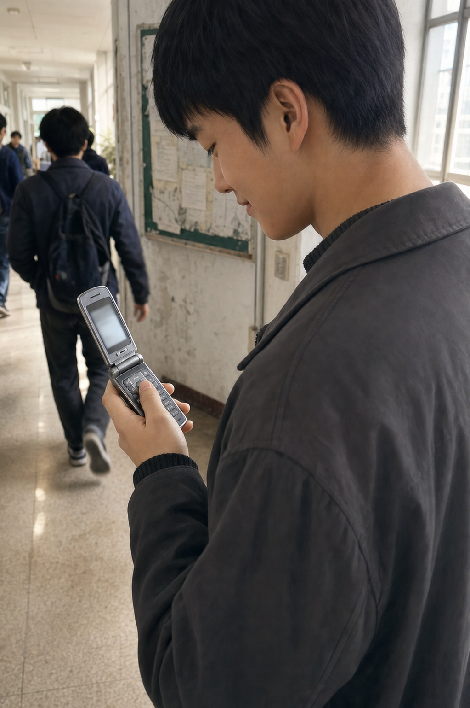
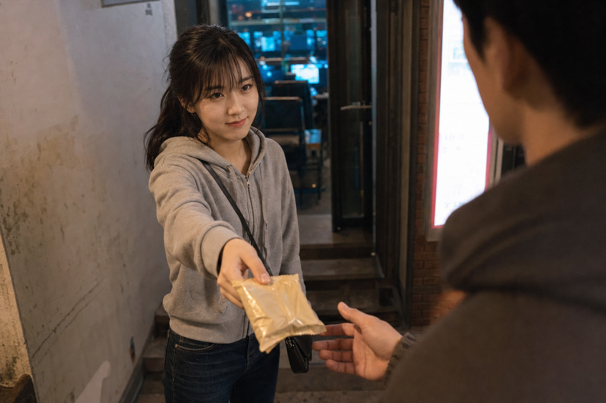

# 010. 안놓침

김용식의 폴더폰은 아침부터 조용했다.

너무 조용해서 오히려 신경 쓰였다.

그는 강의실 맨 뒤에 앉아 있었다. 교수는 오리엔테이션 자료를 넘겼고, 앞자리 학생들은 시간표를 비교했다.

김용식은 책상 아래 폴더폰을 열었다.

새 문자 없음.

닫았다.

이쯤 되면 휴대폰이 잘못한 게 아니라 사람이 문제다.

[동기] "너 누구 기다려?"

[김용식] "아니."

[동기] "표정은 기다리는데."

[김용식] "수업 끝나길."

[동기] "그건 다 기다려."

김용식은 폴더폰을 주머니에 넣었다.

점심시간이 되자 캠퍼스가 한꺼번에 풀렸다. 학생들이 계단과 복도로 흘러나왔다. 김용식은 학생식당 쪽으로 가려다 멈췄다.

폴더폰이 울렸다.

짧은 진동.

손이 너무 빨리 움직였다.

[안놓침] 오늘 PC방 감?

김용식은 화면을 봤다.

저장명부터 이미 졌다.

그는 답장을 썼다.

[김용식] 수업 끝나고요.

잠깐 뒤.

[안놓침] 몇 시.

[김용식] 5시 반쯤.

[안놓침] 늦으면 죽음.

김용식은 복도 한가운데서 웃음을 삼켰다.

2008년 대학생 문자답게 가볍고 과격했다.

오후 강의는 길었다.

칠판에는 과목 소개가 적혔다. 교수는 과제와 출석을 말했다. 김용식은 듣는 척하면서 머릿속으로 돈을 분류했다.

생활비. 등록금. 예비 자금. 절대 쓰지 않을 돈.

그런데 그 사이를 자꾸 문자 한 줄이 비집고 들어왔다.

늦으면 죽음.

집중력이 죽었다.

수업이 끝나자 김용식은 일부러 천천히 가방을 챙겼다.

너무 빨리 나가면 또 기다린 사람 같다.

PC방 앞에는 김초연이 서 있었다.

오늘은 회색 후드티에 청바지였다. 머리는 대충 묶었고, 앞머리는 바람에 조금 흩어져 있었다. 손에는 작은 과자 봉지가 들려 있었다.

그녀는 김용식을 보자 봉지를 들어 보였다.

[김초연] "늦었어요."

[김용식] "5시 29분인데요."

[김초연] "내가 먼저 왔잖아요."

[김용식] "그럼 김초연 씨가 빠른 겁니다."

[김초연] "말대꾸."

[김용식] "정정입니다."

김초연은 과자 봉지를 그의 가슴 앞에 툭 밀었다.

[김초연] "먹어요."

[김용식] "왜요?"

[김초연] "게임 오래 하려면 당 떨어져요."

김용식은 봉지를 받았다.

값은 천 원 조금 넘을 것이다.

그런데 이상하게 무거웠다.

누군가가 자기 몫을 생각해서 사 온 물건.

그건 통장 숫자보다 다루기 어렵다.

[김용식] "감사합니다."

[김초연] "너무 정중한데."

[김용식] "감동해서요."

[김초연] "과자 하나에요?"

[김용식] "기준이 낮습니다."

[김초연] "불쌍하네."

그녀는 말은 그렇게 하면서 먼저 계단을 올랐다.

김용식은 뒤따라갔다.

계단 폭은 좁았다.

김초연의 운동화 뒤축이 눈에 들어왔다.

용식은 한 칸 아래에서 걸었다.

그게 지금 자신이 할 수 있는 최선이었다.

PC방 안에서는 이미 자리가 반쯤 차 있었다.

둘은 나란히 앉았다.

김초연은 과자 봉지를 뜯어 책상 가운데에 놓았다.

[김초연] "이거 공동 재산."

[김용식] "지분은요?"

[김초연] "제가 샀으니까 제가 70."

[김용식] "그럼 저는 30."

[김초연] "아니요. 먹는 속도 봐서 조정."

[김용식] "시장경제가 불안정하네요."

[김초연] "내 과자니까 독재예요."

그녀는 당당했다.

김용식은 그 생각을 삼켰다.

첫 판은 졌다.

김초연이 이겼다.

그녀가 과자를 집어 먹는 걸 보다가 코너를 놓쳤다.

[김초연] "봤죠?"

[김용식] "봤습니다."

[김초연] "뭘 봤는데요?"

김용식은 대답을 골랐다.

[김용식] "졌다는 사실이요."

[김초연] "거짓말."

그녀가 모니터에서 시선을 떼지 않고 말했다.

[김초연] "방금 나 봤잖아요."

김용식은 손을 멈췄다.

숨기는 일은 늘 어려웠다.

돈도. 기억도. 시선도.

[김용식] "봤습니다."

이번에는 거짓말하지 않았다.

김초연은 잠깐 조용했다.

그리고 과자 봉지를 그의 쪽으로 밀었다.

[김초연] "그럼 벌금."

[김용식] "벌금이 과자예요?"

[김초연] "먹으라고요."

그녀의 귀 끝이 조금 붉었다.

김용식은 과자를 하나 집었다.

짭짤했다.

위험하게.

김초연은 다시 준비 버튼을 눌렀다.

[김초연] "한 판만 더."

김용식은 폴더폰 화면에 저장된 이름을 떠올렸다.

안놓침.

그 별명은 이제 자신에게 붙은 게 아니었다.

오늘 그는 놓치지 않으려고 애쓰고 있었다.
