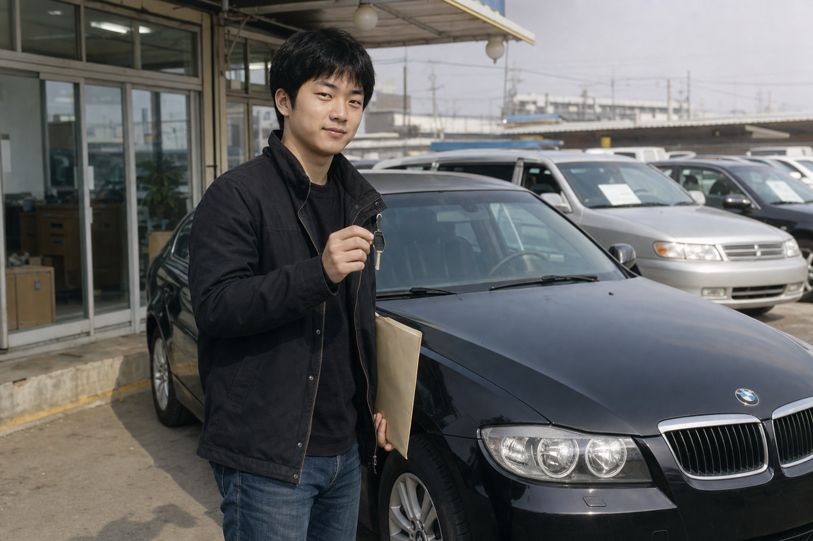

# ep.011 BMW를 학교에 세우는 법

수지 외곽의 중고차 매매단지는 평일 오전이라 조용했다.

차들만 번쩍였다.

김용식은 검은색 BMW 320i 앞에 섰다. 낮은 차체, 긴 보닛, 낯선 가죽 냄새. 평택대학교 주차장에 세우는 장면이 먼저 떠올랐다.

새내기가 외제차 문을 열고 내린다. 누군가는 욕하고, 누군가는 부러워하고, 누군가는 소문을 낸다.

그리고 김초연은 분명히 이렇게 말할 것이다.

`너 뭐야?`

[딜러] "학생이라고 하셨죠? 이거는 좀 부담되실 텐데요."

[김용식] "부담되면 안 사죠."

말이 너무 빨리 나갔다.

김용식은 속으로 웃었다. 돈을 쥔 스무 살에게 제일 먼저 튀어나오는 건 신중함이 아니라 허세였다.

차량가 45,200,000원.

등록, 보험, 초기 비용까지 대충 52,000,000원.

2,215,634,741원에서 빠지면 2,163,634,741원.

계산은 끝났다. 계약서에 이름을 쓰는 손끝은 뜨거웠다.

보험료가 비싸다는 말에도 김용식은 고개만 끄덕였다. 상관없다는 말은 편했다. 돈이 있으니까. 동시에 무서웠다. 그런데도 자동차 키를 받는 순간, 그는 웃고 있었다.

집으로 바로 갈 수는 없었다. 김용식은 집에서 걸어서 십오 분쯤 떨어진 오래된 상가 지하주차장에 차를 넣었다.

[관리인] "학생 차야?"

[김용식] "친척 차요. 제가 좀 맡아둬서요."

[관리인] "요즘 친척 좋네."

김용식은 자연스럽게 웃었다. 그래서 더 이상했다.

그날 저녁 어머니는 반찬가게에서 남은 잡채를 데워 줬다.

[어머니] "입학하고 힘들지?"

[김용식] "아직은 괜찮아."

[어머니] "돈 많이 쓰지 말고."

젓가락이 멈췄다.

[김용식] "응."

잡채는 달았다. 숨겨 놓은 돈은 달지 않았다.

다음 날 아침, 그는 평소처럼 집을 나섰다. 버스 정류장 방향으로 걷다가 골목을 돌아 상가 지하로 내려갔다. 가방 안에는 전공책보다 자동차 키의 존재감이 컸다.

엔진이 걸렸다.

2008년의 도로가 앞유리에 들어왔다.

수지에서 평택까지는 생각보다 길었다. 차로 가면 달랐다. 라디오에서는 오래된 가요가 흘렀고, 김용식은 속도를 과하게 올리지 않았다. 돈은 있어도 사고 나면 끝이다.

평택대학교 정문이 보였을 때, 그는 일부러 학생들이 지나가는 시간에 맞춰 천천히 들어갔다.

숨길 마음이 없었다.

학교에서는.

주차장 한쪽에 차를 세우자마자 시선이 붙었다. 남학생 둘이 걸음을 늦췄다. 여학생 하나가 친구 팔을 쳤다.

[남학생] "야, 저거 BMW 아니냐?"

[다른 남학생] "새내기가?"

문을 열고 내리는 순간, 김용식은 알았다.

이건 통학 수단이 아니다.

폭죽이다.

그리고 역시나, 카페테리아 쪽 계단에서 김초연이 멈춰 섰다.

검은 긴 머리. 작은 크로스백. 손에는 아직 뜯지 않은 삼각김밥.

그녀는 차와 김용식을 번갈아 봤다.

[김초연] "너 뭐야?"

[김용식] "통학."

[김초연] "통학을 왜 저걸로 해?"

[김용식] "버스가 불편해서."

[김초연] "버스가 불편하면 다들 BMW 타냐?"

주변에서 작게 웃음이 터졌다. 친척 차라고 둘러대야 했다. 그런데 입은 멋대로 갔다.

[김용식] "응. 나는 타."

김초연의 눈이 가늘어졌다.

[김초연] "와. 재수 없어."

말은 그랬는데, 입꼬리는 아주 조금 올라가 있었다.

김용식은 그걸 봤다.

[김초연] "왜 또 그렇게 봐?"

[김용식] "귀여워서."

이번엔 주변 웃음이 더 크게 터졌다.

김초연은 삼각김밥으로 김용식 팔을 툭 쳤다.

[김초연] "미쳤냐?"

귀 끝이 아주 조금 빨개졌다. 김용식은 그 작은 변화 때문에 돈이 덜 아깝다고 생각했다.

점심 무렵, 김종규에게 문자가 왔다.

[김종규] 야 너 외제차라며? 미친놈아 설명해

송기훈도 바로 이어 보냈다.

[송기훈] 나도 태워줘

김초연은 옆에서 그 문자를 힐끗 보더니 말했다.

[김초연] "나도."

[김용식] "뭘?"

[김초연] "태워 달라고."

[김용식] "어디까지?"

김초연은 삼각김밥 포장지를 접었다.

[김초연] "수원."

말은 가벼웠지만 가볍지 않았다. 수원까지 데려다주는 사이. 그건 PC방에서 한 판 하는 사이보다 훨씬 멀리 가는 말이었다.

[김용식] "오늘?"

[김초연] "왜, BMW는 수원 못 가?"

김용식은 자동차 키를 손안에서 굴렸다.

[김용식] "가."

김초연은 만족한 얼굴로 고개를 끄덕였다.

[김초연] "그럼 끝나고 튀지 마."

튀지 말라. 그 말이 이상하게 좋았다. 김용식은 아직 몰랐다. 차는 사람을 태우지만, 소문도 같이 태운다는 걸.
