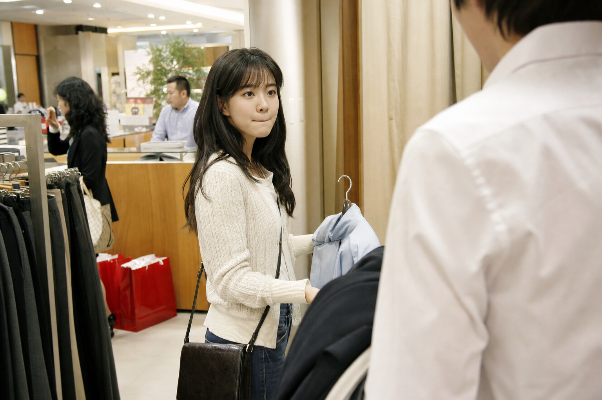

# ep.012 네 옷은 내가 고른다

죽전으로 빠지는 도로에는 오후 햇빛이 낮게 깔려 있었다.

김초연은 조수석에 앉자마자 안전벨트를 잡고 한참 당겼다. 딸깍, 하고 버클이 잠긴 뒤에도 손은 그대로 남아 있었다. 새 가죽 냄새와 방향제 냄새가 차 안에 섞여 있었고, 히터 바람은 유리 아래쪽을 조용히 말리고 있었다.

[김초연] "차 냄새 난다."

[김용식] "새 차 냄새 같은 거지. 정확히는 중고차지만."

[김초연] "그렇게 말하면 덜 자랑 같을 줄 알았어?"

[김용식] "아직 시동도 제대로 안 걸었는데 벌써 잡네."

[김초연] "너는 숨 쉬는 것도 약간 자랑처럼 해."

김용식은 웃으며 시동을 걸었다. 엔진 소리가 낮게 깔리자 김초연의 시선이 창밖이 아니라 실내를 먼저 훑었다. 도어 손잡이, 계기판, 컵홀더, 시트에 눌린 자기 치마 끝까지. 그녀는 가죽 시트에 등을 붙였다가 금방 떼고, 다시 조금 기대 앉았다.

[김초연] "비싸?"

[김용식] "적당히."

[김초연] "적당히가 얼마인지 말 못 하는 거면 비싼 거잖아."

[김용식] "네가 들으면 욕할 만큼."

[김초연] "그럼 엄청 비싸네. 너 지금 되게 쉽게 말하는 거 알아?"

김용식은 바로 대답하지 못했다. 쉽게 산 건 아니었다. 계약서 앞에서 손에 힘이 들어갔고, 보험 설명은 생각보다 길었고, 집 근처에 차를 숨길 주차장을 찾느라 괜히 두 바퀴를 더 돌았다. 그런데 초연 앞에서는 그 과정을 말하고 싶지 않았다.

말하면 덜 멋있어질 것 같았다.

[김용식] "쉽게 말하려고 하는 거지. 안 그러면 나도 민망해서."

초연은 그 말을 듣고 창밖으로 시선을 돌렸다. 웃지는 않았다. 대신 안전벨트 줄을 손끝으로 한 번 더 문질렀다.

김용식은 수원 방향으로 핸들을 틀었다. 바로 집까지 데려다줄 수도 있었지만, 그렇게 빨리 내려주고 싶지 않았다. 말로 붙잡으면 이상해지고, 목적지를 바꾸면 핑계가 생긴다.

그때 김초연이 먼저 말했다.

[김초연] "야. 너 옷 사야겠다."

[김용식] "갑자기?"

[김초연] "갑자기가 아니라 계속 생각했어. 차는 BMW인데 너 옷은 입학식 때 그 니트 계속 입을 기세라서."

[김용식] "그거 편해. 나름 오래 입은 건데."

[김초연] "오래 입은 거랑 어울리는 건 다른 문제야. 그리고 편한 거랑 멋없는 것도 다른 문제고."

정확했다.

반박할 말이 없으면 사람은 괜히 운전에 집중하는 척을 한다. 김용식은 차선을 바꾸며 룸미러를 봤고, 초연은 이미 휴대폰을 열어 근처 쇼핑몰을 찾고 있었다. 폴더폰 작은 화면을 들여다보는 옆얼굴이 이상하게 진지했다.

차는 수원 집이 아니라 죽전 근처 쇼핑몰로 향했다.

매장 앞에 서자 김초연은 팔짱을 끼고 김용식을 위아래로 훑었다. 노골적인 시선이었다. 그런데 불쾌하지 않았다. 오히려 어디까지 들켜도 되는지 시험받는 기분이 들었다.

[김초연] "너 키랑 어깨는 괜찮은데 왜 그렇게 낡은 사람처럼 입어?"

[김용식] "나름 단정하게 입은 건데. 너무 뭐라 하지 마. 상처받는다."

[김초연] "상처는 나중에 받고, 일단 들어가. 내가 아무거나 입히진 않을게."

그녀는 자연스럽게 앞장섰다. 김용식은 그 뒤를 따라가며 쇼윈도에 비친 둘의 간격을 봤다. 아직 손이 닿을 만큼 가깝지는 않았지만, 모르는 사람이라고 하기엔 너무 나란했다.

이건 데이트인가.

물어보면 초연은 아니라고 할 것이다. 네가 너무 못 입어서 구제하는 거라고, 말끝을 올리며 대답할 것이다. 그런데 셔츠를 고르는 손은 묘하게 신중했다. 흰색, 짙은 회색, 얇은 재킷, 청바지. 그녀는 자기 취향을 숨기지 않았고, 김용식에게 어울리는지보다 자기 옆에 세웠을 때 어떤지 보는 사람처럼 옷을 골랐다.

[김초연] "이거 입어 봐."

[김용식] "흰 셔츠?"

[김초연] "응. 너 검은 거만 입으면 좀 답답해 보여. 얼굴이 나쁜 건 아닌데 옷이 자꾸 너를 가려."

[김용식] "방금 칭찬이 섞였던 거 같은데."

[김초연] "섞인 김에 탈의실 들어가. 더 말하면 취소할 수도 있어."

김용식은 셔츠와 얇은 재킷, 청바지를 들고 탈의실로 들어갔다. 커튼 안은 좁고 조명이 뜨거웠다. 옷을 갈아입는 동안 주머니 속 차 키가 바닥에 닿아 작게 소리를 냈다. 거울 속에는 아직 낯선 얼굴이 있었다. BMW 차 키를 쥐고, 백만 원이 넘는 옷을 아무렇지 않은 척 사려는 스무 살 남자.

아무렇지 않은 건 아니었다.

그는 숨을 한 번 고르고 커튼을 열었다.

김초연이 고개를 들었다.

눈이 반 박자 멈췄다.

그 반 박자면 충분했다.

[김용식] "어때?"

[김초연] "음."

[김용식] "그 음은 좋은 쪽이야, 안 좋은 쪽이야?"

[김초연] "봐줄 만해. 아니, 솔직히 말하면 생각보다 괜찮아. 근데 네가 그 말 듣고 너무 좋아할 것 같아서 여기까지만 할래."

[김용식] "그 정도면 이미 다 들은 거 같은데."

[김초연] "그래도 입 밖으로 잘생겼다는 말은 안 할 거야. 너 더 재수 없어질까 봐."

김용식은 웃었다. 재수 없어지고 있었다. 그걸 알면서도 기분이 좋았다.

계산대에서 가격이 찍혔다. 셔츠 두 벌, 재킷 하나, 청바지 하나, 신발 하나.

합계 1,286,000원.

김초연의 눈이 커졌다. 계산대 직원은 표정을 바꾸지 않았고, 카드 단말기 화면은 조용히 금액을 띄우고 있었다. 김용식은 카드를 꺼냈다가 손가락 끝에 힘이 들어간 것을 느꼈다. 비싼 건 맞았다. 하지만 아깝지는 않았다. 초연이 고른 옷을 입고 학교에 가는 그림이 이미 머릿속에 있었고, 그 그림은 돈보다 오래 남을 것 같았다.

[김초연] "야, 잠깐만. 여기 원래 이렇게 비싸?"

[김용식] "좀 비싸긴 한데 괜찮아."

[김초연] "뭐가 괜찮아. 내가 골라놓고 이런 말 하긴 이상한데, 백만 원 넘는 걸 그렇게 바로 결제해?"

[김용식] "필요한 거였잖아. 그리고 마음에 들면 오래 입을 거고."

[김초연] "너 돈 쓰는 기준 진짜 이상하다. 부자인 척하는 건 아닌데, 그냥 선이 달라."

그 말이 더 정확했다.

김용식은 카드를 내밀었다. 단말기에서 승인음이 나고, 영수증이 길게 밀려 나왔다. 초연은 그 영수증 끝을 바라보다가 입술을 다물었다. 허세는 보는 사람에게 꼭 같은 맛이 아니다. 누군가에겐 설렘이지만, 누군가에겐 경고가 된다.

[김용식] "다음엔 네가 가격표 먼저 보고 골라."

[김초연] "다음?"

[김용식] "응. 다음에도 네가 골라 주면 좋을 것 같아서."

초연은 대답 대신 옆 매장 유리창에 비친 둘을 봤다. 새 셔츠를 입은 김용식, 쇼핑백을 든 자기. 처음보다 가까웠고, 그래서 조금 위험해 보였다.

[김초연] "싫다고는 안 했어. 근데 다음엔 나도 가격 보고 고를 거야. 너 진짜 아무렇지 않은 척하지 마."

저녁은 돈가스였다. 식사비 28,000원. 카페 14,000원. 주차비 6,000원. 김용식은 머릿속으로 숫자를 더했다.

옷값까지 1,334,000원.

돈은 여전히 많았다. 그래도 숫자를 놓치면 안 됐다. 돈을 쓰는 순간은 즐거웠지만, 영수증은 늘 흔적이 됐다.

수원 골목에 도착했을 때, 김초연은 집 앞보다 조금 떨어진 곳에서 세워 달라고 했다.

[김용식] "왜?"

[김초연] "우리 엄마가 보면 귀찮아져. 차도 그렇고, 너도 그렇고."

비슷했다. 김용식은 가족에게 차를 숨기고, 김초연은 가족에게 남자를 숨긴다. 서로 다른 비밀인데, 같은 조수석에 놓여 있었다.

차를 세우자 김초연은 안전벨트를 바로 풀지 않았다. 손이 버클 위에 머물렀고, 가로등 빛이 그녀의 손등에 얇게 걸렸다.

[김초연] "오늘 고마웠어."

[김용식] "옷 골라준 건 너잖아."

[김초연] "차 태워줬잖아. 밥도 샀고. 이상하게 돈 많이 썼고."

[김용식] "또 태워줄게. 밥도... 뭐, 너무 부담스러우면 다음엔 네가 음료수 사."

말이 자연스럽게 나왔다. 자연스러운 만큼, 초연은 바로 움직이지 않았다.

[김초연] "너 그렇게 쉽게 말하면 진짜인 줄 안다."

[김용식] "진짜로 말한 건데."

초연은 그 말을 들은 뒤에야 안전벨트를 풀었다. 문을 열고 내렸다가, 고개만 다시 넣었다.

[김초연] "근데 너 오늘 산 옷, 내일 입고 와."

[김용식] "검사야?"

[김초연] "응. 내가 골랐으니까 확인해야지."

문이 닫혔다.

김용식은 혼자 남은 차 안에서 한참 핸들을 잡고 있었다. 새 옷 냄새와 커피 향이 희미하게 남아 있었다.

검사받는 사이.

나쁘지 않았다.

아니, 너무 좋았다. 그래서 더 위험했다.
