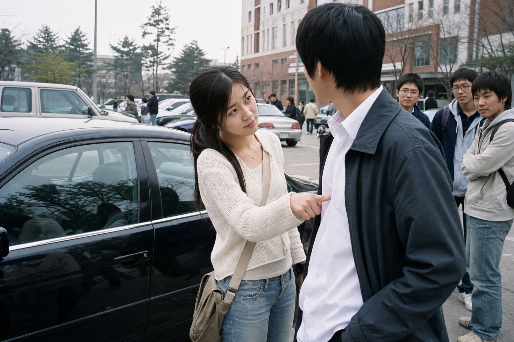

# ep.013 소문은 엔진보다 빠르다

다음 날 아침, 김용식은 새 흰 셔츠에 검은 재킷을 입고 거울 앞에 섰다.

한 번은 옷을 보려고 봤다. 두 번째는 자신이 그걸 신경 쓰고 있다는 걸 들키려고 보는 사람처럼, 괜히 어깨선을 다시 폈다. 어머니는 부엌에서 김치를 작은 통에 담으며 버스 시간 늦지 말라고 했고, 김용식은 방문 앞에서 응, 하고 대답했다.

버스는 타지 않았다.

상가 지하주차장에 내려가 BMW 문을 여는 손은 어제보다 가벼웠지만, 완전히 편하지는 않았다. 차 문이 닫히는 소리가 지하주차장 벽에 부딪혀 돌아왔고, 그는 반사적으로 주변을 둘러봤다. 집에서는 아직 아무도 몰랐다. 모르게 해야 했다. 그런데 학교에서는, 이상하게도 숨기고 싶지 않았다.

평택대학교 주차장에 들어설 때 그는 어제보다 더 천천히 달렸다.

일부러라고 인정하기 싫었지만 일부러였다.

학생들이 지나가는 쪽에 차를 세우고, 문을 열고, 새 가방을 들었다. 시선 몇 개가 먼저 붙었다. 누군가는 번호판을 봤고, 누군가는 차종을 확인하려고 뒤로 한 걸음 물러났다. 김용식은 아무렇지 않은 척 문을 잠갔다.

그때 김종규가 뛰어왔다.

[김종규] "야, 김용식!"

[송기훈] "저거 네 거야? 아니, 대답하기 전에 생각하고 말해. 우리 마음의 준비가 필요해."

둘이 동시에 달려오는 장면은 창피했다. 하지만 좋기도 했다. 고등학교 때 PC방 앞에서나 듣던 목소리가 대학 주차장에 울리자, 이상하게 시간이 한꺼번에 겹쳐지는 느낌이 났다.

[김용식] "내 거 맞아."

[김종규] "내 거 맞아? 너 지금 무슨 연필 빌려준 사람처럼 말한다?"

[송기훈] "설명 좀 해 봐. 집이 갑자기 석유 나왔냐?"

[김용식] "중고로 샀어. 통학이 멀어서."

[김종규] "중고면 다 싸냐? 나도 중고 인간인데 안 싸."

[김용식] "싸다고는 안 했어. 그냥... 필요해서 산 거야."

필요해서.

말은 그렇게 했지만, 사실 필요만으로 산 차는 아니었다. 수지에서 평택까지의 거리, 통학 시간, 차 안에 생기는 혼자만의 공간. 그런 이유도 있었지만, 더 깊은 곳에는 보여 주고 싶은 마음이 있었다. 스무 살 새내기가 외제차 문을 열고 내리는 장면. 누군가 놀라고, 누군가 부러워하고, 누군가 질문하는 장면.

그 장면을 원했다.

주변에 같은 과 애들이 모여들었다. 렌트 아니냐는 말이 나왔고, 아버지 차 아니냐는 말도 나왔다. 김용식은 웃으며 대답을 흘렸다. 돈은 숨겨야 했다. 당첨금은 절대 말하면 안 됐다. 하지만 이 정도 허세는 너무 달았다.

등 뒤에서 익숙한 목소리가 들렸다.

[김초연] "검사하러 왔습니다."

김용식이 돌아섰다.

김초연은 얇은 니트에 청바지를 입고 있었다. 그녀는 차보다 먼저 김용식의 셔츠를 봤고, 그다음 재킷, 신발, 머리까지 차례로 확인했다. 어제 매장 조명 아래에서 보던 눈과 달랐다. 학교의 아침빛 속에서 보는 눈은 조금 더 조심스러웠다.

[김초연] "합격."

[김용식] "감사합니다."

[김종규] "뭐야, 둘이 뭐야. 검사가 자연스럽네?"

[송기훈] "옷 검사야? 차 검사야? 우리도 줄 서면 돼?"

김초연은 당황하지 않았다. 오히려 턱을 살짝 들었다.

[김초연] "제가 골랐거든요. 이상하게 입고 다니길래."

주차장이 잠깐 조용해졌다.

[김종규] "야, 너 어제 여자랑 옷 사러 갔냐?"

[김용식] "응."

[송기훈] "그걸 또 응이라고 하네. 사람 약 올리는 재능이 있다, 너."

왜 그렇게까지 억울해하는지는 모르겠지만, 분위기는 이해했다. 김용식은 웃음을 삼켰고, 김초연은 괜히 자기 가방끈을 고쳐 잡았다.

소문은 오전 강의가 끝나기도 전에 커졌다.

정보통신학과 새내기가 BMW를 타고 다닌다. 패션디자인과 여학생이 옷을 골라 줬다. 둘이 어제 수원까지 갔다. 마지막 문장은 반만 사실이었지만, 소문은 사실보다 반쪽짜리 문장을 더 좋아했다.

점심시간, 김용식은 김초연과 학생식당에 마주 앉았다. 식판 위의 김치는 말랐고, 단무지는 물기가 많았다. 김초연은 젓가락으로 단무지를 찌르며 말했다.

[김초연] "너 일부러 그랬지?"

[김용식] "뭘?"

[김초연] "학교에 차 가져와서 사람들 보게 한 거. 그냥 통학이면 그렇게 천천히 안 들어오지."

김용식은 김치를 집었다가 내려놓았다.

[김용식] "조금. 아니, 좀 많이."

[김초연] "그래도 솔직하긴 하네. 재수 없지만."

[김용식] "알아. 근데 안 하면 아쉬울 것 같았어."

[김초연] "그 말도 재수 없어. 그런데..."

초연은 김용식의 재킷 끝을 한 번 보고, 시선을 식판으로 내렸다.

[김초연] "안 어울리진 않아."

김용식은 웃으려다 참았다. 김초연 기준으로는 꽤 큰 칭찬이었다. 그녀는 젓가락을 들고 경고하듯 말했다.

[김초연] "웃지 마. 방금 말 취소하기 전에."

그때 누군가 식판을 들고 다가왔다.

[여학생] "여기 자리 있어요?"

처음 보는 얼굴이었다. 같은 과 정다은. 단발에 가까운 검은 머리, 회색 후드집업, 빠르게 웃는 눈. 그녀는 묻고 있으면서도 이미 앉을 수 있다는 걸 아는 사람처럼 의자를 살짝 잡고 있었다.

[김용식] "없어요."

[여학생] "그럼 앉아도 돼요?"

김초연의 젓가락이 아주 미세하게 멈췄다. 김용식은 봤다. 봤는데도 피하지 않았다.

[김용식] "네. 앉으세요."

여학생이 옆자리에 앉았다.

[여학생] "저 같은 과 정다은이에요. 아까 차 봤어요. 진짜 본인 차예요?"

[김용식] "네. 김용식이에요."

[정다은] "알아요. 오늘 강의 때 교수님이 이름 불렀잖아요. 이름도 기억하기 쉽던데."

그녀는 웃으며 김용식의 셔츠를 봤다. 시선이 길지는 않았지만, 김초연이 눈치채기엔 충분했다.

[정다은] "근데 차보다 옷이 더 눈에 띄던데요. 어제보다 사람이 달라 보인다 해야 하나."

김초연의 입술이 닫혔다.

아. 이건 위험하다.

그런데 김용식은 위험을 알면서도 손을 빼지 않았다. 누군가가 자신을 흥미롭게 보는 느낌은 쉽게 끊어내기 어려웠다.

[김용식] "어제 스타일리스트가 생겨서요."

[정다은] "스타일리스트요?"

김초연이 단무지를 씹었다.

[김초연] "무료 봉사였어요. 상태가 좀 심각해서."

[정다은] "아, 두 분 친하신가 봐요."

대답하기 전에 김초연이 먼저 말했다.

[김초연] "네. 친해지는 중이요."

정다은이 웃었다.

[정다은] "좋겠다."

그 말의 방향을 알 수 없었다. 김용식에게 한 말인지, 초연에게 한 말인지, 둘 사이에 던진 말인지. 학생식당의 소음 속에서 그 한마디만 조금 선명하게 남았다.

수업이 끝난 뒤 정다은은 복도에서 김용식에게 손을 흔들었다. 김초연은 바로 옆에 있었다.

[정다은] "용식 씨, 나중에 차 한 번 태워 줘요. 학교 밖에 나갈 일 생기면."

정답은 많았다. 여자친구도 아닌데 뭐가 문제냐고 넘길 수도 있고, 그냥 웃고 말 수도 있었다. 그런데 김초연이 옆에 있는 걸 알면서도 김용식의 입은 가장 쉬운 길을 골랐다.

[김용식] "기회 되면요."

김초연은 아무 말도 하지 않았다.

그 침묵이, 엔진 소리보다 컸다.
