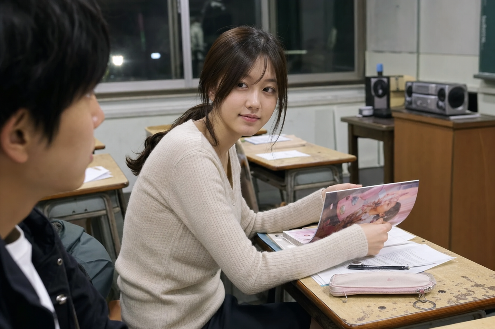

# ep.014 일본어 학원에서 만난 사람

수원역 앞 일본어 학원은 간판부터 조금 낡았다. 유리문에는 일본어능력시험 대비반, 회화반, 유학반 같은 종이가 겹겹이 붙어 있었다.

2008년의 일본어 학원. 미래에는 앱 하나로 발음도 듣지만, 지금은 달랐다. 이 시대의 공부는 손에 종이가 남았다.

[직원] "회화반이요? 시험반이요?"

[김용식] "회화랑 JLPT 같이 보고 싶어요."

[직원] "일본어 해 보신 적 있으세요?"

[김용식] "조금요."

거짓말은 아니었다. 조금 많이 했을 뿐이다.

레벨 테스트는 짧았다. 김용식은 일부러 속도를 늦췄다. 너무 잘하면 이상했다.

[강사] "독학하셨어요?"

[김용식] "애니 보다가요."

[강사] "발음이 생각보다 괜찮네요."

[김용식] "많이 봐서요."

수업료 3개월분 660,000원.

교재비 42,000원.

등록비 20,000원.

합계 722,000원.

김용식은 카드로 결제했다. 영수증을 지갑에 넣으며 머릿속으로 잔액을 줄였다. 돈은 여전히 많았다. 그래도 숫자를 놓치면 안 됐다.

수업은 저녁 일곱 시에 시작했다. 김용식은 뒤쪽 창가에 앉았다.

그때 옆자리 의자가 조용히 밀렸다.

[한서윤] "여기 비었죠?"

긴 짙은 갈색 머리를 낮게 묶은 여자였다. 얇은 니트, 정리된 필통. 표정은 차분했고, 눈은 책상 위 교재를 먼저 봤다.

[김용식] "네."

[한서윤] "감사합니다."

그녀는 앉으며 가방에서 일본 잡지를 꺼냈다. 김용식의 시선이 아주 잠깐 그쪽으로 갔다. 한서윤이 바로 말했다.

[한서윤] "읽으세요?"

[김용식] "조금요."

[한서윤] "다들 조금이라고 하네요."

[김용식] "그럼 조금보다 조금 더요."

한서윤은 입꼬리만 올렸다.

수업은 생각보다 빨랐다. 강사는 옆 사람과 자기소개를 주고받게 했다.

[한서윤] "はじめまして。ハン・ソユンです。"

발음은 깔끔했다.

김용식은 순간 반응이 늦었다.

2008년의 교실에서 이런 발음을 들을 줄은 몰랐다.

[김용식] "はじめまして。キム・ヨンシクです。よろしくお願いします。"

한서윤의 눈이 조금 달라졌다.

[한서윤] "정말 조금이에요?"

[김용식] "애니를 많이 봐서요."

[한서윤] "어떤 거요?"

위험한 질문이었다. 2008년에 아직 방영 전인 작품 이름을 말하면 끝이다. 김용식은 목록을 과거로 돌렸다.

[김용식] "에반게리온, 코드기어스, 하루히요."

[한서윤] "메이저한 것만 보네요."

[김용식] "들키기 쉬운 취향이라."

[한서윤] "그 말은 조금 웃기네요."

한서윤은 크게 웃지 않았다. 대신 시선을 오래 남겼다. 김초연과 다른 타입이었다. 알아차리면 멈춰야 했다. 그런데 멈추지 않았다.

쉬는 시간, 한서윤은 자판기 커피를 뽑았다. 김용식도 옆에 섰다.

[한서윤] "대학생이세요?"

[김용식] "네. 평택대요."

[한서윤] "멀리 다니네요. 수원 사세요?"

[김용식] "수지는요."

[한서윤] "그럼 여기까지도 멀잖아요."

[김용식] "차가 있어서요."

말하고 나서야 아차 싶었다.

또 자랑.

입이 가벼웠다.

한서윤은 커피 캔을 따며 김용식을 봤다.

[한서윤] "스무 살에 차 있어요?"

[김용식] "통학 때문에요."

[한서윤] "좋겠다."

정다은도 그렇게 말했다. 좋겠다. 그 말은 부러움일 수도 있고, 문을 두드리는 말일 수도 있다.

[김용식] "나중에 역까지 태워 드릴까요?"

말을 해 놓고 스스로를 욕했다. 오는 여자 안 막는다고 했지. 내가 먼저 문 열라는 뜻은 아니었는데.

한서윤은 바로 대답하지 않았다.

[한서윤] "오늘은 괜찮아요."

[김용식] "아."

[한서윤] "다음엔 부탁할게요."

거절이 아니었다. 예약이었다.

수업이 끝난 뒤 김용식의 폴더폰이 울렸다.

[김초연] 뭐함?

[김용식] 일본어 학원

[김초연] 갑자기?

[김용식] 원래 좋아했어

[김초연] 나한텐 그런 말 안 했잖아

김용식은 손가락을 멈췄다.

맞다. 김초연에게는 말하지 않았다.

그 사이 한서윤이 엘리베이터 앞에서 돌아봤다.

[한서윤] "김용식 씨, 내려가요?"

김초연의 문자가 다시 떴다.

[김초연] 끝나고 전화해

김용식은 폴더폰 액정과 엘리베이터 문에 비친 한서윤 사이에 서 있었다.

둘 다 닫히기 전에 뭔가를 골라야 했다. 그런데 김용식은 제일 나쁜 선택을 했다.

[김용식] "네, 같이 내려가요."

그리고 김초연에게는 이렇게 보냈다.

[김용식] 조금 이따 할게

거짓말은 아니었다. 하지만 진실도 아니었다.
