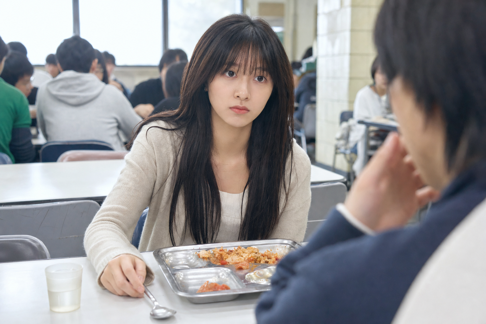

# ep.015 너 나랑 뭐 하는 사이야?

김초연은 다음 날 점심시간에 웃고 있었다.

[김초연] "일본어 학원 재밌었어?"

김용식은 숟가락을 들다 멈췄다.

[김용식] "응. 괜찮더라."

[김초연] "누구랑 같이 들었어?"

질문이 너무 빠르다. 김초연은 게임할 때도 직선으로 들어왔다.

[김용식] "사람 많았지."

[김초연] "여자도?"

김종규가 옆 테이블에서 물을 뿜을 뻔했다. 송기훈은 식판을 들고 멀어졌다.

[송기훈] "나는 생존 본능이 있어."

둘은 떠났다. 의리는 없었다.

[김용식] "있었지."

[김초연] "친해졌어?"

[김용식] "처음 본 사람이야."

[김초연] "처음 봤는데 친해졌냐고."

말끝이 조금 올라갔다. 여기서 멈춰야 했다. 그런데 20살의 김용식은 방어부터 했다.

[김용식] "그냥 말 좀 한 거야."

[김초연] "말 좀."

김초연은 그 말을 입 안에서 굴렸다.

[김초연] "나랑도 처음엔 말 좀 했지."

정확했다.

[김용식] "초연아."

처음으로 이름만 불렀다. 호칭 하나가 공기를 바꿨다.

[김초연] "왜."

[김용식] "별거 아니야."

최악의 답이었다. 김초연은 숟가락을 내려놓았다.

[김초연] "그 말 진짜 싫다."

그녀는 웃지 않았다. 이번에는 정말로.

오후 강의는 제대로 들어오지 않았다. 김초연에게 문자는 오지 않았다.

강의가 끝나자 정다은이 복도에서 손을 흔들었다.

[정다은] "용식 씨, 오늘 차 가져왔어요?"

김용식은 뒤쪽을 봤다. 김초연은 친구들과 걷고 있었지만, 분명히 들었다.

[김용식] "네."

[정다은] "나 편의점까지만 태워 주면 안 돼요? 비 올 것 같아서."

창밖은 멀쩡했다. 비는 오지 않을 것이다.

[김용식] "가까운데요."

[정다은] "그래서 부담 없죠."

뒤에서 김초연의 목소리가 들렸다.

[김초연] "나도 갈 건데."

정다은이 고개를 돌렸다.

[정다은] "아, 같이 가세요?"

김초연은 김용식을 보지 않고 말했다.

[김초연] "몰라요. 물어보는 중이에요."

복도 공기가 얇아졌다. 김용식은 차 키를 내려다봤다.

[김용식] "초연이 먼저 데려다주려고 했어."

거짓말은 아니었다. 생각은 했다. 말하지 않았을 뿐.

[김초연] "먼저?"

[김용식] "수원 가야 하니까."

[정다은] "아, 그럼 저는 다음에."

정다은은 물러섰다. 깔끔해서 오히려 흔적이 남았다.

수원으로 향하는 차 안은 조용했다. 라디오만 너무 들떠서, 김용식은 결국 볼륨을 줄였다.

[김용식] "화났어?"

[김초연] "응."

[김초연] "뭐가 미안한데?"

어려운 질문이다.

[김용식] "말을 애매하게 해서."

[김초연] "그것만?"

[김용식] "다은 씨한테 차 태워 준다고 한 것도."

[김초연] "학원 여자는?"

훅 들어왔다.

[김용식] "그 사람은 진짜 그냥 수업 같이 들은 사람이야."

[김초연] "근데 너 표정이 달랐어."

[김용식] "네가 봤어?"

[김초연] "문자 답장만 봐도 알아."

말이 안 되는데, 됐다. 김초연은 그런 사람이었다.

[김초연] "너 나랑 뭐 하는 사이야?"

차 안이 완전히 조용해졌다.

김용식은 그 질문을 알고 있었다. 미래에도 들었다. 다른 얼굴, 다른 차, 다른 상황에서. 하지만 질문은 같았다.

대답을 피하면 관계는 더 꼬인다. 대답하면 책임이 생긴다. 김용식은 돈 앞에서는 책임을 잘 졌지만, 사람 앞에서는 자꾸 미뤘다.

[김용식] "나는..."

김초연이 창밖을 봤다.

[김초연] "대답 오래 걸리면 됐어."

[김용식] "아니야."

[김초연] "그럼 빨리 해."

차는 신호에 걸렸다. 여기서 좋아한다고 말하면 된다. 이미 좋아한다. 하지만 말하는 순간 다른 문들이 닫힌다. 김용식은 자기가 쓰레기 같은 계산을 하고 있다는 걸 알았다.

[김용식] "너랑 있으면 좋아."

김초연은 웃지 않았다.

[김초연] "그건 대답 아니야."

뒤차가 짧게 경적을 울렸다. 김용식은 차를 출발시켰다.

김초연은 조수석 창문에 이마를 거의 붙인 채 말했다.

[김초연] "그럼 나도 다른 남자랑 놀아도 되지?"

핸들이 아주 조금 흔들렸다. 김용식은 바로 대답하지 못했다. 김초연은 그 침묵을 보고 작게 웃었다.

[김초연] "봐. 너도 싫잖아."

수원 골목에 차를 세웠을 때 김초연은 바로 내리지 않았다.

[김초연] "내일 PC방 오지 마."

[김용식] "초연아."

[김초연] "오고 싶으면, 대답 정해서 와."

문이 닫혔다.

김용식은 골목에 혼자 남았다.

엔진은 켜져 있었다. 돈으로 해결 안 되는 문제가 처음으로 선명해졌다.
