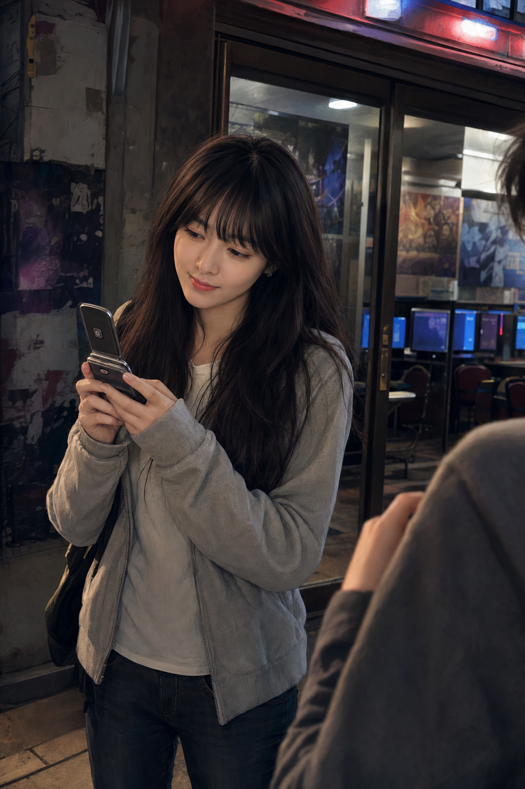

# ep.016 대답 같은 대답

저녁 일곱 시.

김용식은 PC방 앞에서 다섯 분째 서 있었다. 유리문 너머로 담배 냄새와 라면 냄새가 희미하게 새어 나왔고, 안쪽에서는 키보드 두드리는 소리가 쉬지 않고 흘렀다.

문은 바로 앞이었다.

들어가면 김초연이 있을 수도 있다. 없을 수도 있다.

어느 쪽이든 문제였다.

[김용식] "대답 정해서 오라니."

그 말이 하루 종일 따라다녔다. 강의실에서도, 학생식당에서도, 차 안에서도. 폴더폰을 열 때마다 답장을 써야 할 것 같았고, 닫을 때마다 도망치는 것 같았다.

좋아한다.

이건 쉽다.

사귀자.

이건 이상하게 무겁다.

좋아하는 마음보다 그 말을 한 뒤의 생활이 먼저 떠올랐다. 정다은이 같은 과 복도에서 웃으며 손을 흔드는 장면, 한서윤이 학원 엘리베이터 앞에서 돌아보던 장면, 초연이 조수석 창문에 이마를 붙이고 "너도 싫잖아"라고 말하던 장면.

김용식은 돈 앞에서는 숫자를 세웠다. 사람 앞에서는 자꾸 핑계를 셌다.

문이 열렸다.

김초연이 나왔다.

긴 머리를 대충 묶고, 후드티 소매를 손등까지 끌어내린 채였다. 눈은 바로 김용식을 봤다. 기다렸다는 얼굴은 아니었다. 하지만 모른 척하고 지나갈 얼굴도 아니었다.

[김초연] "왔네."

[김용식] "오라며."

[김초연] "오지 말라고도 했어."

[김용식] "조건부였잖아. 대답 정해서 오면 되는 거."

[김초연] "그 조건 달성했어?"

초연은 뒤로 한 걸음 물러났다. PC방 안쪽의 모니터 불빛이 그녀의 옆얼굴에 파랗게 닿았다. 평소 같으면 들어가서 자리부터 봤을 텐데, 오늘은 카운터 앞이 경기장이었다.

김용식은 차 키를 손안에서 굴리다 멈췄다.

[김용식] "나 너 좋아해."

말은 생각보다 쉽게 나왔다.

그래서 더 위험했다.

김초연은 바로 웃지 않았다. 입술만 살짝 움직였다.

[김초연] "그다음."

[김용식] "그다음?"

[김초연] "좋아한다는 말만 하면 끝이야? 어제도 그 비슷한 말은 했잖아."

끝이면 얼마나 좋겠냐.

김용식은 숨을 고르고, 이번에는 그녀의 눈을 피하지 않았다.

[김용식] "나랑 만나볼래?"

김초연의 눈이 조금 커졌다. 그 표정은 이긴 사람의 표정이 아니었다. 오히려 받아 놓고도 의심하는 얼굴이었다.

[김초연] "만나볼래?"

[김용식] "말이 좀 이상하게 나왔는데, 가볍게 해 보자는 뜻은 아니야. 너랑 제대로 만나고 싶다는 뜻이야. 내가 잘할 수 있다고 큰소리치면 거짓말 같고, 그래도 피하고 싶지는 않아."

초연은 손등까지 내려온 소매를 잡아당겼다.

[김초연] "말 길어지니까 더 수상하긴 한데."

[김용식] "긴장해서 그래."

[김초연] "긴장도 해?"

[김용식] "너 앞에서는 해."

그제야 초연이 살짝 웃었다. 공기가 풀리는 줄 알았다.

아니었다.

[김초연] "그럼 정다은은?"

이름이 너무 빨리 나왔다.

[김용식] "같은 과 동기야. 앞으로도 강의실에서 보고, 조별 과제 같은 거 생기면 엮일 수도 있겠지. 근데 내가 먼저 애매하게 굴지는 않을게."

[김초연] "한서윤은?"

[김용식] "학원에서 만난 사람. 수업 때문에 마주칠 수는 있어. 그것도 숨기지 않을게."

[김초연] "숨기지 않는 게 다야?"

김용식은 바로 대답하지 않았다. 초연의 질문은 늘 한 단계 더 들어왔다.

[김용식] "아니. 네가 싫어할 만한 선을 내가 먼저 생각해야지. 네가 매번 말해 줘야만 움직이면 그건 네가 나 키우는 거잖아."

김초연은 그 말을 듣고 잠깐 눈을 내렸다. 마음에 든 건지, 더 의심스러운 건지 알 수 없었다.

[김초연] "그럼 나는?"

[김용식] "너는..."

그는 한 번 더 숨을 골랐다.

[김용식] "내가 좋아하는 사람. 그리고 지금 내가 대답해야 하는 사람."

김초연은 손을 내밀었다.

[김초연] "폰 줘."

[김용식] "왜?"

[김초연] "내 이름 뭐로 저장했는지 보게. 말만 들어서는 성의 있는지 모르겠거든."

아.

그건 생각 못 했다.

김용식은 폴더폰을 건넸다. 김초연은 익숙하지 않은 손길로 연락처를 열었다. 작은 화면에 저장된 이름이 떴다.

`김초연`

그녀는 화면을 들이밀었다.

[김초연] "성의가 없어."

[김용식] "그때는 그냥 저장한 거라서. 바꾸면 되지."

[김초연] "뭐로?"

[김용식] "그걸 물어보면 안 되는 거지?"

[김초연] "이제 좀 배우네."

김용식은 폰을 돌려받아 자판을 눌렀다.

`초연`

너무 평범했다.

다시 지웠다.

`안놓침`

김초연이 옆에서 봤다.

[김초연] "야. 그거 내 거잖아."

[김용식] "맞춰 준 건데."

[김초연] "따라 하지 마. 남의 숙제 베끼는 것도 아니고."

[김용식] "그럼 네가 정해 줘. 아니, 정해 주면 안 되는 거 아는데 지금은 도저히 모르겠다."

김초연은 잠깐 생각했다. 그리고 손을 뻗어 직접 자판을 눌렀다. 손끝이 김용식의 손등에 잠깐 닿았다. 키보드 소음 속에서 그 짧은 접촉만 이상하게 조용했다.

`대답받음`

[김용식] "이름이 너무 행정적이야."

[김초연] "너한텐 이 정도가 맞아. 오늘은 진짜 대답을 받아냈으니까."

폰 화면에 네 글자가 박혔다.

대답받음.

이게 연애의 시작이면, 공문서 냄새가 너무 났다. 그런데 이상하게 지우고 싶지 않았다.

둘은 PC방에 들어갔다.

김초연은 자연스럽게 김용식 옆자리에 앉았다. 아직 손을 잡지는 않았다. 하지만 의자는 예전보다 조금 가까웠고, 그녀의 후드티 소매가 마우스패드 끝에 닿을 만큼 거리가 줄어 있었다.

게임을 켰다.

카트라이더 로딩 화면이 떴다.

[김초연] "오늘은 봐주면 진짜 화낼 거야. 내가 기분 풀렸다고 방심하지 마."

[김용식] "사귄 첫날부터 너무 살벌한 거 아니야?"

초연의 손이 멈췄다.

[김초연] "뭐라고?"

김용식도 멈췄다. 방금 입에서 너무 쉽게 나왔다.

사귄 첫날.

김초연은 모니터를 보다가, 고개를 살짝 숙였다. 귀 끝이 조금 빨갰다.

[김초연] "그 말은... 괜찮네. 근데 내가 아직 완전히 봐준 건 아니야."

[김용식] "알아. 시험 기간인 거지."

[김초연] "응. 너 되게 오래 봐야 하는 과목 같아."

그때 폴더폰이 울렸다.

[정다은] 용식아. 내일 오전 강의 자리 맡아줄 수 있어? 창가 쪽.

김초연은 화면을 봤다.

그리고 아주 천천히 웃었다.

[김초연] "대답받음 씨."

[김용식] "응."

[김초연] "내일부터 시험 시작이네."

게임은 아직 출발도 안 했다.

이미 첫 코너에서 박은 기분이었다.
