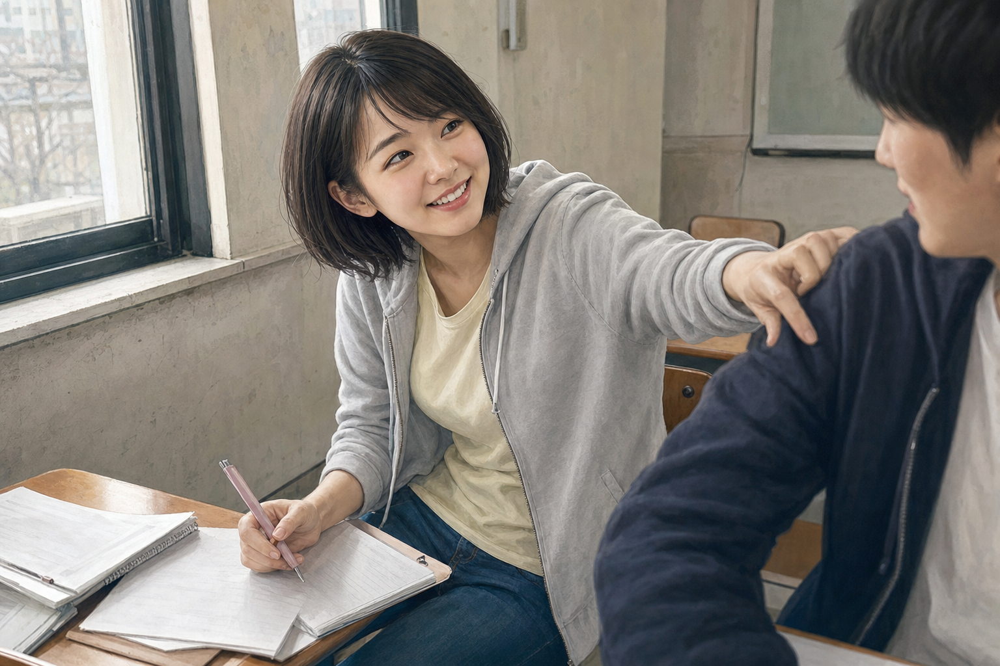

# ep.017 창가 자리

정다은은 정말 창가 자리를 원했다.

그것도 그냥 원하는 게 아니었다.

강의 시작 십 분 전.
김용식이 창가 줄 두 자리를 잡고 앉자마자, 정다은이 문에서 손을 번쩍 들었다.

[정다은] "오. 진짜 맡아줬네?"

[김용식] "네가 맡아달라며."

[정다은] "말 잘 듣네."

정다은은 웃으며 다가왔다.

그리고 책상 위에 노트를 내려놓기 전에 김용식의 어깨를 가볍게 쳤다.

툭.

아무렇지 않은 손이었다.

문제는 아무렇지 않은 손이 제일 오래 남는다는 점이다.

[정다은] "고마워, 용식아."

반말 전환이 빠르다.

어제까지만 해도 용식 씨였다.
오늘은 용식아.

대학생의 친화력은 가끔 행정 절차를 무시한다.

정다은은 옆자리에 앉았다.
후드집업 모자를 의자 뒤로 넘기고, 볼펜을 손가락 사이에서 빙글 돌렸다.

[정다은] "근데 너 어제 그 여자친구야?"

[김용식] "누구."

[정다은] "긴 머리. 눈 무서운 애."

[김용식] "무섭진 않아."

[정다은] "너한테만 안 무섭겠지."

정확했다.

김용식은 책을 펼쳤다.

[김용식] "여자친구... 비슷한 거."

[정다은] "비슷한 거?"

정다은의 눈이 동그래졌다.

[정다은] "그 말 하면 맞아?"

[김용식] "아니."

[정다은] "알면서 해?"

[김용식] "방금 수정 중이야."

[정다은] "너 좀 이상하다."

그녀는 그렇게 말하고 웃었다.

웃으면서 김용식의 팔꿈치를 또 툭 쳤다.

두 번째다.

세면 지는 것 같아서 세지 않기로 했다.

교수가 들어왔다.
강의가 시작됐다.

문제는 정다은이 조용히 못 있는 타입이라는 점이었다.

칠판을 보다가 고개를 기울이고.
필기하다가 펜을 떨어뜨리고.
프린트를 넘기다 말고 김용식 쪽으로 몸을 숙였다.

[정다은] "여기 뭐래?"

속삭임이었다.

가깝다.

샴푸와 새 노트 냄새가 섞였다.

김용식은 프린트 위를 손가락으로 짚었다.

[김용식] "여기. 과제 제출 방식."

[정다은] "오. 글씨 잘 보네."

[김용식] "글씨를 보는 게 아니라 문맥을 보는 거야."

[정다은] "와."

정다은은 작게 박수를 쳤다.

[정다은] "너 말투 아저씨 같아."

심장이 잠깐 멈췄다.

[김용식] "칭찬이야?"

[정다은] "아니. 신기하다는 뜻."

김용식은 펜을 잡았다.

조심해야 한다.

돈도.
말투도.
여자도.

조심해야 할 게 너무 많다.

강의가 끝나자 과 남자 동기 셋이 몰려왔다.

[남자동기1] "야, 김용식. 너 차 진짜 네 거야?"

[김용식] "왜."

[남자동기2] "BMW라며."

[남자동기3] "신입생이 무슨 BMW야. 집 잘살아?"

강의실 공기가 순식간에 귀를 세웠다.

정다은이 먼저 끼어들었다.

[정다은] "뭐 어때. 멋있으면 됐지."

[남자동기1] "너 태워봤냐?"

[정다은] "아직."

그녀는 김용식 쪽으로 몸을 돌렸다.

[정다은] "오늘 태워줄 거지?"

말투가 너무 가볍다.

그래서 거절 타이밍이 더 이상해졌다.

[김용식] "어디 가는데."

[정다은] "매점."

[김용식] "차 타고?"

[정다은] "농담이지."

정다은은 웃으며 김용식의 손목을 잡았다.

[정다은] "걸어가자. 나 배고파."

손목.

잡힌 쪽은 김용식이었다.

주변에서 휘파람이 나왔다.

[남자동기2] "오."

[정다은] "오 하지 마. 배고픈 게 죄냐?"

그녀는 정말 아무렇지 않았다.

아무렇지 않아서 더 난감했다.

매점 앞에서 김용식은 삼각김밥과 캔커피를 샀다.
정다은은 막대사탕 하나를 집었다.

[정다은] "이건 내가 살게."

[김용식] "그거 오백 원이잖아."

[정다은] "내 마음은 비싸."

[김용식] "계산이 안 맞는데."

[정다은] "아저씨 말투 또 나왔다."

그녀는 계산대로 뛰어갔다.

그때 김용식의 폴더폰이 울렸다.

[대답받음] 오늘은 나랑 점심 먹어.

김용식은 답장을 쓰려다 멈췄다.

정다은이 막대사탕을 입에 물고 돌아왔다.

[정다은] "누구?"

[김용식] "초연."

[정다은] "아. 눈 무서운 애."

[김용식] "그렇게 부르지 마."

정다은은 눈을 동그랗게 떴다.

그리고 웃었다.

[정다은] "오. 제대로네?"

그 말이 이상하게 기분 좋았다.

문제는 그 장면을 김초연이 멀리서 보고 있었다는 점이다.

긴 머리.
작은 얼굴.
가만히 선 눈.

김용식은 막대사탕보다 더 단단한 것을 삼킨 기분이 들었다.

[김초연] "점심 먹자며."

문자 보낸 지 일 분.

답장보다 사람이 먼저 왔다.

이 시대의 알림은 가끔 너무 빠르다.
