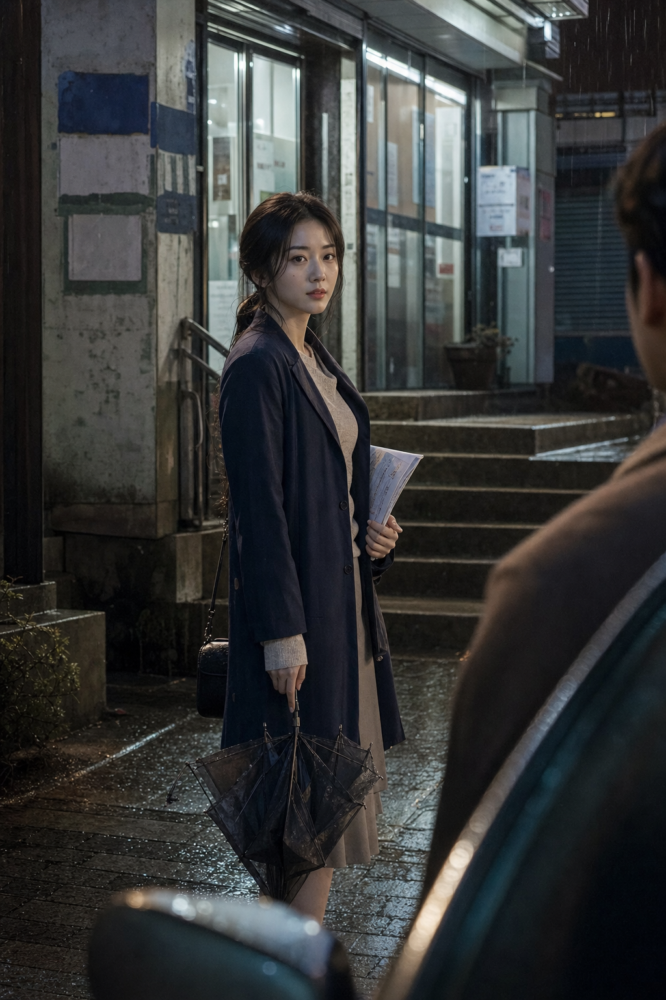

# ep.018 원래 저래?

학생식당 돈가스는 늘 비슷한 냄새가 났다.

튀김옷에서 올라오는 기름 냄새, 양배추 샐러드의 마요네즈 냄새, 플라스틱 식판에 닿는 칼 소리. 평소라면 김초연은 돈가스를 반으로 잘라 김용식 접시에 한 조각 올려놓고 시작했을 것이다.

오늘은 칼질만 했다.

슥.

슥.

접시가 고문당하는 소리였다.

[김용식] "초연아."

[김초연] "응."

[김용식] "고기는 죄가 없어. 네가 너무 세게 자르면 고기도 억울하지 않을까."

[김초연] "너보단 있겠지."

칼이 멈췄다.

김용식은 물을 마셨다. 목이 아팠다. 정다은에게 잡혔던 손목이 괜히 식판 아래에서 조용해졌다.

[김초연] "정다은 원래 저래?"

[김용식] "친화력이 좋은 거지. 사람들한테 다 편하게 대하더라."

[김초연] "손목 잡는 것도?"

[김용식] "그건... 편한 것치고는 좀 가까웠지."

[김초연] "너 좋았지."

[김용식] "좋았다기보다 당황했어. 바로 빼면 강의실에서 더 이상해질 것 같아서."

대답을 길게 했다. 길게 말할수록 더 방어처럼 들린다는 걸 말하고 나서야 알았다.

김초연은 포크를 들었다.

[김초연] "너 거짓말할 때는 아니라고 빨리 말하고, 숨길 때는 설명이 길어져."

김용식은 입을 다물었다.

[김초연] "안 피했잖아."

[김용식] "응. 그건 맞아. 피했어야 했는데 못 했어."

김초연의 손이 아주 잠깐 멈췄다. 예상한 반박이 아니라 인정이 나오면, 화난 사람도 다음 말을 고르는 데 시간이 걸린다.

[김초연] "그럼 나는?"

[김용식] "너는?"

[김초연] "내가 다른 남자 손목 잡고 매점 가면? 그냥 편해서 그랬다고 하면?"

상상했다.

기분이 바로 나빠졌다.

스스로도 참 빠르다.

[김용식] "싫지. 엄청."

[김초연] "봐."

김초연은 그제야 돈가스 한 조각을 김용식 접시에 던지듯 올렸다.

[김초연] "먹어. 벌점."

[김용식] "벌점인데 왜 줘?"

[김초연] "먹고 정신 차리라고. 굶기면 네가 또 불쌍한 척할 것 같아서."

그녀는 화났는데 챙겼다.

이게 제일 어렵다.

챙기면서 화내면 도망갈 구멍이 없었다.

점심이 끝나갈 때 폴더폰이 울렸다.

[한서윤] 오늘 학원 오시죠? 프린트 하나 더 받아뒀어요.

김초연의 눈이 화면으로 내려갔다.

숨길 수도 있었다. 그런데 숨기면 정말 끝난다. 김용식은 폰을 책상 위에 그대로 두었다.

[김초연] "한서윤."

[김용식] "응. 일본어 학원 옆자리."

[김초연] "프린트까지 챙겨 주네."

[김용식] "같은 수업이라서. 내가 부탁한 건 아니야."

[김초연] "정다은도 그냥 같은 과고."

맞는 말이 쌓이면 구석에 몰린다.

김용식은 젓가락을 내려놨다.

[김용식] "오늘 끝나고 바로 전화할게. 수업 끝나면 누구랑 있었는지도 말할게. 네가 매번 캐묻기 전에 내가 먼저."

[김초연] "바로?"

[김용식] "바로."

[김초연] "역까지 태워준다고 하진 말고."

김용식은 대답이 조금 늦었다.

[김용식] "안 할게."

말하면서도 알았다. 사람 일은 말한 대로만 되지 않는다. 특히 비가 오거나, 누군가 우산을 접고 서 있으면 더 그렇다.

수원 일본어 학원은 저녁 공기가 달랐다.

좁은 책상, 형광등, 프린트 냄새, 캔커피, 벽에 붙은 일본 여행 포스터. 한서윤은 이미 자리에 앉아 있었다. 낮게 묶은 머리 옆으로 잔머리가 내려와 있었고, 교재 위에는 여분 프린트가 반듯하게 놓여 있었다.

[한서윤] "여기요."

그녀가 프린트를 내밀었다.

[김용식] "고마워요. 일부러 챙겨 주신 거예요?"

[한서윤] "지난번에 발음 좋다고 하셨잖아요. 그 말 때문에 숙제 더 했어요. 그래서 오늘은 프린트도 하나 더 받아뒀고요."

한서윤은 크게 웃지 않았다. 입가만 아주 조금 올라갔다. 조용한 사람의 농담은 늦게 들어온다.

[김용식] "그럼 제가 괜히 책임을 만든 거네요."

[한서윤] "네. 끝나고 발음 체크해 주세요."

책임이 더 생겼다.

수업은 빠르게 지나갔다. 학원 계단을 내려오자 비가 오고 있었다. 계단 아래에는 젖은 우산들이 접힌 채 기대어 있었고, 거리의 간판빛은 물웅덩이 위에서 흔들렸다.

한서윤은 우산을 펴다 말고 멈췄다. 우산살 하나가 휘어 있었다.

[한서윤] "아."

[김용식] "망가졌어요?"

[한서윤] "조금요. 펴지긴 하는데, 이러면 옆으로 다 샐 것 같네요."

그녀는 망가진 우산을 그냥 접었다.

[한서윤] "역까지 뛰면 되겠어요."

뛰면 된다.

그 말은 태워 달라는 말보다 더 태워 주게 만든다.

김용식은 차 키를 손안에서 굴렸다. 초연의 말이 떠올랐다. 역까지 태워준다고 하진 말고. 그런데 눈앞의 비는 생각보다 굵었고, 한서윤의 니트 소매는 벌써 빗방울에 조금 젖어 있었다.

[김용식] "역까지는 태워드릴게요. 멀지도 않고, 비가 너무 와서요."

말했다.

말하지 않겠다고 한 지 세 시간 만이었다.

차 안에서 한서윤은 창밖을 봤다. 와이퍼가 유리를 밀 때마다 거리의 불빛이 지워졌다가 다시 번졌다.

[한서윤] "여자친구 있으세요?"

질문은 조용했다. 그래서 피하기 어려웠다.

[김용식] "있어요. 아직 좀 복잡하긴 한데, 있어요."

한서윤이 고개를 돌렸다.

[한서윤] "그럼 저 태워 주면 혼나요?"

[김용식] "아마요."

[한서윤] "그래도 태워 주시네요."

김용식은 대답하지 못했다. 친절이라고 말하면 너무 편했고, 호감이라고 말하면 너무 위험했다.

수원역 앞에 차를 세우자마자 폴더폰이 울렸다.

[대답받음] 바로 전화한다며.

시간은 수업 끝난 지 이십칠 분.

김용식은 휴대폰을 들었다.

한서윤은 문을 열기 전에 말했다.

[한서윤] "여자친구분한테는 비 때문에 그랬다고 하세요."

[김용식] "네."

[한서윤] "근데 그 말, 별로 안 믿을 것 같아요."

문이 닫혔다.

정확한 사람은 가끔 잔인하다.

김용식은 통화 버튼을 눌렀다. 첫 신호음이 가기도 전에 김초연이 받았다.

[김초연] "비 오지?"

김용식은 앞유리에 흐르는 빗물을 봤다.

[김초연] "설마 태워줬어?"

그는 바로 대답하지 못했다.

빗소리가 먼저 차 안을 채웠다.
