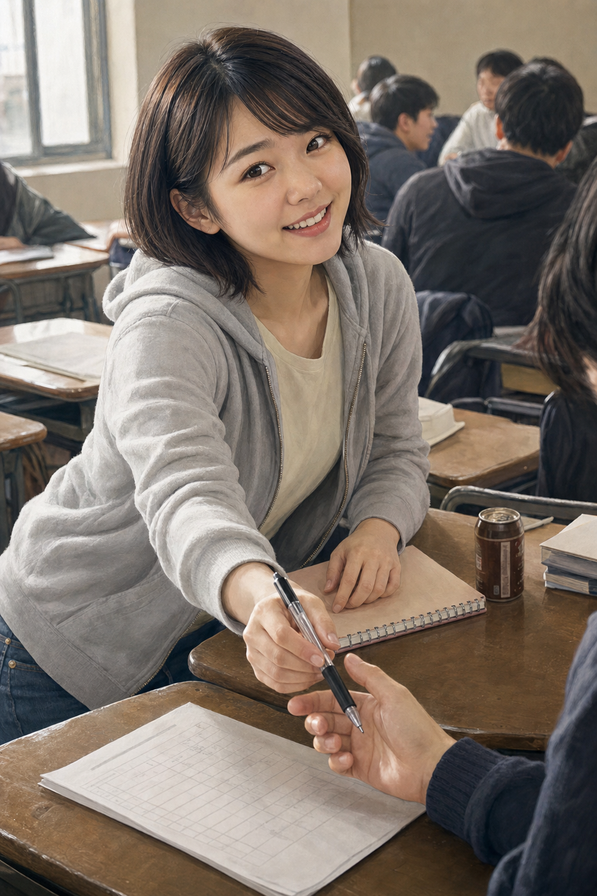

# ep.019 BMW는 누구 돈이야?

소문은 생각보다 차를 잘 탔다.

BMW보다 빨랐다.

월요일 오전 강의실.
김용식이 문을 열자 남자 동기들이 동시에 고개를 들었다.

[남자동기1] "왔다."

[남자동기2] "오너."

[남자동기3] "회장님."

김용식은 그대로 문을 닫고 나가고 싶었다.

[김용식] "출석만 하고 가도 되냐?"

[남자동기1] "안 됩니다, 회장님."

[남자동기2] "오늘 주주총회 있습니다."

[정다은] "뭐야. 재밌는 거 해?"

정다은이 뒤에서 끼어들었다.
밝은 후드집업에 작은 가방.
손에는 캔커피 두 개.

그녀는 하나를 김용식 책상 위에 올렸다.

[정다은] "이거. 어제 매점 값."

[김용식] "막대사탕 오백 원 아니었어?"

[정다은] "이자."

[김용식] "금리가 너무 높네."

[정다은] "BMW 타는 사람한테 이 정도는 받아야지."

강의실이 웃었다.

웃음은 가볍다.
하지만 가벼운 웃음이 소문을 더 오래 굴린다.

남자 동기 하나가 의자를 끌고 왔다.

[남자동기1] "진짜 궁금해서 그러는데, 차 네 거야?"

[김용식] "내가 타고 다니잖아."

[남자동기2] "그건 우리 아빠 차도 내가 타면 내 차지."

[남자동기3] "집 잘 살아?"

질문이 정면으로 들어왔다.

김용식은 캔커피 뚜껑을 땄다.

칙.

시간을 벌기 좋은 소리였다.

[김용식] "중고로 싸게 샀어."

[남자동기1] "BMW가 싸면 나는 뭐 타냐."

[정다은] "버스?"

[남자동기1] "야."

정다은은 웃으며 그 동기의 어깨에 팔을 걸었다.

[정다은] "삐치지 마. 너도 멋있어. 교통카드 잔액 확인하는 모습."

강의실이 또 웃었다.

그녀는 사람을 편하게 건드렸다.
말로도.
손으로도.

김용식은 그 장면을 보며 안심해야 했다.

정다은은 원래 저렇다.

그런데 안심은 이상한 방향으로 새었다.

김초연이 보면 뭐라고 할까.

그 생각이 먼저 들었다.

오전 강의가 끝나자 과 대표가 조별 과제 얘기를 꺼냈다.

프린트가 돌았다.

이름을 쓰는 표가 있었다.

정다은은 김용식 옆에 펜을 꽂았다.

[정다은] "우리 같은 조 할래?"

[김용식] "벌써?"

[정다은] "친한 사람이랑 해야 편하지."

[남자동기2] "나도 친한데."

정다은은 그쪽으로 고개를 돌렸다.

[정다은] "너는 발표할 때 도망갈 얼굴이야."

[남자동기2] "아직 발표 안 했는데 인생 평가 끝났네."

김용식은 이름표를 봤다.

같은 조.

이건 단순히 같이 밥 먹는 것보다 오래 간다.
강의실.
도서관.
프린트.
문자.

김초연의 얼굴이 머릿속에 떴다.

[정다은] "싫어?"

정다은은 묻고 있었다.
장난처럼.

하지만 눈은 답을 기다렸다.

[김용식] "싫은 건 아닌데."

[정다은] "그럼 써."

그녀가 김용식 손에 펜을 쥐여 주었다.

손끝이 닿았다.

길지 않았다.

짧아서 더 변명하기 좋았다.

점심시간.

김용식은 김초연에게 전화를 걸었다.

세 번 울렸다.

받았다.

[김초연] "왜."

[김용식] "점심 먹었어?"

[김초연] "아직."

[김용식] "같이 먹을래?"

잠깐 조용했다.

[김초연] "너 오늘 학과 사람들이랑 먹는 거 아니야?"

[김용식] "아니야. 너랑 먹으려고."

[김초연] "정다은은?"

이름이 또 나왔다.

[김용식] "조별 과제 같은 조 됐어."

말하고 나서 알았다.

순서가 틀렸다.

먼저 말했어야 하는 건 사실이 아니라 방어였다.

전화 너머가 조용해졌다.

[김초연] "같은 조."

[김용식] "강의에서 정한 거야."

[김초연] "네가 이름 썼어?"

[김용식] "응."

[김초연] "그럼 정한 거네."

김용식은 학생식당 입구에서 멈췄다.

사람들이 지나갔다.
식판 부딪히는 소리.
튀김 냄새.
새내기들의 웃음.

그 안에서 김초연의 목소리만 작게 남았다.

[김초연] "오늘은 됐어."

[김용식] "초연아."

[김초연] "나도 오늘 우리 과 애들이랑 먹을게."

통화가 끊겼다.

김용식은 폰을 내려다봤다.

그때 정다은이 학생식당 안쪽에서 손을 흔들었다.

[정다은] "용식아! 여기 자리 있어!"

목소리가 밝았다.

밝아서 더 피곤했다.

김용식은 한 걸음도 움직이지 못했다.

폰이 다시 울렸다.

[대답받음] 너도 싫은 거 해봐. 어떤 기분인지.

짧은 문자였다.

가벼운 복수는 가끔 무겁다.
