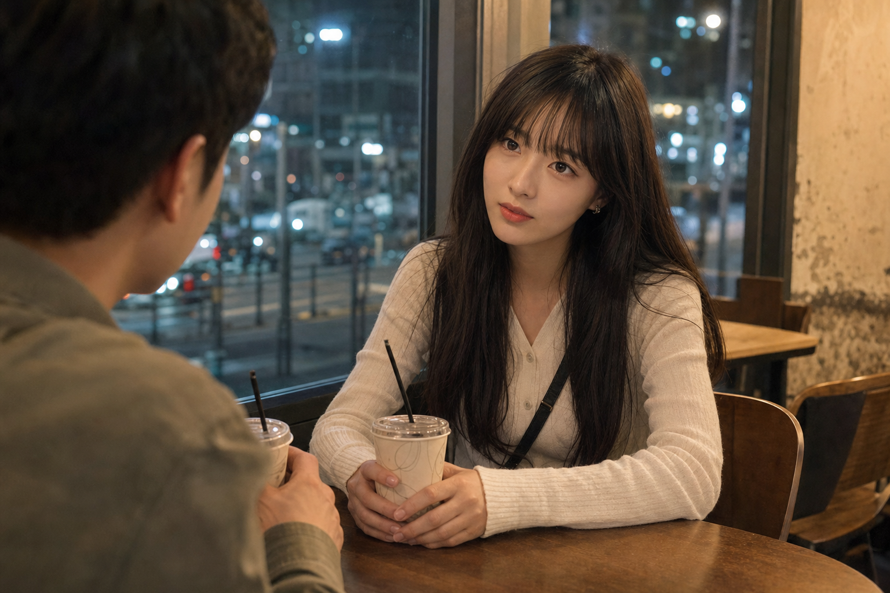

# ep.020 제대로 해

김초연은 약속 장소를 PC방으로 잡지 않았다.

[대답받음] 수원역. 사람 많은 데.

사람 많은 데.

그 말이 제일 무서웠다.

헤어지자는 말도 아니고.
보자는 말도 아니고.

공개 재판 같은 말이었다.

김용식은 평택에서 수원까지 차를 몰았다.
라디오는 껐다.

수원역 앞은 저녁 사람들로 복잡했다.
버스와 택시가 줄을 섰고, 대학생들이 웃으며 지나갔다.

김초연은 역 앞 계단 아래에 서 있었다.

긴 머리.
흰 니트.
작은 크로스백.

예뻤고, 화나 있었다.

[김용식] "기다렸어?"

[김초연] "오 분."

[김용식] "미안."

[김초연] "오 분은 괜찮아. 근데 며칠 기다린 건 별로 안 괜찮아."

김용식은 할 말이 없었다.

둘은 역 앞 카페로 들어갔다.
창가 자리에 앉았다.

김용식이 계산하려 하자 김초연이 먼저 카드를 냈다.

[김용식] "내가 살게."

[김초연] "오늘은 내가 살 거야."

[김용식] "왜."

[김초연] "네 돈으로 말하면 내가 지는 것 같아서."

말끝이 날카롭다.

김용식은 지갑을 다시 넣었다.

돈을 못 쓰는 순간도 불편했다.

커피가 나왔다.

[김초연] "나 너 좋아해."

김용식은 고개를 들었다.

선공이었다.

[김초연] "그래서 화나는 거야."

[김용식] "알아."

[김초연] "몰라."

바로 잘렸다.

[김초연] "너는 네가 좋아한다는 걸 말하면 끝이라고 생각해."

[김용식] "끝이라고 생각 안 해."

[김초연] "그럼 왜 계속 열어 둬?"

[김용식] "뭘."

[김초연] "정다은. 한서윤. 애매하게 웃는 거. 거절 안 하는 거. 다."

[김용식] "내가 잘못한 거 맞아."

김초연은 놀란 듯 눈을 깜빡였다.

사과를 예상하지 않았던 얼굴.

[김용식] "네가 싫어하는 거 알면서도, 그냥 넘겼어. 별일 아닌 척하면 별일 아닌 게 될 줄 알았어."

[김초연] "그리고?"

[김용식] "앞으로 조심할게."

김초연은 빨대를 꽂았다.

푹.

소리가 너무 단호했다.

[김초연] "조심 말고 제대로 해."

[김용식] "제대로?"

[김초연] "정다은이 손목 잡으면 빼. 한서윤 태워줄 일이 있으면 나한테 먼저 말해. 같은 조 된 것도 숨기지 마."

[김초연] "나랑 있을 때 다른 여자한테 잘 보이려고 하지 마."

그 말이 제일 정확했다.

잘 보이려고 했다.

BMW는 차가 아니라 확성기였다.

내가 이제는 봐달라고.

[김용식] "알았어."

[김초연] "알았어 말고."

[김용식] "할게."

[김초연] "그것도 약해."

[김용식] "그럼 뭐라고 해."

[김초연] "나랑 사귄다고 말해."

김용식은 김초연을 봤다.

시끄러운 카페였다.

그런데 그 말만 선명했다.

[김용식] "나랑 사귀자."

김초연의 눈이 흔들렸다.

그녀는 웃지 않았다.

[김초연] "늦었어."

김용식의 손이 멈췄다.

[김초연] "그래도 싫다는 건 아니야."

아.

[김초연] "나도 생각할 거야."

[김용식] "얼마나."

[김초연] "몰라."

[김용식] "내일?"

[김초연] "재촉하지 마."

[김용식] "모레?"

[김초연] "야."

김용식은 손을 들었다.

[김용식] "알았어. 안 물어볼게."

김초연은 그제야 아주 조금 웃었다.

[김초연] "대신 오늘은 집에 데려다줘."

[김용식] "수원 안이잖아."

[김초연] "그래서 부담 없지?"

어디서 들은 말이다.

정다은의 말투였다.

김초연도 알고 따라 했다.

그리고 좋았다.

수원 골목으로 들어서자 김초연이 창밖을 보며 말했다.

[김초연] "나 아직 네 여자친구 아니야."

[김용식] "응."

[김초연] "근데 네가 다른 여자한테 웃으면 화낼 거야."

[김용식] "그건 좀 불리한 계약인데."

[김초연] "싫어?"

[김용식] "아니."

[김초연] "그럼 됐어."

차가 멈췄다.

김초연은 안전벨트를 풀고도 바로 내리지 않았다.

김용식 쪽으로 몸을 조금 돌렸다.

가까웠다.

키스해도 이상하지 않은 거리였다.

김용식은 움직이지 않았다.

이번에는 기다렸다.

[김초연] "오늘은 봐줄게."

[김용식] "뭘."

[김초연] "모르는 척하지 마."

그녀는 손을 뻗어 김용식의 손등을 가볍게 눌렀다.

[김초연] "제대로 해."

문이 열렸다.

김초연은 골목 안으로 걸어갔다.

김용식은 손등을 내려다봤다.

손을 잡은 것도 아니었다.

그런데 오늘 하루 중 제일 오래 남았다.

폰이 울렸다.

[정다은] 조별 과제 단톡 만들었어. 초대해도 되지?

김용식은 화면을 보고 웃었다.

웃음이 나와서가 아니었다.

이건 정말 시험이었다.
