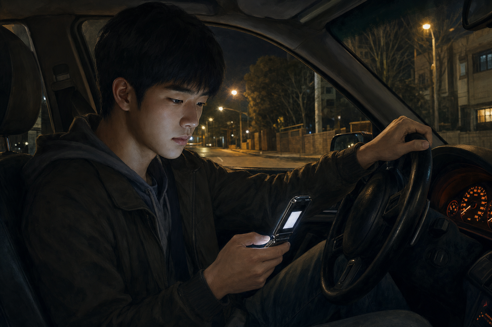

# ep.021 단톡 초대

[정다은] 조별 과제 단톡 만들었어. 초대해도 되지?

김용식은 폴더폰 화면을 보고 멈췄다.

차 안은 조용했다.
김초연이 골목 안으로 사라진 지 삼 분도 안 됐다.

제대로 해.

그 말이 아직 손등에 남아 있었다.

그런데 시험지가 바로 왔다.

정다은.
조별 과제.
단톡.

대학교는 참 성실하다.
문제를 매일 낸다.

김용식은 답장을 쓰려다 지웠다.

[김용식] 잠깐만.

너무 수상하다.

다시 지웠다.

[김용식] 응.

너무 가볍다.

또 지웠다.

결국 김초연에게 먼저 문자를 보냈다.

[김용식] 정다은이 조별 과제 단톡 초대해도 되냐고 물어봤어.

보내고 나서 핸들을 잡았다.

이게 뭐라고 손에 땀이 난다.

로또 1등 확인할 때보다 더 긴장된다.
인간관계는 세금 계산표가 없다.

답장은 바로 오지 않았다.

김용식은 차를 출발시켰다.

큰길로 나와 신호에 걸렸을 때 폴더폰이 울렸다.

[대답받음] 잘했네.

짧다.

너무 짧다.

김용식은 그 문자를 세 번 읽었다.

칭찬인가.
경고인가.
사형 집행 유예인가.

세 가지가 다 섞인 것 같았다.

[김용식] 초대받을게. 내용 이상하면 말할게.

이번엔 답이 빨랐다.

[대답받음] 내가 검사하는 사람 같네?

아.

이것도 틀렸다.

[김용식] 그런 뜻은 아니고.

[대답받음] 됐어. 들어가.

김용식은 한숨을 쉬었다.

고백보다 사후 관리가 어렵다.

다음 날 오전.

강의실은 평소보다 더 시끄러웠다.

조별 과제 때문이다.
신입생에게 조별 과제는 공부보다 친목 행사에 가까웠다.

정다은은 창가 쪽에 앉아 있었다.
짧은 단발 끝이 볼 옆에서 튀었다.

그녀는 김용식을 보자마자 손을 흔들었다.

[정다은] "용식아. 단톡 들어왔더라?"

[김용식] "응."

[정다은] "왜 그렇게 늦게 들어와?"

[김용식] "생각 좀 하느라."

[정다은] "단톡 초대를?"

[김용식] "요즘 신중하게 살아."

[정다은] "뭐야. 어제부터 착한 사람 코스프레 해?"

정다은은 웃으며 옆자리를 툭 쳤다.

[정다은] "여기 앉아. 우리 조 자리."

김용식은 잠깐 망설였다.

창가 자리.
정다은 옆.

어제라면 그냥 앉았을 것이다.

오늘은 가방을 든 채 한 칸 뒤를 봤다.

[김용식] "난 여기 앉을게."

정다은의 눈이 동그래졌다.

[정다은] "왜?"

[김용식] "칠판 잘 보여."

[정다은] "창가도 보여."

[김용식] "햇빛 때문에."

[정다은] "너 선글라스 낄 얼굴인데."

말이 이상하게 칭찬 같다.

김용식은 흔들리지 않으려고 의자에 앉았다.

정다은은 입술을 삐죽였다가 바로 웃었다.

[정다은] "알았어. 오늘은 봐준다."

봐주는 사람이 많아졌다.

나는 뭘 그렇게 많이 잘못했나.

강의가 시작되기 전 단톡이 울렸다.

[정다은] 다들 발표 자료 언제 할래?

[남자동기1] 오늘?

[남자동기2] 내일?

[정다은] 용식이는 차 있으니까 이동 담당.

김용식은 화면을 보자마자 김초연의 얼굴이 떠올랐다.

바로 답장을 쳤다.

[김용식] 이동 담당은 못 해. 과제는 학교에서 하자.

강의실 안이 묘하게 조용해졌다.

남자 동기 하나가 뒤돌아봤다.

[남자동기1] "오. 차주님 단호한데?"

[정다은] "왜? 여자친구한테 혼났어?"

정다은은 장난처럼 말했다.

강의실 몇 명이 웃었다.

김용식은 폴더폰을 닫았다.

[김용식] "혼난 건 맞고."

웃음이 한 박자 끊겼다.

[김용식] "근데 그거랑 별개로, 차는 과제 도구 아니잖아."

정다은은 김용식을 봤다.

눈웃음이 잠깐 사라졌다.

그리고 다시 웃었다.

[정다은] "오. 오늘 멋있는 척 성공."

[김용식] "척은 빼."

[정다은] "그럼 실패."

다시 웃음이 터졌다.

하지만 이번엔 김용식도 웃었다.

선 하나.

아주 작게 그었다.

점심시간이 됐다.

김용식은 학생식당 입구에서 김초연에게 전화를 걸었다.

두 번 울리고 받았다.

[김초연] "왜."

[김용식] "밥 먹었어?"

[김초연] "아직."

[김용식] "같이 먹자."

[김초연] "정다은은?"

[김용식] "조별 과제 얘기는 단톡에서만 하기로 했어. 차 얘기도 끊었고."

전화 너머가 조용해졌다.

[김초연] "보고하네?"

[김용식] "응."

[김초연] "왜 이렇게 순해졌어?"

[김용식] "말 잘 들으면 점수 올라가?"

[김초연] "아직 채점 안 했어."

그녀는 그렇게 말했지만 목소리가 조금 풀려 있었다.

[김용식] "그럼 점심은?"

[김초연] "돈가스."

[김용식] "또 벌점 메뉴야?"

[김초연] "오늘은 가산점 메뉴."

김용식은 작게 웃었다.

좋다.

이런 대화가 좋다.

전화가 끊기기 직전, 단톡이 다시 울렸다.

[정다은] 내일 학교 밖에서 자료 찾을 사람? 차 있는 사람 있으면 편하긴 한데 ㅋㅋ

김용식은 화면을 보고 멈췄다.

김초연의 목소리가 전화 너머에서 들렸다.

[김초연] "방금 뭐 왔지?"

아직 끊기지 않았다.

이런 건 왜 꼭 들킬까.
