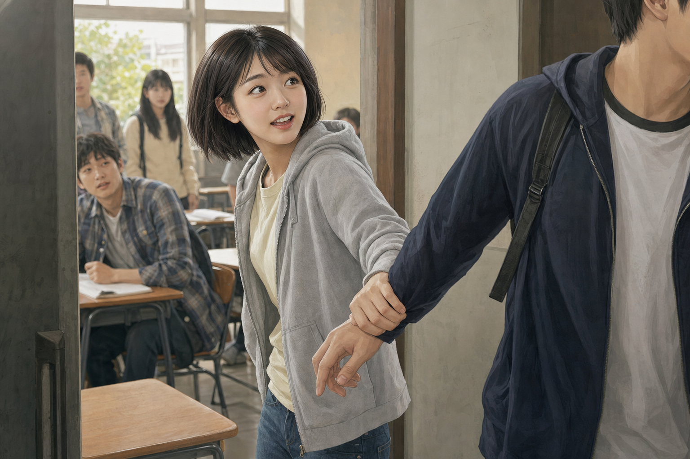

# ep.022 안 태워주는 남자

[정다은] 용식아. 오늘 나 집 방향까지만 태워주면 안 돼?

강의가 끝나자마자였다.

정다은은 가방끈을 한쪽 어깨에 걸치고 김용식 앞을 막았다. 표정은 밝았다. 말투도 가벼웠다. 문제는 뒤에 남자 동기들이 남아 있다는 점이었다. 누군가는 벌써 웃을 준비를 하고 있었다.

[남자동기1] "오. 드라이브?"

[남자동기2] "오늘 영업합니까?"

[정다은] "야, 조용히 해. 나 진짜 방향 같아서 그래."

[김용식] "어디 방향인데."

[정다은] "수원 쪽."

[김용식] "너 수원 살아?"

[정다은] "아니."

[김용식] "그럼 방향이 아니잖아."

[정다은] "넓게 보면 다 이어져 있지. 평택도 수원도 대한민국이고."

논리가 크다.

너무 커서 쓸모가 없다.

정다은은 웃으며 김용식 손목을 잡았다.

[정다은] "가자. 잠깐이면 돼. 진짜 멀리 가자는 것도 아니고."

손목.

익숙한 압력.

예전 같으면 웃으며 넘겼을 것이다. 그게 편했으니까. 누군가 무안해지지 않고, 주변도 웃고, 자신도 적당히 좋은 사람으로 남는다. 하지만 김초연의 목소리가 떠올랐다.

정다은이 손목 잡으면 빼.

명령 같아서 싫었다.

그런데 더 싫은 건, 그 말을 듣기 전까지 스스로 선을 긋지 못했다는 사실이었다.

김용식은 손목을 천천히 뺐다. 세게는 아니었다. 무안하지 않게. 하지만 확실하게.

[김용식] "오늘은 안 돼."

강의실 공기가 살짝 멈췄다.

정다은은 빈손을 내려다봤다.

아주 짧은 순간이었다. 눈웃음이 사라졌다. 그리고 바로 돌아왔다.

[정다은] "왜. 여자친구한테 잡혀 살아?"

남자 동기들이 웃었다.

[남자동기1] "벌써?"

[남자동기2] "사귄대?"

김용식은 가방끈을 고쳐 멨다. 목 뒤가 조금 뜨거웠다. 여기서 웃고 넘기면 다시 원래 자리로 돌아간다.

[김용식] "잡혀 사는 건 아니고."

[정다은] "그럼?"

[김용식] "내가 싫어서."

웃음이 한 번 더 끊겼다.

정다은은 눈을 깜빡였다.

[정다은] "나 태워주는 게 싫어?"

[김용식] "너를 태워주는 게 싫다기보다, 애매하게 태워주는 게 싫어. 내가 설명하기 어려운 일은 안 하려고."

말하고 나서 김용식은 본인이 더 놀랐다.

제법 사람 같은 말을 했다.

정다은은 입술을 살짝 내밀었다.

[정다은] "재미없어졌네."

[김용식] "원래 그렇게 재밌는 사람은 아니었어."

[정다은] "거짓말. 너 재밌어서 말 거는 건데. 반응이 은근히 늦고, 그래서 더 건드리고 싶단 말이야."

그녀는 웃으며 물러났다. 그리고 남자 동기 하나의 어깨에 팔을 걸었다.

[정다은] "야, 그럼 네가 매점까지 태워줘."

[남자동기1] "나는 다리 두 개밖에 없어."

[정다은] "충분해. 걸어."

정다은은 그 동기를 끌고 나갔다. 밝게. 아무렇지 않게.

그래서 더 애매했다.

정말 아무렇지 않은 건지, 아무렇지 않은 척하는 건지.

점심시간.

소문은 이미 학생식당에 도착해 있었다.

[남자동기2] "야, 김용식 여자친구 무섭다며?"

[김용식] "누가 그래."

[남자동기2] "정다은."

정다은은 식판을 들고 뒤에서 나타났다.

[정다은] "내가 언제 무섭대. 잡혀 산다고 했지."

[김용식] "그게 더 나빠."

[정다은] "아냐. 귀엽잖아. 자기 나름대로 선 지키려고 굳어 있는 거."

귀엽다.

그 단어가 남자 동기들에게 잘못 들어갔다.

[남자동기1] "오. 귀엽대."

[남자동기3] "BMW 타는 귀염둥이."

[김용식] "밥 먹다가 체하겠다."

정다은은 웃으며 김용식 맞은편에 앉으려 했다. 김용식은 옆 의자를 가리켰다.

[김용식] "우리 조 다 같이 앉아."

[정다은] "왜 또 거리 둬?"

[김용식] "조별 과제 하자며. 조별로 앉으면 되잖아."

[정다은] "치. 요즘 대답이 너무 정리돼서 재미없어."

정다은은 그래도 옆으로 갔다. 남자 동기들이 작은 소리로 웃었다.

김용식은 식판 위의 국을 한 숟가락 떠서 입에 넣었다. 뜨거웠다. 뜨거운 걸 삼키는 동안 폴더폰이 울렸다.

[대답받음] 밥 먹어?

김용식은 답장을 보냈다.

[김용식] 응. 과 애들이랑. 정다은도 있어. 따로 앉았어.

이번엔 과했다.

보내고 나서 후회했다.

삼 초 뒤 답장이 왔다.

[대답받음] 자리 배치까지 보고하라는 말은 안 했는데.

김용식은 숟가락을 들었다가 내려놓았다.

이건 진짜 어렵다.

[김용식] 그럼 어디까지 말하면 돼?

[대답받음] 네가 숨기고 싶은 거.

짧은 문장.

김용식은 그걸 오래 봤다.

숨기고 싶은 거.

그 기준은 정확했다. 돈도 그렇고, 차도 그렇고, 여자도 그렇다. 숨기고 싶은 것들은 대체로 숨기면 더 커졌다.

김용식은 고개를 들었다.

정다은은 남자 동기들과 웃고 있었다. 아무렇지 않게 어깨를 치고, 젓가락 포장지를 빼앗고, 누군가의 음료를 한 모금 달라고 했다.

원래 저렇다.

맞다.

그런데 원래 저런 사람이라고 해서, 내가 다 받아줘도 되는 건 아니다.

오후 강의가 끝날 때쯤 단톡이 울렸다.

[정다은] 오늘 용식이 착한 남자 모드라 차 못 탄대요.

[남자동기1] 착한 남자 모드래.

[남자동기2] 여자친구 생기면 다 저렇게 됨?

김용식은 답장을 치지 않았다.

대신 김초연에게 전화했다.

[김초연] "왜."

[김용식] "나 오늘 안 태워줬어."

잠깐 침묵.

[김초연] "누굴."

[김용식] "정다은. 손목 잡았는데 뺐고, 차도 안 태워줬어."

[김초연] "잘했네."

같은 말.

하지만 어제와 달랐다. 이번엔 진짜 칭찬처럼 들렸다.

김용식은 살짝 웃었다.

[김용식] "점수 올랐어?"

[김초연] "조금."

[김용식] "얼마나."

[김초연] "삼 점."

[김용식] "백 점 만점?"

[김초연] "천 점 만점."

잔인하다.

전화 너머에서 김초연이 아주 작게 웃는 소리가 났다. 그 소리 때문에 김용식도 웃었다.

[김초연] "근데 나 내일 과 술자리 있어."

김용식의 웃음이 멈췄다.

[김초연] "남자 선배들도 온대."

이번엔 시험지가 저쪽에서 날아왔다.
