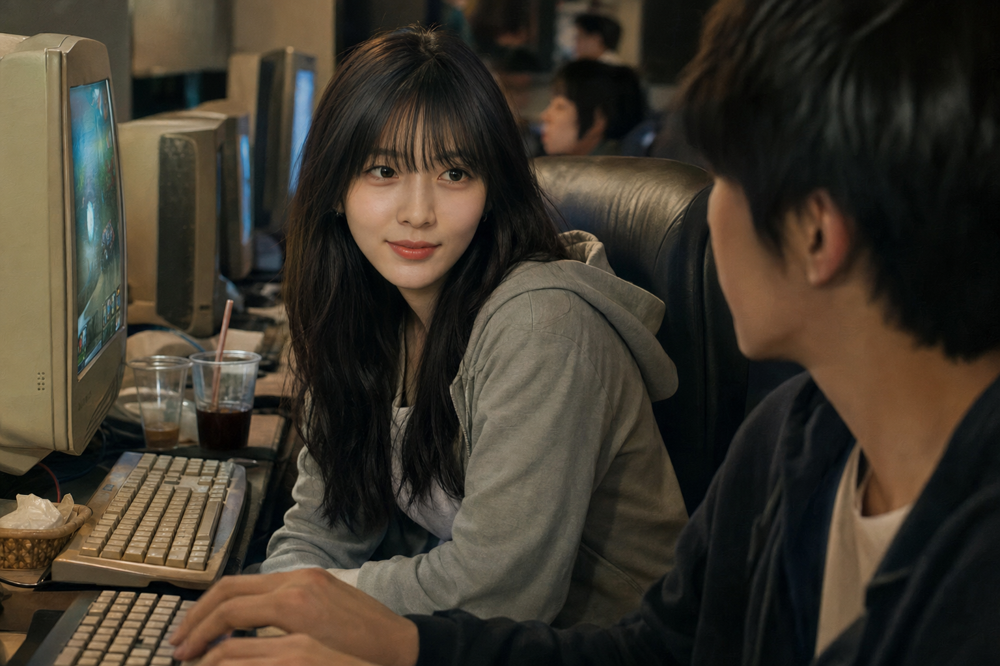

# ep.023 여자친구 아닌데

[김용식] "남자 선배들도 온다고?"

[김초연] "응."

[김용식] "몇 명."

[김초연] "몰라."

[김용식] "어디서."

[김초연] "왜."

전화 너머의 김초연 목소리가 바로 낮아졌다.

[김초연] "나 아직 네 여자친구 아닌데?"

맞다.

정확히 맞다.

하지만 그 말은 치사하다.
어제까지 채점하던 사람이 갑자기 시험 감독 권한을 내려놓았다.

[김용식] "걱정돼서."

[김초연] "뭐가?"

[김용식] "술자리니까."

[김초연] "나 술 못 마시는 애 아니야."

[김용식] "너 아직 스무 살이야."

말하고 바로 후회했다.

너도 스무 살이다.

이 말이 전화기 안에서 튀어나올 줄 알았다.

하지만 김초연은 다른 말을 했다.

[김초연] "너 가끔 진짜 이상하게 어른처럼 말해."

김용식은 입을 다물었다.

이건 가끔이 아니다.
자주다.

[김용식] "미안."

[김초연] "뭐가 미안한데."

[김용식] "걱정한 척하면서 통제하려고 한 거."

전화 너머가 조용해졌다.

이번엔 김초연도 바로 받아치지 않았다.

[김초연] "너 오늘 이상하네."

[김용식] "좋은 쪽?"

[김초연] "아직 몰라."

아직.

그 말이 희망처럼 들리는 날이 오다니.

다음 날 오후.

PC방은 평소처럼 시끄러웠다.

김초연은 먼저 와 있었다.
두 자리 중 안쪽 자리에 앉아 카트라이더를 켜 놓고 있었다.

[김초연] "늦었어."

[김용식] "오 분."

[김초연] "오 분은 괜찮아."

[김용식] "그 말 이제 무서워."

[김초연] "잘 배웠네."

그녀는 마우스를 까딱였다.

[김초연] "한 판 해."

게임이 시작됐다.

김초연은 오늘 유난히 공격적이었다.
부스터를 모으자마자 들이받고, 코너마다 김용식 차체를 밀었다.

[김용식] "게임에서까지 심문하면 반칙 아니냐?"

[김초연] "운전 연습이야."

[김용식] "내 차로 하지 마."

[김초연] "네 차는 너무 비싸."

김용식은 순간 손가락이 꼬였다.
카트가 벽에 박았다.

[김초연] "어. 박았다."

[김용식] "현실 반영 하지 마."

초연이 웃었다.

웃음이 나왔다.

그걸 보는 게 좋았다.
어제보다 훨씬.

게임이 끝나고, 김초연은 의자를 살짝 돌렸다.

[김초연] "왜 안 태워줬어?"

[김용식] "정다은?"

[김초연] "응."

[김용식] "네가 싫어할 것 같아서."

김초연은 바로 대답하지 않았다.

키보드 위에 손가락만 올려뒀다.

[김초연] "그럼 내가 시켜야만 해?"

김용식은 그 말을 예상하지 못했다.

[김초연] "내가 손목 잡으면 빼라고 해야 빼고, 말하라고 해야 말하고, 숨기지 말라고 해야 안 숨겨?"

[김용식] "아니."

[김초연] "그럼?"

김용식은 모니터를 봤다.

리플레이 화면에서 카트가 벽에 또 박고 있었다.

참 일관적이다.

[김용식] "내가 생각해도 애매해서."

김초연의 손가락이 멈췄다.

[김용식] "네가 싫어할 것 같아서도 맞는데, 내가 계속 그러면 나도 별로인 사람이 되는 것 같았어."

김초연은 김용식을 봤다.

눈빛이 조금 풀렸다.

[김초연] "별로인 사람 맞았잖아."

[김용식] "과거형으로 해줘서 고맙다."

[김초연] "현재진행형일 수도 있어."

[김용식] "채점이 너무 엄격해."

[김초연] "천 점 만점이라니까."

둘 다 웃었다.

짧게.

하지만 진짜였다.

저녁이 가까워지자 김초연은 가방을 챙겼다.

[김용식] "술자리 오늘이야?"

[김초연] "응."

[김용식] "어디서 해?"

김초연은 눈썹을 올렸다.

[김용식] "물어봐도 돼?"

[김초연] "그렇게 물으면 괜찮고."

어렵다.

하지만 조금 알 것 같았다.

정답은 질문을 못 하게 하는 게 아니다.
상대의 결정을 잡아당기지 않는 말투다.

[김초연] "학교 앞 호프집. 과 애들이랑 선배들."

[김용식] "몇 시까지?"

[김초연] "몰라. 분위기 봐서."

[김용식] "늦으면 전화해."

[김초연] "데리러 오게?"

[김용식] "네가 원하면."

김초연은 가방끈을 만졌다.

[김초연] "안 원하면?"

[김용식] "안 가."

[김초연] "진짜?"

[김용식] "응."

[김초연] "거짓말."

[김용식] "조금."

김초연이 웃었다.

[김초연] "솔직해서 봐준다."

그녀는 PC방 문을 열고 나갔다.

김용식은 따라 나가지 않았다.

카운터 앞에서 음료수를 하나 더 샀다.

뚜껑을 열자 단톡이 울렸다.

[정다은] 용식아. 우리 조 자료 찾으러 내일 도서관 갈 건데 너 올 거지?

바로 이어서 김초연의 문자가 왔다.

[대답받음] 나 술자리 도착.

김용식은 두 화면을 번갈아 봤다.

삶이 갑자기 멀티태스킹 게임이 됐다.

문제는 내가 컨트롤이 그렇게 좋은 편이 아니라는 점이다.
