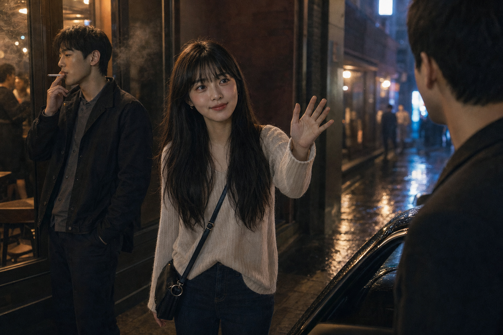

# ep.024 데리러 올래?

김용식은 도서관에 있었다.

금요일 저녁.
남들은 술집에 있을 시간.
그는 조별 과제 자료 더미 앞에 앉아 있었다.

이게 성장인가.

아니면 처벌인가.

정다은은 맞은편에서 책을 넘기고 있었다.
정확히는 넘기는 척하고 있었다.

[정다은] "용식아."

[김용식] "왜."

[정다은] "너 오늘 좀 재미없다."

[김용식] "과제하러 왔잖아."

[정다은] "과제하면서도 재밌을 수 있지."

[김용식] "그럼 네가 발표해."

[정다은] "그건 재미없어."

남자 동기 둘이 옆에서 웃었다.

도서관이라 웃음이 작았다.
그 작은 웃음이 더 간지럽다.

정다은은 책상 아래에서 발끝으로 김용식 운동화를 톡 쳤다.

김용식은 발을 뺐다.

정다은이 눈을 동그랗게 떴다.

[정다은] "이것도 안 돼?"

[김용식] "발은 과제랑 관련 없어."

[정다은] "그럼 손은?"

[김용식] "손은 필기할 때만."

[정다은] "와. 규칙 생겼네."

[김용식] "응. 내가 만들었어."

정다은은 펜 끝을 입술 근처에 댔다.

[정다은] "여자친구가 만든 게 아니고?"

[김용식] "아니."

이번엔 바로 말했다.

[김용식] "내가."

정다은은 잠깐 조용해졌다.

그 얼굴은 화난 얼굴은 아니었다.
조금 낯선 걸 본 얼굴이었다.

[정다은] "그래?"

[김용식] "응."

[정다은] "그럼 인정."

그녀는 손을 들어 가볍게 항복 표시를 했다.

그리고 바로 남자 동기 쪽으로 몸을 돌렸다.

[정다은] "야. 너 자료 찾았어?"

[남자동기1] "나?"

[정다은] "그럼 귀신한테 물었겠냐."

도서관 공기가 다시 가벼워졌다.

김용식은 폴더폰을 봤다.

[대답받음] 술자리 시작.

아직 괜찮다.

한 시간 뒤.

[대답받음] 선배가 게임 졌다고 술 마시래.

김용식은 답장을 썼다.

[김용식] 싫으면 안 마셔도 돼.

보내고 나서 한숨을 쉬었다.

더 말하고 싶었다.
누가 그러냐고.
어느 선배냐고.
주소 찍으라고.

하지만 참았다.

손가락은 성숙하지 못했다.
문자를 하나 더 치려 했다.

그때 정다은이 옆에서 고개를 내밀었다.

[정다은] "여자친구?"

[김용식] "아직."

[정다은] "아직인데 그렇게 봐?"

[김용식] "어떻게 봤는데."

[정다은] "문자에 들어갈 기세."

정확했다.

[김용식] "술자리라서."

[정다은] "가고 싶지?"

[김용식] "응."

[정다은] "근데 안 가?"

[김용식] "오라면 가고."

[정다은] "와."

정다은은 턱을 괴었다.

[정다은] "진짜 재미없어졌는데 조금 멋있네."

[김용식] "둘 중 하나만 해."

[정다은] "싫어. 둘 다 할 거야."

자료 정리는 열 시가 넘어서 끝났다.

동기들은 하나씩 흩어졌다.
정다은은 도서관 계단 앞에서 기지개를 켰다.

[정다은] "나 버스 끊기기 전에 가야겠다."

[김용식] "조심히 가."

[정다은] "진짜 안 태워주네."

[김용식] "응."

[정다은] "너 독하다."

[김용식] "요즘 수련 중이야."

정다은은 웃었다.

그리고 이번엔 김용식 어깨를 치지 않았다.

손만 흔들었다.

[정다은] "잘 가, 수련생."

그녀가 멀어졌다.

김용식은 주차장으로 걸어갔다.

차 문을 열려는 순간 폴더폰이 울렸다.

[대답받음] 안 바쁘면 데리러 올래?

문장을 보자마자 심장이 먼저 뛰었다.

이건 명령이 아니다.

부탁이다.

김용식은 바로 답했다.

[김용식] 갈게. 위치 보내.

위치는 곧 왔다.

평택대 근처 호프집.

차로 십 분.

그 십 분이 이상하게 길었다.

호프집 앞은 금요일 밤답게 시끄러웠다.
담배 냄새.
튀김 냄새.
젖은 아스팔트 냄새.

김초연은 가게 앞에 서 있었다.

혼자가 아니었다.

키 큰 남자 선배가 옆에 있었다.
검은 재킷.
웃는 얼굴.
손에는 담배.

초연은 김용식을 보자 손을 들었다.

조금 취한 얼굴이었다.

[김초연] "왔네."

김용식은 차에서 내렸다.

남자 선배가 먼저 웃었다.

[남자선배] "아, 남자친구?"

김초연은 대답하지 않았다.

대신 김용식을 봤다.

시험지다.

또.

김용식은 남자 선배에게 고개를 숙였다.

[김용식] "안녕하세요. 데리러 왔습니다."

[남자선배] "아직 술자리 안 끝났는데."

[김용식] "초연이가 불렀습니다."

남자 선배의 웃음이 살짝 옅어졌다.

김초연은 그 장면을 가만히 봤다.

[남자선배] "초연아, 갈 거야?"

김초연은 잠깐 침묵했다.

그리고 김용식 쪽으로 걸어왔다.

[김초연] "응. 갈래."

그녀의 발걸음이 조금 흔들렸다.

김용식은 손을 뻗으려다 멈췄다.

[김용식] "잡아도 돼?"

김초연이 눈을 깜빡였다.

그리고 작게 웃었다.

[김초연] "응."

김용식은 그녀의 팔을 가볍게 받쳤다.

이번엔 괜찮았다.

물어봤으니까.

그 차이가 이렇게 클 줄 몰랐다.
