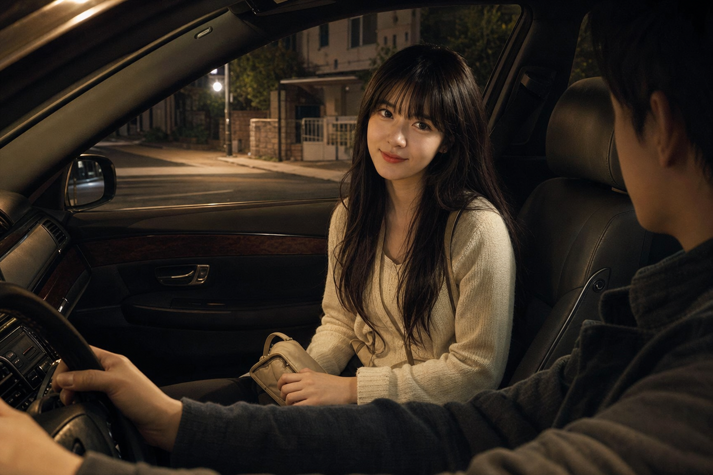

# ep.025 이번엔 내가 대답할게

차 안에 술 냄새가 조금 들어왔다.

김초연은 조수석에 앉아 안전벨트를 한참 만지작거렸다.

[김용식] "해줄까?"

[김초연] "나 애 아니야."

딸깍.

안전벨트가 잠겼다.

그녀는 의기양양한 얼굴로 김용식을 봤다.

[김초연] "봤지?"

[김용식] "대단하다."

[김초연] "비꼬지 마."

[김용식] "진심이야."

[김초연] "그게 더 짜증 나."

김용식은 시동을 걸었다.

호프집 앞에서 남자 선배가 아직 서 있었다.
담배 불빛이 작게 흔들렸다.

김초연은 창밖을 보다가 물었다.

[김초연] "싫었어?"

질문은 예상했다.

그래도 어렵다.

[김용식] "응."

김초연이 고개를 돌렸다.

[김초연] "뭐가."

[김용식] "남자 선배랑 같이 서 있는 거."

[김초연] "화났어?"

[김용식] "조금."

[김초연] "왜 안 따졌어?"

신호가 빨간불로 바뀌었다.

차가 멈췄다.

김용식은 핸들 위에 손을 올려둔 채 말했다.

[김용식] "네가 싫은 일을 내가 했으니까."

김초연은 대답하지 않았다.

[김용식] "정다은이랑 한서윤 때 네가 이런 기분이었겠구나 싶었어."

[김초연] "그래서 참았어?"

[김용식] "응."

[김초연] "나 시험한 거 알아?"

[김용식] "알아."

[김초연] "기분 나쁘지 않았어?"

[김용식] "나빴어."

김초연의 눈이 조금 커졌다.

김용식은 작게 웃었다.

[김용식] "근데 네가 왜 그랬는지도 알겠더라."

초연은 손가락으로 가방끈을 만졌다.

술기운 때문인지 볼이 조금 붉었다.
눈은 이상하게 맑았다.

[김초연] "나 유치하지."

[김용식] "응."

[김초연] "야."

[김용식] "근데 나도 유치했어."

김초연은 입을 다물었다.

빨간불이 초록불로 바뀌었다.

차가 천천히 움직였다.

[김용식] "나도 네가 다른 남자랑 있으면 싫어. 근데 그걸 이유로 네가 어디 못 가게 하거나, 누구 못 만나게 하는 건 싫어."

[김초연] "그럼 어떻게 할 건데."

[김용식] "싫으면 싫다고 말하고, 부탁할 건 부탁하고, 네가 선택하면 믿어볼게."

[김초연] "믿어볼게?"

[김용식] "완전히 믿는 척은 거짓말이니까."

김초연이 피식 웃었다.

[김초연] "너 진짜 말 못하는데 가끔 이상하게 솔직해."

[김용식] "그거 칭찬이야?"

[김초연] "아직 몰라."

아직이 또 나왔다.

하지만 이번엔 무섭지 않았다.

수원으로 가는 길은 조용했다.
김초연은 창문에 이마를 기대지 않았다.

대신 김용식 쪽으로 몸을 조금 돌린 채 앉아 있었다.

[김초연] "나 아까 일부러 남자 선배 옆에 서 있었어."

[김용식] "알아."

[김초연] "그 사람이 나한테 관심 있는 것도 알아."

핸들이 아주 조금 무거워졌다.

[김초연] "근데 나 걔한테 관심 없어."

김용식은 천천히 숨을 내쉬었다.

[김초연] "이 말 들으니까 좋아?"

[김용식] "응."

[김초연] "단순해."

[김용식] "지금은 단순한 게 좋아."

초연은 웃었다.

이번엔 눈까지 접혔다.

수원 골목에 차를 세웠다.

김초연은 바로 내리지 않았다.
안전벨트를 풀고, 가방을 무릎 위에 올렸다.

[김초연] "너 나랑 사귀자고 했지."

[김용식] "응."

[김초연] "그때 내가 늦었다고 했고."

[김용식] "응."

[김초연] "근데 오늘은..."

그녀는 잠깐 말을 멈췄다.

술기운인지.
부끄러운 건지.

아마 둘 다였다.

[김초연] "이번엔 내가 대답할게."

김용식은 그녀를 봤다.

김초연은 고개를 똑바로 들었다.

[김초연] "나랑 사귀자."

차 안이 조용해졌다.

밖에서는 오토바이 한 대가 지나갔다.
골목 끝 편의점 문이 열렸다 닫혔다.

별거 아닌 소리들이 너무 선명했다.

[김용식] "응."

김초연의 눈썹이 올라갔다.

[김초연] "응?"

[김용식] "좋아."

[김초연] "더 해."

[김용식] "나도 너랑 사귈래."

[김초연] "그 정도면 됐어."

그녀는 만족한 듯 고개를 끄덕였다.

귀엽다.

말하면 혼날 것 같아서 속으로만 했다.

김초연은 문을 열려다 멈췄다.

[김초연] "이제 나 여자친구야."

[김용식] "응."

[김초연] "그럼 연락처 이름 바꿔."

[김용식] "뭐로."

[김초연] "그걸 또 나한테 물어?"

김용식은 폴더폰을 꺼냈다.

`대답받음`

이름을 지웠다.

한참 고민했다.

그리고 입력했다.

`초연이`

김초연은 화면을 보고 입술을 삐죽였다.

[김초연] "평범해."

[김용식] "평범하게 하고 싶어서."

그녀는 잠깐 조용해졌다.

[김초연] "그럼 봐준다."

문이 열렸다.

초연은 내리기 전에 몸을 돌렸다.

[김초연] "내일부터 잘해."

[김용식] "오늘부터 아니고?"

[김초연] "오늘은 합격 처리."

문이 닫혔다.

김용식은 폴더폰 화면을 봤다.

초연이.

네 글자.

이상하게 무거웠다.

그때 단톡이 울렸다.

[정다은] 용식아, 조별 과제 장소 너희 차에서 정해도 돼?

김용식은 화면을 보고 웃었다.

연애가 시작됐다.

그리고 시작하자마자, 첫 과제가 제출됐다.
