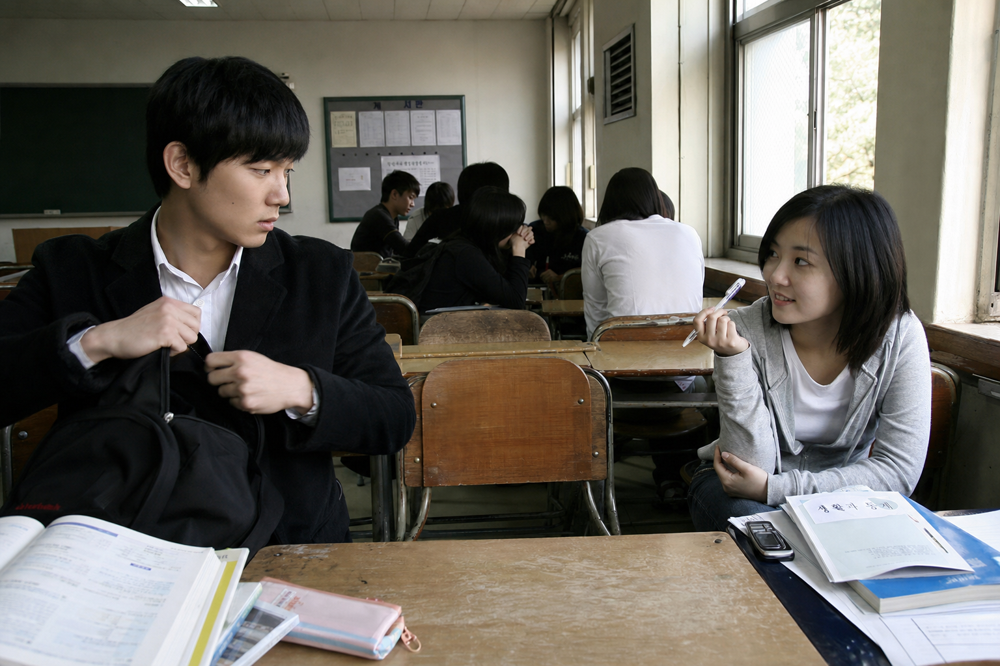

# ep.026 차 안에서 정하지 말자

월요일 아침.

평택대학교 정문 앞 도로는 주말 동안 쌓인 먼지가 봄바람에 얇게 일어났다. 김용식은 차창을 반쯤 내린 채 주차장으로 들어갔다. 바람에는 아직 찬 기운이 남아 있었고, 히터를 끄자마자 손등이 서늘해졌다.

폴더폰은 조수석 위에 놓여 있었다.

닫아도 자꾸 생각났다.

[정다은] 용식아, 조별 과제 장소 너희 차에서 정해도 돼?

토요일 밤에 온 문자였다.

그 뒤로 답장을 하지 않은 채 일요일을 넘겼다. 초연에게 보여 줘야겠다는 생각은 했지만, 막상 휴대폰을 꺼내려 하면 손이 멈췄다. 보여 주면 잘한 일이 될 수도 있었고, 괜히 새로운 화제가 될 수도 있었다. 어느 쪽이든 피곤했다.

피곤하다는 생각을 하는 순간, 용식은 자신이 이미 한 번 숨기고 있다는 걸 알았다.

차 문을 닫았다.

BMW의 문 닫히는 소리가 주차장 벽에 낮게 울렸다.

강의실에는 아직 절반 정도만 자리가 차 있었다. 창가 쪽에는 같은 과 남자애들이 모여 앉아 있었고, 가운데 줄에는 정다은이 가방을 의자에 걸어 둔 채 볼펜 끝으로 책상을 톡톡 두드리고 있었다.

[정다은] "야, 김용식."

용식은 가방을 내려놓았다.

[김용식] "응."

[정다은] "너 토요일에 문자 봤어?"

강의실 소음이 아주 조금 낮아지는 느낌이 들었다. 누가 대놓고 듣는 건 아니었지만, 차 이야기만 나오면 주변 귀가 느슨하게 열렸다.

[김용식] "봤어. 답장을 못 했어."

[정다은] "못 한 거야, 안 한 거야?"

정다은은 웃으며 물었다. 말투는 가벼웠는데 눈은 바로 빠지지 않았다.

[김용식] "못 한 쪽에 가까워. 그거 차에서 정하는 건 좀 아닌 것 같아서."

[정다은] "왜? 그냥 장소만 정하는 건데. 애들 다 모이면 자리도 없고, 차 있으면 편하잖아."

그 말은 틀리지 않았다.

학교 근처 카페는 신학기라 항상 붐볐고, 도서관 세미나실은 예약이 귀찮았다. 차 안은 조용했고, 문을 닫으면 밖의 소리도 줄었다. 그래서 더 안 됐다.

[김용식] "편하긴 한데, 우리 조에 네 명이잖아. 차 안에서 다 같이 자료 펴기도 애매하고, 나도 좀 불편해."

[정다은] "너 말 되게 조심한다."

[김용식] "조심해야 할 때가 있지."

정다은이 고개를 기울였다. 짧은 단발 끝이 턱선 근처에서 살짝 흔들렸다.

[정다은] "여자친구 때문에?"

용식은 바로 대답하지 못했다.

그 짧은 침묵이 더 티 났다.

[정다은] "아, 맞네. 진짜 생겼구나?"

[김용식] "응. 생겼어."

[정다은] "김초연?"

용식은 가방 지퍼를 닫다가 멈췄다.

정다은은 별일 아닌 얼굴로 웃고 있었다.

[정다은] "왜 그렇게 봐. 소문 다 났는데. 너 맨날 패디과 애랑 붙어 다니잖아. 주말에도 데리러 갔다며."

교수님이 들어오기 전 강의실은 지저분했다. 의자 끄는 소리, 누가 과자를 뜯는 소리, 뒤쪽 남학생들이 축구 얘기로 웃는 소리가 한꺼번에 섞였다. 그 속에서 초연의 이름만 이상하게 또렷했다.

[김용식] "맞아."

[정다은] "그럼 더 웃긴데. 여자친구 있으면 조별 과제 차에서 하면 안 되는 거야?"

[김용식] "안 된다기보다, 내가 괜히 애매하게 만들고 싶지 않은 거야."

[정다은] "애매하게?"

[김용식] "너랑 나만 타는 것도 아니고, 아무 일 없는 것도 맞는데, 말이 이상하게 돌면 설명하기 귀찮아져. 그리고 내가 이미 그런 걸로 한 번 걸렸어."

정다은은 입술을 살짝 벌렸다가 닫았다.

말이 너무 길었다.

용식은 뒤늦게 그걸 느끼고 웃으려 했지만, 웃음이 어색하게 걸렸다.

[정다은] "너 되게 솔직하다. 아니, 솔직한 척하는 건가?"

[김용식] "나도 잘 모르겠어."

정다은이 볼펜을 내려놓았다.

[정다은] "알았어. 그럼 도서관으로 하자. 근데 너 조장처럼 굴 거면 세미나실 예약은 네가 해."

[김용식] "그건 할게."

[정다은] "그리고 나 이상한 애처럼 만들지 마. 나 진짜 그냥 편해서 물어본 거야."

용식은 정다은을 봤다.

정다은은 웃고 있었지만, 볼펜 뚜껑을 괜히 눌렀다 뺐다 했다. 딸깍거리는 소리가 강의 시작 전의 소란 속에서 짧게 끊겼다.

[김용식] "알아. 그래서 더 말 조심하는 거야."

[정다은] "됐어. 나도 여자친구 있는 남자한테 들이대는 애 되고 싶지는 않거든."

그 말끝이 조금 빨랐다.

교수님이 문을 열고 들어왔다.

대화는 거기서 끊겼다.

점심시간이 되자 폴더폰이 울렸다.

[김초연] 밥 먹었어?

용식은 학생식당 줄 끝에 서서 휴대폰을 내려다봤다. 식판 부딪히는 소리와 국 냄새가 줄 사이로 퍼졌다. 정다은은 앞쪽에서 같은 조 남자애들과 자리를 잡고 있었다.

[김용식] 아직. 너는?

[김초연] 우리 과 애들이랑 먹는 중.  
[김초연] 근데 너 오늘 정다은이랑 얘기했어?

목덜미가 조금 굳었다.

용식은 줄에서 한 걸음 앞으로 움직였다.

[김용식] 응. 조별 과제 장소 얘기.

답장을 보내고 나서야 토요일 문자를 아직 보여 주지 않았다는 게 다시 떠올랐다. 숨긴 건 아니라고 말할 수 있었다. 그러나 숨기지 않은 것도 아니었다.

[김초연] 차에서 하자는 거?

용식은 화면을 봤다.

김초연은 먼저 들어 버린 뒤였다.

식당 천장 형광등이 폴더폰 액정에 하얗게 비쳤다. 뒤에서 누가 "앞에 가요"라고 말했고, 용식은 뒤늦게 식판을 집었다.

[김용식] 응. 내가 도서관으로 하자고 했어.

답장을 보내고 몇 초 뒤 전화가 왔다.

김초연이었다.

용식은 식판을 든 채 줄에서 빠져나와 자동문 옆으로 갔다. 문이 열릴 때마다 찬바람과 튀김 냄새가 번갈아 들어왔다.

[김용식] "어."

[김초연] "너 토요일에 그 문자 받았지."

[김용식] "응."

[김초연] "왜 나한테 바로 안 보여줬어?"

목소리는 크지 않았다.

그래서 더 어려웠다.

[김용식] "보여주려고 했는데, 그날 바로 네가 사귀자고 했고, 분위기 깨기 싫어서 미뤘어. 일요일엔 내가 괜히 꺼내면 더 이상할 것 같아서 또 미뤘고."

[김초연] "그러니까 안 보여준 거네."

[김용식] "응. 맞아."

김초연은 잠깐 말이 없었다.

전화기 너머로 여자애들 웃음소리가 들렸다. 식판이 테이블에 놓이는 소리도 섞였다. 그녀가 지금 사람들 사이에서 혼자 목소리를 낮추고 있다는 게 느껴졌다.

[김초연] "나 그거 다른 애한테 들었어."

[김용식] "누구한테?"

[김초연] "우리 과 애가 정보통신학과 남자애랑 아는 사이래. 너희 조 여자애가 네 차에서 과제하려고 했다더라, 이런 식으로 말하던데."

용식은 눈을 감았다.

소문은 늘 실제보다 빨랐다.

[김초연] "너 거절한 거 알아. 방금 너도 말했고. 근데 내가 기분 나쁜 건 그게 아니야."

[김용식] "안 보여준 거."

[김초연] "응. 내가 먼저 알면, 너는 계속 뒤에서 설명하는 사람이 돼."

자동문이 다시 열렸다.

찬바람이 셔츠 안쪽으로 들어왔다.

[김용식] "미안. 이건 내가 잘못했어."

[김초연] "그 말 듣고 싶어서 전화한 거 아니야."

[김용식] "알아. 그래도 미안하다고는 해야 돼."

김초연은 작게 숨을 내쉬었다.

[김초연] "오늘 끝나고 수원 데려다줄 거야?"

[김용식] "응. 네가 괜찮으면."

[김초연] "그럼 차에서 얘기해. 밥 먹어."

전화가 끊겼다.

용식은 폴더폰을 닫지 못하고 한참 들고 있었다. 식당 안에서는 정다은이 멀리서 손을 흔들었다. 옆자리 하나를 비워 둔 듯했다.

그는 식판을 들고 다른 줄로 갔다.

오후 수업이 끝난 뒤, 김초연은 정문 바깥 편의점 앞에 서 있었다.

하얀 후드 위에 얇은 카디건을 걸치고 있었다. 긴 머리는 낮게 묶었고, 입술은 평소보다 덜 발라진 것 같았다. 그녀는 용식의 차를 보자마자 문을 열고 타지 않았다. 대신 조수석 문 앞에 서서 그를 올려다봤다.

[김초연] "오늘부터 나 여자친구 맞지."

[김용식] "응."

[김초연] "그럼 내가 듣는 순서 좀 바꿔줘. 남들한테 듣고, 너한테 해명 듣는 거 싫어."

용식은 차 키를 손안에서 굴렸다.

금속 모서리가 손바닥을 눌렀다.

[김용식] "알겠어."

[김초연] "알겠어 말고. 너 또 미루면 나 진짜 기분 나빠."

[김용식] "미루지 않을게. 근데 나도 가끔 겁나. 말하면 네가 화낼까 봐."

[김초연] "화낼 수도 있지."

초연은 문 손잡이에 손을 얹었다.

[김초연] "근데 숨기면 더 화내."

그녀는 조수석에 앉았다.

문이 닫혔다.

차 안에는 초연의 옷에서 묻어온 섬유유연제 냄새와 편의점 앞 튀김 냄새가 희미하게 섞였다. 용식은 시동을 걸고도 바로 출발하지 않았다.

[김용식] "오늘 도서관 세미나실 예약했어. 목요일 저녁."

[김초연] "정다은도 와?"

[김용식] "응. 조원이니까."

[김초연] "그럼 끝나고 바로 연락해."

[김용식] "전화할게."

[김초연] "문자 말고?"

[김용식] "응. 전화."

초연은 그제야 안전벨트를 맸다.

수원으로 가는 길에 둘은 평소보다 말을 덜 했다. 그렇다고 완전히 차갑지도 않았다. 신호에 걸릴 때마다 초연은 폴더폰을 열었다 닫았고, 용식은 그 작은 소리를 들으며 운전했다.

집 근처 골목에 도착했을 때, 초연은 내리기 전에 몸을 돌렸다.

[김초연] "나 너 믿고 싶은데, 아직 되게 성가셔."

[김용식] "내가?"

[김초연] "응. 너."

용식은 웃지 않았다.

[김용식] "그럼 덜 성가시게 해볼게."

[김초연] "그것도 말만 하지 말고."

초연은 잠깐 망설이다가 손을 내밀었다.

용식은 그 손을 잡았다.

처음에는 손가락만 닿았다. 그녀가 빼지 않자 손바닥이 조금 더 붙었다. 차 안의 히터 바람은 꺼져 있었는데, 손 안쪽만 이상하게 따뜻했다.

초연은 시선을 피한 채 말했다.

[김초연] "오늘은 여기까지."

손이 빠져나갔다.

문이 열렸다.

용식의 손바닥에는 그녀의 온기만 남았다.

그리고 조수석 바닥에는, 정다은과 과제할 세미나실 예약 확인증이 떨어져 있었다.
