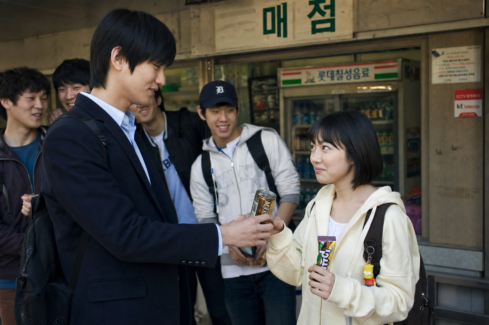

# ep.028 돈은 말보다 빨리 돈다

수요일 점심.

학생식당 창가 자리는 햇빛이 너무 밝았다. 김용식은 식판을 들고 그 앞을 지나가다 멈췄다. 창밖 주차장 한쪽에 BMW가 보였다. 은색 차체 위로 봄 햇살이 미끄러졌고, 지나가던 남학생 두 명이 차 쪽을 보며 뭔가를 말했다.

그중 한 명이 손가락으로 번호판 쪽을 가리켰다.

용식은 모르는 척 안쪽 자리로 갔다.

오늘은 초연과 점심을 같이 먹지 못했다. 패션디자인과는 오전 수업 뒤 과제 재료를 사러 나간다고 했다. 대신 문자만 왔다.

[김초연] 밥 제대로 먹어.  
[김초연] 그리고 목요일 세미나실 끝나고 전화.

짧은 문자였다.

그런데 이상하게 여자친구가 보낸 문자 같았다.

용식은 화면을 보며 웃다가 바로 폴더폰을 닫았다. 앞자리에 같은 과 남자애 두 명이 앉았다. 한 명은 박민재였고, 다른 한 명은 이름은 아는데 아직 친하다고 하기 애매한 동기였다.

[박민재] "야, 김용식. 너 진짜 집 뭐 해?"

숟가락이 국그릇 옆에서 멈췄다.

[김용식] "왜."

[박민재] "아니, 그냥. 차도 그렇고 옷도 그렇고. 너 처음엔 되게 평범했는데 갑자기 바뀌었잖아."

옆에 앉은 남학생이 웃었다.

[남학생] "로또 맞은 거 아니냐?"

그 말은 농담이었다.

그래서 더 오래 들렸다.

용식은 김치볶음밥 위에 숟가락을 눌렀다. 밥알이 납작하게 뭉개졌다.

[김용식] "로또 맞았으면 학교 안 왔지."

[박민재] "그건 또 그렇네."

민재는 웃으며 돈가스를 잘랐다.

[박민재] "근데 중고차라며? 중고라도 BMW면 장난 아니잖아. 너희 아버지 뭐 하시는데?"

아버지.

그 단어가 식당 소음 사이로 가라앉았다.

용식은 물컵을 들었다. 물은 미지근했고, 컵 가장자리에는 세제 냄새가 조금 남아 있었다.

[김용식] "그냥 집에서 조금 보태주고, 나도 모아둔 거 좀 쓰고."

[남학생] "스무 살이 뭘 얼마나 모아."

[김용식] "알바도 했고."

거짓말이 점점 넓어졌다.

크게 위험한 거짓말은 아니라고 생각하고 싶었다. 누구나 할 수 있는 말이었다. 집에서 보태줬다. 알바했다. 중고다. 조금 무리했다. 그런 말들은 실제와 너무 멀지도 않고, 너무 가깝지도 않았다.

그런데 말을 할수록 입안이 마른다.

[박민재] "야, 그럼 오늘 커피 네가 쏴."

[김용식] "왜 그렇게 돼."

[박민재] "부자잖아."

[김용식] "부자 아니야."

[남학생] "부자들은 다 그렇게 말해."

정다은이 식판을 들고 다가왔다.

[정다은] "뭐야, 또 용식이 돈 얘기해?"

그녀는 자연스럽게 용식 옆자리에 앉았다. 의자가 바닥을 끌며 소리를 냈다.

[박민재] "얘 집 뭐 하는지 물어봤지."

[정다은] "그걸 왜 물어봐. 너희가 물어보면 말하겠냐?"

[남학생] "넌 아는 것처럼 말한다?"

정다은은 웃으며 단무지를 집었다.

[정다은] "나도 몰라. 근데 돈 있는 척하는 애랑 진짜 기준이 다른 애는 좀 다르잖아."

용식은 고개를 돌렸다.

정다은은 별생각 없이 말한 얼굴이었다.

[정다은] "얘는 과시하려고 쓰는 느낌은 아닌데, 그냥 가격 보는 기준이 우리랑 다른 것 같아. 어제도 세미나실 예약하는데 복사비랑 음료값 내가 낸다고 하니까, 그냥 자기가 낸다더라."

[김용식] "그건 몇 천 원이잖아."

[정다은] "그 몇 천 원도 계속 쌓이면 돈이야."

그녀는 장난스럽게 말했지만, 마지막 문장은 묘하게 정확했다.

민재가 웃었다.

[박민재] "봐. 부자 맞네."

[김용식] "진짜 아니라고."

[정다은] "아니라잖아. 그만 캐. 너희 진짜 없어 보여."

분위기는 웃음으로 넘어갔다.

하지만 완전히 넘어가지는 않았다.

식사 뒤 매점 앞에서 민재는 또 커피를 사 달라고 졸랐다. 용식은 결국 캔커피 네 개와 초코바 두 개를 샀다. 5,800원. 별돈은 아니었다. 그런데 매점 아주머니가 카드를 받아 들고, 뒤에 선 동기들이 "역시" 하고 웃는 순간 그 돈은 그냥 돈이 아니게 됐다.

그는 캔커피 하나를 정다은에게 건넸다.

[정다은] "나까지?"

[김용식] "아까 말 돌려줬잖아."

[정다은] "나 말 돌린 거 아니고, 진짜 없어 보여서 그런 건데."

[김용식] "그래도 고마워."

정다은은 캔을 받았다. 차가운 캔 표면에 물방울이 맺혀 있었다.

[정다은] "너 여자친구한테도 이런 식으로 돈 써?"

[김용식] "어떤 식."

[정다은] "그냥. 마음에 들면 바로 내고, 상대가 불편해하는지 뒤늦게 보는 식."

용식은 대답을 늦췄다.

정다은이 캔 뚜껑을 땄다. 딸깍, 하는 소리가 짧게 울렸다.

[김용식] "그런 것 같아."

[정다은] "그럼 싫어할 수도 있겠다."

[김용식] "왜?"

[정다은] "좋은데 부담스러울 수 있잖아. 돈이 아니라 속도 때문에."

용식은 정다은을 다시 봤다.

그녀는 자신이 방금 꽤 중요한 말을 했다는 걸 모르는 얼굴이었다. 캔커피를 한 모금 마시고 얼굴을 찡그렸다.

[정다은] "아, 너무 달아."

오후 수업이 끝나고 주차장으로 가는데, 차 앞에 작은 종이가 끼워져 있었다.

`역시 부자`

누군가 장난으로 찢은 공책 조각이었다. 글씨는 굵은 네임펜으로 적혀 있었고, 와이퍼 아래에 끼워져 있었다.

민재 쪽 장난일 가능성이 컸다.

용식은 종이를 빼서 구겼다.

웃고 넘기면 됐다.

그런데 손에 힘이 들어갔다.

종이가 너무 작게 구겨졌다.

차에 타자마자 초연에게 전화가 왔다.

[김용식] "어."

[김초연] "너 오늘 또 커피 쐈다며."

용식은 운전석에 앉은 채 앞유리를 봤다.

정문 쪽에서는 학생들이 천천히 걸어가고 있었다. 누군가 웃고, 누군가 담배를 피웠다. 모든 소리가 차창 밖에서 조금 둔하게 들렸다.

[김용식] "그 얘기가 벌써 갔어?"

[김초연] "우리 과 애들이랑 같이 재료 사러 갔는데, 정보통신학과 애들이 카페에서 떠들더라. 너 돈 많다고."

[김용식] "캔커피 몇 개 산 거야."

[김초연] "그게 문제가 아니라니까."

초연의 목소리가 낮아졌다.

[김초연] "너 돈 쓰는 건 네 마음인데, 사람들이 너를 그런 식으로 보게 만들면 나도 같이 보이잖아."

용식은 말이 막혔다.

[김초연] "나 너 돈 보고 만나는 애 되는 거 싫어."

그 말은 생각보다 깊게 박혔다.

용식은 구겨진 종이를 컵홀더에 넣었다. 종이의 검은 글씨가 접힌 틈 사이로 보였다.

[김용식] "미안. 내가 거기까지 생각 못 했어."

[김초연] "또 미안."

[김용식] "지금은 진짜 그 말밖에 안 나와."

초연은 대답하지 않았다.

전화기 너머로 바람 소리가 들렸다. 아마 밖에서 걷고 있는 것 같았다.

[김초연] "너 집에서 보태줬다고 했다며."

용식의 손이 굳었다.

[김용식] "그 얘기도 들었어?"

[김초연] "응. 근데 나한테는 그런 말 한 적 없잖아."

거짓말은 이렇게 돌아온다.

밖에서 웃음으로 끝난 말이, 가장 듣기 싫은 사람의 목소리로 다시 온다.

[김용식] "정확히는... 애들이 계속 물어봐서 둘러댄 거야."

[김초연] "둘러댄 거면 나한테는 뭐라고 말해야 돼?"

용식은 입술을 눌렀다.

당첨금 얘기는 할 수 없었다. 아직은 누구에게도, 초연에게도.

그렇다고 계속 거짓말을 쌓는 것도 싫었다.

[김용식] "차 산 돈은 집에서 나온 돈 아니야."

초연이 조용해졌다.

[김초연] "그럼?"

[김용식] "내 돈이야. 정확히 설명하기 어려운 돈."

[김초연] "그게 더 이상해."

[김용식] "알아."

[김초연] "불법이야?"

[김용식] "아니야. 그건 아니야."

그 대답은 빨랐다.

너무 빨랐다.

초연도 그걸 느낀 듯했다.

[김초연] "너 지금 나 안심시키려고 너무 빨리 말했어."

용식은 눈을 감았다가 떴다.

[김용식] "불법은 아니야. 진짜야. 근데 내가 지금 다 말하기는 힘들어."

[김초연] "그럼 나한테 뭘 믿으라는 건데."

말끝이 흔들렸다.

화보다 서운함이 먼저였다.

[김용식] "나를."

말하고 나서, 그 말이 얼마나 부족한지 알았다.

초연은 한참 대답하지 않았다.

[김초연] "내일 목요일이지."

[김용식] "응."

[김초연] "세미나실 끝나고 전화해. 그때 얘기하자."

[김용식] "오늘은?"

[김초연] "오늘은 나 생각 좀 할래."

전화가 끊겼다.

용식은 폴더폰을 닫았다.

주차장에는 봄바람이 불었고, 와이퍼 아래에 남아 있던 종이 먼지가 유리 위에서 작게 떨렸다.

`역시 부자`

그 장난이, 처음으로 초연까지 긁었다.
