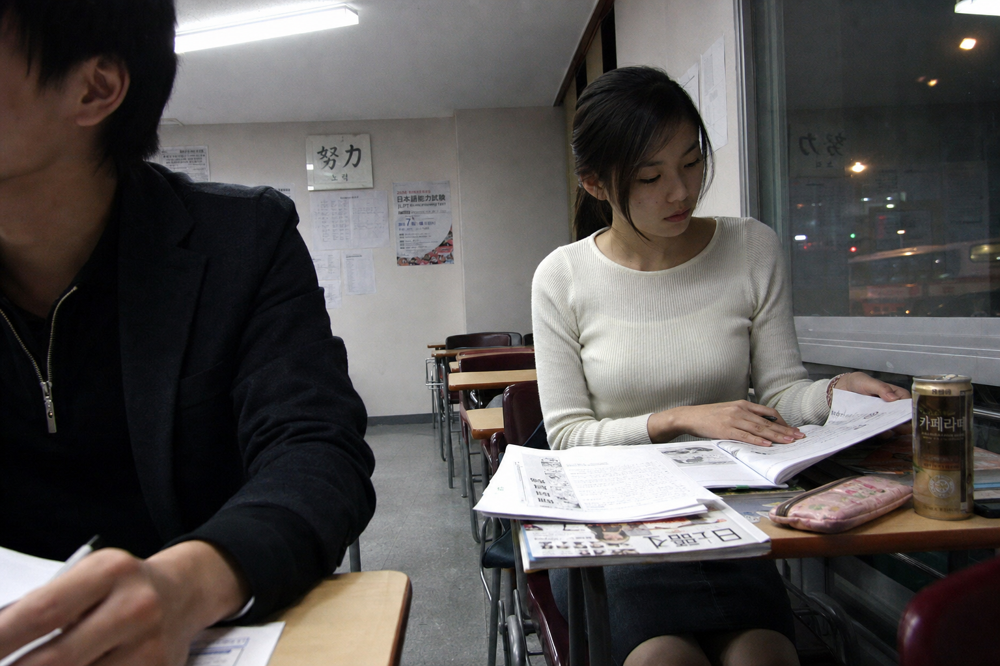

# ep.029 옆자리의 일본어

목요일 오후 여섯 시.

도서관 세미나실 형광등은 이상하게 푸른빛이 돌았다. 긴 테이블 위에는 프린트한 자료와 캔커피, 샤프심 통, 누군가 먹다 남긴 초코바 껍질이 어지럽게 놓여 있었다.

정다은은 창가 쪽에 앉아 노트북 화면을 들여다보고 있었다.

용식은 문 옆 의자에 앉았다. 일부러 가장 끝자리였다. 책상 아래에서 발이 닿을 거리도 아니고, 자료를 건네려면 팔을 뻗어야 하는 거리였다.

[정다은] "너 오늘 되게 멀리 앉는다."

[김용식] "여기가 콘센트 가까워."

[정다은] "노트북도 없으면서?"

옆에 있던 조원들이 웃었다.

용식은 가방에서 프린트를 꺼냈다.

[김용식] "자료 정리하려고."

정다은은 그 이상 캐묻지 않았다. 대신 볼펜으로 자기 앞 종이를 톡톡 쳤다. 어제와 비슷한 소리였다. 하지만 오늘은 그 소리가 덜 가볍게 들렸다.

과제 회의는 생각보다 길었다.

누가 발표를 맡을지, 자료 조사를 어떻게 나눌지, PPT 디자인을 누가 할지 정하는 데만 한 시간이 넘게 걸렸다. 정다은은 말을 잘했다. 남자 조원들이 딴소리를 하면 바로 끊었고, 발표 순서를 적을 때는 글씨를 크게 써서 모두가 보게 했다.

용식은 그런 정다은을 보며 가끔 감탄했다.

그리고 그 감탄을 들키지 않으려고 자료를 넘겼다.

[정다은] "김용식."

[김용식] "어."

[정다은] "너는 발표할래, 자료조사 할래?"

[김용식] "자료조사. 발표는 민재가 더 잘할 것 같은데."

[박민재] "야, 왜 나를 팔아."

[정다은] "민재 발표 괜찮지. 목소리 크잖아."

[박민재] "그게 칭찬이냐?"

웃음이 짧게 퍼졌다.

용식도 따라 웃었지만, 폴더폰을 한 번 확인했다.

초연에게 전화해야 했다.

회의가 끝나갈 때쯤, 정다은이 프린트 더미를 정리하다가 용식 쪽으로 몸을 기울였다.

[정다은] "나 이거 한 장만 네 파일에 같이 넣어줘. 내 가방 터질 것 같아."

[김용식] "메일로 보내."

[정다은] "프린트인데?"

[김용식] "그럼 내가 들고 갈게. 다음 회의 때 줄게."

[정다은] "차에 놓고 가도 되냐고 물어봤을 땐 안 된다더니, 네가 들고 가는 건 돼?"

말투는 장난이었다.

하지만 방 안의 공기가 잠깐 멈췄다. 민재가 눈치를 보듯 두 사람을 번갈아 봤다.

용식은 종이를 받아 가방에 넣었다.

[김용식] "차가 아니라 가방이니까."

[정다은] "되게 기준이 세밀하다."

[김용식] "나도 요즘 배우는 중이야."

정다은은 그 말을 듣고 웃지 않았다.

잠깐, 생각하는 얼굴을 했다.

회의가 끝난 건 여덟 시가 조금 넘어서였다. 용식은 도서관 밖으로 나오자마자 초연에게 전화를 걸었다. 바람이 차가웠다. 도서관 앞 계단에는 학생들이 삼삼오오 앉아 담배를 피우고 있었고, 연기가 가로등 불빛 아래에서 희미하게 흩어졌다.

[김초연] "끝났어?"

[김용식] "응. 지금 끝났어."

[김초연] "정다은도 있었고?"

[김용식] "응. 조원 다 있었어. 세미나실에서 했고, 차 안에서는 안 했어."

초연은 바로 대답하지 않았다.

[김초연] "오늘은 바로 말하네."

[김용식] "약속했으니까."

[김초연] "나 수원역이야. 친구들이랑 재료 보고 이제 끝났어."

[김용식] "데리러 갈까?"

[김초연] "아니. 오늘은 나 버스 타고 갈게."

용식은 걸음을 멈췄다.

[김용식] "왜?"

[김초연] "매번 네 차 타면 또 말 나와. 그리고 나도 생각 좀 정리하고 싶어."

[김용식] "어제 돈 얘기 때문에?"

[김초연] "그것도 있고."

그녀는 말을 끊었다가 다시 이었다.

[김초연] "너랑 있으면 좋은데, 내가 자꾸 확인하는 사람 되는 게 싫어."

용식은 계단 옆 난간을 잡았다. 금속이 차가웠다.

[김용식] "내가 그렇게 만들고 있어."

[김초연] "응. 근데 나도 좀 그래. 네 폰 울리면 누구냐고 묻고 싶고, 네가 바로 답 안 하면 나 혼자 상상하고. 나 이런 애 아닌 줄 알았는데."

[김용식] "그럼 오늘은 내가 안 갈게. 네가 그렇게 하고 싶으면."

[김초연] "응. 내일 보자."

[김용식] "내일은 내가 데려다줘도 돼?"

초연이 작게 웃었다.

[김초연] "그건 내일 봐서."

전화가 끊겼다.

용식은 폴더폰을 닫고도 한동안 계단 아래를 내려가지 못했다.

오늘은 일본어 학원 날이었다.

원래대로라면 수원으로 가야 했다. 초연도 수원역에 있다. 데리러 가지 않겠다고 말한 바로 그 길을, 그는 다른 이유로 가야 했다.

말해야 하나.

그는 폴더폰을 열었다.

[김용식] 나 오늘 일본어 학원은 가. 수원역 근처라서 혹시 불편할까 봐 말해.

문자를 보내고 나서 차로 걸어갔다.

답장은 바로 오지 않았다.

수원 일본어 학원 강의실은 난방이 조금 과했다. 창문은 닫혀 있었고, 사람들의 외투 냄새와 복사한 교재 냄새가 섞여 있었다. 용식이 늦게 들어가자 한서윤은 이미 옆자리에 앉아 있었다.

그녀는 낮게 묶은 머리 끝을 어깨 앞으로 넘기고 있었다. 책상 위에는 일본 잡지와 작은 필통, 캔커피 하나가 가지런히 놓여 있었다.

[한서윤] "오늘 늦었네요."

[김용식] "학교 과제 때문에요."

[한서윤] "대학생 같네요."

[김용식] "대학생 맞잖아요."

[한서윤] "그렇긴 한데, 지난번에는 좀 덜 대학생 같았어요."

용식은 교재를 꺼내다 말고 그녀를 봤다.

[김용식] "그게 무슨 뜻이에요?"

한서윤은 웃었다. 입꼬리만 살짝 올라갔다.

[한서윤] "그냥. 말하는 게 가끔 너무 정리돼 있어서."

용식은 필요 없는 말을 하려다가 삼켰다.

[김용식] "오늘은 덜 정리돼 있어요. 좀 정신없었거든요."

[한서윤] "여자친구 때문에요?"

심장이 아주 조금 늦게 뛰었다.

[김용식] "그 얘기 기억하고 있었어요?"

[한서윤] "물어봤으니까요."

그녀는 교재를 펼쳤다.

[한서윤] "잘 돼 가요?"

[김용식] "잘... 모르겠어요."

말하고 나니 더 이상했다.

보통은 잘 된다고 말해야 했다. 어제 키스까지 했다. 손도 잡았다. 공식 여자친구가 생겼다. 그런데 그 말을 꺼내면 바로 뒤에 돈 얘기와 정다은, 세미나실, 숨긴 문자들이 따라왔다.

한서윤은 고개를 조금 기울였다.

[한서윤] "좋아하는데 잘 모르겠는 거예요?"

[김용식] "네. 좋아하는 건 맞는데, 좋아한다고 다 잘하는 건 아니더라고요."

[한서윤] "그건 맞죠."

그녀는 그 말을 아주 조용히 받았다.

강사가 들어왔고, 수업이 시작됐다. 히라가나 복습과 짧은 회화 문장이 이어졌다. 용식은 입으로 따라 읽으면서도 옆자리의 움직임을 자꾸 의식했다. 한서윤은 필기할 때 펜을 가볍게 쥐었고, 어려운 발음이 나오면 입술을 아주 작게 움직이며 먼저 연습했다.

그녀가 가까이 앉은 건 아니었다.

오히려 초연보다 거리를 잘 지켰다.

그런데 그 거리 때문에 더 신경 쓰였다.

수업이 끝나자 폴더폰에 답장이 와 있었다.

[김초연] 말해줘서 고마워.  
[김초연] 끝나면 바로 집 가.

용식은 화면을 한참 봤다.

끝나면 바로 집 가.

그 말은 부탁이면서 명령처럼 읽혔다. 초연은 그렇게 쓰고 싶지 않았을지도 몰랐다. 그래도 용식에게는 그렇게 들어왔다.

[한서윤] "집 가요?"

그녀가 교재를 가방에 넣으며 물었다.

[김용식] "네."

[한서윤] "지난번처럼 역까지 태워 달라고 하려던 건 아닌데."

[김용식] "네?"

[한서윤] "표정이 먼저 방어하길래요."

용식은 웃을 타이밍을 놓쳤다.

[김용식] "그런 표정이었어요?"

[한서윤] "조금요."

한서윤은 가방끈을 어깨에 걸었다.

[한서윤] "여자친구 있으면 불편할 수 있죠. 저도 알아요."

[김용식] "불편해서 그런 건 아니고..."

말이 또 길어질 뻔했다.

용식은 멈췄다.

[김용식] "아니네요. 불편한 거 맞아요. 정확히는 제가 괜히 애매하게 행동할까 봐."

한서윤은 그를 보았다.

눈 아래 작은 점이 형광등 아래에서 희미하게 보였다.

[한서윤] "그럼 오늘은 먼저 가요."

[김용식] "네."

[한서윤] "다음 수업 때 봐요."

그녀는 먼저 강의실을 나갔다.

용식은 자리에 남아 폴더폰을 열었다.

[김용식] 끝났어. 바로 집 갈게.

보내려다가 멈췄다.

바로 집 갈게.

그 말이 사실이 되려면 곧장 주차장으로 가야 했다. 그런데 그는 한서윤이 내려간 계단 쪽을 한 번 봤다. 아주 짧게였다. 스스로도 민망할 만큼 짧았다.

그래도 봤다.

그는 문자를 보냈다.

[김용식] 끝났어. 바로 집 갈게.

학원 밖으로 나오자 한서윤은 건물 입구 앞에서 우산을 접고 있었다. 비는 오지 않았다. 아마 낮에 들고 온 우산을 정리하는 것뿐이었다.

그녀가 용식을 봤다.

[한서윤] "진짜 바로 가네요."

[김용식] "네."

[한서윤] "좋네요. 그렇게 하려고 하는 거."

칭찬인지 아닌지 알 수 없는 말이었다.

용식은 고개를 끄덕이고 주차장 쪽으로 걸었다. 등 뒤에서 한서윤의 구두 소리가 반대 방향으로 멀어졌다. 또각거리는 소리는 차 소리에 금방 묻혔다.

차에 타자 초연에게 전화가 왔다.

[김초연] "진짜 끝났어?"

[김용식] "응. 지금 차 탔어."

[김초연] "혼자?"

[김용식] "응. 혼자."

초연은 대답하지 않았다.

용식은 시동을 걸었다.

[김용식] "서윤 씨가 역까지 태워 달라고 안 했고, 나도 먼저 간다고 했어."

[김초연] "내가 물어본 건 그거 아니야."

[김용식] "그럼?"

[김초연] "네가 아쉬웠는지."

차 안이 조용해졌다.

용식은 거짓말을 할 수 있었다.

아니라고.

아무렇지 않았다고.

그런데 초연은 이미 전화기 너머에서 숨죽이고 있었다. 듣기 싫은 대답도 들으려고 기다리는 사람처럼.

[김용식] "조금."

초연의 숨이 멈췄다.

[김용식] "근데 그래서 바로 왔어. 아쉬워서 더 있으면 안 될 것 같아서."

초연은 한참 말이 없었다.

[김초연] "너 진짜 사람 어렵게 한다."

[김용식] "미안."

[김초연] "그 미안하다는 말도 짜증 나는데, 지금 거짓말 안 한 건 또 다행이라 더 짜증 나."

용식은 핸들을 잡았다.

[김초연] "집 가. 내일 봐."

전화가 끊겼다.

용식은 차를 출발시켰다.

수원역 큰길의 불빛이 앞유리 위로 길게 번졌다. 그는 신호를 기다리며 조수석을 봤다. 어제 초연이 놓고 간 박하사탕 껍질이 아직 있었다.

그 작은 껍질 옆에, 오늘 학원 교재 모서리가 닿아 있었다.

두 개가 나란히 놓여 있었다.

그게 싫었다.
