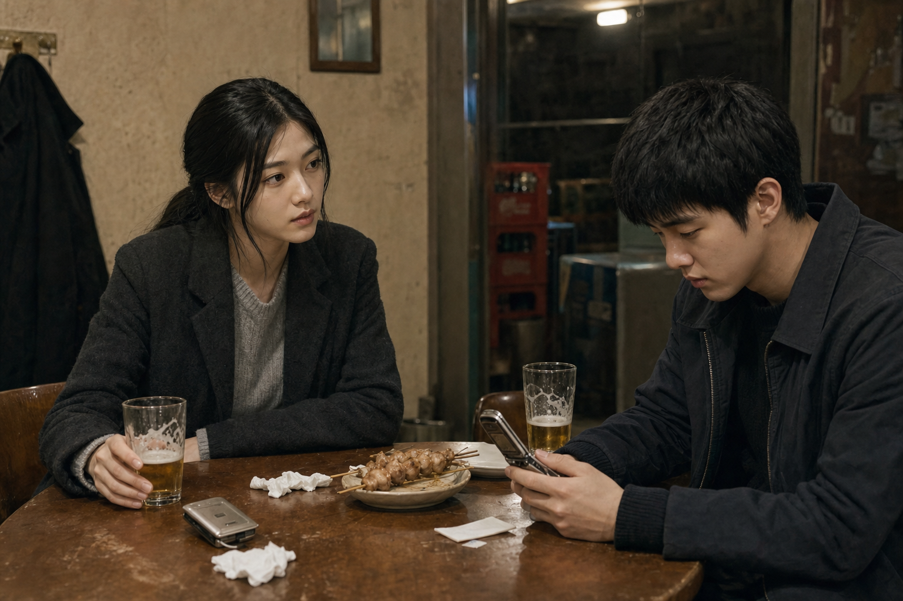

# ep.031 오늘만

수원역 뒤쪽 골목에는 금요일 밤 냄새가 남아 있었다.

튀김 기름 냄새, 젖은 담배꽁초 냄새, 막차 시간을 놓치지 않으려 뛰어가는 사람들의 땀 냄새가 좁은 길 위에 낮게 깔렸다. 김용식은 한 손에 폴더폰을 쥔 채 횡단보도 앞에 서 있었다. 화면에는 한서윤이 보낸 문자가 아직 떠 있었다.

[한서윤] 미안해요. 괜찮아요?

괜찮지 않았다.

그런데 초연에게는 괜찮지 않다고 말할 수 없었고, 한서윤에게는 괜찮다고 말하면 안 될 것 같았다. 둘 다 맞는 말이라서 더 피곤했다. 용식은 답장을 쓰지 않은 채 폴더폰을 닫았다. 닫는 소리가 작게 났다. 그 소리마저 누군가 들은 것처럼 등 뒤가 서늘했다.

초연은 이미 골목 너머로 사라졌다.

따라갈 수 있었다. 신호가 바뀌고, 사람들 틈을 헤치면, 몇 분 안에 따라잡을 수 있었다. 초연이 정말 혼자 가고 싶다고 말한 것도 알고 있었다. 그래도 붙잡아야 하는 순간이 있다는 것도 알았다.

용식은 한 걸음도 떼지 못했다.

폰이 다시 울렸다.

[김초연] 너 오늘은 따라오지 마.

문장은 짧았다.

그 짧음이 차가웠다. 화가 난 사람의 긴 말보다, 마음을 닫은 사람의 짧은 말이 더 오래 남았다.

용식은 답장을 썼다.

[김용식] 알았어. 미안해. 집 들어가면 문자 줘.

전송 버튼을 누르고 나니 손가락 끝이 축축했다. 그는 주머니에서 차 키를 꺼냈다가 다시 넣었다. 주차장으로 가야 했다. 집으로 가야 했다. 오늘은 아무것도 하지 말라는 말을 들었으니, 정말 아무것도 하지 않아야 했다.

하지만 아무것도 하지 않는다는 건, 혼자 차 안에 앉아 초연의 답장을 기다리는 일이었다.

그때 뒤에서 낮은 목소리가 들렸다.

[한서윤] "아직 여기 있었네요."

용식은 돌아섰다.

한서윤은 학원 건물 쪽에서 천천히 걸어오고 있었다. 회색 니트 위에 어두운 코트를 걸쳤고, 낮게 묶은 머리 끝이 목 뒤에서 조금 흐트러져 있었다. 그녀는 방금 전처럼 미안하다는 표정을 짓지 않았다. 대신 상황을 이미 알고 있는 사람처럼, 용식의 손에 든 폴더폰을 한 번 보고 얼굴을 올렸다.

[김용식] "왜 안 갔어요?"

[한서윤] "저도 역 가는 길이라서요."

[김용식] "아까 먼저 간다고 했잖아요."

[한서윤] "그랬죠."

한서윤은 대답을 끝내고도 떠나지 않았다. 버스가 지나가며 바람을 밀어냈다. 그녀의 코트 자락이 살짝 흔들렸고, 용식은 괜히 시선을 아래로 내렸다.

[한서윤] "여자친구분, 많이 화났어요?"

[김용식] "모르겠어요."

[한서윤] "또 모르겠다고 하네요."

[김용식] "그럼 뭐라고 해요. 화난 것 같다고 하면 제가 나쁜 놈이고, 아니라고 하면 제가 눈치 없는 놈인데."

말이 생각보다 날카롭게 나갔다.

용식은 바로 입을 다물었다. 한서윤에게 화낼 일은 아니었다. 아니, 정확히 말하면 한서윤에게도 화가 났다. 초연에게도 화가 났고, 자신에게는 더 화가 났다. 누구에게 먼저 사과해야 하는지 모르는 사람이 결국 아무 상관 없는 사람에게 목소리를 높이는 꼴이었다.

[김용식] "미안해요. 서윤 씨한테 할 말 아닌데."

[한서윤] "괜찮아요."

그녀는 그렇게 말하고 잠깐 웃었다.

괜찮다는 말이 이상하게 쉬웠다. 초연이 괜찮다고 말하면 믿을 수 없었을 텐데, 한서윤이 괜찮다고 하니 정말 조금 괜찮아지는 것 같았다. 그게 문제였다.

[한서윤] "집에 바로 갈 거예요?"

[김용식] "가야죠."

[한서윤] "가고 싶어요?"

용식은 대답하지 못했다.

한서윤은 그 침묵을 기다렸다. 재촉하지 않았다. 그냥 옆에 서서 버스정류장 쪽 불빛을 보고 있었다. 기다리는 방식도 사람을 당길 수 있다는 걸, 용식은 그날 밤 처음 알았다.

[한서윤] "저 맥주 한 잔만 마시고 갈 건데."

[김용식] "지금요?"

[한서윤] "네. 오늘 수업 끝나고 집에 바로 들어가면, 저도 괜히 마음이 이상할 것 같아서요."

[김용식] "왜 서윤 씨 마음이 이상해요."

[한서윤] "제가 끼어든 것 같잖아요."

[김용식] "끼어든 거 아니에요."

[한서윤] "그럼 같이 한 잔 해요. 끼어든 거 아니면, 그냥 학원 끝나고 아는 사람이랑 맥주 한 잔 하는 거잖아요."

그 말은 너무 그럴듯했다.

그냥 아는 사람.

학원 끝나고 맥주 한 잔.

용식은 그 말 안에서 빠져나갈 구멍을 찾았다. 여자친구와 싸운 직후 다른 여자와 술을 마시는 건 분명히 이상했다. 하지만 그는 이미 초연에게 오늘은 따라오지 말라는 말을 들었다. 집에 들어가면 문자 달라고도 보냈다. 그러니까 지금 자신이 할 수 있는 건 기다리는 일뿐이었다.

기다리면서 술 한 잔 마시는 게 그렇게 큰일인가.

생각은 빠르게 비겁해졌다.

[김용식] "한 잔만이에요."

[한서윤] "네. 한 잔만."

한서윤이 먼저 걸었다.

수원역 뒤쪽 작은 술집은 문이 반쯤 열려 있었다. 안에서는 오래된 가요가 작게 흘렀고, 벽에는 맥주 포스터와 바랜 메뉴판이 붙어 있었다. 테이블은 끈적했고, 젓가락통 옆에는 누군가 흘린 소금 알갱이가 굳어 있었다.

두 사람은 제일 안쪽 테이블에 마주 앉았다.

용식은 차를 가져왔다는 이유로 맥주를 거절해야 했다. 하지만 한서윤이 메뉴판을 내려놓으며 말했다.

[한서윤] "차는 내일 찾아가면 되죠."

그 말은 너무 쉽게 나왔다.

[김용식] "그런 식으로 말하면 제가 진짜 마실 것 같잖아요."

[한서윤] "안 마실 사람이면 제가 말해도 안 마시겠죠."

한서윤은 잔을 두 개 주문했다.

맥주는 금방 나왔다. 유리잔 밖으로 물방울이 맺혔다. 용식은 그 잔을 한참 보다가 들었다. 차가운 감각이 손바닥에 붙었다. 첫 모금을 넘기자 목 안쪽이 쓰게 식었다.

[한서윤] "여자친구분 예쁘더라고요."

용식은 잔을 내려놓았다.

[김용식] "갑자기요?"

[한서윤] "아까 봤으니까요."

[김용식] "예쁘죠."

[한서윤] "좋아해요?"

질문은 똑바로 들어왔다.

용식은 바로 대답해야 했다. 좋아한다고. 당연하다고. 그렇게 말하면 끝나는 질문이었다.

그런데 그는 맥주잔의 물방울을 엄지로 문질렀다.

[김용식] "좋아해요."

[한서윤] "근데 왜 그렇게 말해요?"

[김용식] "어떻게 말했는데요."

[한서윤] "좋아한다는 말보다, 설명해야 한다는 생각이 먼저 있는 사람처럼요."

용식은 웃었다. 웃음은 짧고 힘이 없었다.

[김용식] "서윤 씨는 사람을 너무 잘 봐요."

[한서윤] "용식 씨가 너무 티 나요."

술집 문이 열리고 닫힐 때마다 찬바람이 바닥을 훑었다. 한서윤은 닭꼬치 하나를 앞접시에 덜어 용식 쪽으로 밀었다. 손끝이 접시 가장자리에 닿았다가 떨어졌다. 별일 아닌데, 그 움직임이 너무 조용해서 오히려 오래 보였다.

[김용식] "초연이는 내가 뭘 숨긴다고 생각해요."

[한서윤] "안 숨겼어요?"

[김용식] "아무 일 없었잖아요. 진짜 학원에서 수업 듣고, 같이 나온 것뿐인데."

[한서윤] "그 말, 여자친구분이 아까 맞힐 것 같다고 했던 말이네요."

용식은 입을 다물었다.

한서윤은 잔을 들었다. 그녀는 술을 많이 마시는 사람처럼 보이지 않았는데, 잔을 드는 손은 어색하지 않았다. 한 모금을 마시고 내려놓는 동안 눈은 용식에게서 떨어지지 않았다.

[한서윤] "아무 일 없었다는 말이 틀린 건 아닌데, 그 말로 다 설명되지는 않잖아요."

[김용식] "그럼 뭘 더 설명해야 해요."

[한서윤] "아쉬웠던 거요."

용식은 숨을 멈췄다.

한서윤이 너무 정확한 곳을 눌렀다. 같이 나온 것뿐이었다. 손을 잡지도 않았고, 어디를 간 것도 아니었다. 그런데 같이 나오는 몇 걸음이 싫지 않았다. 초연이 수원역에 있을지도 모른다는 걸 알면서도, 학원 앞까지만이라는 말을 붙잡았다. 그 작고 편한 말에 기대어 거절하지 않았다.

[김용식] "그런 건 말하면 안 되는 거잖아요."

[한서윤] "여자친구한테요?"

[김용식] "누구한테든."

[한서윤] "그럼 저한테도 하지 마요."

그 말에 용식은 고개를 들었다.

한서윤은 웃고 있지 않았다.

[한서윤] "제가 편하다고 해서, 저한테 다 말해도 되는 건 아니에요. 저도 사람이라서요."

술기운이 얼굴로 조금 올라왔다. 용식은 물을 마셨다. 입안에 맥주의 쓴맛이 남았다.

[김용식] "서윤 씨는 왜 저한테 이렇게 말해요?"

[한서윤] "용식 씨가 듣고 싶어 하는 말만 해 주면, 제가 되게 좋은 사람처럼 보일 것 같아서요."

[김용식] "그럼 좋은 사람처럼 보이면 되잖아요."

[한서윤] "그건 재미없잖아요."

그녀가 그제야 웃었다.

작게.

입가만 조금 올라가는 웃음이었다. 그런데 그 웃음이 술집 형광등 밑에서 이상하게 선명했다. 용식은 그녀의 왼쪽 눈 아래 작은 점을 봤다. 가까이 앉으니 그 점이 더 분명했다. 봐서는 안 되는 곳을 본 것 같아 시선을 내렸지만, 이미 늦었다.

두 번째 잔이 비었다.

한 잔만 하자는 말은 조용히 사라졌다.

초연에게서는 답장이 오지 않았다. 용식은 폴더폰을 몇 번 열었다 닫았다. 한서윤은 그걸 보면서도 묻지 않았다. 대신 안주 접시를 정리하고, 휴지를 접고, 잔 밑에 고인 물을 닦았다. 그런 사소한 행동이 이상하게 차분해서, 용식은 더 오래 앉아 있었다.

[한서윤] "여자친구분 욕해도 돼요."

[김용식] "욕할 거 없어요."

[한서윤] "그래요?"

[김용식] "화낼 만하니까 화낸 거죠."

[한서윤] "근데 억울하잖아요."

그 말은 달았다.

억울하다는 말은 자기 편을 들어주는 것처럼 들렸다. 용식은 그 단어를 밀어내야 했다. 하지만 이미 술이 들어갔고, 초연의 짧은 문자가 머릿속에서 계속 닫히는 소리를 냈다.

[김용식] "억울하긴 해요."

한서윤은 대답하지 않았다.

[김용식] "내가 뭐 엄청 잘못한 것처럼 보잖아요. 진짜 아무 일도 없었는데. 아니, 내가 좀 애매하게 군 건 맞는데, 그렇다고 설명도 안 듣고 가 버리면 나는 뭐가 돼요."

말이 나오기 시작하자 멈추기 어려웠다.

[김용식] "초연이는 나한테 제대로 하라고 하는데, 나도 처음이에요. 여자친구 있는 거. 내가 다 잘할 수 있으면 좋겠는데, 사람이 어떻게 그래요. 나도 기분 좋을 때 있고, 누가 말 걸어 주면 좋고, 예쁜 사람이 옆에 앉으면 신경 쓰이고..."

용식은 거기서 멈췄다.

너무 많이 말했다.

한서윤은 잔을 내려놓았다.

[한서윤] "저 예뻐요?"

술집 안의 소리가 갑자기 멀어졌다.

용식은 웃어넘기려 했다. 그런데 한서윤은 웃는 얼굴이 아니었다. 묻는 얼굴이었다. 도망갈 수 없게, 하지만 붙잡지는 않는 얼굴.

[김용식] "예쁘죠."

[한서윤] "그럼 신경 쓰였어요?"

[김용식] "서윤 씨."

[한서윤] "대답하기 싫으면 안 해도 돼요."

그녀는 그렇게 말하고 몸을 조금 물렸다. 물러나는 동작이었다. 그래서 오히려 더 가까워졌다. 용식은 그녀가 자기 앞에서 선을 긋고 있다는 걸 알았다. 여기서 그만하면 됐다. 술값을 계산하고, 택시를 타고, 집에 가면 됐다.

폰이 울렸다.

[김초연] 집 들어왔어.

용식은 화면을 봤다.

초연이 집에 들어갔다.

안도해야 했다. 그런데 이상하게 안도보다 빈자리가 먼저 왔다. 초연은 집에 들어갔고, 자신은 수원역 뒤쪽 술집에서 한서윤과 마주 앉아 있었다. 이 상황을 초연에게 말할 수 없다는 걸 깨닫는 순간, 그는 이미 한 발 넘어와 있었다.

[한서윤] "가야겠네요."

[김용식] "네."

둘은 자리에서 일어났다.

계산은 용식이 했다. 지갑에서 현금을 꺼낼 때 손끝이 조금 떨렸다. 한서윤은 말리지 않았다. 계산대 옆 작은 영수증이 기계에서 밀려 나왔다. 용식은 그것을 무심코 접어 주머니에 넣었다.

밖으로 나오니 밤공기가 더 차가웠다.

막차 시간은 애매했다. 버스정류장에는 사람이 거의 없었고, 택시는 줄지어 서 있다가 손님을 태우고 빠져나갔다. 한서윤은 정류장 시간표를 보고 있다가 고개를 돌렸다.

[한서윤] "용식 씨는 차 어디 있어요?"

[김용식] "주차장요. 근데 술 마셨으니까 못 몰죠."

[한서윤] "잘했네요."

[김용식] "칭찬받을 일인가."

[한서윤] "지금 운전하면 진짜 별로였을 것 같아서요."

둘은 나란히 걸었다.

수원역 뒤쪽 모텔 간판들이 골목 위로 낮게 켜져 있었다. 빨간빛, 파란빛, 흰빛이 젖은 보도블록에 번졌다. 용식은 그쪽을 일부러 보지 않으려 했다. 보지 않으려 하니 더 보였다. 한서윤도 그 간판들을 봤다.

그녀는 걸음을 늦췄다.

[김용식] "왜요?"

[한서윤] "택시 타면 되는데."

[김용식] "네."

[한서윤] "근데 저는 지금 택시 타고 집에 가면, 오늘 일 계속 생각날 것 같아요."

용식은 그녀를 봤다.

한서윤은 눈을 피하지 않았다. 술기운 때문인지 얼굴에 열이 조금 올라와 있었다. 하지만 흐트러진 사람의 얼굴은 아니었다. 자기가 무슨 말을 하는지 아는 얼굴이었다.

[김용식] "그 말 무슨 뜻이에요."

[한서윤] "용식 씨가 모르는 척할 수 있는 뜻이요."

심장이 한 번 세게 뛰었다.

용식은 주먹을 쥐었다 폈다. 초연의 문자가 주머니 안에서 닫힌 채 식어 가고 있었다. 집에 들어왔다는 말. 오늘은 따라오지 말라는 말. 사귀기 시작한 지 일주일도 안 된 여자친구의 목소리.

그리고 눈앞에는 한서윤이 있었다.

[김용식] "이러면 안 돼요."

[한서윤] "알아요."

[김용식] "서윤 씨도 알잖아요."

[한서윤] "네."

그녀가 한 걸음 다가왔다.

가까워진 만큼 샴푸 냄새와 술 냄새가 섞여 왔다. 용식은 뒤로 물러나지 않았다. 한서윤은 그의 손목을 잡지 않았다. 대신 손등에 손끝을 살짝 대고 바로 뗐다. 닿았다가 떨어진 자리만 이상하게 뜨거웠다.

[한서윤] "그래서 물어보는 거예요."

[김용식] "뭘요."

[한서윤] "오늘만 모르는 척할 수 있어요?"

용식은 대답하지 않았다.

대답하지 않는 것도 대답이었다.

모텔 프런트에는 작은 창문이 있었고, 안쪽에서는 텔레비전 소리가 낮게 새어 나왔다. 용식은 현금을 냈다. 직원은 두 사람을 거의 보지 않았다. 열쇠고리에 달린 번호표가 손바닥에 차갑게 닿았다.

복도는 좁았다.

형광등 하나가 깜박였다. 한서윤은 앞서 걷다가 방문 앞에서 멈췄다. 용식은 열쇠를 넣으려다 손을 멈췄다.

[김용식] "서윤 씨."

한서윤이 돌아봤다.

[김용식] "지금이라도 가도 돼요."

[한서윤] "그 말, 용식 씨한테도 하는 거예요?"

용식은 고개를 숙였다.

[김용식] "네."

[한서윤] "그럼 저 안 가요."

그녀가 먼저 손을 내밀었다.

용식은 그 손을 잡았다. 손가락이 차가웠다. 문이 열리고, 방 안의 노란 조명이 복도 바닥으로 흘러나왔다.

문이 닫혔다.

폴더폰은 테이블 위에서 한 번 진동했다가 멈췄다.

토요일 아침.

커튼 틈으로 들어온 빛은 생각보다 밝았다.

용식은 낯선 천장을 보고 있었다. 방 안에는 싸구려 방향제 냄새와 식은 술 냄새가 섞여 있었다. 테이블 위에는 꺼진 폴더폰, 구겨진 영수증, 반쯤 남은 생수병이 놓여 있었다. 바닥에는 한서윤의 작은 가방이 의자 다리에 기대어 있었다.

한서윤은 창가 쪽에 앉아 머리를 다시 묶고 있었다.

둘 사이에는 말이 없었다.

아무 일도 아니라고 하기에는 방 안의 모든 물건이 너무 많은 말을 하고 있었다. 실수였다고 하기에는, 어젯밤 방문 앞에서 둘 다 한 번 멈췄다. 멈췄고, 그래도 들어왔다.

용식은 폴더폰을 열었다.

[김초연] 아침에 일어나면 연락해.

새벽 한 시 사십칠 분.

그 아래 부재중 전화 하나가 있었다.

김초연.

용식은 화면을 닫았다.

한서윤이 그 소리를 듣고 돌아봤다.

[한서윤] "여자친구예요?"

용식은 대답하지 못했다.

한서윤은 더 묻지 않았다. 대신 코트 주머니에서 립밤을 꺼내 조용히 발랐다. 어젯밤보다 더 차분한 얼굴이었다. 그래서 더 멀어 보였고, 더 가까워 보였다.

[한서윤] "학원에서 봐요."

[김용식] "서윤 씨."

[한서윤] "밖에서는 그냥 아는 사람처럼 해요."

그 말은 약속처럼 들렸다.

아니, 공범의 규칙처럼 들렸다.

한서윤은 가방을 들고 먼저 문을 열었다. 복도 형광등 빛이 방 안으로 들어왔다가, 그녀가 나가자 다시 얇아졌다.

용식은 한동안 움직이지 않았다.

주머니 안에는 술집 영수증이 있었다. 테이블 위에는 모텔 영수증이 있었다. 폴더폰 화면에는 초연의 이름이 남아 있었다.

그는 셋 중 무엇부터 숨겨야 할지 생각했다.

그게 제일 찜찜했다.
