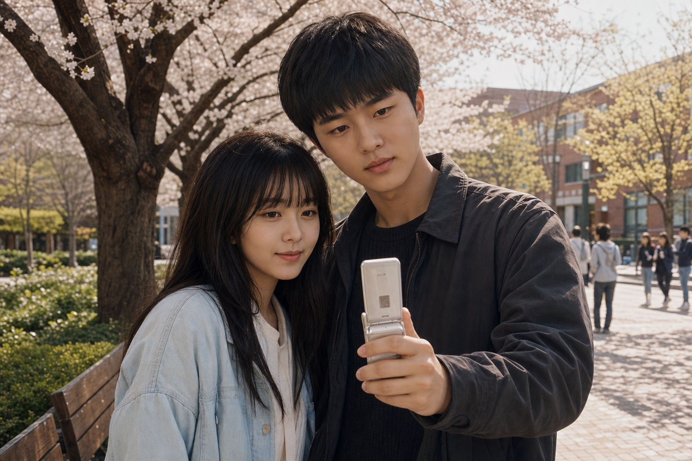

# ep.032 꽃 밑에서

화요일 오전.

평택대학교 캠퍼스 벚나무는 주말 사이에 갑자기 달라져 있었다. 금요일까지만 해도 붉은 점처럼 맺혀 있던 꽃망울이, 며칠 바람을 맞고 나더니 얇은 흰빛으로 터져 나왔다. 아직 만개는 아니었다. 그래서 더 신기했다. 완전히 예쁜 것보다, 예뻐지기 직전의 어설픔이 사람들 발을 더 붙잡았다.

용식은 주차장에 차를 세우고 한동안 내리지 않았다.

폴더폰 화면에는 초연의 이름이 있었다.

[김초연] 오늘 점심 먹을 거야?

문자는 아침 여덟 시 십칠 분에 와 있었다.

그는 답장을 세 번 썼다 지웠다.

[김용식] 응. 너 괜찮으면.

전송하고 나서도 손이 차가웠다. 토요일 아침 이후로 초연은 묻지 않았다. 금요일 밤 어디 있었냐고도, 왜 새벽 전화를 못 받았냐고도, 한서윤에게 답장을 했냐고도 묻지 않았다. 대신 토요일 낮에는 “자느라 못 받았어?”라고만 했고, 용식이 “응, 늦게 잤어”라고 답하자 더는 캐묻지 않았다.

그게 더 무서웠다.

사람은 가끔 모르는 게 아니라, 묻지 않기로 한다.

강의실 앞 복도에는 벚꽃 얘기가 많았다. 누군가는 사진을 찍으러 간다고 했고, 누군가는 과잠을 빌려 입고 싶다고 했다. 정다은은 창가 쪽에 기대어 있다가 용식을 보고 손을 들었다.

[정다은] "김용식. 너 오늘 왜 얼굴이 죽었냐."

[김용식] "잠을 좀 못 잤어."

[정다은] "연애 힘들다?"

용식은 가방끈을 고쳐 잡았다.

[김용식] "과제 얘기면 수업 끝나고 하자."

[정다은] "와. 선 긋는 거 봐. 나 이제 무섭다."

장난이었지만 끝이 조금 남았다. 정다은은 더 다가오지 않았다. 그게 다행인지 아닌지 용식은 알 수 없었다.

점심시간이 되자 초연은 학생식당 뒤쪽 벤치에 서 있었다. 흰 카디건 위에 연한 데님 재킷을 걸치고, 머리는 반쯤 묶었다. 바람이 불 때마다 옆머리가 볼에 붙었다 떨어졌다. 그녀는 용식을 보았지만 바로 웃지 않았다.

[김용식] "기다렸어?"

[김초연] "방금 왔어."

거짓말이었다.

벤치 옆 종이컵 커피가 반쯤 식어 있었다. 용식은 그것을 봤고, 초연도 그가 본 걸 알았다. 둘 다 말하지 않았다.

학생식당 안은 붐볐다. 줄이 길어서 둘은 결국 매점에서 삼각김밥과 캔커피를 샀다. 용식은 계산하려고 지갑을 꺼냈다가 멈췄다. 초연이 먼저 동전을 냈기 때문이다.

[김용식] "내가 살게."

[김초연] "오늘은 내가 먹고 싶은 거 내가 산 거야."

[김용식] "그런 뜻 아니었는데."

[김초연] "나도 그런 뜻 아니야."

말이 짧게 부딪쳤다.

둘은 벚나무 아래로 걸었다. 바람에 꽃잎 몇 장이 떨어졌다. 아직 떨어질 때가 아닌데도, 급한 꽃잎은 먼저 내려왔다. 길가에서는 커플 몇 쌍이 서로를 찍어 주고 있었다. 여학생 하나가 남자친구의 목에 팔을 걸고 웃었고, 남학생은 폴더폰 카메라를 들고 초점이 안 맞는다고 투덜거렸다.

초연은 그 장면을 보고 있다가 말했다.

[김초연] "우리도 찍을래?"

용식은 바로 대답하지 못했다.

사진.

남는 것.

숨길 수 없는 것.

[김용식] "찍자."

초연은 그의 늦은 대답을 들었다. 들었지만 넘어갔다. 둘은 벚나무 아래 섰다. 용식이 폴더폰을 들자 화면 속에서 두 사람의 얼굴이 작게 흔들렸다. 초연은 어색하게 웃었다. 용식도 웃으려고 했다. 그런데 입가가 생각처럼 올라가지 않았다.

[김초연] "너 왜 이렇게 죄지은 사람 같아?"

손가락이 버튼 위에서 멈췄다.

[김용식] "내가 미안해서 그렇지."

[김초연] "뭐가."

용식은 숨을 삼켰다.

말할 수 있는 미안함과 말할 수 없는 미안함이 한꺼번에 목에 걸렸다.

[김용식] "금요일에. 네가 싫다고 했는데도, 내가 계속 설명하려고만 해서."

초연은 화면 속 자신을 보다가 고개를 돌렸다.

[김초연] "그건 미안할 만해."

[김용식] "응."

[김초연] "근데 그게 다야?"

용식은 폴더폰을 내렸다.

초연은 그를 똑바로 보지 않았다. 벚꽃 가지 사이로 지나가는 바람을 보고 있었다. 그녀는 정말 몰라서 묻는 게 아니었다. 뭔가 더 있을 것 같은데, 아직 이름을 붙이지 못해서 묻는 얼굴이었다.

[김용식] "내가 너 불안하게 만든 거."

[김초연] "그 말 되게 넓다."

[김용식] "넓게 미안해서."

초연은 웃지 않았다.

대신 손을 내밀었다. 용식은 그 손을 봤다. 잡아도 되는 손인지, 시험인지, 용서인지 알 수 없었다. 그는 조심스럽게 잡았다. 초연의 손은 차갑지 않았다. 손바닥이 닿자 이상하게 숨이 조금 내려갔다.

[김초연] "나 지금 다 풀린 거 아니야."

[김용식] "알아."

[김초연] "근데 나도 계속 화난 사람처럼 있기 싫어."

용식은 손에 힘을 조금 주었다.

[김초연] "그리고 너, 앞으로 학원 끝나면 바로 문자해. 누구랑 같이 나오든 말든, 내가 묻기 전에."

[김용식] "응."

[김초연] "한서윤 씨랑은?"

이름이 나오는 순간 손바닥에 땀이 났다.

[김용식] "학원에서만 볼게."

거짓말이었다.

아니, 앞으로는 그렇게 할 수도 있었다. 그렇게 하겠다고 마음먹으면 거짓말이 아닐 수도 있었다. 용식은 그런 식으로 생각했다. 생각이 다시 빠르게 비겁해졌다.

초연은 손을 놓지 않았다.

[김초연] "사진 찍자."

둘은 다시 가까이 섰다. 용식은 폴더폰을 들어 올렸다. 화면 안에서 초연이 그의 어깨에 조금 기대었다. 향이 가까워졌다. 샴푸 냄새와 섬유유연제 냄새, 벚꽃 밑의 먼지 냄새가 섞였다.

찰칵.

사진은 흔들렸다.

그래도 초연은 지우지 않았다.

오후 강의가 끝나고, 용식은 초연을 수원까지 태워다 주었다. 차 안에는 라디오가 작게 흘렀고, 초연은 조수석 창문을 조금 열었다. 바람이 머리카락을 흐트러뜨렸다. 용식은 신호에 걸릴 때마다 그녀의 손을 봤다.

수원 집 근처 골목에서 초연이 안전벨트를 풀었다.

[김초연] "오늘은 안아줘."

용식은 그녀를 봤다.

[김초연] "그냥. 나도 내가 너무 쉽게 풀리는 것 같아서 짜증 나는데, 그래도 안아줘."

용식은 차를 세워 놓고 몸을 돌렸다. 초연이 먼저 팔을 뻗었다. 좁은 차 안에서 어깨가 닿고, 머리카락이 턱에 스쳤다. 초연은 그의 가슴팍에 이마를 대고 한동안 말이 없었다.

용식은 안고 있으면서도 다른 아침을 떠올렸다.

낯선 천장.

구겨진 영수증.

한서윤의 낮은 목소리.

초연이 더 세게 그를 붙잡았다.

[김초연] "너 나 좋아하지."

[김용식] "응."

[김초연] "말로 해."

[김용식] "좋아해."

[김초연] "더."

용식은 눈을 감았다.

[김용식] "너 좋아해, 초연아."

초연은 그제야 고개를 들었다. 입술이 가까웠다. 키스는 짧았다. 하지만 짧은 만큼 오래 남았다. 초연은 차에서 내리기 전 폴더폰을 꺼내 아까 찍은 흔들린 사진을 다시 봤다.

[김초연] "이거 저장할 거야."

[김용식] "흔들렸는데."

[김초연] "그래도 우리잖아."

그녀는 문을 열고 내렸다.

용식은 차 안에 혼자 남았다. 초연이 골목으로 사라질 때까지 지켜보다가, 폴더폰을 열었다.

새 문자가 와 있었다.

[한서윤] 벚꽃 폈더라고요.

용식은 화면을 닫았다.

초연과 찍은 흔들린 사진이 아직 액정 안쪽에 남아 있었다.
