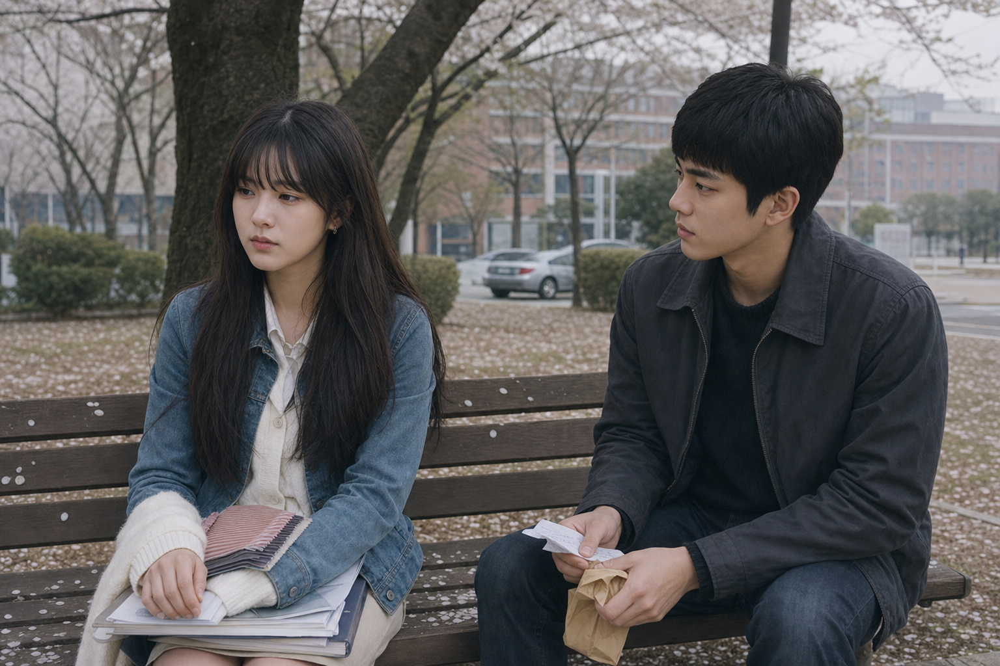

# ep.033 돈 보고

금요일 오후.

평택대학교 주차장 바닥에는 벚꽃잎이 젖은 종이처럼 붙어 있었다. 비가 온 것도 아닌데, 오전 내내 흐린 하늘 탓에 꽃잎은 바삭하게 날리지 못하고 차 바퀴 밑에서 눌렸다. 용식은 BMW 앞유리 와이퍼 밑에 끼워진 종이를 보고 걸음을 멈췄다.

처음엔 광고 전단인 줄 알았다.

가까이 가니 공책 찢은 종이였다.

삐뚤삐뚤한 글씨가 있었다.

돈 보고 만나는 거 아니면 왜 맨날 태워다 줌?

용식은 종이를 바로 구겨 쥐었다.

늦었다.

옆줄에 서 있던 남자 동기 둘이 이미 봤다. 한 명은 눈을 피했고, 다른 한 명은 웃음을 참는 얼굴을 했다. 그 얼굴이 더 열받았다. 대놓고 웃으면 화라도 낼 텐데, 모르는 척하려는 표정은 화낼 자리조차 없앴다.

[정다은] "뭐야?"

정다은이 뒤에서 다가왔다.

용식은 종이를 주머니에 넣었다.

[김용식] "아무것도 아니야."

[정다은] "아무것도 아닌 얼굴이 아닌데."

[김용식] "과제 자료는?"

[정다은] "말 돌리지 마."

정다은은 차 앞유리를 봤다. 와이퍼가 들려 있던 자국이 남아 있었다. 그녀는 바로 알아차린 얼굴이었다.

[정다은] "또 돈 얘기야?"

[김용식] "또라니."

[정다은] "너 요즘 모르나 본데, 너보다 네 차 얘기가 더 많이 돌아."

용식은 주먹을 쥐었다.

[김용식] "누가 그래."

[정다은] "누가 그랬는지 알아서 뭐하게. 걔네랑 다 싸울 거야?"

맞는 말이라 더 기분이 나빴다.

점심시간에 초연은 학생식당에 오지 않았다. 대신 문자만 왔다.

[김초연] 나 오늘 과방에서 먹을게.

용식은 전화를 걸었다.

한 번.

두 번.

세 번째 신호가 가기 전에 끊겼다.

[김초연] 수업 중이야. 문자해.

거짓말이었다. 과방에서 먹는다고 했으면서 수업 중이라는 말은 맞지 않았다. 하지만 용식은 따지지 못했다. 자기도 금요일 밤과 토요일 아침을 통째로 숨긴 사람이었다. 남의 작은 거짓말을 들여다볼 자격이 없는 것 같았다.

오후 늦게 초연을 만난 곳은 도서관 옆 벤치였다.

벚꽃은 예쁘게 피었는데, 하늘이 흐려서 색이 죽어 있었다. 초연은 무릎 위에 전공 책을 올려놓고 있었다. 책 모서리에는 천 조각 샘플이 끼워져 있었다. 그녀는 용식을 보자 책을 닫았다.

[김초연] "너 종이 봤어?"

용식은 대답하지 않았다.

[김초연] "봤구나."

[김용식] "누가 말했어?"

[김초연] "내가 못 볼 줄 알았어? 패디과 애들도 다 알아."

말끝이 떨리지는 않았다. 오히려 너무 또렷했다.

[김초연] "나 돈 보고 너 만난대."

[김용식] "그런 말 신경 쓰지 마."

초연은 책을 세게 잡았다.

[김초연] "그 말 제일 싫어."

[김용식] "미안."

[김초연] "신경 쓰지 말라니. 너는 그게 돼? 너는 돈 있는 쪽이니까 그냥 무시하면 되지. 나는 뭐가 돼?"

용식은 말을 잃었다.

그는 정말 돈으로부터 자유로워진 줄 알았다. 적어도 또래보다 자유롭다고 생각했다. 차를 사고, 밥값을 내고, 좋은 옷을 입고, 마음에 드는 사람을 태워다 주는 일이 자신에게는 여유였고, 초연에게는 추억이 될 거라고 생각했다.

그런데 초연에게는 다른 이름으로 남고 있었다.

돈 보고 만나는 애.

[김용식] "내가 어떻게 하면 돼."

[김초연] "그 말도 싫어."

[김용식] "그럼 뭐라고 해야 돼."

[김초연] "네가 알아서 해야지. 왜 맨날 나한테 정답 물어봐."

바람이 불었다. 벤치 위에 떨어진 꽃잎 하나가 책 표지 위로 올라갔다. 초연은 그것을 손끝으로 치우지 않았다.

용식은 가방에서 작은 종이봉투를 꺼냈다.

목걸이였다.

비싼 건 아니었다고 말하려다가 멈췄다. 말하는 순간 비싼지 아닌지가 중요해질 것 같았다. 그는 그냥 봉투를 내밀었다.

[김용식] "이거."

초연은 받지 않았다.

[김초연] "뭔데."

[김용식] "그냥. 너 생각나서."

[김초연] "오늘?"

[김용식] "며칠 전에."

그것도 반쯤 거짓말이었다. 목걸이는 어제 샀다. 소문을 들은 뒤, 뭘 해야 할지 몰라 백화점 매장에서 샀다. 판매원이 “여자친구분이 좋아하시겠다”고 말했을 때, 그는 안도했다. 돈을 내면 적어도 뭔가 하고 있다는 느낌이 들었다.

초연은 봉투를 보다가 웃었다.

웃음이 아니었다.

[김초연] "너 진짜 모르지."

[김용식] "초연아."

[김초연] "나 지금 사람들이 나 돈 보고 만난다고 해서 자존심 상했다고 했잖아. 근데 너는 여기서 또 뭘 사 와?"

용식은 봉투를 내렸다.

[김용식] "미안. 내가 생각이 짧았어."

[김초연] "아니. 생각은 했겠지. 네 방식으로."

그 말이 더 아팠다.

초연은 자리에서 일어나려 했다. 용식은 손목을 잡지 않았다. 대신 봉투를 가방 안에 다시 넣었다.

[김용식] "나 너 창피하게 안 할게."

초연이 멈췄다.

[김용식] "네가 내 차 때문에 그런 소리 듣는 거, 나도 싫어. 앞으로 학교에서는 괜히 티 내면서 태우고 다니는 거 줄일게. 네가 싫으면 차 멀리 세울게. 그리고... 돈으로 미안하다고 안 할게."

초연은 돌아보지 않았다.

[김용식] "근데 좋아하는 건 말로 할게."

그제야 초연이 돌아봤다.

[김초연] "그럼 해."

[김용식] "지금?"

[김초연] "응. 지금."

주변에 사람이 있었다. 벤치 뒤로 학생 둘이 지나갔고, 도서관 계단에는 누군가 통화를 하고 있었다. 용식은 목이 말랐다. 초연은 그걸 알면서 기다렸다. 이건 애교가 아니었다. 벌에 가까웠다. 동시에 확인이었다.

[김용식] "나 너 좋아해."

[김초연] "작게 말고."

용식은 숨을 들이마셨다.

[김용식] "김초연 좋아한다고."

지나가던 학생 하나가 돌아봤다.

초연의 얼굴이 조금 붉어졌다. 자기가 시켜 놓고도 민망한 얼굴이었다. 그런데 눈빛은 풀리지 않았다.

[김초연] "더 해."

[김용식] "너 좋아해. 돈 때문에 만나는 거 아니고, 내가 차 있어서 만나는 것도 아니고, 내가 너 좋아해서 만나는 거야."

초연은 한참 동안 그를 보았다.

그리고 갑자기 다가왔다.

키스는 벤치와 도서관 사이, 사람들 눈이 완전히 닿지 않는 나무 그늘에서 시작됐다. 초연이 먼저 입술을 눌렀다. 용식은 놀라서 한 박자 늦게 그녀의 허리를 감쌌다. 초연은 피하지 않았다. 오히려 더 가까이 왔다.

그녀는 화가 난 사람처럼 그를 붙잡았다.

용식은 그 가까움에 정신이 흐려졌다. 며칠 동안 쌓였던 죄책감과 불안, 초연의 차가운 말투, 한서윤의 문자, 모텔 방의 노란 조명이 한꺼번에 밀려왔다가, 초연의 입술이 다시 닿는 순간 잠깐 사라졌다.

손이 올라갔다.

초연이 바로 그의 손목을 잡았다.

[김초연] "그건 안 돼."

짧은 말이었다.

용식은 멈췄다.

초연의 숨이 조금 가빴다. 그녀는 화난 얼굴도, 겁먹은 얼굴도 아니었다. 다만 방금 자신이 어디까지 용식의 마음을 잡을 수 있는지 확인한 사람처럼, 그리고 그 선을 자기가 정해야 한다는 걸 아는 사람처럼 그를 보고 있었다.

[김용식] "미안."

[김초연] "미안하다고만 하지 마."

[김용식] "응."

[김초연] "내가 싫어서 멈춘 거 아니야."

용식은 그녀를 봤다.

[김초연] "근데 그렇게 넘어가면, 내가 너 붙잡으려고 다 허락하는 사람 같잖아."

그 말에 용식은 아무 말도 못 했다.

초연은 그의 손을 잡았다. 이번엔 손목이 아니라 손가락이었다.

[김초연] "나를 그렇게 만들지 마."

용식은 고개를 끄덕였다.

그날 저녁, 용식은 초연을 학교 정문까지만 데려다주었다. 차는 주차장에 그대로 있었다. 둘은 버스정류장까지 걸었다. 초연은 버스가 올 때까지 그의 손을 놓지 않았다.

버스가 도착하자 초연은 계단을 오르다 돌아봤다.

[김초연] "목걸이는 나중에 줘."

[김용식] "응."

[김초연] "오늘 말고. 내가 받고 싶을 때."

문이 닫혔다.

용식은 버스가 움직이는 걸 봤다. 손 안에는 아직 초연의 온기가 남아 있었다. 가방 안에는 받지 않은 목걸이가 있었다.

그리고 주머니 안쪽, 깊은 곳에는 아직 버리지 못한 영수증 하나가 있었다.
