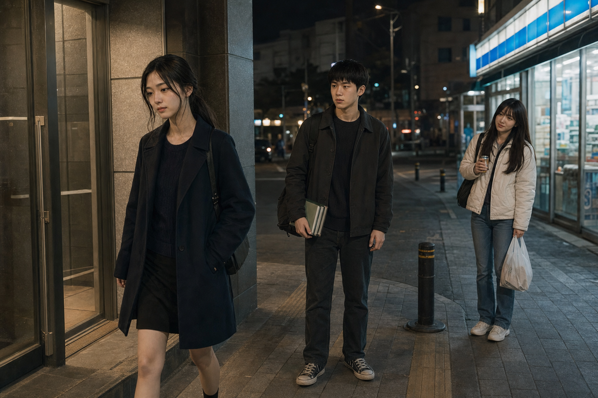

# ep.034 남처럼

금요일 저녁.

수원 일본어 학원 강의실 창문에는 벚꽃잎이 몇 장 붙어 있었다. 바깥 가로수에서 날아온 것인지, 누가 장난으로 붙여 놓은 것인지는 알 수 없었다. 투명테이프도 없는데 꽃잎은 유리에 얇게 달라붙어 떨어지지 않았다.

용식은 평소보다 일찍 도착했다.

일찍 와야 할 이유는 없었다. 오히려 늦게 와서 수업 시작 직전에 앉는 게 맞았다. 한서윤과 마주치는 시간을 줄이고, 초연에게도 학원 끝나자마자 문자하면 됐다. 간단했다.

간단한 일일수록 몸이 반대로 움직였다.

그는 책상 위에 교재를 펴고, 볼펜을 꺼냈다. 볼펜 끝으로 빈칸을 몇 번 두드렸다. 딱딱한 소리가 강의실에 작게 울렸다. 앞자리 남학생이 한 번 돌아봤고, 용식은 볼펜을 내려놓았다.

문이 열렸다.

한서윤이 들어왔다.

그녀는 오늘 짙은 남색 니트에 검은 스커트를 입고 있었다. 머리는 낮게 묶었고, 귀 옆 잔머리가 조금 흘러내렸다. 금요일 밤 이후 처음 보는 얼굴이었다. 정확히는 토요일 아침 이후였다. 모텔 방의 커튼 틈 빛과, 창가에서 머리를 묶던 손이 동시에 떠올랐다.

한서윤은 강의실을 천천히 훑었다.

빈자리는 많았다.

그런데도 그녀는 용식 옆에 앉았다.

[한서윤] "일찍 왔네요."

[김용식] "네."

[한서윤] "저 피하려고 늦게 올 줄 알았는데."

[김용식] "피하면 더 이상하잖아요."

[한서윤] "그건 그래요."

둘 사이에 교재 한 권이 놓였다. 아무 일도 없던 사이처럼 적당한 거리였다. 하지만 용식은 그 거리 안에 들어 있는 것들을 알았다. 손끝, 방문 앞의 멈춤, 닫힌 문, 아침의 영수증.

한서윤은 필통을 열었다.

펜 하나가 바닥으로 떨어졌다. 용식이 먼저 몸을 숙였다. 한서윤도 동시에 숙였다. 책상 아래에서 손이 부딪쳤다. 아주 잠깐이었다. 그런데 한서윤은 바로 손을 빼지 않았다.

손가락 끝이 그의 손등을 스쳤다.

[한서윤] "고마워요."

그녀는 펜을 받아 들고 아무렇지 않게 고개를 들었다.

용식은 목이 말랐다.

수업이 시작됐다. 강사는 칠판에 문형을 적었다. 용식은 따라 읽었다. 입에서는 일본어가 나왔고, 눈은 교재를 보고 있었지만, 신경은 옆자리로 가 있었다. 한서윤은 평소처럼 반듯하게 앉아 있었다. 무릎도 가지런했고, 목소리도 낮았다.

그러다 짝 연습 시간이 왔다.

[강사] "옆 사람하고 질문하고 대답해 보세요."

강의실이 금방 시끄러워졌다.

한서윤은 교재를 용식 쪽으로 조금 밀었다. 어깨가 가까워졌다. 그녀의 머리카락 끝이 책상 위에 살짝 닿았다.

[한서윤] "어제 뭐 했어요?"

교재 문장에는 그런 질문이 있었다.

용식은 대답을 보고 읽으면 됐다.

[김용식] "영화를 봤어요."

[한서윤] "누구랑 봤어요?"

그 문장은 교재에 없었다.

용식은 그녀를 봤다.

[김용식] "친구랑요."

[한서윤] "무슨 친구요?"

한서윤은 웃지 않았다. 낮은 목소리로, 다른 사람에게 들리지 않을 만큼만 말했다. 용식은 교재 아래에서 손을 쥐었다. 그녀의 무릎이 아주 살짝 그의 무릎에 닿았다. 우연처럼 보일 수 있는 거리였다.

[김용식] "서윤 씨."

[한서윤] "네."

[김용식] "장난치지 마요."

[한서윤] "장난 아닌데."

그녀는 교재를 넘겼다. 손끝이 용식의 손등 위를 지나갔다. 지나가다 멈추지 않았다. 그래서 더 위험했다. 누가 보면 아무 일도 아니었다. 용식만 알아차릴 수 있는 정도의 접촉이었다.

그는 초연을 생각했다.

도서관 옆 벤치.

사람들 앞에서 좋아한다고 말하던 자기 목소리.

초연이 손목을 잡고 "그건 안 돼"라고 말하던 순간.

그 기억이 올라오자 죄책감도 같이 올라와야 했다. 그런데 죄책감이 오기 전에 한서윤의 목소리가 먼저 귀 가까이 왔다.

[한서윤] "밖에서는 남처럼 할 거예요."

속삭임이었다.

[한서윤] "안에서는요?"

용식은 아무 대답도 하지 못했다.

수업이 끝날 때까지 둘은 더 이상 선을 넘지 않았다. 정확히는 남들이 볼 수 있는 선만 넘지 않았다. 책상 아래 닿았다 떨어지는 무릎, 교재를 함께 볼 때 좁아지는 어깨, 필기를 고쳐 주는 손끝, 낮게 웃는 숨소리가 계속 남았다.

종이 울리자 한서윤은 가장 먼저 가방을 챙겼다.

[한서윤] "먼저 갈게요."

목소리는 평범했다.

[김용식] "네. 조심히 가세요."

용식도 평범하게 대답했다.

한서윤은 강의실 문을 나서며 한 번도 돌아보지 않았다. 복도에서도 다른 수강생들과 적당히 거리를 두고 걸었다. 학원 계단을 내려갈 때도 용식보다 두세 걸음 앞서 있었다. 마치 둘이 방금 옆자리에 앉은 적도 없는 사람처럼.

밖으로 나오자 수원역 밤공기가 차가웠다.

초연이 있었다.

학원 건물 맞은편 편의점 앞에서 캔커피를 들고 서 있었다. 흰 점퍼에 청바지, 손에는 작은 쇼핑백. 그녀는 한서윤이 먼저 나오는 걸 봤고, 한서윤이 용식에게 별다른 말 없이 지나가는 것도 봤다.

한서윤은 초연을 모르는 사람처럼 지나쳤다.

정말 완벽했다.

[김초연] "수업 끝났어?"

용식은 심장이 내려앉는 걸 느꼈다.

[김용식] "어. 너 언제 왔어?"

[김초연] "방금."

방금은 아니었다. 캔커피는 반쯤 비어 있었다.

[김초연] "한서윤 씨 맞지?"

[김용식] "응."

[김초연] "인사도 안 하네."

[김용식] "그냥 학원 사람이라서."

거짓말은 너무 쉽게 나왔다.

초연은 그 말을 듣고 조금 웃었다. 안심한 얼굴이었다. 그 얼굴이 용식의 가슴을 눌렀다. 그녀는 쇼핑백을 내밀었다.

[김초연] "너 교재 넣고 다니는 거 가방 안에서 다 구겨지길래. 파일 하나 샀어."

투명 파일이었다. 안에는 벚꽃 무늬가 작게 박혀 있었다. 값비싼 것도, 대단한 선물도 아니었다. 그런데 용식은 그것을 받는 손이 더 떨렸다. 백화점에서 산 목걸이보다, 이 작은 파일이 더 설명하기 어려웠다.

[김용식] "고마워."

[김초연] "나 잘했지?"

[김용식] "응."

[김초연] "너도 오늘 잘했네."

용식은 숨을 멈췄다.

[김초연] "끝나고 바로 나왔고. 한서윤 씨랑도 아무렇지 않게 나오고."

초연은 정말 믿고 있었다.

아니, 믿고 싶어 했다.

용식은 투명 파일을 품에 안듯 들었다. 길 건너편에서 한서윤이 횡단보도 앞에 서 있었다. 그녀는 이쪽을 보지 않았다. 신호가 바뀌자 사람들 사이로 섞여 걸었다.

용식의 폴더폰이 진동했다.

초연이 바로 화면을 보았다.

[김초연] "누구야?"

용식은 폰을 열었다.

[정다은] 과제 표지 내가 뽑을게. 너는 발표 자료만 봐.

다행이었다.

다행이라고 느끼는 자신이 싫었다.

[김용식] "정다은. 과제."

초연은 화면을 보고 고개를 끄덕였다.

[김초연] "응. 그건 보여 줘서 고마워."

그녀는 그의 팔짱을 꼈다.

[김초연] "집까지 데려다줘."

[김용식] "차 주차장에 있어."

[김초연] "알아. 오늘은 타도 돼."

둘은 주차장 쪽으로 걸었다. 초연의 팔이 그의 팔에 감겨 있었다. 따뜻했다. 편해야 했다. 용식은 초연의 손등을 가볍게 덮었다.

주머니 속 폴더폰이 다시 진동했다.

이번엔 열지 않았다.

한서윤일 것 같았다.

그걸 아는 자신이 제일 나빴다.
