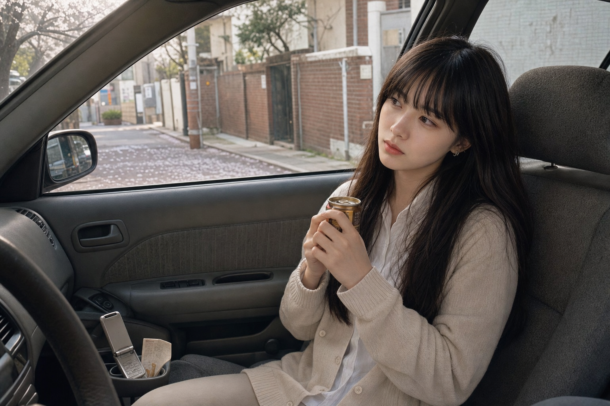

# 036. 그 전화

폴더폰 화면 위에 한서윤이라는 이름이 떠 있었다.

용식은 손바닥으로 화면을 덮었다.

덮는 동작이 너무 빨랐다. 숨기려고 했다는 것을 숨기지 못할 정도로.

초연은 이불 끝을 가슴께까지 끌어올린 채 그 손을 봤다. 방 안에는 밤새 켜 두었던 작은 조명의 누런 빛과, 창밖 큰길에서 밀려오는 버스 소리와, 테이블 위에서 아직도 짧게 떨고 있는 폴더폰 진동음이 섞여 있었다. 어제 밤에는 그 소리들이 전부 멀게 느껴졌는데, 아침이 되자 하나하나 너무 선명했다.

[김초연] "누구야?"

용식은 바로 대답하지 못했다.

진동이 끊겼다.

그 조용해진 순간이 더 길었다.

[김용식] "학원 사람."

[김초연] "일본어 학원?"

[김용식] "응."

초연은 눈을 내리깔았다. 이불 밖으로 나온 어깨에 아침빛이 얇게 걸려 있었다. 어제 먼저 손을 내밀던 얼굴과 달랐다. 부끄러워서 피하는 얼굴이 아니라, 방금 들은 말을 어디에 놓아야 할지 모르는 얼굴이었다.

[김초연] "여자야?"

용식은 손바닥 아래 폴더폰을 눌렀다. 플라스틱이 손바닥에 차갑게 닿았다.

[김용식] "응. 같은 반."

[김초연] "아침부터?"

[김용식] "학원 숙제 때문에 그런가 봐. 어제 내가 답장을 못 해서."

말은 입 밖으로 나오자마자 조금씩 모양이 바뀌었다. 숙제. 답장. 같은 반. 전부 완전히 틀린 말은 아니었다. 그래서 더 쉽게 나왔다. 틀린 말보다 절반만 맞는 말이 사람을 더 오래 버티게 했다.

초연은 몸을 일으키려다 다시 멈췄다. 침대 가장자리에 놓인 자기 티셔츠를 끌어당겼고, 머리카락이 볼 옆으로 흘러내렸다.

[김초연] "받아."

[김용식] "뭐?"

[김초연] "받아도 되잖아. 학원 사람이면."

용식은 목이 말랐다.

전화를 받으면 한서윤의 목소리가 방 안으로 들어온다. 낮게 가라앉은, 어제 전화가 왜 안 됐는지 묻는 목소리. 밖에서는 남처럼 하자고 말하던 사람이 일요일 아침에 왜 전화를 했는지, 그 이유까지 초연에게 들릴 수 있었다.

[김용식] "끊겼어."

[김초연] "다시 오면?"

[김용식] "나중에 할게."

[김초연] "왜 나중에?"

질문은 날카롭지 않았다. 그래서 더 아팠다. 초연은 따지려는 사람처럼 눈을 치켜뜨지 않았다. 그냥 알고 싶어 했다. 어제 밤, 자기가 선택했다고 말한 다음 날 아침에 자기 옆에서 울린 여자 이름이, 정말 아무것도 아닌지.

용식은 테이블 위 폴더폰을 뒤집어 놓았다.

[김용식] "너 있는데 통화하는 게 좀 그렇잖아."

[김초연] "내가 있으면 못 받는 전화야?"

방 안 공기가 식었다.

용식은 침대 끝에 앉았다. 초연과 너무 가깝지도, 너무 멀지도 않은 거리였다. 그 애매한 거리가 지금 둘 사이에 제일 솔직한 것이었다.

[김용식] "그런 뜻 아니야."

[김초연] "그럼 무슨 뜻인데."

[김용식] "어제... 우리 어제 그랬잖아. 아침부터 다른 사람이랑 통화하고 그러는 거, 네가 싫을 수도 있으니까."

초연은 잠깐 웃을 것처럼 입꼬리를 움직였다. 하지만 웃지는 않았다.

[김초연] "싫을 수도 있는 거랑 숨기는 거랑은 다르잖아."

용식은 대답을 찾았다. 고를 수 있는 말은 많았다. 그런데 꺼낼 수 있는 말은 별로 없었다.

폴더폰이 다시 울렸다.

이번에는 초연이 먼저 화면 쪽을 봤다.

용식은 손을 뻗지 못했다. 뒤집힌 폴더폰은 테이블 위에서 낮게 떨었다. 플라스틱이 나무 상판에 부딪히는 소리가 방 안을 얇게 긁었다.

[김초연] "그 사람 맞아?"

[김용식] "응."

[김초연] "이름 뭐야?"

용식은 숨을 들이마셨다.

[김용식] "한서윤."

초연은 이름을 한 번 입 안에서 굴리는 것처럼 조용히 있었다.

[김초연] "친해?"

[김용식] "그냥 옆자리라서."

[김초연] "옆자리면 일요일 아침에도 전화해?"

[김용식] "학원 과제 같이 봐야 하는 게 있어서."

또 절반의 말.

용식은 자기가 말하고도 얼굴이 뜨거워지는 것을 느꼈다. 초연은 그 뜨거움을 보지 못한 척했다. 이불을 걷고 침대 아래로 발을 내렸다. 바닥에 발끝이 닿자 몸을 조금 움츠렸다.

[김초연] "나 씻을래."

[김용식] "초연아."

[김초연] "받고 싶으면 받아. 나 물 틀어 놓을게."

초연은 욕실로 들어갔다. 문은 완전히 닫지 않았다. 물소리가 바로 들리지 않았다. 안에서 수건을 집는 소리, 칫솔 컵이 세면대에 닿는 소리가 먼저 났다. 용식은 그 짧은 틈에 폴더폰을 열었다.

부재중 전화 두 통.

한서윤.

문자 한 통도 와 있었다.

[한서윤] 어제부터 연락 안 되네. 무슨 일 있어?

용식은 답장을 쓰지 못했다.

엄지손가락이 자판 위에서 멈췄다. 욕실에서 물이 쏟아지는 소리가 났다. 초연이 문을 닫지 않은 이유를 생각했다. 들으라는 건지, 듣지 않겠다는 건지 알 수 없었다.

그는 문자창을 닫았다.

대신 통화기록을 열었다. 한서윤 이름이 맨 위에 박혀 있었다. 방금 본 이름은 작은 폰 화면 안에서도 이상하게 크게 느껴졌다. 그는 지우기 버튼 위에 손가락을 올렸다가 멈췄다.

지우면 더 숨긴 게 된다.

안 지우면 보일 수 있다.

용식은 폴더폰을 덮었다.

체크아웃 시간까지는 얼마 남지 않았다. 둘은 어색하게 씻고, 옷을 입고, 침대 아래 떨어진 양말을 각자 찾았다. 어제 밤에는 손이 닿을 때마다 숨이 느려졌는데, 아침에는 손이 닿을 것 같으면 둘 다 조금씩 비켜났다.

프런트에서 계산은 이미 끝나 있었다. 용식은 주차권을 받아 들고 밖으로 나왔다. 4월 아침 공기는 생각보다 차가웠고, 초연은 카디건 단추를 하나 더 잠갔다.

[김용식] "밥 먹고 갈래?"

[김초연] "속이 좀 그래."

[김용식] "죽이라도."

초연은 대답 대신 주차장 쪽으로 걸었다. 차 문을 열자 밤새 갇혀 있던 가죽 냄새가 올라왔다. 용식은 운전석에 앉아 시동을 걸었고, 초연은 조수석에서 안전벨트를 맸다.

벨트가 딸깍, 하고 잠겼다.

그 소리가 어제와 달랐다.

수원역 근처 편의점 앞에서 용식은 차를 잠깐 세웠다. 초연이 아무것도 못 먹겠다 했지만, 그는 따뜻한 캔커피와 삼각김밥 하나, 물 한 병을 사 왔다. 영수증은 주머니에 구겨 넣었다. 이런 사소한 돈까지 숨길 필요는 없는데도, 그는 무언가를 계속 접고 숨기고 있었다.

[김용식] "커피라도 마셔."

초연은 캔을 받았다. 손끝이 닿았다가 바로 떨어졌다.

[김초연] "너 나 좋아해?"

용식은 차선을 보다가 고개를 돌렸다.

[김용식] "좋아해."

[김초연] "그럼 잘해."

[김용식] "응."

[김초연] "그냥 말로 잘한다고 하지 말고."

그녀는 캔커피 뚜껑을 따지 않았다. 손바닥 안에서만 굴렸다.

[김초연] "나 어제 후회 안 해. 근데 오늘 아침은 좀 싫었어."

용식은 핸들을 잡은 손에 힘을 줬다.

[김용식] "미안."

[김초연] "미안하다고 하면 끝나는 거 말고."

초연은 창밖을 봤다. 수원 골목 사이로 벚꽃잎이 검은 아스팔트 위에 눌려 있었다. 며칠 전만 해도 예쁘다고 말했던 것들이, 떨어지고 나니 누군가 밟고 지나간 자국처럼 보였다.

초연의 집 근처 골목에 도착했을 때, 그녀는 바로 내리지 않았다.

[김초연] "다음 학원 언제야?"

[김용식] "화요일."

[김초연] "그날 내가 데려다줄게."

[김용식] "뭐?"

[김초연] "네가 나 수원까지 데려다주잖아. 나도 학원 앞까지 같이 갈 수 있잖아."

[김용식] "굳이 안 그래도 돼."

초연은 그제야 용식을 봤다.

[김초연] "왜? 학원 사람이라며."

용식은 아무 말도 하지 못했다.

초연은 캔커피를 가방에 넣고 문을 열었다. 내리기 전, 그녀는 어제보다 조금 느린 목소리로 말했다.

[김초연] "나 아직 믿고 싶어."

문이 닫혔다.

용식은 골목에 혼자 남았다. 조수석에는 초연이 앉았던 온기가 조금 남아 있었고, 컵홀더 옆에는 편의점 영수증이 구겨진 채 떨어져 있었다.

그때 폴더폰이 다시 진동했다.

이번에는 열지 않아도 알 것 같았다.
