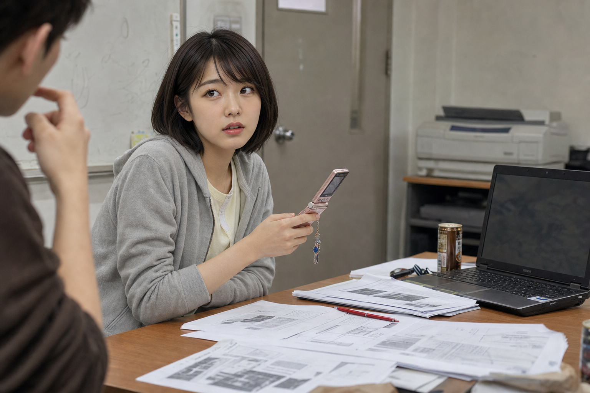

# 037. 정다은이 본 것

월요일 오후 네 시.

도서관 세미나실 프린터는 종이를 한 장 뱉고 멈췄다.

정다은이 프린터 옆에 쪼그려 앉아 종이함을 열었다. 후드집업 소매가 손등을 반쯤 덮고 있었다. 그녀는 안쪽에 걸린 종이를 손톱 끝으로 끌어내며 짧게 욕을 삼켰다.

[정다은] "아, 이거 또 씹혔어. 발표 전날에 진짜 왜 이래."

[김용식] "비켜 봐."

용식은 의자에서 일어나 프린터 앞으로 갔다. 세미나실 안에는 형광등 소리와 노트북 팬 돌아가는 소리, 복도에서 지나가는 학생들의 발소리가 겹쳐 있었다. 책상 위에는 조별과제 출력물, 형광펜, 반쯤 식은 캔커피, 그리고 그의 폴더폰이 놓여 있었다.

초연에게서 온 문자는 점심 이후 없었다.

그 침묵이 자꾸 눈에 밟혔다.

용식은 프린터 뚜껑을 열고 걸린 종이를 빼냈다. 정다은은 옆에서 턱을 괴고 그를 올려다봤다.

[정다은] "너 오늘 좀 이상하다."

[김용식] "뭐가."

[정다은] "아침부터 폰만 봐. 여자친구랑 싸웠냐?"

용식은 종이를 찢지 않으려고 천천히 당겼다.

[김용식] "안 싸웠어."

[정다은] "안 싸운 얼굴이 아닌데."

[김용식] "너 발표 대본이나 봐."

정다은은 입을 삐죽 내밀었다. 예전 같으면 장난으로 어깨를 쳤을 텐데, 요즘은 그 선 앞에서 한 번 멈췄다. 용식이 거절했던 손목의 기억이 그녀에게도 남아 있는 것 같았다. 대신 그녀는 책상 쪽으로 돌아가 출력물을 정리했다.

그때 폴더폰이 진동했다.

용식은 프린터 안에 손을 넣고 있었다.

책상 위에서 폰이 조금씩 미끄러졌다. 정다은은 반사적으로 손을 뻗어 떨어지기 직전 잡았다. 화면이 그녀 쪽으로 열려 있었다.

짧은 문자 미리보기가 떴다.

[한서윤] 어제 왜 피했어?

정다은의 손이 그대로 멈췄다.

용식은 종이를 빼내고 돌아섰다. 정다은의 눈이 폴더폰 화면에서 그의 얼굴로 올라왔다.

[김용식] "줘."

정다은은 바로 주지 않았다.

[정다은] "한서윤?"

[김용식] "줘."

목소리가 조금 낮아졌다. 정다은은 그 변화를 알아차렸다. 그녀는 폴더폰을 천천히 책상 위에 내려놓았다. 던지지도, 놀리듯 흔들지도 않았다. 그래서 더 불편했다.

[정다은] "여자친구 이름 초연 아니었나?"

[김용식] "학원 사람이야."

[정다은] "학원 사람한테 '왜 피했어' 이런 문자가 와?"

용식은 폰을 집어 들어 화면을 닫았다.

[김용식] "네가 신경 쓸 일 아니야."

정다은은 의자에 등을 기대고 앉았다. 장난스러운 눈웃음이 조금 사라졌다.

[정다은] "나도 신경 쓰고 싶어서 쓰는 건 아닌데, 네 폰이 내 손에 떨어졌잖아."

[김용식] "봤으면 못 본 척해."

[정다은] "그 말 되게 이상한 거 알아?"

세미나실 밖에서 누군가 웃으며 지나갔다. 문에 붙은 작은 유리창 너머로 지나가는 얼굴들이 잠깐 보였다 사라졌다. 이 방 안의 공기만 따로 멈춘 것 같았다.

용식은 노트북 앞으로 돌아와 앉았다. 발표 자료 마지막 장에는 네트워크 구성도가 떠 있었다. 화살표와 박스, 포트 번호. 설명하면 되는 것들. 연결이 어디서 어디로 이어지는지 선만 보면 알 수 있는 것들.

사람 관계는 그렇게 안 됐다.

[정다은] "너 진짜 양다리야?"

[김용식] "말 조심해."

[정다은] "그럼 아니라고 하면 되지."

[김용식] "아니야."

대답은 빨랐다. 너무 빨라서 가벼웠다.

정다은은 마우스를 잡고 슬라이드를 넘겼다. 발표 자료에는 오탈자가 몇 개 남아 있었다. 그녀는 빨간 펜으로 종이에 표시하면서 말했다.

[정다은] "근데 왜 그렇게 화내."

[김용식] "네가 이상하게 몰아가니까."

[정다은] "내가 몰아간 게 아니라 네 폰이 먼저 말했잖아."

용식은 대답하지 않았다.

한서윤에게 답장을 해야 했다. 초연에게도 연락해야 했다. 그런데 지금 누구에게 먼저 답하든, 그 답은 다른 한쪽에게 보여 줄 수 없는 말이 될 것 같았다.

정다은은 한동안 아무 말 없이 오탈자만 고쳤다. 펜 끝이 종이에 닿는 소리가 이상하게 컸다. 그녀가 장난을 멈추자 세미나실은 더 좁아졌다.

[정다은] "나 이런 거 별로 안 좋아해."

[김용식] "뭐."

[정다은] "여자친구 있는 애가 다른 여자한테 여지 주는 거. 그리고 들키면 상대가 이상한 애 되는 거."

용식은 고개를 들었다.

[김용식] "너 지금 네 얘기 하는 거야?"

정다은은 웃었다. 웃음이 짧았다.

[정다은] "그러게. 나도 내가 왜 이 말을 하고 있나 모르겠네."

그녀는 대본 첫 장을 용식 쪽으로 밀었다.

[정다은] "여기 네 파트 길어. 줄여. 교수님 중간에 잘라."

다시 과제 이야기로 돌아왔다. 하지만 돌아온 척일 뿐이었다. 책상 위 폴더폰은 닫혀 있었고, 닫힌 화면 안에 한서윤의 문자가 그대로 남아 있었다.

저녁이 되자 세미나실 창밖이 파랗게 어두워졌다. 복도는 조용해졌고, 프린터는 마지막 수정본을 뱉어 냈다. 용식은 학생회관 지하 복사실에서 제본비를 계산했다. 조별과제 팀원들 것까지 묶으니 생각보다 돈이 나갔다. 정다은은 지갑을 꺼내려 했지만, 용식이 먼저 카드를 내밀었다.

[정다은] "야, 나중에 걷자."

[김용식] "그냥 해."

[정다은] "너 이런 거 때문에 소문나는 거야. 차도 그렇고, 밥값도 그렇고."

[김용식] "몇 천 원 가지고 무슨."

[정다은] "몇 천 원이 아니라 태도."

용식은 카드 영수증을 받아 접었다. 정다은의 말이 이상하게 초연의 말과 겹쳤다. 돈으로 해결하려고 하지 말라던 얼굴. 잘하라는 말. 숨기는 것과 배려가 다르다는 말.

두 사람은 복사실 앞 벤치에 앉아 제본된 자료를 가방에 나눠 넣었다. 정다은은 자기 몫을 챙기다가 갑자기 물었다.

[정다은] "그 문자, 여자친구도 알아?"

용식은 손을 멈췄다.

[김용식] "몰라도 되는 거야."

[정다은] "그건 네가 정하는 거고?"

[김용식] "다은아."

이름을 부르자 정다은이 잠깐 눈을 깜빡였다. 용식이 그녀 이름을 그렇게 낮게 부른 건 처음이었다.

[김용식] "괜히 말 만들지 마."

정다은은 입술을 다물었다. 그 말이 부탁인지 협박인지 그녀도 잠깐 가늠하는 얼굴이었다.

[정다은] "나 말 만들 생각 없어."

용식은 숨을 내쉬었다.

[정다은] "근데 네가 이렇게 굴면, 말은 네가 만드는 거야."

그녀는 가방을 어깨에 메고 먼저 일어났다. 복도 끝 자동문이 열리며 찬 공기가 밀려왔다. 용식은 벤치에 앉은 채 폴더폰을 열었다.

한서윤의 문자.

초연의 부재중 전화 한 통.

둘 다 같은 화면 안에 있었다.

용식은 초연에게 먼저 전화를 걸었다. 신호음이 세 번 울린 뒤 끊겼다.

곧 문자가 왔다.

[김초연] 과제 중이라며. 끝나고 해.

용식은 답장을 쓰다 지웠다.

정다은은 자동문 밖에서 한 번 뒤돌아봤다. 그녀는 아무 말도 하지 않았지만, 이미 본 사람의 얼굴이었다.

용식은 그 얼굴이 싫었다.

그런데 제일 싫은 건, 정다은이 틀리지 않았다는 점이었다.
