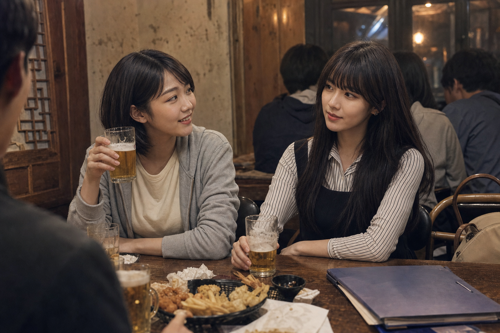

# 039. 정다은의 카드

목요일 밤, 조별과제 발표가 끝난 뒤 호프집 테이블은 젖어 있었다.

누군가 따른 맥주가 넘쳐 휴지로 닦았는데도, 나무 상판에는 끈적한 자국이 남았다. 종이컵, 튀김 접시, 발표 자료를 넣은 파일철, 가방끈이 서로 엉켜 있었다. 발표를 망치지는 않았다. 교수는 몇 가지를 물었고, 용식은 대답했다. 정다은은 중간에 말이 꼬였지만 웃으며 넘겼다.

그래서 다들 들떠 있었다.

용식만 빼고.

초연은 옆자리에 앉아 있었다. 패션디자인과 수업이 끝나고 뒤늦게 왔다. 원래는 안 오겠다고 했지만, 정다은이 단톡에 올린 사진을 보고 마음이 바뀐 것 같았다. 사진 속 용식 옆에는 정다은이 있었고, 발표 끝난 사람들의 웃음이 있었다.

초연은 들어오자마자 웃었다.

그 웃음도 어제와 같지 않았다.

[정다은] "초연 씨 맞죠? 저번에 한 번 봤죠?"

[김초연] "네. 안녕하세요."

[정다은] "와, 진짜 예쁘다. 용식이가 왜 그렇게 조심하는지 알겠네."

테이블에 앉은 동기들이 웃었다. 초연도 웃었다. 용식은 그 웃음 사이에서 맥주잔을 내려놓았다.

[김용식] "다은아."

[정다은] "왜. 칭찬인데."

정다은은 별생각 없다는 듯 잔을 돌렸다. 그녀는 오늘 발표가 끝나서인지 평소보다 말이 빨랐다. 후드집업 대신 얇은 가디건을 걸쳤고, 짧은 단발 끝이 볼 옆에서 흔들렸다.

[정다은] "근데 용식이 진짜 바빠요. 학교, 조별과제, 여자친구, 일본어 학원."

초연의 손이 잔 옆에서 멈췄다.

용식은 정다은을 봤다.

[김용식] "그 얘기가 왜 나와."

[정다은] "왜. 학원 다니는 거 비밀이야?"

동기 하나가 웃으며 끼어들었다.

[동기] "일본어 학원? 얘 진짜 뭐 준비하냐?"

[김용식] "그냥 취미야."

[정다은] "취미치고 열심히 다니던데. 학원 사람이랑도 친한가 봐?"

말은 가볍게 던져졌다.

하지만 테이블 아래에서 초연의 무릎이 아주 조금 움직였다. 용식은 그 작은 움직임을 봤다. 정다은은 맥주잔을 들고 있었고, 눈웃음을 지었다. 악의가 있다고 말하기엔 표정이 너무 자연스러웠다. 그런데 자연스러워서 더 나빴다.

[김초연] "학원 사람?"

[정다은] "아, 제가 괜한 말 했나."

[김용식] "정다은."

용식의 목소리가 낮아지자 테이블에 잠깐 틈이 생겼다. 누군가 감자튀김을 집던 손을 멈췄다. 정다은은 그 분위기를 느끼고도 웃음을 완전히 거두지 않았다.

[정다은] "아니, 폰에 문자가 와서. 우연히 본 거야. 떨어질 뻔해서 잡아 준 거고."

초연은 용식을 보지 않았다.

그게 더 무서웠다.

[김초연] "여자야?"

주변 소리가 멀어졌다. 호프집 스피커에서는 오래된 발라드가 흘렀고, 주방 쪽에서는 접시 부딪히는 소리가 났다. 그런데 용식 귀에는 초연의 질문만 남았다.

[김용식] "학원 같은 반."

[김초연] "한서윤?"

정다은의 눈이 초연 쪽으로 움직였다.

용식은 그 순간 정다은도 이름을 기억하고 있다는 것을 알았다.

[김용식] "응."

초연은 잔을 들어 한 모금 마셨다. 맥주 거품이 입술 위에 잠깐 묻었다가 사라졌다.

[김초연] "친하네. 여기저기서 이름이 나오는 거 보니까."

[김용식] "그런 거 아니야."

[정다은] "나 진짜 이상하게 말하려던 건 아닌데..."

[김용식] "그럼 그만해."

정다은은 입을 다물었다. 테이블의 다른 동기들이 분위기를 돌리려고 발표 점수 이야기를 꺼냈다. 누가 교수 흉내를 냈고, 누가 웃었다. 초연도 따라 웃었다. 하지만 그녀의 웃음은 조금 늦게 나왔다.

뒤풀이가 끝날 때까지 용식은 술을 거의 마시지 않았다. 계산대 앞에서 그는 또 먼저 카드를 꺼냈다. 팀원들이 말렸지만, 발표 자료 제본비까지 냈던 흐름이라 어색하게 밀어붙였다. 초연은 그 모습을 뒤에서 봤다. 돈을 아끼지 않는 태도, 설명 없이 먼저 처리하는 버릇, 상황을 돈과 말로 덮으려는 손.

가게 밖으로 나오자 밤공기가 젖어 있었다. 비가 오지는 않았지만, 도로에는 낮에 뿌린 물기가 남아 있었다. 동기들은 각자 택시와 버스정류장 쪽으로 흩어졌다. 정다은은 마지막까지 남아 있다가 초연에게 고개를 숙였다.

[정다은] "오늘 괜히 이상하게 들렸으면 죄송해요."

[김초연] "아니에요."

초연은 웃었다.

[김초연] "우연히 본 거라면서요."

정다은은 그 말에 바로 대답하지 못했다.

용식은 초연의 손목을 잡고 싶었다. 잡으면 더 이상해질 것 같아서 참았다. 정다은은 가방끈을 고쳐 메고 한 걸음 물러났다.

[정다은] "조심히 가세요."

그녀가 돌아서고 나서야 초연은 용식 쪽으로 몸을 돌렸다.

[김초연] "차 어디 있어?"

[김용식] "저쪽."

둘은 주차장까지 걸었다. 초연은 손을 잡지 않았다. 용식도 먼저 내밀지 못했다. 호프집 간판 불빛이 뒤로 멀어지고, 골목 끝 편의점 앞에서 취한 학생들이 큰 소리로 웃었다.

차에 타자마자 초연이 말했다.

[김초연] "그 여자랑 아무것도 아니야?"

용식은 시동을 걸지 못했다.

[김초연] "솔직히."

그 단어가 차 안에 떨어졌다.

솔직히.

용식은 핸들 위에 올린 손을 내려다봤다. 손등에 작은 상처가 있었다. 프린터에 걸린 종이를 빼다가 긁힌 자국이었다. 별것 아닌 상처인데, 갑자기 눈에 들어왔다.

[김용식] "아무것도 아니야."

[김초연] "전화 오고, 문자 오고, 학원 앞에서 마주치고, 같은 과 애도 이름을 아는데?"

[김용식] "학원 같은 반이라니까."

[김초연] "너 나 바보로 봐?"

[김용식] "그런 거 아니야."

[김초연] "그럼 내가 뭘 보고 믿어야 돼?"

용식은 고개를 들었다. 초연의 눈은 젖어 있지 않았다. 울 것 같은 얼굴도 아니었다. 오히려 너무 또렷해서 피하고 싶었다.

[김용식] "내가 잘할게."

[김초연] "그 말 말고."

[김용식] "진짜 아무 일 없어. 네가 생각하는 그런 거 아니야."

그 말은 거짓말이었다.

초연은 한참 동안 그를 봤다. 차 밖으로 지나가는 택시 불빛이 그녀의 얼굴을 노랗게 만들었다가 사라졌다. 용식은 그 빛이 사라지는 동안 숨도 제대로 쉬지 못했다.

[김초연] "그럼 앞으로 나한테 연락 다 보여줄 수 있어?"

용식은 눈을 깜빡였다.

[김초연] "숨길 거 없으면. 보여줄 수 있잖아."

[김용식] "초연아, 그건..."

[김초연] "싫어?"

그녀의 목소리는 작았다. 작아서 더 물러설 곳이 없었다.

[김초연] "나도 이런 말 하는 거 싫어. 진짜 싫어. 내가 무슨 폰 검사하는 사람도 아니고, 이런 거 요구하는 여자 되는 것도 싫은데."

초연은 가방끈을 손가락으로 꼬았다.

[김초연] "근데 지금은 안 보면 못 믿겠어."

용식은 대답하지 못했다.

그 침묵을 초연은 답으로 받아들인 것 같았다.

[김초연] "오늘은 그냥 갈게."

[김용식] "데려다줄게."

[김초연] "응. 데려다줘."

그녀는 창밖을 봤다.

차가 출발했다. 둘 사이에는 아무 음악도 없었다. 라디오를 켜면 너무 가볍고, 끄고 있으면 너무 무거웠다. 용식은 결국 아무것도 하지 않았다.

초연의 집 앞에 도착했을 때, 그녀는 안전벨트를 풀고 말했다.

[김초연] "내일 줘."

[김용식] "뭘."

[김초연] "폰."

용식의 손이 멈췄다.

[김초연] "나 확인하고 싶어."

그녀는 문을 열고 내렸다.

용식은 닫힌 조수석 문을 한참 봤다. 유리창에 비친 자기 얼굴이 어두웠다. 차 안 어딘가에서 폴더폰이 진동한 것 같았지만, 그는 꺼내지 않았다.

꺼내는 순간, 이미 대답해야 하는 사람이 너무 많았다.
