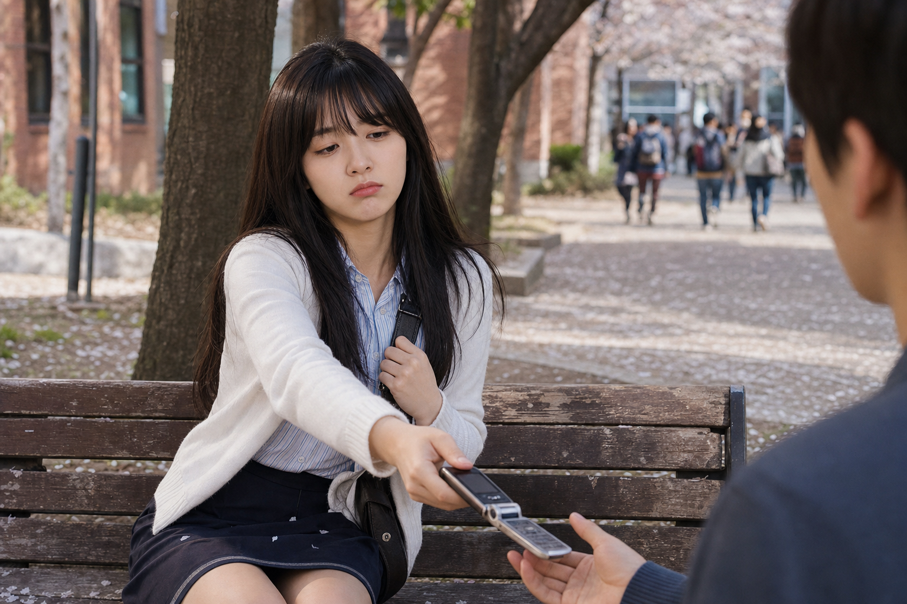

# 040. 보여줄 수 있는 것과 없는 것

금요일 오후, 초연은 손을 내밀었다.

[김초연] "폰 좀 줘봐."

평택대 학생회관 뒤편 벤치에는 벚꽃잎이 아직 조금 남아 있었다. 꽃이라고 부르기엔 너무 많이 짓밟힌 것들이었다. 점심시간이 지난 캠퍼스는 한산했고, 매점 앞에서는 캔커피를 마시는 학생 몇 명이 웃고 있었다.

용식은 주머니 안 폴더폰을 만졌다.

어젯밤 그는 거의 잠을 자지 못했다. 집 근처 상가 지하주차장에 차를 세워 두고, 운전석에 앉아 폴더폰 연락처를 열었다 닫았다. 한서윤. 그 세 글자는 너무 또렷했다. 지우면 더 위험했고, 그대로 두면 바로 끝이었다.

새 이름을 입력하는 데 오래 걸렸다.

학원자료.

그 이름을 저장하고 나서도 한참 폰을 들고 있었다. 사람을 지운 게 아니라, 사람을 물건처럼 접어 다른 서랍에 넣은 기분이었다.

[김초연] "안 줄 거야?"

용식은 폴더폰을 꺼냈다.

[김용식] "봐."

초연은 바로 받지 않았다. 그의 손 위에 놓인 폰을 잠깐 내려다봤다. 자기도 정말 이걸 해야 하는지 마지막으로 망설이는 얼굴이었다. 하지만 손은 결국 움직였다.

폴더폰이 초연의 손으로 넘어갔다.

용식은 이상하게 빈손이 됐다.

초연은 폴더를 열었다. 작은 화면 빛이 그녀 얼굴 아래쪽을 희게 비췄다. 그녀는 먼저 최근 통화 기록을 봤다. 손가락이 버튼 위에서 천천히 움직였다.

[김초연] "어제 부재중은?"

[김용식] "정리했어."

말하고 나서야 너무 이상한 대답이라는 걸 알았다.

초연이 고개를 들었다.

[김초연] "정리?"

[김용식] "아니, 통화 기록이 너무 많아서. 예전부터 가끔 지워."

[김초연] "나랑 통화한 것도?"

[김용식] "그건 남겨 놨지."

초연은 다시 화면을 봤다. 입술이 조금 굳었다. 그녀가 화를 내지 않는 시간이 길어질수록, 용식은 더 조급해졌다.

[김초연] "문자함 봐도 돼?"

[김용식] "응."

그는 대답했다.

어제 밤 한서윤의 문자들은 지워져 있었다. 아니, 완전히 지운 건 아니었다. 몇 개는 보관함 안쪽으로 옮겨 두었고, 몇 개는 삭제했다. 폴더폰의 작은 저장공간 안에서도 용식은 사람을 숨길 곳을 찾아냈다.

초연은 받은 문자함을 열었다. 김초연, 정다은, 조별과제 단톡 알림, 학원자료, 김종규. 이름들이 줄지어 있었다.

그녀의 손가락이 학원자료 위에서 멈췄다.

[김초연] "이건 뭐야?"

용식은 심장이 내려앉는 느낌을 받았다.

[김용식] "학원에서 숙제 보내 주는 번호. 조교 같은 거."

[김초연] "조교?"

[김용식] "응. 프린트랑 공지 같은 거."

초연은 메시지를 열었다.

[학원자료] 오늘 프린트 범위 확인해 주세요.

초연의 눈이 문장 위에서 멈췄다.

용식은 등줄기에 식은땀이 맺히는 것을 느꼈다. 어젯밤 그는 한서윤의 문자 대부분을 지우고, 대신 학원 공지처럼 보일 짧은 문장 하나를 남겨 두었다. 한서윤이 실제로 그런 말을 보낸 적은 없었다. 번호 이름을 바꾸는 것만으로 부족할 것 같아, 그는 스스로 알리바이를 만들었다.

초연은 메시지를 한 번 더 읽었다.

[김초연] "프린트?"

[김용식] "응. 수업 자료."

[김초연] "이름이 왜 학원자료야?"

[김용식] "처음에 누가 보내는지 몰라서 그렇게 저장했어. 반에서 자료 돌리는 번호인 줄 알고."

거짓말은 이번에도 매끄럽지 않았다.

하지만 폰 안에는 초연이 당장 붙잡을 만한 것이 없었다. 이름도, 문장도, 통화 기록도. 너무 깨끗한 화면은 오히려 수상했지만, 깨끗하다는 이유만으로 사람을 몰아붙이기는 어려웠다.

벤치 옆으로 학생 두 명이 지나갔다. 그들은 아무것도 모르는 얼굴로 웃고 있었다. 누군가 들고 가는 떡볶이 냄새가 바람을 타고 왔다. 너무 일상적인 냄새였다.

초연은 폴더폰을 닫았다.

[김초연] "나 이거 하는 거 싫어."

용식은 대답하지 못했다.

[김초연] "네 폰 보는 거. 문자함 넘기는 거. 내가 이런 애 되는 거."

[김용식] "미안."

[김초연] "미안하면 안 하게 해."

초연은 폰을 돌려줬다. 손끝이 조금 차가웠다.

[김초연] "오늘은 믿을게."

[김용식] "응."

[김초연] "믿어서 믿는 게 아니라, 더 보면 내가 더 싫어질 것 같아서 그만 보는 거야."

그 말은 화난 말이 아니었다.

상처 난 말이었다.

용식은 폰을 받아 들었다. 초연은 가방을 챙겼다. 점심 바람에 머리카락이 흔들렸다. 그녀는 몇 걸음 걷다가 멈추고 돌아봤다.

[김초연] "앞으로 그 사람 연락 오면 말해."

[김용식] "알았어."

[김초연] "그리고 나한테 숨길 거 없게 해."

용식은 고개를 끄덕였다.

초연은 더 묻지 않았다. 그래서 위기는 지나간 것처럼 보였다. 그러나 벤치 위에 남은 것은 안도감이 아니라, 방금 생긴 새 규칙의 모양이었다. 초연은 이제 확인할 수 있는 사람이 됐고, 용식은 확인당하기 전에 정리하는 사람이 됐다.

그건 연애라기보다 준비였다.

들키지 않기 위한 준비.

용식은 벤치에 혼자 남아 폴더폰을 열었다. 연락처에는 아직 학원자료라는 이름이 남아 있었다. 그 이름 아래에 한서윤의 번호가 있었다. 그는 이름을 다시 바꾸려고 했다가 손을 멈췄다.

한서윤으로 바꾸면 초연에게 보여 줄 수 있다.

학원자료로 두면 초연을 속이는 게 된다.

그런데 이미 속였다.

그는 결국 아무것도 누르지 못했다.

저녁에는 수원 일본어 학원 수업이 있었다. 그는 학원에 갔고, 한서윤은 옆자리에 앉았다. 그녀는 평소처럼 얇은 니트 소매를 손목 위로 정리하고, 필통을 책상 오른쪽에 놓았다. 수업 중에는 아무 말도 하지 않았다.

교재 아래로 손끝이 스치지도 않았다.

그게 더 이상했다.

수업이 끝난 뒤, 한서윤은 가방을 메고 일어났다. 용식이 따라 나가려 하자 그녀가 먼저 말했다.

[한서윤] "오늘은 인사하지 말아요."

[김용식] "서윤 씨."

[한서윤] "어차피 밖에서는 모르는 사람이잖아요."

그녀는 먼저 계단을 내려갔다.

용식은 따라가지 못했다. 학원 복도 창문에는 자기 얼굴이 비쳤다. 초연에게는 들키지 않으려고 사람 이름을 바꾸고, 한서윤에게는 지우지 않겠다고 말하지 못하는 얼굴이었다.

밤 열한 시가 조금 넘어서, 집 근처 상가 지하주차장에 차를 세웠다. 형광등 하나가 깜빡거렸고, 콘크리트 바닥에는 오래된 타이어 자국이 남아 있었다. 용식은 운전석에 앉아 폴더폰을 열었다.

초연에게 문자가 와 있었다.

[김초연] 집 도착하면 연락해.

그는 답장을 보냈다.

[김용식] 도착했어. 오늘 미안해.

답은 오지 않았다.

잠시 뒤 다른 문자가 도착했다.

[한서윤] 우리 이렇게 계속 숨기고 지내야 해?

용식은 화면을 오래 봤다.

지하주차장 형광등이 한 번 더 깜빡였다. 폴더폰 화면 속 작은 글자들은 사라지지 않았다. 숨길 수 있는 이름과 숨길 수 없는 질문이 같은 손 안에 있었다.

그는 답장을 쓰지 못했다.
