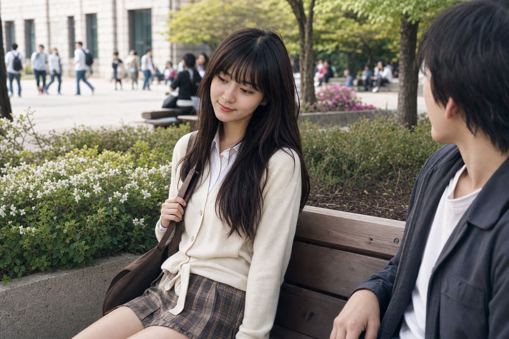

# 041. 마지막 답안지

다음 주 금요일 오후 두 시.

평택대학교 정보통신학과 강의실에는 시험지 넘기는 소리만 남아 있었다. 용식은 마지막 서술형 문제 앞에서 볼펜을 두 번 돌리다가, 아는 만큼만 채우고 답안지를 뒤집었다.

감독관이 걷어 간 답안지 뭉치가 문밖으로 사라지자, 강의실 여기저기서 낮은 탄식과 웃음이 동시에 터졌다. 누군가 가방을 던지듯 어깨에 걸쳤다. 용식도 볼펜을 필통에 꽂으며 목을 한 번 꺾었다.

중간고사가 끝났다.

정확히는 이번 학기 처음으로 제대로 준비해서 본 시험이었다. 도서관 세미나실, 조별과제, 발표 준비까지 겹치며 4월 내내 학교에 묶여 있었던 셈이다. 강의실을 나서는데 핸드폰 진동이 짧게 울렸다.

[김초연] 시험 끝났어?

[김용식] 방금.

[김초연] 나도. 완전 죽는 줄.

학생회관 앞 벤치에는 이미 시험 끝난 학생들이 삼삼오오 모여 있었다. 용식은 정문 쪽으로 걸으며 초연에게 전화를 걸었다.

[김초연] "왜 전화해."

[김용식] "그냥."

[김초연] "목소리 들으려고?"

[김용식] "어. 뭐, 대충."

전화 너머로 웃는 소리가 짧게 들렸다가 사라졌다. 최근 며칠 초연의 말투에는 미세하게 날이 서 있었다. 폰을 보여 달라던 그날 이후로, 겉으로는 아무 일 없다는 듯 지냈지만 둘 사이에는 예전에 없던 틈이 하나 생겨 있었다. 손을 잡아도 예전만큼 자연스럽지 않았고, 문자에 답하는 속도도 서로 미묘하게 늦어졌다.

용식은 정문 앞 계단에 앉아 그녀를 기다렸다.

십 분쯤 지나 초연이 나타났다. 패션디자인과 건물 쪽에서 걸어오는 걸음이 평소보다 느렸다. 어깨에 멘 가방끈을 손으로 꾹 누르고 있었다.

[김초연] "왜 여기 있어."

[김용식] "기다렸지."

초연은 대답 대신 옆에 앉았다. 두 사람 사이에 손 하나 폭만큼의 거리가 남았다. 예전 같으면 자연스럽게 좁혀졌을 거리였다.

[김용식] "시험 잘 봤어?"

[김초연] "몰라. 망한 거 같기도 하고."

[김초연] "너는?"

[김용식] "그냥저냥."

초연이 벤치 옆 화단을 내려다봤다. 벚꽃은 진작 다 졌고, 대신 초록 잎이 무성해져 있었다. 계절이 완전히 바뀐 걸 그제야 알아차린 얼굴이었다.

[김초연] "봄이 벌써 다 갔네."

말투에 힘이 없었다. 시험 때문만은 아닌 것 같았다.

용식은 잠깐 망설이다가 입을 열었다.

[김용식] "우리 어디 좀 갔다 올까."

[김초연] "어디."

[김용식] "멀리. 하루 자고 오는 거."

초연이 고개를 돌려 그를 봤다. 눈빛에 경계와 기대가 반반 섞여 있었다.

[김초연] "갑자기 왜."

[김용식] "그냥. 요즘 좀... 이상했잖아, 우리."

그 말에 초연의 표정이 잠깐 굳었다. 용식은 서둘러 말을 이었다.

[김용식] "싸운 것도 아니고, 화해할 것도 딱히 없는데 뭔가 붕 떠 있는 느낌. 그거 좀 없애고 싶어서."

초연은 바로 대답하지 않았다. 손끝으로 가방끈을 계속 만지작거렸다.

[김초연] "돈 많이 들잖아."

[김용식] "그런 걸 왜 걱정해."

[김초연] "내가 걱정하는 게 아니라, 그냥... 매번 이렇게 크게 쓰는 게 좀."

용식은 그 말의 결을 알아들었다. 목걸이 사건, BMW 소문, 돈 보고 만난다는 쪽지까지 겹쳐 온 이후로 초연은 그가 돈으로 뭔가를 해결하려 할 때마다 몸을 움츠렸다.

[김용식] "돈으로 때우려는 거 아니야. 그냥 둘이 어디 가서 아무 생각 없이 하루 있고 싶어서 그래."

[김초연] "..."

[김용식] "싫으면 안 가도 돼."

초연은 한참 말이 없다가, 결국 작게 웃었다. 억지로 눌러 참던 웃음이 새어 나오는 웃음이었다.

[김초연] "어디 갈 건데."

[김용식] "바다."

[김초연] "이 시기에?"

[김용식] "이 시기라서."

두 사람은 나란히 앉은 채로 한동안 아무 말도 하지 않았다. 학생회관 스피커에서 다음 학기 학생회 선거 안내 방송이 흘러나왔다. 익숙한 소음이 오히려 마음을 편하게 만들었다.

저녁에는 학교 앞 치킨집에서 간단히 저녁을 먹었다. 시험 끝난 걸 축하한다며 반반 치킨과 생맥주를 시켰고, 초연은 오랜만에 소리 내어 웃었다. 계산은 이만사천 원이 나왔다. 용식은 아무렇지 않게 카드를 꺼냈다.

[김초연] "이런 건 좋아, 이런 건."

[김용식] "뭐가."

[김초연] "그냥 치킨. 이런 거."

무슨 뜻인지 알 것 같았다. 큰돈이 아니라 평범한 지출일 때, 초연은 훨씬 편하게 웃었다.

집으로 돌아가는 차 안에서 초연은 창밖을 보며 물었다.

[김초연] "진짜 가는 거지?"

[김용식] "어."

[김초연] "언제."

[김용식] "내일 아침. 짐 대충 챙겨."

[김초연] "너무 갑작스러운 거 아니야?"

[김용식] "원래 좋은 건 갑자기 오는 거야."

초연은 대답 대신 창문에 이마를 살짝 기댔다. 창밖으로 지나가는 가로등 불빛이 그녀의 얼굴 위를 스치듯 지나갔다.

수원 집 앞에 차를 세웠을 때, 초연은 내리기 전에 문득 물었다.

[김초연] "요즘 나 좀 이상했지."

[김용식] "조금."

[김초연] "미안. 나도 왜 그런지 잘 모르겠어서."

용식은 대답 대신 그녀의 손을 잠깐 잡았다. 손끝이 차가웠다.

[김용식] "내일 늦잠 자지 마."

[김초연] "안 자."

그녀는 차에서 내려 몇 걸음 걷다가 돌아봤다. 손을 흔들지는 않았지만, 표정이 아까보다 훨씬 가벼워 보였다.

집으로 돌아온 용식은 침대에 누워 폴더폰을 열었다. 초연에게서 문자가 와 있었다.

[김초연] 나 진짜 설렌다. 오랜만에.

그 짧은 문장 하나가 최근 며칠 쌓였던 어색함을 조금은 씻어 내는 것 같았다. 용식은 답장을 보냈다.

[김용식] 나도.

폰을 접어 협탁 위에 올려놓았다. 창밖은 완전히 어두워져 있었고, 내일 갈 곳의 날씨를 검색해 보려다가 그만두었다. 어차피 날씨가 어떻든 상관없을 것 같았다.

옷장을 열어 가방을 꺼내는데, 문득 헛헛한 웃음이 나왔다.

돈은 넘칠 만큼 있었다. 그런데도 이렇게 사소한 결정 하나에, 초연이 웃어 주는 것 하나에 마음이 이렇게 풀리는 게 스스로도 신기했다.

내일은 아무 생각 없이 그냥 좋은 하루를 보내고 싶었다.

가방에 여벌 티셔츠 두 장과 세면도구를 대충 쑤셔 넣다가, 디지털카메라를 챙겨야 한다는 생각이 뒤늦게 스쳤다. 서랍 안쪽에서 카메라를 꺼내 배터리를 확인했다. 절반쯤 남아 있었다. 충전기까지 챙겨 가방 옆주머니에 밀어 넣고 나서야 뭔가 준비가 끝난 기분이 들었다.

침대에 다시 누워 천장을 보는데, 낮에 초연이 지었던 표정이 자꾸 떠올랐다. 벤치에서 화단을 내려다보던 얼굴, 돈 얘기를 꺼낼 때 살짝 움츠러들던 어깨, 그리고 마지막에 웃으며 손을 흔들지도 않은 채 돌아보던 그 짧은 순간.

폰을 다시 열어 시간을 확인했다. 열두 시가 넘어 있었다.

알람을 여섯 시로 맞추고 폰을 덮었다. 내일은 늦잠 자지 말라고 해 놓고 정작 자기가 늦잠을 자면 안 될 일이었다.
