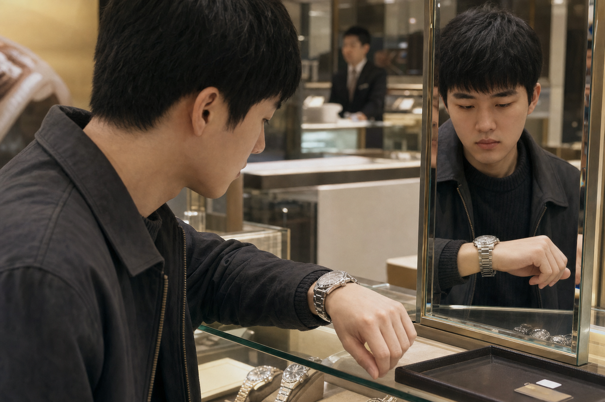

# 043. 혼자 쓰는 오후

화요일 오후 한 시.

이번 학기 들어 처음으로 통째로 빈 시간이었다. 조별과제도 끝났고, 시험도 끝났고, 다음 수업까지는 세 시간이나 남아 있었다. 용식은 강의실을 나서다가 그대로 주차장으로 걸어갔다.

딱히 정한 목적지는 없었다. 다만 오늘은 혼자 있고 싶었다.

차를 몰고 분당 쪽 백화점으로 향했다. 라디오에서 흘러나오는 노래를 들으며 운전하는데, 문득 이런 평일 낮에 이렇게 혼자 돌아다니는 게 얼마 만인지 헤아려 봤다. 대학에 들어온 뒤로는 늘 누군가와 얽혀 있었다. 초연, 정다은, 조별과제, 학원. 혼자만의 시간은 밤에 방에 누워 있을 때 말고는 거의 없었다.

백화점 지하 주차장에 차를 세우고 엘리베이터를 타고 올라갔다. 곧바로 명품관으로 가지 않고, 1층부터 천천히 걸었다. 화장품 매장의 향수 냄새가 코끝을 스쳤고, 점심시간이 지난 평일 백화점은 한산했다. 정장을 입은 사람들 몇몇이 쇼핑백을 들고 지나갔다.

에스컬레이터를 타고 올라가는 동안 창밖으로 주차장 진입로가 내려다보였다. 차들이 줄지어 들어오고 있었다. 고등학교 때는 버스비 아끼겠다고 이십 분 거리를 걸어 다니던 시절도 있었다. 그때는 이런 백화점에 들어올 일도 거의 없었다. 지금은 3층 명품관까지 아무렇지 않게 올라가고 있다는 사실이, 새삼 낯설게 느껴졌다.

3층 명품관 코너 앞에서 그는 걸음을 멈췄다. 오래전부터 눈여겨봐 둔 매장이었다.

유리 진열장 안에는 스위스산 시계 몇 개가 조용한 조명 아래 놓여 있었다. 점원이 다가와 가볍게 목례했다.

[점원] "찾으시는 모델 있으세요?"

[김용식] "그냥 좀 보려고요."

[점원] "천천히 보세요."

용식은 진열장을 따라 걸으며 몇 개를 손목에 대 보았다. 무게감이 묵직하게 손목을 눌렀다. 크게 화려하지 않으면서도 오래 써도 질리지 않을 만한 디자인을 찾는 중이었다.

[김용식] "이거, 한번 껴 봐도 돼요?"

[점원] "그럼요."

시계를 손목에 채우자 점원이 몇 마디 설명을 덧붙였다. 무브먼트가 어떻고, 방수가 어떻고. 용식은 절반쯤 흘려들으며 거울에 손목을 비춰 봤다.

옆 진열대에서는 다른 손님 두 명이 시계를 고르고 있었다. 이십 대 후반쯤 되어 보이는 커플이었다. 여자가 남자 손목에 시계를 채워 주며 웃었다.

[여자 손님] "이거 완전 잘 어울린다."

[남자 손님] "우리 이거 커플로 맞출까."

[여자 손님] "좋아."

두 사람은 나란히 서서 서로의 손목을 번갈아 보며 웃었다. 점원도 그 옆에서 함께 미소 짓고 있었다.

용식은 그 장면을 잠깐 봤다가 시선을 돌렸다. 딱히 부럽다는 감정은 아니었다. 그런데 뭔가 미묘하게 마음 한구석이 서늘해졌다. 저 커플은 오늘 이 시계를 산 걸 서로 자랑하고, 사진 찍고, 친구들한테도 보여 줄 것이다. 자신은 오늘 뭘 사든 그걸 보여 줄 사람이 없었다.

집에서는 안 된다. 어머니가 이런 걸 보면 백 가지 질문이 따라올 게 뻔했다. 초연에게도 마찬가지였다. 학생 신분에 이런 시계를 차고 다니면 그 자체로 또 다른 소문의 시작이 될 것이었다.

결국 이것도 서랍 안에 넣어 두고 혼자만 아는 물건이 될 예정이었다.

커플 손님은 결제까지 마치고 매장을 나서며 서로의 팔짱을 꼈다. 점원이 문 앞까지 배웅하며 인사를 건넸다. 용식은 그 뒷모습이 완전히 사라질 때까지 시선을 두었다가, 다시 진열장 쪽으로 고개를 돌렸다.

[점원] "손님 손목에 잘 어울리시네요. 젊으신데 이런 클래식한 걸 좋아하시나 봐요."

[김용식] "그냥, 오래 쓸 만한 거 찾다 보니까요."

[점원] "안목 있으시네요."

용식은 거울 속 자신의 손목을 다시 봤다. 시계는 확실히 마음에 들었다. 다만 이걸 사고 나서 느껴야 할 감정이 뭔지 스스로도 헷갈렸다.

한참을 고민한 끝에 그는 결국 그 시계를 골랐다.

[김용식] "이걸로 할게요."

[점원] "탁월한 선택이세요. 포장은 선물용으로 해 드릴까요?"

[김용식] "아니요. 그냥 저 쓸 거예요."

점원이 잠깐 의외라는 표정을 지었다가 곧 다시 웃었다. 혼자 쓸 거라며 이만한 시계를 고르는 손님은 흔치 않은 모양이었다. 결제는 카드로 했다. 삼백팔십만 원이 넘는 금액이 찍혔지만, 용식은 별다른 표정 변화 없이 서명을 했다.

매장을 나오면서 손목에 찬 새 시계를 내려다봤다. 묵직한 무게가 낯설었다.

기분이 후련할 줄 알았는데, 이상하게 그렇지 않았다. 갖고 싶던 걸 손에 넣었는데도 뭔가 텅 빈 느낌이 계속 따라왔다. 백화점 1층을 가로질러 걸어가는데, 진열장 유리에 비친 자기 얼굴이 문득 낯설게 느껴졌다.

주차장으로 내려가는 엘리베이터 안에서 폴더폰을 꺼내 초연에게 문자를 쓰려다가 멈췄다.

[김용식] 오늘 뭐 해

썼다가 지웠다. 시계 얘기는 뺐다. 그냥 뭐 하냐고 묻는 것도 괜히 어색하게 느껴졌다.

[김초연] 그냥 집. 왜?

답장이 금방 왔다. 용식은 잠깐 화면을 보다가 답을 보냈다.

[김용식] 아니 그냥.

차에 올라 시동을 걸고 나서도 한참을 그대로 앉아 있었다. 손목의 시계가 운전대를 잡을 때마다 눈에 들어왔다. 이걸 초연에게 보여 주고 싶은 마음과, 오늘만큼은 이걸 혼자만 알고 싶은 마음이 동시에 있었다.

그때 문득, 며칠 전부터 답하지 않은 문자가 떠올랐다.

[한서윤] 우리 이렇게 계속 숨기고 지내야 해?

용식은 문자함을 열지 않았다. 오늘은 혼자 있고 싶었다는 말로, 그는 그 문장까지 같이 미뤘다. 학원도 마찬가지였다. 가야 하는 날이라는 걸 알고 있었지만, 시계를 산 손목이 운전대 위에서 무겁게 빛나자 괜히 그 건물 쪽으로 가고 싶지 않았다.

결국 그는 집에 도착해서 시계를 서랍 깊숙한 곳에 넣었다. 예전에 사 뒀던 다른 물건들 옆이었다. 아무도 모르는 서랍 안에는 그가 아무에게도 보여 주지 못한 것들이 조용히 쌓여 가고 있었다.

창밖이 어두워질 무렵, 용식은 침대에 누워 오늘 하루를 되짚었다. 혼자 백화점에 가고, 혼자 시계를 고르고, 혼자 결제를 하고, 혼자 서랍에 넣었다. 처음부터 끝까지 혼자였다.

나쁘지 않은 하루였다. 다만 그 끝에 남는 감정이 뭔지는, 아직 정확히 이름 붙이기 어려웠다.

어머니가 반찬가게에서 돌아오는 소리가 현관 쪽에서 들렸다. 용식은 얼른 몸을 일으켜 방문을 살짝 닫았다. 서랍은 이미 잠가 둔 뒤였다.

[어머니] "용식아, 저녁 먹었어?"

[김용식] "아직."

[어머니] "내려와, 반찬 좀 남았어."

용식은 손목을 한 번 내려다봤다. 시계는 이미 서랍 속에 들어가 아무 흔적도 남기지 않았다. 그는 평소와 다름없는 얼굴로 방문을 열고 나갔다.
