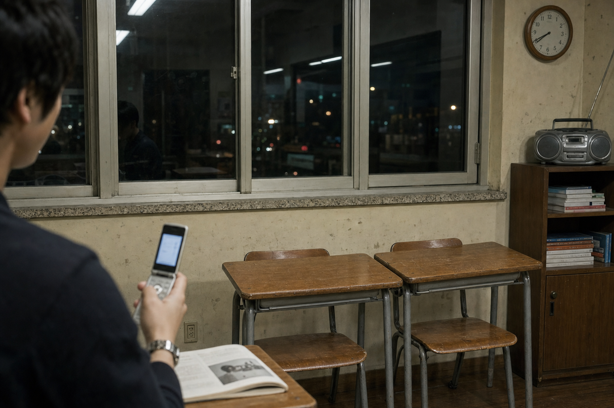

# 045. 빈자리

5월 첫 금요일 저녁 일곱 시.

수원으로 넘어가는 도로는 퇴근 시간과 겹쳐 평소보다 막혔다. 용식은 신호 대기 중에 손목시계를 몇 번이나 확인했다. 새로 산 시계였다. 오늘은 처음으로 그걸 차고 나왔다. 손목에 익숙해지려면 며칠은 더 필요할 것 같았다.

강릉 여행과 중간고사, 그 뒤로 이어진 며칠 동안 학원을 두 번이나 빠졌다. 지난주 금요일은 시험이 끝난 뒤 초연과 치킨집에 앉아 시간을 흘려보냈고, 화요일은 백화점에서 시계를 산 뒤 그냥 피곤하다는 핑계로 미뤘다. 대수롭지 않게 넘긴 결석이었다.

학원 앞에 도착해 주차를 하고 계단을 오르는데, 오랜만이라는 느낌이 생각보다 크게 다가왔다. 요 며칠 초연과의 시간, 정다은과의 어색한 순간, 시계를 사던 오후까지 겹치면서 이 건물 자체를 거의 잊고 지냈다는 걸 그제야 깨달았다.

강의실 문을 열고 들어서자, 익숙한 자리가 눈에 들어왔다. 창가 쪽 두 번째 줄. 늘 그 옆자리에 앉아 있던 사람이 오늘은 없었다.

용식은 별생각 없이 자리에 앉아 가방을 내려놓았다. 수업 시작 오 분 전인데도 옆자리는 비어 있었다. 늦나 보다, 정도로만 생각했다.

수업이 시작되고도 그 자리는 끝까지 채워지지 않았다.

쉬는 시간, 옆줄에 앉은 다른 수강생이 지나가는 말로 물었다.

[수강생] "저 자리 원래 앉으시던 분, 이번 주부터 안 나오시나 봐요."

[김용식] "아, 그래요?"

[수강생] "네, 원장님이 그러시던데. 개인 사정이라고."

용식은 애써 아무렇지 않은 얼굴로 고개를 끄덕였다. 속으로는 뭔가 덜컥 내려앉는 기분이었다.

강의실 앞쪽에서 원장이 출석부를 정리하다가 슬쩍 그를 봤다.

[원장] "용식 학생, 이번 주 두 번이나 빠졌네요."

[김용식] "죄송해요, 좀 바빠서요."

[원장] "다음 달 재등록할 거죠?"

[김용식] "네, 할 거예요."

원장은 별다른 의심 없이 다시 서류로 시선을 돌렸다. 용식은 창가 쪽 빈자리를 다시 한번 흘끗 봤다. 누군가 그 자리에 잠깐 앉았다가 다시 자기 자리로 돌아가는 걸 지켜보면서, 이상하게 그 빈 의자 하나가 강의실 전체보다 크게 느껴졌다.

수업이 끝난 뒤, 주차장으로 걸어가며 폴더폰을 열었다. 며칠 전 마지막으로 왔던 문자가 그대로 남아 있었다.

[한서윤] 우리 이렇게 계속 숨기고 지내야 해?

그 문자에 아직 답을 하지 않았다는 사실이 그제야 뚜렷하게 떠올랐다. 강릉에 다녀오고, 시험을 보고, 정다은과 어색한 순간을 겪는 사이, 이 문자 하나는 완전히 뒷전으로 밀려나 있었다.

차에 올라 시동을 걸기 전, 그는 잠깐 화면을 들여다봤다. 저장된 이름은 여전히 '학원자료'였다.

[김용식] 오늘 학원 안 왔던데, 무슨 일 있어?

보내고 나서 후회했다. 너무 늦은 질문이었다.

답은 오지 않았다. 집으로 돌아오는 내내 폰은 조용했다.

라디오도 켜지 않은 채 익숙한 도로를 달렸다. 강릉 여행에서 돌아오던 길, 초연이 잠든 옆얼굴을 몇 번이나 확인하던 순간이 떠올랐다. 그날은 아무 걱정도 없었다. 지금은 같은 도로인데도 마음 한쪽이 계속 뭔가에 걸려 있는 기분이었다.

신호 대기 중에 문득 낮에 있었던 정다은과의 순간도 다시 스쳤다. 어깨가 닿았던 감각, 그 뒤에 남은 이상한 여운. 그것도 아직 완전히 지워지지 않은 채였다. 초연과는 그 어느 때보다 편안했고, 정다은에게는 설명할 수 없는 감정이 남아 있었고, 한서윤은 이제 답조차 없었다. 세 갈래로 흩어진 마음이 동시에 그를 잡아당기고 있었다.

신호가 바뀌자 그는 액셀을 밟았다. 아무것도 정리되지 않은 채로 집이 가까워지고 있었다.

집에 도착해 방에 들어서자마자 초연에게서 문자가 와 있었다.

[김초연] 오늘 학원 갔어?

[김용식] 어, 방금 끝났어.

[김초연] 늦었네. 조심히 와.

짧은 문자였지만, 그 안에는 예전 같은 의심의 기색이 없었다. 강릉 이후로 초연은 확실히 편안해져 있었다. 그 편안함이 지금은 오히려 마음을 더 무겁게 만들었다.

샤워를 마치고 침대에 누웠을 때, 폰이 짧게 진동했다.

[한서윤] 이제 와서 왜 물어봐.

용식은 그 문장을 몇 번이나 다시 읽었다. 화가 난 것 같기도 하고, 지친 것 같기도 한 말투였다. 뭐라고 답해야 할지 손가락이 쉽게 움직이지 않았다.

[김용식] 그동안 좀 정신없었어. 미안.

한참을 기다렸지만 답은 오지 않았다. 대신 몇 분 뒤 다른 문자가 도착했다.

[한서윤] 나 이번 학기 그냥 그만둘까 생각 중이야.

그 한 줄이 방 안의 공기를 다르게 만들었다. 학원을 그만둔다는 건, 이 관계의 마지막 접점 하나가 사라진다는 뜻이었다. 용식은 그 문장을 오래 들여다봤다. 안도해야 할지, 불안해야 할지조차 스스로 판단이 서지 않았다.

[김용식] 잠깐 만나서 얘기하면 안 될까.

이번에는 답이 빠르게 왔다.

[한서윤] 무슨 말을 더 해.

그리고 몇 초 뒤, 마지막 문자가 도착했다.

[한서윤] 나 지금 수원역이야.

용식은 몸을 일으켜 앉았다. 창밖은 완전히 어두워져 있었다. 폴더폰 화면 속 그 한 줄이 사라지지 않고 그대로 남아 있었다.

시계를 보니 밤 열 시가 넘어 있었다. 이 시간에 혼자 수원역에 나와 있다는 것 자체가, 그녀가 지금 어떤 상태인지 짐작하게 했다. 아무 계획 없이 나온 게 아니라, 답을 받을 때까지 기다릴 작정으로 나온 것 같았다.

용식은 침대에 걸터앉은 채 한참을 망설였다. 지금 나가면 또 다른 거짓말을 하나 더 만들어야 했다. 초연에게는 뭐라고 할지, 이 시간에 수원까지 나가는 걸 어떻게 설명할지 아무것도 정리되지 않았다.

그런데도 몸이 먼저 움직였다.

강릉의 바다, 시계 매장의 조용한 오후, 정다은의 웃음, 그리고 지금 이 문자까지. 며칠 사이 쌓인 감정들이 한꺼번에 밀려오는 것 같았다. 좋았던 시간과 정리하지 못한 감정이 동시에 그를 밀어냈다.

그는 옷을 챙겨 입으며 답장을 쓰지 못한 채 현관으로 향했다. 어머니 방에서는 이미 불이 꺼져 있었다. 조용히 현관문을 열고 나서는데, 차가운 밤공기가 얼굴에 닿았다.

주차장으로 내려가는 발걸음이 평소보다 빨랐다. 계단을 다 내려가기도 전에, 그는 이미 수원역까지 가는 길을 머릿속으로 그리고 있었다.
