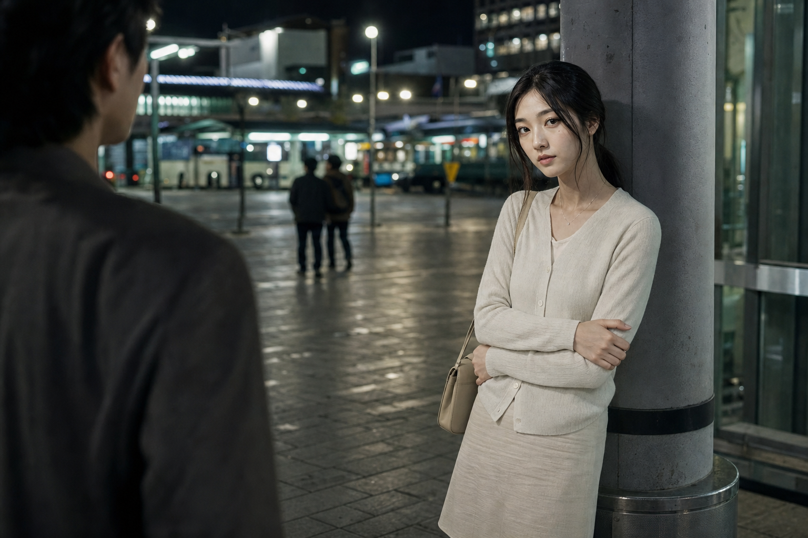

# 046. 수원역

밤 열한 시 반.

평택에서 수원까지 가는 국도는 밤이라 한산했다. 용식은 신호마다 걸릴 때마다 폴더폰을 흘끗거렸다. 한서윤에게서는 더 이상 문자가 오지 않았다. 나 지금 수원역이야, 라는 그 한 문장 뒤로 화면은 조용했다.

라디오를 켰다가 이내 꺼 버렸다. 무슨 말을 해야 할지 정하지 못한 채로 운전대만 잡고 있었다. 강릉에서 돌아오던 길과 같은 국도인데, 그때와는 완전히 다른 속도로 달리고 있었다.

수원역 근처에 다다르자 도로 양옆으로 늦은 시간까지 불을 켠 술집과 편의점 간판이 지나갔다. 주차할 곳을 찾다가 결국 역 앞 공영주차장에 대충 차를 세웠다.

수원역 앞 광장은 평일 심야치고는 사람이 꽤 남아 있었다. 마지막 버스를 기다리는 사람들, 취기가 오른 채 큰 소리로 떠드는 무리, 그리고 그 사이에 혼자 서 있는 사람 하나.

한서윤은 벤치에도 앉지 않은 채, 광장 기둥에 몸을 기대고 있었다. 얇은 카디건 하나만 걸친 채였다. 용식이 차에서 내려 다가가자, 그녀는 고개를 들었다가 다시 시선을 내렸다.

[김용식] "왜 이렇게 얇게 입고 나왔어."

[한서윤] "그런 걱정, 이제 와서 하지 마."

목소리에 힘이 없었다. 화가 난 것도 아니고, 그렇다고 담담한 것도 아닌, 둘 다 지나쳐 버린 목소리였다.

[김용식] "많이 기다렸어?"

[한서윤] "몰라. 시간 안 봤어."

용식은 그녀 앞에 섰다. 광장 조명이 두 사람 사이 거리를 어정쩡하게 비췄다. 가까이 가야 할지, 그냥 서 있어야 할지 판단이 서지 않았다.

[김용식] "학원 왜 안 나왔어."

[한서윤] "그거 물으려고 여기까지 왔어?"

[김용식] "아니, 그건 아니고..."

[한서윤] "그럼 뭐."

용식은 대답을 찾지 못했다. 사실 자신도 여기까지 오는 내내 무슨 말을 해야 할지 정하지 못한 채였다.

[한서윤] "나 요즘 내가 뭔지 모르겠어."

[김용식] "무슨 소리야."

[한서윤] "학원자료. 그거 내 이름이잖아, 지금."

그 말에 용식은 아무 대답도 하지 못했다.

[한서윤] "학원 안에서는 손끝 스치고, 밖에서는 모르는 사람처럼 굴고. 처음엔 그것도 재밌었어. 우리만 아는 규칙 같아서. 근데 요즘은 그냥... 내가 진짜로 없어지는 것 같아."

[김용식] "그런 거 아니야."

[한서윤] "그럼 뭔데. 말해 봐."

용식은 입을 열었다가 다물었다. 정확한 말이 나오지 않았다. 초연을 지키고 싶은 마음과, 한서윤을 완전히 놓고 싶지 않은 마음이 동시에 있었고, 그 두 마음을 한 문장으로 정리할 방법이 없었다.

[김용식] "지금 당장 뭐라고 확실하게 말은 못 하겠는데..."

[한서윤] "역시 그렇지."

[김용식] "서윤 씨."

[한서윤] "이름도 제대로 못 부르면서."

정확한 지적이었다. 용식은 그녀를 부를 때조차 은연중에 조심하고 있었다. 누가 들을까 봐, 누가 알아챌까 봐.

[김용식] "미안해. 요즘 좀 정신이 없었어."

[한서윤] "여행 가서? 아니면 딴 여자애랑 있느라?"

용식의 표정이 굳었다.

[한서윤] "봤어. 학교 앞에서, 다른 여자애랑 되게 편하게 웃고 있던 거."

[김용식] "그건 그냥 같은 과 동기야."

[한서윤] "그래, 뭐. 나도 그냥 학원 아는 사람이니까."

그 말에는 비꼬는 기색이 분명했다. 용식은 아무 말도 하지 못했다.

한서윤은 잠깐 하늘을 올려다봤다가 다시 그를 봤다.

[한서윤] "나 이번 학기 진짜 그만둘까 봐."

[김용식] "그러지 마."

[한서윤] "왜, 아쉬워서?"

[김용식] "어."

그 짧은 대답에 한서윤은 잠깐 흔들리는 표정을 지었다. 그러나 곧 다시 무표정으로 돌아왔다.

[한서윤] "아쉬운 거 말고, 나한테 뭘 해 줄 수 있는데."

용식은 대답하지 못했다. 광장 스피커에서 막차 안내 방송이 흘러나왔다. 그 소리가 지나가는 동안, 둘 다 아무 말도 하지 않았다.

[한서윤] "됐어."

[김용식] "서윤아."

[한서윤] "됐다고."

그녀는 카디건 앞섶을 여미며 몸을 돌렸다. 용식이 손을 뻗었지만 닿지 않았다.

[김용식] "데려다줄게."

[한서윤] "됐어. 버스 타고 갈게."

[김용식] "밤늦었잖아."

[한서윤] "그런 걱정도 이제 와서 하지 말라니까."

그녀는 그렇게 말하고 정류장 쪽으로 걸어갔다. 뒤돌아보지 않았다.

용식은 몇 걸음 따라가다가 멈췄다. 더 쫓아가는 것도, 여기서 그냥 보내는 것도 둘 다 답이 아닌 것 같았다. 정류장 불빛 아래 서 있는 한서윤의 등이 점점 작아졌다. 버스가 도착하는 소리가 들렸고, 그녀는 뒤도 돌아보지 않은 채 올라탔다.

버스 문이 닫히는 소리가 유난히 크게 들렸다. 창문 너머로 그녀가 앉는 모습이 잠깐 보였다가, 버스가 출발하며 시야에서 사라졌다.

용식은 그 뒷모습이 사람들 사이로 사라질 때까지 그 자리에 서 있었다.

끝난 것 같지도, 그렇다고 봉합된 것 같지도 않았다. 그냥 어정쩡하게 멈춘 채로 남겨진 기분이었다.

차로 돌아와 시동을 걸면서 폴더폰을 열었다.

부재중 전화 두 통. 초연이었다.

용식의 손이 잠깐 멈췄다. 시계를 보니 벌써 자정에 가까워지고 있었다. 이 시간에 전화가 두 통이나 왔다는 건, 그녀가 그만큼 걱정했다는 뜻이었다.

그는 콜백 버튼을 누르려다가, 뭐라고 말할지 정하지 못한 채 폰을 다시 접었다.

차를 몰아 평택 방향 국도로 올라서는데, 반대편 차선에 심야버스 한 대가 지나갔다. 저 버스 어딘가에 한서윤이 타고 있을지도 모른다는 생각이 스쳤다. 그는 백미러로 멀어지는 버스 불빛을 잠깐 봤다가, 다시 앞을 봤다.

집 근처 상가 지하주차장에 차를 세웠을 때는 새벽 한 시가 다 되어 있었다. 형광등 하나가 여전히 깜빡거렸다. 그는 시동을 끄고도 한동안 운전석에 그대로 앉아 있었다.

부재중 전화 두 통이 화면에 그대로 남아 있었다. 통화 버튼을 누르면 초연이 잠에서 깰지도 몰랐다. 안 누르면 아침에 왜 전화를 안 받았냐는 질문이 기다리고 있을 게 뻔했다.

용식은 결국 아무 버튼도 누르지 않고 폰을 접었다.

깜빡이는 형광등 아래, 차에서 내려 집으로 걸어가는 짧은 거리 동안에도 오늘 밤 있었던 모든 말들이 계속 맴돌았다.
