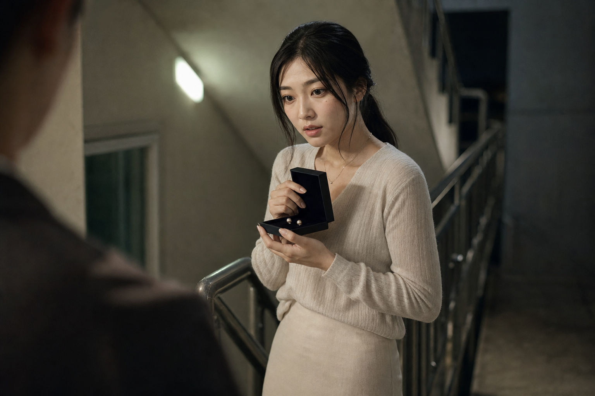

# 054. 옥죈다는 말

금요일 오후, 용식은 수업이 끝나자마자 분당의 한 백화점으로 차를 몰았다.

지난주부터 마음에 걸리던 게 있었다. 로비에서의 그 순간, 자신이 뱉었던 "학원 같이 다니는 분이야"라는 말. 틀린 말은 아니었지만, 그 말을 하던 순간 한서윤의 눈에서 스쳐 지나간 감정을 용식은 여전히 잊지 못하고 있었다.

주얼리 매장 유리 진열대 앞에 선 용식은 한참을 서성였다. 점원이 다가와 몇 가지를 추천해 줬다.

[점원] "여자친구 선물이세요?"

[김용식] "아, 그냥... 아는 사람이요."

점원은 별 의심 없이 웃으며 진열대에서 몇 개를 더 꺼내 놓았다. 용식은 그중 작은 진주가 박힌 은색 귀걸이를 골랐다. 가격표를 보지도 않고 카드를 내밀었다. 138만 원. 결제 서명을 하는 손이 잠깐 멈칫했다. 초연에게 목걸이를 사 줬다가 오히려 자존심을 건드렸던 4월의 일이 잠깐 스쳤지만, 지금은 그 기억을 애써 밀어냈다.

포장된 상자를 재킷 안주머니에 넣고 나오는 길, 용식은 이 선물이 정확히 무엇을 의미하는지 스스로도 완전히 정리하지 못한 채였다.

수원 일본어 학원, 저녁 여섯 시.

강의실에서는 평소와 다름없이 수업이 진행됐다. 한서윤은 지난주와 마찬가지로 필기를 하며 그와 눈을 마주치지 않았다. 로비에서의 일 이후 두 사람 사이에는 눈에 보이지 않는 거리가 하나 더 생긴 것 같았다.

수업이 끝나고 다른 수강생들이 하나둘 빠져나갔다. 용식은 계단 옆 비상구 쪽에서 그녀를 기다렸다.

[김용식] "잠깐 시간 돼?"

한서윤이 걸음을 멈췄다. 표정에는 별다른 변화가 없었다.

[한서윤] "왜."

[김용식] "저번 일, 미안했어."

[한서윤] "뭐가 미안한데."

[김용식] "그렇게 말한 거. 아는 사이라고만 하고 넘긴 거."

한서윤은 잠깐 그를 보다가 짧게 웃었다. 웃음에는 온기가 없었다.

[한서윤] "틀린 말은 아니잖아. 우리, 밖에서는 그렇게 지내기로 한 거."

[김용식] "그래도 그 순간엔 다르게 말했어야 했어."

용식은 재킷 안주머니에서 상자를 꺼내 내밀었다. 한서윤은 그걸 바로 받지 않고 잠시 바라봤다.

[한서윤] "이게 뭐야."

[김용식] "그냥, 미안해서."

[한서윤] "돈으로 때우려는 거야?"

[김용식] "그런 거 아니야."

한서윤은 상자를 받아 들고 뚜껑을 열었다. 진주 귀걸이가 비상구 조명 아래에서 옅게 빛났다. 그녀의 표정이 잠깐 흔들렸다.

[한서윤] "……예쁘네."

[김용식] "잘 어울릴 것 같아서."

한서윤은 상자를 가방에 넣으며 한숨을 쉬었다.

[한서윤] "너 이런 거 자꾸 하면 안 돼. 나 진짜 헷갈려."

[김용식] "미안해."

두 사람은 학원 건물을 나와 근처 골목의 작은 술집으로 자리를 옮겼다. 딱히 약속한 건 아니었지만, 어느새 자연스럽게 그렇게 흘러갔다.

술이 몇 잔 들어가자 용식의 말이 늘어졌다.

[김용식] "요즘 좀 힘들어. 초연이가... 자꾸 확인하려고 해. 폰이며 학원이며. 숨 막힐 때가 있어."

[한서윤] "여자친구가 그럴 수도 있지."

[김용식] "아는데. 근데 요즘은 그게 좀... 옥죄는 것 같아."

그 말을 뱉고 나서 용식은 스스로도 놀랐다. 누군가에게 이런 말을 이렇게 솔직하게 꺼낸 건 처음이었다.

한서윤은 술잔을 만지작거리며 그를 바라봤다.

[한서윤] "그래서 나한테 이런 거 사 온 거야? 숨 쉴 구멍 찾으려고?"

[김용식] "그런 건 아닌데."

[한서윤] "아니긴."

그녀는 그렇게 말하면서도 자리를 뜨지 않았다. 잔이 몇 번 더 채워졌다. 창밖으로 늦은 밤 골목의 가로등이 젖은 아스팔트 위에 흐릿하게 번져 있었다. 낮에 잠깐 소나기가 지나간 모양이었다.

[한서윤] "나 오늘 좀 늦게 들어가도 괜찮아. 원래 자취방 근처 아무도 신경 안 써."

그 말에 용식은 잔을 든 채 잠깐 멈췄다.

[김용식] "괜찮겠어?"

[한서윤] "뭐가."

[김용식] "우리, 또……"

한서윤은 대답 대신 자리에서 일어나 그의 옆으로 옮겨 앉았다. 어깨가 닿았다. 그녀에게서 술과 섞인 옅은 향이 났다.

[한서윤] "네가 먼저 멈추면 나도 멈출게."

용식은 멈추지 않았다. 한서윤도 멈추지 않았다.

두 사람은 계산을 마치고 술집을 나와 말없이 걸었다. 골목 끝, 낯익은 모텔 간판 불빛이 젖은 도로 위에 어른거렸다. 누구도 먼저 그쪽으로 가자고 말하지 않았지만, 걸음은 자연스럽게 그리로 향했다.

방문이 닫히고 조명이 꺼졌다.

창밖 가로등 불빛이 커튼 틈으로 가늘게 스며들었다.

다음 날 아침, 용식은 낯선 천장을 보며 눈을 떴다. 옆자리는 비어 있었다. 욕실 쪽에서 물소리가 들렸다.

협탁 위에는 어젯밤 그가 준 귀걸이 상자가 열린 채 놓여 있었다. 한서윤이 한쪽만 먼저 걸어 본 흔적처럼, 귀걸이 한 짝만 상자 밖으로 나와 있었다.

용식은 몸을 일으켜 앉았다. 머릿속이 무겁게 가라앉았다. 폴더폰을 열어 보니 초연에게서 온 문자는 없었다. 다행인 건지 아닌지 알 수 없었다.

욕실 문이 열리고 한서윤이 나왔다. 젖은 머리를 수건으로 대충 두른 채였다.

[한서윤] "먼저 나갈게. 너도 정리하고 나와."

[김용식] "어. 데려다줄까?"

[한서윤] "아니, 혼자 갈게."

그녀는 짐을 챙기며 귀걸이 상자를 가방 안쪽 깊숙이 넣었다. 그 손짓이 조심스러웠다. 잃어버리지 않으려는 것처럼 보이기도 했고, 누구에게도 들키지 않으려는 것처럼 보이기도 했다.

한서윤이 나가고 방 안에 혼자 남은 용식은 한참을 그대로 앉아 있었다. 창밖으로 아침 버스가 지나가는 소리가 들렸다. 초연에게 오늘 하루를 어떻게 설명해야 할지, 아직 아무 계획도 없었다.

체크아웃을 하고 나온 그는 편의점에서 생수 하나를 사 들고 차로 돌아왔다. 운전석에 앉아 시동을 걸기 전, 백미러에 비친 자기 얼굴을 잠깐 들여다봤다. 어젯밤의 말들이 다시 떠올랐다. 옥죈다는 말, 숨 막힌다는 말. 초연에게는 절대 할 수 없는 말들을 한서윤에게는 아무렇지 않게 뱉어 버렸다는 사실이 뒤늦게 무겁게 다가왔다.

집으로 돌아가는 길, 라디오에서는 아침 뉴스가 흘러나오고 있었다. 용식은 그 소리를 듣는 둥 마는 둥 하며 초연에게 보낼 문자를 고민했다. 결국 아무렇지 않은 척, 평범한 안부 문자 한 줄만 적어 보냈다.

[김용식] 잘 잤어? 오늘 뭐해.

답장이 오기 전까지, 그는 핸들을 쥔 손에서 좀처럼 힘을 풀지 못했다.
