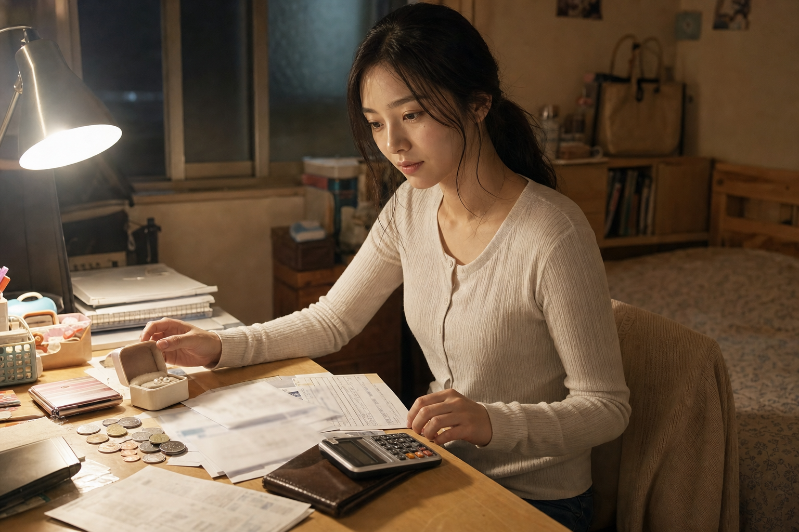

# 060. 미리 잡아 둔 방

일요일 오전, 용식은 초연에게 문자를 보냈다.

[김용식] 오늘 학교 과제 자료 정리하러 도서관 가야 해서, 좀 늦게 볼 것 같아.

[김초연] 그래, 무리하지 말고.

거짓말은 아니었다. 정리해야 할 자료가 있는 것도 사실이었다. 다만 그 전에 들러야 할 곳이 하나 더 있다는 사실을 굳이 덧붙이지 않았을 뿐이었다.

일요일 오후, 수원역 근처 패스트푸드점.

한서윤이 먼저 자리를 잡고 앉아 있었다. 테이블 위에는 프린트한 종이 한 장이 놓여 있었다. 용식이 앉자, 그녀가 그 종이를 그의 앞으로 밀었다.

그녀는 편의점 아르바이트를 마치고 바로 온 듯, 여전히 조끼 자국이 남은 셔츠 차림이었다.

[한서윤] "이거 봐 봐."

항공권 예약 화면을 출력한 종이였다. 날짜는 6월 15일, 도쿄행이었다.

[김용식] "이게 뭐야."

[한서윤] "나도 그날 갈까 해서."

용식은 순간 말을 잃었다.

[김용식] "진심이야?"

[한서윤] "왜, 안 돼?"

[김용식] "그런 게 아니라, 갑자기……"

[한서윤] "나도 방학이잖아. 어차피 학원도 이번 달까지만 다니기로 했고."

한서윤의 목소리는 담담했지만, 그 밑에 깔린 결심은 분명해 보였다.

[김용식] "숙소는 어떻게 하려고."

[한서윤] "그건 아직. 알아보는 중이야."

[김용식] "그럼 내가 잡아 놓을게."

한서윤은 그 말에 잠깐 멈칫했다.

[한서윤] "됐어, 그런 거까지."

[김용식] "어차피 나도 어학원 근처 지리는 좀 알잖아. 내가 알아보는 게 더 빠를 거야."

[한서윤] "……진짜 상관없어?"

[김용식] "어. 그 정도는 아무것도 아니야."

한서윤은 잠깐 시선을 내렸다가 다시 그를 봤다. 딱 잘라 거절할 말이 쉽게 나오지 않았다.

[한서윤] "그럼 3박만. 그 이상은 안 돼."

[김용식] "왜 3박이야, 어차피 예약하는 김에 더 오래 잡아도 되는데."

[한서윤] "아니, 3박이면 딱 맞아. 그 이상은…… 나도 부담이야."

돈 이야기가 아니었다. 그녀 스스로도 그 말이 정확히 무엇을 가리키는지 설명하지 못했다. 다만 그가 아무렇지 않게 방을 잡아 주겠다는 것과, 그걸 받아들이는 자신 사이에 그어 두고 싶은 선이 있었다.

[김용식] "그래, 알았어. 3박으로 잡을게."

[한서윤] "항공권은 내가 알아서 할게. 이건 내 여행이니까."

[김용식] "그래."

한서윤은 그렇게 말하며 프린트물을 가지런히 정리했다. 적어도 오는 것과 가는 것만은 스스로 결정한 일이라는 사실을, 그녀는 그렇게라도 지키고 싶어 했다.

두 사람은 프린트물을 앞에 두고 세부 일정을 맞춰 나갔다.

[한서윤] "첫날은 너 어학원 오리엔테이션 있다며. 그거 끝나고 저녁에 보자."

[김용식] "어, 그때쯤이면 시간 될 거야."

[한서윤] "둘째 날은 아사쿠사 쪽 가 보고 싶어. 사진으로만 봤거든."

[김용식] "그래, 거기 가자."

[한서윤] "셋째 날 저녁 비행기로 나 먼저 들어갈게. 너는 그다음부터 혼자 지내야 하고."

용식은 종이 위 날짜를 손가락으로 짚어 보며 고개를 끄덕였다. 어느 역에서 어느 숙소까지, 목소리를 낮춘 채 조율하는 두 사람의 모습은 마치 평범한 여행 계획을 짜는 커플처럼 보이기도 했다.

[한서윤] "너 초연 씨한테는."

[김용식] "말 안 할 거야."

[한서윤] "그럴 줄 알았어."

그녀는 별다른 반응 없이 종이를 접어 가방에 넣었다.

패스트푸드점 유리창 너머로 저녁 어스름이 내려앉고 있었다. 두 사람은 자리를 정리하고 밖으로 나와 헤어졌다. 한서윤은 반대 방향 버스 정류장으로 걸어갔다.

버스에 오른 한서윤은 창가 자리에 앉아 핸드폰을 꺼냈다. 항공권 예약 확인 문자가 화면에 떠 있었다. 그녀는 그 문자를 한참 들여다보다가, 손가락으로 삭제 버튼을 눌렀다.

혹시나 누가 보게 될까 봐 남겨 두지 않는 습관이었다. 이제는 익숙해진 손짓이었다. 삭제 버튼을 누르는 손끝에는 별다른 망설임이 없었다.

창밖으로 지나가는 야경을 보며, 한서윤은 오늘 자신이 한 선택을 다시 곱씹었다. 용식이 사 준 진주 귀걸이, 술자리마다 계산해 주던 카드, 부담 없이 건네던 선물들, 그리고 이제는 방 하나까지. 그런 것들이 자신에게 유독 잘 통한다는 걸, 그녀는 스스로도 잘 알고 있었다.

넉넉하지 않은 집에서 자란 그녀에게 그 정도의 호의는 쉽게 뿌리치기 어려운 것들이었다. 친구들이 부모님께 용돈을 받아 쓰는 걸 볼 때마다 느꼈던 위축감, 아르바이트로 학원비를 겨우 맞춰 온 시간들. 용식의 무심한 씀씀이는 그 결핍을 정확히 건드렸다.

그렇다고 그녀가 그걸 노리고 다가간 적은 없었다. 처음엔 오히려 그의 씀씀이가 부담스러워 몇 번이고 자기 몫을 따로 계산하려 했었다. 다만 그가 아무렇지 않게 내미는 걸 매번 밀어내는 것도 이상하게 자존심이 상하는 일이었고, 언젠가부터는 그냥 그의 방식을 받아들이기로 했다. 대신 자신이 지킬 수 있는 선 하나쯤은 스스로 정해 두고 싶었다. 항공권은 자신이 사고, 머무는 기간은 3박까지만. 그 정도는 자신의 몫으로 남겨 두고 싶었다.

고등학교 때부터 늘 그랬다. 친구들이 방학마다 어학연수니 여행이니 다녀오는 이야기를 할 때, 한서윤은 늘 편의점 아르바이트 시간표를 먼저 확인해야 했다. 이번 여행도 항공권 특가를 몇 번이나 뒤져 본 끝에 겨우 낸 결정이었다. 숙소까지 그가 잡아 준다는 게 마음 한구석 불편하면서도, 동시에 처음으로 그 계산에서 놓여난다는 게 낯설게 편했다.

용식이 아무렇지 않게 건네는 귀걸이나 밥값, 술값, 그리고 이번 숙소 같은 것들이 그녀에게는 매번 다르게 다가왔다. 사랑받는다는 느낌과, 결핍이 채워진다는 느낌이 묘하게 뒤섞여 있었다. 그 둘을 구분하는 게 그녀에게도 점점 어려워지고 있었다. 어쩌면 구분하고 싶지 않은 건지도 몰랐다.

이게 사랑인지, 아니면 그저 자신에게 맞는 위안인지 한서윤도 확신할 수 없었다. 다만 지금 이 순간, 3박이라는 한계 안에서라도 그의 옆에 있고 싶다는 마음만은 분명했다.

버스가 정류장에 멈췄다. 한서윤은 폰을 가방에 넣고 자리에서 일어났다. 내려서 걷는 길, 편의점 아르바이트 시간대를 다시 확인했다. 항공권 값은 이미 결제했으니, 남은 건 여행 중 쓸 용돈 정도였다. 이번 달 남은 시급을 계산해 보니, 그 정도는 겨우 맞출 수 있을 것 같았다.

자취방에 도착해 불을 켜자, 작은 방 안이 눈에 들어왔다. 책상 위에는 아까 계산했던 메모지가 그대로 놓여 있었다. 항공권 특가와 여행 중 쓸 용돈을 더한 총액이 적혀 있었다. 그 옆에는 지난주 받은 편의점 아르바이트 급여 명세서도 함께 있었다.

한서윤은 메모지를 한참 들여다보다가 서랍 속에 넣었다. 총액 옆에 작게 적어 둔 '3박까지만'이라는 메모가 유독 눈에 밟혔다. 서랍 한쪽에는 용식이 준 진주 귀걸이 상자가 이미 자리 잡고 있었다. 그 상자를 잠깐 열어 보고는 다시 닫았다.

창밖 가로등 불빛이 방 안으로 희미하게 스며들었다. 한서윤은 불을 끄고 침대에 누웠다. 3박이라는 숫자가 자꾸만 마음에 걸렸지만, 지금은 그 이상을 욕심내지 않기로 했다. 어둠 속에서 눈을 감으며, 그녀는 6월 15일이 오기를 조용히 기다렸다.
