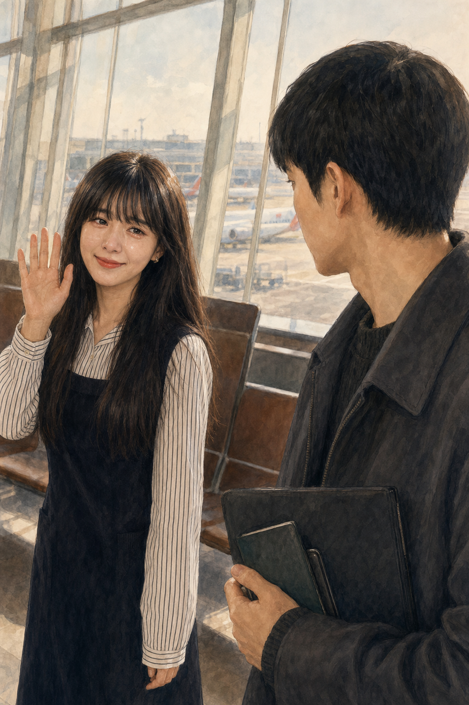

# 062. 게이트 앞에서

토요일 밤, 용식의 방 안은 캐리어와 짐가지들로 어수선했다.

내일 오후 비행기였다. 옷가지와 세면도구를 순서대로 캐리어에 눌러 담는데, 방문이 열리며 어머니가 들어왔다.

[어머니] "다 챙겼어?"

[김용식] "어, 거의 다."

어머니는 캐리어 옆에 앉아 옷 몇 벌을 다시 개켜 넣었다.

[어머니] "두 달이면 짧다면 짧고 길다면 긴데. 밥 잘 챙겨 먹고 다녀."

[김용식] "어."

[어머니] "돈은 있어?"

[김용식] "알바비 모은 거 있다니까."

어머니는 별 의심 없이 고개를 끄덕이며 마지막으로 캐리어 지퍼를 함께 잠가 줬다. 거실을 지나가는데, 아버지가 소파에 앉아 텔레비전을 보고 있었다. 짧은 시선이 오갔지만, 별다른 말은 없었다.

[아버지] "잘 다녀와라."

[김용식] "네."

그게 전부였다. 아버지와는 늘 이 정도의 거리감이었다. 용식은 방으로 돌아와 캐리어 손잡이를 잠깐 만지작거렸다.

다음 날 새벽, 용식은 알람이 울리기도 전에 눈을 떴다. 캐리어는 어젯밤 이미 다 싸 놓았지만, 그는 몇 번이나 다시 열어 여권과 항공권을 확인했다. 부엌에서는 어머니가 벌써 일어나 아침을 준비하고 있었다.

[어머니] "몇 시 비행기라고 했지?"

[김용식] "오후 두 시."

[어머니] "그럼 지금부터 슬슬 준비해야겠네."

간단히 아침을 먹고, 용식은 캐리어를 끌고 현관을 나섰다. 캐리어 바퀴가 좁은 골목 시멘트 바닥에 부딪히며 덜컹거리는 소리를 냈다. 어머니가 문 앞까지 배웅하며 그의 등을 두드려 줬다.

[어머니] "몸 조심하고, 밥 거르지 말고."

[김용식] "어, 갔다 올게."

수원에서 초연을 태운 뒤, 두 사람은 공항버스를 타고 함께 인천공항으로 향했다. 캐리어를 짐칸에 싣고 나란히 앉은 좌석 창밖으로 고속도로 풍경이 빠르게 지나갔다. 차 안에는 평소와 다른 긴장감이 흘렀다. 초연은 창밖을 보며 말없이 손끝으로 옷자락을 만지작거렸다.

공항에 도착해 체크인 카운터에서 캐리어를 부치고, 항공권과 여권을 다시 한번 확인했다. 직원이 짐표를 붙여 주는 동안 초연은 옆에서 그 모습을 가만히 지켜봤다. 캐리어가 컨베이어 벨트를 타고 사라지는 걸 보며, 그녀는 아무 말 없이 그의 팔을 살짝 붙잡았다.

두 사람은 출국장 앞 카페에 잠깐 앉았다. 유리창 너머로 활주로에 서 있는 비행기들이 보였다.

[김초연] "긴장돼?"

[김용식] "조금. 처음 가는 곳이라 그런가 봐."

[김초연] "나도. 근데 너보다 내가 더 긴장되는 것 같아."

초연이 억지로 웃어 보였다. 커피잔을 감싸 쥔 손끝이 미세하게 떨리고 있었다.

[김용식] "도착하면 바로 연락할게."

[김초연] "어. 꼭."

[김초연] "너 없는 동안 나 뭐 하고 지낼지 벌써 걱정이야."

[김용식] "친구들이랑 자주 놀아. 나 없다고 집에만 있지 말고."

[김초연] "그러다 너 딴생각하면 어떡해."

[김용식] "그런 거 없어."

초연은 그 말에 살짝 웃었지만, 눈에는 여전히 불안이 남아 있었다.

시간이 다가오면서 두 사람은 출국장 게이트 앞까지 함께 걸었다. 오가는 사람들의 캐리어 바퀴 소리와 안내 방송이 뒤섞여 공항 특유의 소란스러움이 가득했다.

게이트 앞에서 초연이 갑자기 그를 끌어안았다.

[김초연] "두 달만이야. 약속해."

[김용식] "약속할게."

[김초연] "진짜 두 달만이야. 더 있고 싶다는 생각 하지 마."

초연의 눈에서 눈물이 떨어졌다. 그녀는 손등으로 급히 닦으며 애써 웃어 보였다.

[김초연] "미안, 안 울려고 했는데."

[김용식] "괜찮아."

용식은 그녀를 다시 한번 꼭 안았다. 공항 특유의 소독약 냄새와 초연의 익숙한 샴푸 향이 뒤섞였다. 오가는 사람들의 시선도 신경 쓰이지 않을 만큼, 이 순간이 오래도록 남을 것 같았다.

[김초연] "가서 나만 생각해."

[김용식] "그럴게."

게이트 직원이 탑승 시작을 알리는 안내 방송을 했다. 용식은 캐리어 손잡이를 잡고 마지막으로 초연을 돌아봤다. 그녀는 손을 흔들며 억지로 밝은 얼굴을 만들고 있었다.

게이트로 들어서기 직전, 재킷 주머니 속 폴더폰이 짧게 진동했다. 용식은 무심코 화면을 열었다.

[한서윤] 나 방금 탑승 완료. 오전 비행기라 먼저 가. 너도 이따 잘 타.

문자와 함께 흐릿하게 찍힌 탑승권 사진이 첨부되어 있었다. 화면 속 게이트 번호까지 선명하게 보였다. 같은 날, 그보다 몇 시간 이른 비행기였다. 용식의 심장이 덜컥 내려앉았다. 그는 반사적으로 폰 화면을 몸 쪽으로 돌려 초연의 시야에서 가렸다.

[김초연] "누구야?"

[김용식] "아, 그냥 학교 동기가 잘 다녀오라고 문자한 거야."

용식은 서둘러 폰을 접어 주머니에 넣었다. 초연은 별다른 의심 없이 고개를 끄덕였다.

[김초연] "빨리 가, 늦겠다. 나 여기서 좀 더 있다가 갈게."

[김용식] "어, 그럼 갈게. 연락할게."

용식은 마지막으로 손을 흔들고 게이트 안으로 들어섰다. 뒤돌아보니 초연이 아직 그 자리에 서서 그를 바라보고 있었다. 손을 흔드는 그녀의 모습이 점점 멀어졌다. 유리벽 너머로 그녀가 손등으로 눈가를 훔치는 게 보였다.

게이트를 지나 탑승 대기 구역에 들어선 뒤에도, 용식은 방금 받은 문자를 다시 열어 봤다. 한서윤은 이미 몇 시간 먼저 출발해 도쿄로 향하고 있을 것이었다. 초연에게 들키지 않고 이 상황을 어떻게 감당해야 할지, 비행기가 이륙하기도 전부터 마음이 무겁게 가라앉았다.

대기 구역 의자에 앉아 창밖을 내다봤다. 활주로 위로 비행기 한 대가 굉음을 내며 이륙하고 있었다. 방금 헤어진 초연의 얼굴과, 몇 시간 먼저 떠난 한서윤의 문자가 동시에 머릿속을 채웠다. 두 사람 모두에게 각자 다른 약속을 한 채, 그는 지금 이 자리에 혼자 앉아 있었다. 어느 쪽에도 완전한 진실을 말하지 못한 채였다.

탑승 안내 방송이 다시 흘러나왔다. 용식은 여권과 탑승권을 손에 쥔 채 자리에서 일어났다. 비행기에 오르면서도, 창밖으로 멀어지는 인천의 활주로를 한참 동안 바라봤다. 좌석에 앉아 안전벨트를 매면서, 용식은 폴더폰의 전원을 껐다. 두 달이라는 시간이 이제 막 시작되고 있었다.
