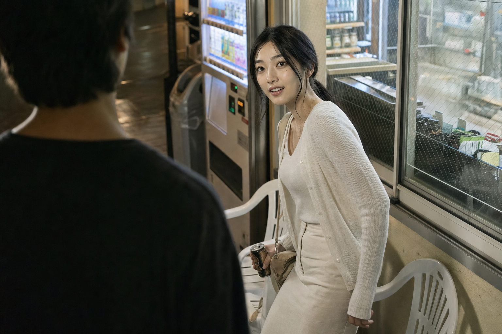

# 063. 오늘부터 3일

나리타 공항, 저녁 일곱 시.

비행기 바퀴가 활주로에 닿는 순간, 기내에 짧은 박수 소리가 퍼졌다. 입국 심사대 앞에는 긴 줄이 늘어서 있었다. 용식은 여권을 손에 쥔 채 낯선 언어로 된 안내판을 두리번거렸다. 심사관 앞에 서자 짧은 일본어로 몇 마디를 주고받았다. 학원에서 배운 문장들이 생각보다 자연스럽게 나왔다.

수하물을 찾아 나오자 후텁지근한 초여름 공기가 온몸을 감쌌다. 공항 안내 방송이 낯선 억양으로 울려 퍼졌다.

전철 매표기 앞에서 잠깐 헤맸다. 안내판의 한자와 가나를 더듬더듬 읽어 가며 겨우 표를 끊었다. 전철을 두 번 갈아타고 신주쿠 인근 어학원 기숙사로 향했다.

전철 안에서 용식은 창에 이마를 기댄 채 눈을 감았다 떴다를 반복했다. 창밖으로 스쳐 가는 낯선 간판들, 자전거를 탄 사람들, 좁은 골목 사이로 늘어선 자판기들이 눈에 들어왔다. 안내 방송이 나올 때마다 정차역 이름을 놓치지 않으려 신경을 곤두세웠다. 모든 게 새로웠고, 동시에 어딘가 정신이 붕 뜬 느낌이었다.

기숙사 건물은 좁은 골목 안쪽, 낡은 3층짜리 건물이었다. 캐리어를 끌고 계단을 오르는데, 다리에 피로가 몰려왔다. 열 몇 시간째 이동만 한 셈이었다.

1층 관리실에서 방 열쇠를 받는 동안, 나이 든 관리인이 서투른 영어와 손짓을 섞어 기숙사 규칙을 설명해 줬다. 방은 좁았지만 침대와 책상, 작은 냉장고가 갖춰져 있었다. 짐을 대충 풀어놓은 뒤, 용식은 근처 편의점이라도 들를 겸 밖으로 나왔다. 골목 어귀 자판기 불빛이 어스름 속에서 밝게 빛나고 있었다.

그런데 편의점 앞, 낯익은 실루엣이 눈에 들어왔다.

[한서윤] "왔네."

용식은 순간 걸음을 멈췄다. 한서윤이 편의점 앞 플라스틱 의자에 앉아 그를 기다리고 있었다. 손에는 캔커피가 들려 있었다. 낯선 나라에서 마주친 익숙한 얼굴이 묘하게 비현실적으로 느껴졌다.

[김용식] "여기서 어떻게……"

[한서윤] "네가 학원 이름 알려 줬잖아. 기숙사 위치는 인터넷에 다 나오더라. 나도 도착하자마자 찾아봤어."

그녀는 아무렇지 않게 웃으며 캔커피를 하나 더 내밀었다.

[김용식] "숙소는 잘 찾아갔어?"

[한서윤] "어, 프런트에서 네 이름 대니까 바로 되던데. 방도 깔끔하고 좋더라."

용식은 그 옆에 앉았다. 다리에 힘이 풀리는 느낌이었다. 낯선 도시, 낯선 시간, 그리고 그 사이에 이렇게 앉아 있는 한서윤까지, 모든 게 비현실적으로 느껴졌다.

[한서윤] "피곤하지?"

[김용식] "어, 좀."

[한서윤] "그래도 오늘은 나랑 좀 있다 가."

[김용식] "내일 오리엔테이션도 있고……"

[한서윤] "오늘 말고 내일부터 시작이잖아. 우리 오늘부터 3일, 알지?"

한서윤의 목소리에는 흔들림이 없었다. 이미 정해진 일정을 확인하는 듯한 말투였다. 용식은 뭐라 반박할 말을 찾지 못했다. 몸도 마음도 지쳐 있었고, 낯선 곳에서 유일하게 아는 얼굴이 눈앞에 있다는 사실이 묘한 안도감을 줬다.

[김용식] "그래, 3일."

[한서윤] "이제야 대답한다. 그럴 줄 알았어."

그녀가 웃으며 자리에서 일어났다. 한국에서보다 훨씬 가벼운 얼굴이었다. 학원 복도에서 늘 한 발쯤 물러서 있던 사람 같지 않았다. 한서윤은 잠깐 망설이는 듯하더니 그의 팔짱을 끼었다. 팔 안쪽으로 닿아 오는 체온에 용식은 반사적으로 주변을 둘러봤다. 아무도 그들을 알아볼 사람이 없는 도시였다.

[한서윤] "여기선 이렇게 해도 되잖아."

용식은 대답 대신 걸음을 맞췄다. 골목 저편으로 자판기 불빛이 깜빡였고, 어디선가 스쿠터 엔진 소리가 들려왔다.

[한서윤] "일단 밥부터 먹자. 근처에 라멘집 봐 놨어."

[김용식] "그래."

두 사람은 나란히 골목을 걸어 나갔다. 좁은 골목 양옆으로 늘어선 자판기와 간판 불빛이 낯선 도시의 저녁을 채우고 있었다. 자전거를 탄 교복 차림의 학생들이 종을 울리며 옆을 스쳐 지나갔다. 한서윤은 그때마다 그의 팔을 더 가까이 끌어당기며 작게 웃었다. 용식은 걸으면서도 한국에 두고 온 사람들을 생각했다. 초연은 지금쯤 집에 돌아가 있을 것이었다. 그 생각과 함께, 지금 이 순간 옆에서 걷고 있는 한서윤의 존재가 동시에 그의 마음을 잡아당겼다.

노렌을 걷고 들어선 라멘집은 좁고 허름했지만 사람들로 붐볐다. 두 사람은 카운터 자리에 나란히 앉아 뜨거운 국물을 후루룩 마셨다. 하루 종일 굶다시피 한 배 속에 온기가 퍼졌다. 한서윤이 젓가락으로 면을 건져 올리며 물었다.

[한서윤] "너 여기 있는 동안, 나 생각 좀 할 거야?"

[김용식] "……어."

[한서윤] "거짓말 아니지?"

[김용식] "아니야."

한서윤은 그 대답에 만족한 듯 웃으며 다시 그릇에 시선을 돌렸다. 오늘의 그녀는 자주 웃었다. 면발을 제대로 못 집어 올려 국물이 튀었을 때도, 용식이 서툰 일본어로 물을 더 달라고 했다가 점원이 못 알아들었을 때도, 그녀는 손등으로 입가를 가리고 한참을 웃었다. 한국에서라면 누군가의 시선을 먼저 살폈을 텐데, 이곳에서는 웃음이 훨씬 쉽게 흘러나왔다.

창밖으로 도쿄의 밤이 깊어 가고 있었다. 용식은 그릇 속 국물을 내려다보며, 이 3일이 시작된 이상 이제는 되돌릴 수 없다는 걸 어렴풋이 느꼈다.

식사를 마치고 나온 두 사람은 편의점에서 캔맥주 두 개를 사 들고 근처 작은 공원 벤치에 앉았다. 도쿄의 밤공기는 서울보다 조금 더 습했다.

[한서윤] "너 진짜 여기 오니까 신기하다. 한국에서 볼 때랑 느낌이 달라."

[김용식] "그러게. 나도 아직 실감이 안 나."

[한서윤] "3일 동안 어디 가고 싶은 데 있어?"

[김용식] "너 아사쿠사 가고 싶다며."

[한서윤] "어, 맞다. 그것도 가고, 오다이바도 가 보고 싶어."

두 사람은 맥주 캔을 부딪히며 짧게 건배했다. 공원 가로등 아래로 벌레들이 몰려들었다 흩어지기를 반복했다. 멀리서 자판기 모터 돌아가는 소리가 낮게 울렸다.

[한서윤] "그리고 셋째 날 저녁엔 나 공항 가야 해. 그때까지만이야."

[김용식] "알아."

[한서윤] "그 뒤에는 또 각자 자리로 돌아가는 거고."

그 말에 담긴 담담함이 오히려 더 무겁게 느껴졌다. 용식은 캔을 든 채 아무 말도 하지 못했다. 벤치 아래 그림자가 가로등 불빛에 길게 늘어져 있었다.

공원에서 나와 역 쪽으로 걷는 길, 한서윤은 편의점 유리창에 비친 두 사람을 보고 잠깐 멈춰 섰다. 유리 속에서 그녀는 그의 팔을 끼고 있었고, 용식은 그런 그녀를 떼어 내지 않고 있었다.

[한서윤] "우리 되게 평범해 보인다."

[김용식] "뭐가."

[한서윤] "그냥 여행 온 커플 같아."

그 말이 너무 쉽게 나와서, 오히려 용식은 대답하지 못했다. 한서윤은 대답을 기다리지 않고 다시 걸었다. 손은 여전히 그의 팔에 걸려 있었다.

호텔로 돌아가는 길, 한서윤은 자신의 숙소 건물 앞에서 잠깐 멈춰 섰다.

[한서윤] "내일 아침에 연락할게. 오리엔테이션 끝나는 시간 맞춰서 갈 테니까 문자해."

[김용식] "어, 그래."

[한서윤] "그리고... 잠깐 들어왔다 갈래?"

용식은 호텔 입구의 작은 조명을 올려다봤다. 자동문 너머 로비에는 직원 한 명이 조용히 서류를 정리하고 있었다.

[김용식] "내일 아침 일찍 나가야 돼."

[한서윤] "알아. 오래 붙잡지는 않을게."

그녀는 그렇게 말했지만, 눈은 이미 대답을 기다리고 있었다. 용식은 한 번 숨을 고른 뒤 고개를 끄덕였다.

호텔 방은 생각보다 좁았다. 캐리어 하나를 펼치면 발 디딜 곳이 얼마 남지 않는 방이었다. 침대 위에는 낮에 그녀가 벗어 둔 가디건이 접힌 듯 흐트러져 있었고, 창가 작은 테이블에는 편의점 봉투와 카메라가 놓여 있었다. 한서윤은 방 안에 들어서자마자 불을 전부 켜지 않고 침대 옆 스탠드만 눌렀다. 노란빛이 벽지를 낮게 물들였다.

[한서윤] "이상하지. 한국에서는 맨날 숨어 다녔는데, 여기서는 네가 내 방에 있는 게 제일 자연스러워."

[김용식] "서윤아."

[한서윤] "괜찮아. 나도 알아. 이상한 거."

그녀가 먼저 다가와 그의 재킷 소매를 잡았다. 장난스럽게 웃으려던 입꼬리가 조금 떨렸다.

[한서윤] "싫으면 지금 가. 나 붙잡는 거 안 할게."

용식은 대답 대신 그녀의 손을 잡았다. 한서윤은 그제야 참았던 숨을 작게 내쉬었다. 두 사람 사이의 거리가 조금씩 줄어들었다. 창밖에서 지나가는 전철 소리가 낮게 흔들렸고, 침대 옆 스탠드의 빛이 벽에 길게 번졌다.

불이 꺼진 뒤에도 낯선 도시의 네온이 커튼 틈으로 희미하게 남아 있었다.

새벽녘, 용식은 아직 어두운 골목을 지나 기숙사로 돌아왔다. 재킷 소매에는 호텔 방의 세제 냄새와 한서윤의 샴푸 향이 뒤섞여 있었다. 방에 돌아와 침대에 눕고 나서도 오늘 하루가 실감 나지 않았다. 열두 시간이 넘는 이동, 낯선 도시, 그리고 예상하지 못한 한서윤의 등장까지. 창밖으로 낯선 도시의 소음이 희미하게 들려왔다. 눈을 감았지만, 그녀가 팔짱을 끼던 감각과 방 안의 낮은 조명이 자꾸 눈앞에 떠올랐다 사라지기를 반복했다.
