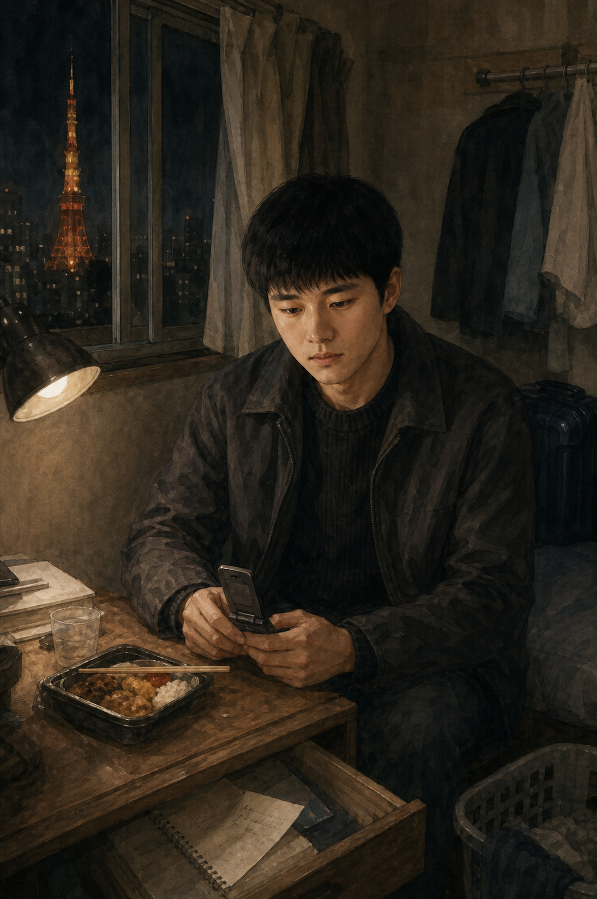

# 065. 세고 있어

목요일 아침, 용식은 배정받은 반 수업에 들어갔다. 낯선 얼굴들 사이에 한국인은 그를 포함해 두세 명뿐이었다. 선생님이 자기소개를 시키자, 그는 학원에서 배운 문장으로 더듬더듬 이름과 출신을 말했다.

[선생님] "김용식 씨, 발음 좋네요."

[김용식] "감사합니다. 열심히 연습했어요."

같은 반 다른 한국인 학생이 쉬는 시간에 말을 걸어 왔다.

[같은반학생] "어디서 오셨어요? 저는 부산인데."

[김용식] "저는 경기도요. 수원 근처요."

[같은반학생] "혼자 오셨어요?"

[김용식] "네, 혼자 왔어요."

[같은반학생] "저도요. 이 시간대에 다들 처음이라 그런지 좀 어색하네요."

짧은 대화를 나누며 낯선 교실에 조금씩 적응해 갔다. 칠판에 적힌 낯선 문형을 노트에 옮겨 적으면서도, 머릿속 한편에는 어제 헤어진 얼굴이 계속 아른거렸다. 학원 앞에서 팔짱을 끼던 손, 라멘집에서 웃음을 참지 못하던 입모양, 호텔 방 스탠드 아래에서 천천히 낮아지던 목소리까지 자꾸만 문장 사이로 끼어들었다. 선생님의 설명이 절반쯤 흘러가 버렸다는 걸 뒤늦게 깨닫고, 그는 애써 정신을 다잡았다. 수업이 끝나고 기숙사로 돌아가는 길, 어제 오후 배웅했던 정류장을 다시 지나쳤다. 버스가 완전히 사라졌던 그 자리가 오늘따라 유독 눈에 밟혔다. 용식은 걸음을 재촉해 기숙사 쪽으로 향했다.

골목은 낮의 소란함이 가시고 조용해져 있었다. 자판기 불빛만 여전히 깜빡이며 그 자리를 지키고 있었다. 어제까지도 함께 걷던 골목이었다. 방으로 돌아와 문을 닫자, 좁은 공간에 정적이 내려앉았다.

방에 들어와 가방을 내려놓고 창문을 열었다. 낯선 골목의 저녁 공기가 방 안으로 흘러들었다. 옷걸이에 걸어 둔 재킷이 눈에 들어왔다. 아사쿠사에 갔던 날 입었던 옷이었다.

무심코 주머니를 뒤지다가, 안쪽에서 작은 종이 한 장이 나왔다. 아사쿠사 기념품 가게에서 받은 영수증이었다. 한서윤이 부적을 살 때 함께 받았던 것을, 그가 무심코 주머니에 넣어 두고 잊고 있었던 모양이었다.

용식은 그 영수증을 한참 들여다봤다. 낯선 글자들 사이로 강바람과 향 연기 냄새가 어렴풋이 떠올랐다. 한서윤이 부적을 고르며 웃던 얼굴, 뜨거운 다코야키 때문에 눈가에 물기가 맺혔던 얼굴, 돌아가는 버스 앞에서 억지로 담담해지려던 얼굴이 차례로 떠올랐다. 이걸 버려야 할지, 아니면 그냥 넣어 둬야 할지 잠깐 망설이다가, 결국 그는 그것을 서랍 한쪽에 넣어 뒀다.

재킷 안쪽에서도 옅은 샴푸 향이 났다. 한서윤의 향이었다. 호텔 방의 세제 냄새와 뒤섞인 그 향은 생각보다 오래 남아 있었다. 용식은 그 재킷을 바로 세탁물 바구니에 넣지 못하고 한참 들고 있었다. 이제 정말 사흘이 끝났다는 걸 실감하는 순간, 이상하게도 끝났다는 안도보다 아직 손끝에 남은 가까움이 먼저 떠올랐다. 결국 그는 재킷을 바구니에 넣었다. 옷걸이만 덩그러니 남은 옷장을 보며 그는 잠깐 멍하니 서 있었다.

저녁, 학원 근처 편의점에서 도시락을 사 들고 방으로 돌아왔다. 계산대에서 점원이 건넨 젓가락 봉지를 받으며, 짧은 일본어로 감사 인사를 건넸다. 창밖으로 낯선 도시의 불빛이 하나둘 켜지고 있었다. 혼자 먹는 도시락은 어색하고 조용했다. 플라스틱 뚜껑을 열자 김이 모락모락 올라왔다.

폴더폰을 열어 초연과의 문자함을 확인했다. 오전에 짧은 안부만 주고받은 뒤로 별다른 연락은 없었다. 시차가 없다는 게 그나마 다행이라면 다행이었다. 용식은 먼저 문자를 보냈다.

[김용식] 오늘 오리엔테이션도 끝나고, 이제 좀 적응되는 것 같아.

답장은 한 시간쯤 지나서야 왔다.

[김초연] 다행이다. 밥은 잘 챙겨 먹고 있어?

[김용식] 어, 방금 저녁 먹었어.

[김초연] 심심하지 않아? 아는 사람도 없을 텐데.

[김용식] 조금. 근데 괜찮아.

거짓말은 아니었지만, 완전한 진실도 아니었다. 방금 전까지 그를 채우고 있던 감정은 심심함과는 거리가 멀었다. 오히려 너무 많은 것들로 가득 차 복잡한 쪽에 가까웠다.

[김초연] 나 요즘 너 없는 거 진짜 실감 나. 집에 오면 조용하고.

[김용식] 미안해.

[김초연] 미안할 거 없어. 어차피 두 달이잖아. 나만 잘 버티면 되지.

문자가 잠깐 끊겼다가, 다시 하나가 도착했다.

[김초연] 나 오늘 매점 갔다가 너랑 자주 앉던 자리 보고 좀 이상했어. 아직도 있는 것 같아서.

[김용식] 나도 여기서 네 생각 계속 나.

[김초연] 나 사실 매일 달력에 표시하고 있어. 며칠 지났는지.

[김용식] 진짜? 유치하게.

[김초연] 뭐 어때, 유치하면.

[김초연] 어. 오늘로 나흘째야. 언제 오는지 세고 있어. 너 오면 뭐 할지 벌써 계획 짜고 있다니까.

그 문장을 읽는 순간, 용식은 방금까지 서랍에 넣어 둔 영수증과 세탁물 바구니 속 재킷을 동시에 떠올렸다. 초연이 하루하루를 세며 그를 기다리는 동안, 자신은 이미 다른 이름과 사흘을 보냈다. 그냥 만난 것도 아니었다. 낯선 도시에서 팔짱을 끼고 걸었고, 별것 아닌 말에 같이 웃었고, 호텔 방의 낮은 조명 아래서 한국에서는 끝내 허락되지 않았던 얼굴을 서로에게 보여 줬다. 그 사실이 무겁게 가슴을 눌렀다.

도시락 그릇을 내려다봤다. 반쯤 남은 밥알이 이미 식어 있었다. 젓가락을 다시 들었지만, 입맛이 완전히 사라진 뒤였다. 결국 뚜껑을 닫고 남은 도시락을 한쪽으로 밀어 놓았다.

[김용식] 나도 빨리 가고 싶어. 진짜로.

[김초연] 진짜지?

[김용식] 어, 진짜야.

답장을 보내고 나서, 용식은 폰을 손에 쥔 채 한참을 그대로 앉아 있었다. 창밖으로 낯선 도시의 야경이 펼쳐져 있었지만, 눈에 잘 들어오지 않았다.

서랍을 열어 아까 넣어 둔 영수증을 다시 꺼내 봤다. 이걸 계속 가지고 있어야 할지, 아니면 지금이라도 버려야 할지 판단이 서지 않았다. 결국 그는 그것을 다시 서랍 안쪽 깊숙이 밀어 넣었다.

앞으로 남은 두 달, 초연은 매일 날짜를 세며 그를 기다릴 것이었다. 그 사이 한서윤과는 '가끔만' 연락하기로 했고, 정다은과 정다은이 흔든 초연의 불안도 한국 어딘가에서 계속 이어지고 있을 것이었다. 자신이 이 도시에 없는 동안에도 그 세 갈래의 실타래는 각자의 속도로 계속 풀리거나 엉키고 있을 터였다. 어느 하나도 완전히 놓지 못한 채, 그는 두 달 뒤의 귀국을 향해 하루씩 나아가야 했다.

용식은 그 모든 걸 감당해야 할 시간이 이제 막 시작되었다는 걸 실감하며, 불을 끄고 침대에 누웠다.

창밖 낯선 도시의 소음이 늦은 밤까지 이어졌다. 자전거 벨 소리, 자판기 모터 소리, 그리고 이따금 지나가는 오토바이 엔진 소리가 뒤섞여 방 안으로 스며들었다. 잠은 쉽게 오지 않았다.

몇 번이나 뒤척이던 끝에, 용식은 결국 몸을 일으켜 서랍을 다시 열었다. 아사쿠사 영수증을 손에 쥔 채 한참을 들여다보다가, 그것을 다이어리 갈피 사이에 조용히 끼워 넣었다. 버리지도, 그렇다고 꺼내 보지도 못할 자리였다. 서랍을 닫고 다시 침대에 누우며, 그는 애써 눈을 감았다.
