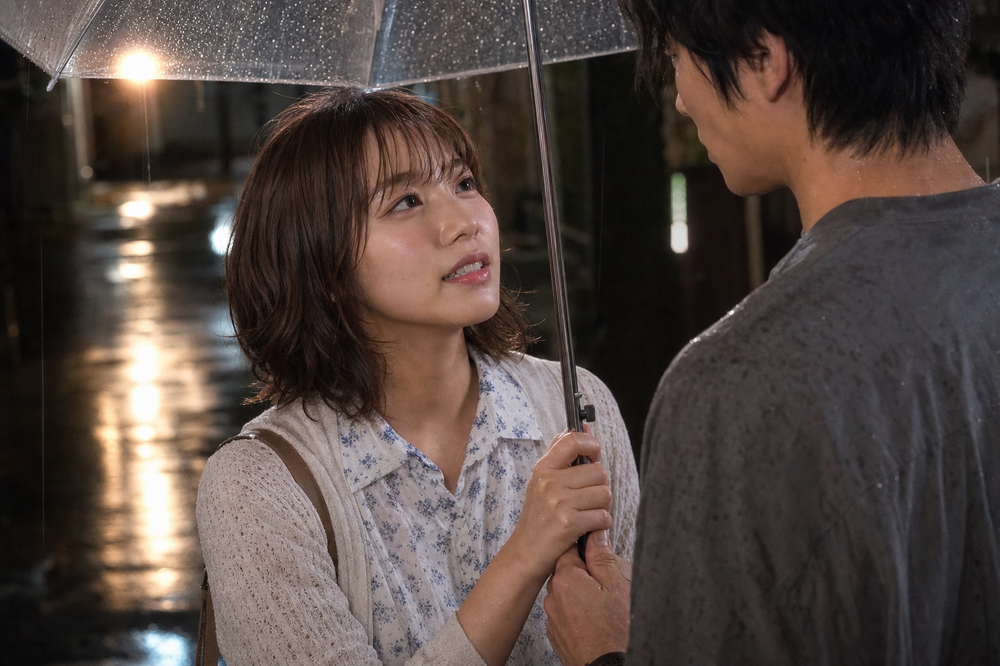

# 068. 우산 속 거리

수요일 아침부터 하늘이 심상치 않았다.

기숙사를 나설 때만 해도 구름이 낮게 깔려 있는 정도였다. 용식은 일기예보를 제대로 확인하지 않은 채 우산 없이 학원으로 향했다. 오전 수업 중간부터 창밖으로 빗방울이 하나둘 떨어지기 시작했고, 점심시간이 지나자 빗줄기가 눈에 띄게 굵어졌다.

수업이 끝날 즈음, 비는 이미 본격적으로 쏟아지고 있었다. 우산을 챙겨 오지 않은 학생들이 처마 밑에 모여 서 있었다. 용식도 그중 하나였다. 빗줄기가 아스팔트 위로 튀어 오르며 신발 끝을 적셨다.

같은 반 학생 몇이 편의점 비닐우산을 사러 뛰어갔다. 용식도 잠깐 따라나설까 망설였지만, 이 정도면 곧 그칠 거라는 생각에 처마 밑에 그대로 서 있었다. 빗줄기는 그칠 기미 없이 오히려 점점 굵어졌다. 손목시계를 확인했다. 기숙사까지는 걸어서 이십 분 남짓이었다.

[나카타 유즈키] ヨンシクさん。(용식 씨.)

뒤에서 부르는 소리에 돌아보니, 유즈키가 접이식 우산을 펼치며 다가오고 있었다. 퇴근하는 길이었는지 사복 차림에 가방을 메고 있었다.

[나카타 유즈키] 傘、忘れましたか？(우산, 두고 왔어요?)

[김용식] "네, 아침엔 안 올 줄 알았어요."

[나카타 유즈키] じゃあ、途中まで一緒に。(그럼, 가는 데까지 같이.)

우산은 하나였다. 유즈키가 먼저 손잡이를 들고 걷기 시작했다. 어쩔 수 없이 거리가 가까워졌다. 어깨가 스칠 듯 말 듯한 간격이었고, 우산 밖으로 삐져나온 어깨 한쪽은 이미 젖고 있었다.

[김용식] "어깨 젖어요."

[나카타 유즈키] 大丈夫。(괜찮아요.)

유즈키는 오히려 우산을 용식 쪽으로 더 기울였다. 자기 쪽 어깨가 완전히 빗물에 젖는 걸 신경 쓰지 않는 눈치였다. 용식이 우산을 반대로 당기려 하자, 유즈키가 손을 살짝 잡아 막았다.

[나카타 유즈키] いいから。(괜찮으니까요.)

그 순간 손끝이 겹쳤다. 유즈키는 손을 바로 떼지 않았다. 용식도 뿌리치지 않았다. 빗소리가 우산 위로 툭툭 떨어지는 소리만 한참 이어졌다. 상점가를 지나는 동안에도 두 사람은 별다른 말을 하지 않았다. 빗물에 젖은 아스팔트 위로 상점 간판의 불빛이 길게 번져 흔들렸다.

[나카타 유즈키] こんな雨、久しぶり。(이런 비, 오랜만이에요.)

[김용식] "그러네요."

[나카타 유즈키] 傘、一つしかないと、なんか。(우산이, 하나밖에 없으니까, 뭔가.)

말끝을 흐리고는, 유즈키는 그 뒤를 잇지 않았다. 대신 손잡이를 쥔 손에 살짝 힘을 줬다.

기숙사 앞 골목에 다다랐을 때, 비가 더 거세졌다. 가로등 불빛이 물웅덩이 위로 흔들리며 번졌다. 유즈키는 우산을 접지 않은 채 그 자리에 멈춰 섰다.

[나카타 유즈키] ここまでで大丈夫ですか？(여기까지면 괜찮아요?)

[김용식] "네. 데려다줘서 고마워요."

[나카타 유즈키] うん。(응.)

대답은 짧았지만, 유즈키는 발을 떼지 않았다. 우산 아래 두 사람의 거리는 이미 처음보다 훨씬 좁아져 있었다. 빗물 냄새와 그녀의 샴푸 향이 섞여 코끝에 닿았다.

용식은 시선을 어디에 둬야 할지 몰라 잠깐 골목 끝을 봤다. 다시 고개를 돌렸을 때, 유즈키는 그를 똑바로 올려다보고 있었다.

[나카타 유즈키] ヨンシクさん。(용식 씨.)

[김용식] "네."

[나카타 유즈키] 今、変なこと言ってもいいですか？(지금, 이상한 말 해도 돼요?)

용식은 대답 대신 그녀를 바라봤다. 유즈키의 눈이 가로등 불빛을 받아 조금 젖어 보였다.

[나카타 유즈키] 私、多分もう好きになってると思います。(저, 아마 이미 좋아하게 된 것 같아요.)

말이 끝나기도 전에, 그녀가 발끝을 살짝 들며 다가왔다.

용식은 뒤로 물러날 틈이 없었다. 아니, 물러나지 않았다. 유즈키의 입술이 그의 입술에 닿았다. 짧은 순간이었지만, 우산을 쥔 그녀의 손이 살짝 떨리는 게 느껴졌다.

떨어진 뒤, 유즈키는 바로 얼굴을 붉히며 시선을 내렸다. 그러다가도 다시 눈을 들어 용식을 봤다. 겁먹은 얼굴이 아니었다. 자기가 한 행동을 후회하지 않는 얼굴이었다.

[나카타 유즈키] びっくりしましたよね。(놀랐죠.)

[김용식] "...조금요."

용식은 그 말밖에 하지 못했다. 머릿속에 초연의 얼굴이 스쳤다가, 빗소리에 금세 흐려졌다. 지금 이 순간 자신이 느끼는 게 정확히 무슨 감정인지 이름을 붙일 수가 없었다. 죄책감이라고 하기엔 너무 생생했고, 설렘이라고 하기엔 어딘가 무거웠다. 두 감정 사이 어딘가에 걸쳐진 채, 그는 아무것도 정리하지 못한 얼굴로 서 있었다.

유즈키가 먼저 한 걸음 물러났다.

[나카타 유즈키] 今日はここで。(오늘은 여기까지.)

[나카타 유즈키] また、明日。(또, 내일.)

그녀는 우산을 고쳐 쓰고 돌아섰다. 골목을 빠져나가는 뒷모습이 빗속에서 점점 작아졌다. 우산 끝에서 떨어지는 빗방울이 그녀의 발자국을 따라 점점이 이어졌다.

용식은 그 자리에 한참 서 있었다. 셔츠 한쪽 어깨가 이미 흠뻑 젖어 있었지만, 그건 신경 쓰이지 않았다.

방으로 돌아와 젖은 옷을 벗어 널면서도, 입술에 남은 감각이 쉽게 가시지 않았다. 거울에 비친 자기 얼굴을 잠깐 들여다봤다. 평소와 다를 게 없는 얼굴인데도, 뭔가 달라진 것 같은 기분이었다.

폴더폰을 열어 봤지만 초연에게서 온 문자는 없었다.

용식은 답장할 상대가 없는 폰을 한참 들여다보다가, 결국 아무것도 쓰지 않고 폰을 닫았다. 대신 서랍을 열어 아사쿠사 영수증이 끼워진 다이어리를 잠깐 봤다가, 도로 닫았다.

창밖으로 빗소리가 밤늦도록 이어졌다.

용식은 몇 번이나 뒤척이다가 결국 몸을 일으켜 창가에 섰다. 골목의 가로등이 빗줄기를 비추며 흔들리고 있었다. 조금 전 유즈키가 서 있던 자리를 눈으로 더듬었다. 이미 아무도 없는 골목이었다.

내일 교실에서 마주치면 어떤 얼굴을 해야 할지, 그는 답을 찾지 못한 채 다시 침대로 돌아왔다. 초연과의 두 달이 이제 절반도 채 지나지 않았다는 사실이 문득 무겁게 다가왔다. 그는 이불을 끌어당기며 애써 눈을 감았다. 빗소리는 좀처럼 잦아들지 않았다.

새벽 어느 순간, 빗소리가 조금씩 가늘어지는 걸 어렴풋이 느끼며 그는 겨우 잠이 들었다. 꿈속에서도 우산 아래 좁혀지던 거리가 계속 되풀이됐다.
