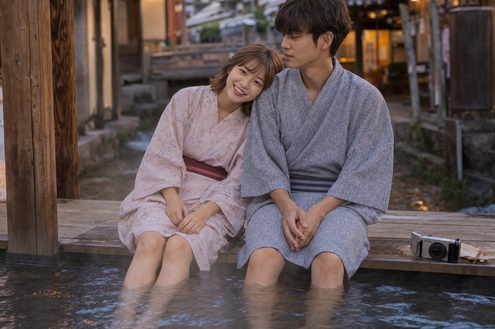

# 069. 두고 간 것

토요일 아침, 유즈키는 사복 차림으로 기숙사 앞에 서 있었다. 화사한 노란색 원피스에 얇은 카디건을 걸치고 있었다.

[나카타 유즈키] 今日、天気いいから。(오늘, 날씨 좋으니까요.)

[나카타 유즈키] 近くの温泉町、行きませんか？(근처 온천 마을, 가지 않을래요?)

용식은 잠깐 망설였다. 지난 수요일 이후 처음 만나는 자리였다. 유즈키는 그 사이 아무 일도 없었다는 듯 평소와 똑같이 웃고 있었지만, 눈이 마주칠 때마다 그 웃음 끝에 살짝 다른 온도가 남아 있었다.

[김용식] "네, 좋아요."

기차로 한 시간 거리였다. 창밖으로 논밭과 낮은 산이 스쳐 지나갔다. 유즈키는 창가 자리에 앉아 이어폰 한쪽을 용식에게 건넸다.

[나카타 유즈키] これ、聞いてみて。(이거, 들어봐요.)

낯선 일본 밴드의 노래였다. 가사는 절반도 알아듣지 못했지만, 어깨가 나란히 닿은 채로 같은 음악을 듣는 시간이 나쁘지 않았다. 유즈키는 노래 중간중간 가사를 짧게 번역해 줬다.

[나카타 유즈키] ここ、「もう戻れない夏」って歌ってるの。(여기, "이제 돌아갈 수 없는 여름"이라고 노래하는 부분이에요.)

[김용식] "무슨 노래인데 제목이 그래요?"

[나카타 유즈키] さあ。でも、好きな部分。(글쎄요. 근데, 좋아하는 부분이에요.)

그녀는 그 말을 하고는 창밖으로 시선을 돌렸다. 용식은 그 옆얼굴을 잠깐 봤다가, 다시 이어폰 너머 낯선 멜로디에 귀를 기울였다.

온천 마을은 작았다. 좁은 상점가를 따라 온천 만주와 유카타 대여점이 늘어서 있었다. 유즈키는 유카타를 입어 보자고 졸랐고, 결국 두 사람 다 대여점에서 옷을 갈아입었다. 유즈키의 유카타는 연분홍 바탕에 작은 꽃무늬가 있었다. 그녀가 거울 앞에서 옷매무새를 다듬으며 웃었다.

[나카타 유즈키] どう？似合ってる？(어때요? 어울려요?)

[김용식] "네, 잘 어울려요."

[나카타 유즈키] ふふ、ヨンシクさんも似合ってる。(후후, 용식 씨도 잘 어울려요.)

디지털카메라로 서로의 사진을 찍었다. 유즈키는 사진을 확인할 때마다 만족스럽게 웃었고, 마음에 안 드는 사진은 바로 지웠다. 상점가를 걸으며 온천 만주를 하나씩 사 먹고, 나무로 된 작은 다리 위에서는 유즈키가 난간에 기댄 채 강물을 내려다봤다.

[나카타 유즈키] こういう景色、田舎の家の近くにもあった。(이런 풍경, 고향 집 근처에도 있었어요.)

[김용식] "나고야 쪽이었죠?"

[나카타 유즈키] うん。小さい町。何もないところ。(네. 작은 동네예요. 아무것도 없는 곳.)

말투는 담담했지만, 그 담담함 안에 뭔가 그리움 같은 게 섞여 있었다. 용식은 굳이 더 캐묻지 않고 그녀 옆에 나란히 섰다.

족욕탕에 나란히 앉아 발을 담글 때는, 유즈키가 자연스럽게 용식의 어깨에 머리를 기댔다.

[나카타 유즈키] こういうの、久しぶり。(이런 거, 오랜만이에요.)

[김용식] "뭐가요?"

[나카타 유즈키] 誰かと、こうやってのんびりすること。(누군가랑, 이렇게 느긋하게 시간 보내는 거요.)

[나카타 유즈키] こっち来てから、ずっと一人だったから。(이쪽 오고 나서, 계속 혼자였으니까요.)

그녀의 목소리가 평소보다 낮았다. 용식은 물속에서 흔들리는 유즈키의 발끝을 봤다가, 그녀의 옆얼굴을 봤다. 나고야를 떠나 혼자 도쿄에 올라와, 첫 직장에서 서투른 채로 하루하루를 버텨 온 얼굴이었다.

저녁 식사 후 마지막 기차 시간이 다가왔지만, 유즈키는 시계를 보고도 서두르지 않았다.

[나카타 유즈키] 最終電車、逃したら。(막차, 놓치면.)

[나카타 유즈키] どうしよう。(어떡하죠.)

말투는 걱정스러웠지만, 얼굴에는 걱정이 없었다. 결국 두 사람은 마지막 기차를 놓쳤다. 역 앞 작은 료칸에 방을 잡았다. 다다미 냄새와 온천 수증기 냄새가 방 안에 은은하게 배어 있었다.

유즈키는 창문을 열고 밤바람을 맞으며 한참 서 있다가, 뒤를 돌아 용식을 봤다.

[나카타 유즈키] 後悔しないですか？(후회 안 해요?)

[김용식] "뭘요?"

[나카타 유즈키] これから起こること。(앞으로 일어날 일.)

용식은 대답 대신 그녀에게 다가갔다. 유즈키는 피하지 않았다.

방의 불이 꺼졌다.

다음 날 아침, 커튼 틈으로 옅은 햇살이 들어왔다. 유즈키는 이불 속에서 몸을 뒤척이며 용식의 팔을 슬쩍 끌어당겼다.

[나카타 유즈키] もうちょっとだけ。(조금만 더요.)

두 사람은 늦은 체크아웃 시간까지 이불 속에서 나오지 않았다. 창밖으로 매미 우는 소리가 벌써부터 요란했다.

---

같은 시각, 수원 집.

한서윤은 침대에 엎드린 채 폴더폰 사진첩을 넘기고 있었다. 아사쿠사 절 앞에서 찍은 사진, 스미다강 다리 위에서 찍은 사진. 화면 속 자신은 웃고 있었다.

손끝으로 액정을 몇 번 문지르다가, 그녀는 사진첩을 닫고 천장을 올려다봤다.

여자친구는 아니었다. 그런데도 함께 해외여행을 다녀왔고, 몸을 섞은 밤도 여러 번이었다. 학원 안에서는 은밀하게, 밖에서는 아무 사이도 아닌 것처럼. 그 규칙을 먼저 제안한 것도 자신이었다.

책상 위에는 아직 뜯지 않은 일본어 학원 교재가 놓여 있었다. 그만둘까 고민했던 게 한 달 전인데, 여전히 그 자리에 다니고 있었다. 그만두면 이 애매한 관계를 정리할 명분이라도 생길 텐데, 막상 그럴 결심은 서지 않았다.

한서윤은 몸을 뒤집어 천장을 바라보며 지난 두 달을 되짚어 봤다. 처음엔 그저 가벼운 호기심이었다. 술자리에서 시작된 관계가 여기까지 이어질 줄은 자신도 몰랐다. 여자친구라는 이름표 없이, 그렇다고 완전히 아무 사이도 아니라고 하기엔 너무 많은 걸 함께 나눈 사이가 되어 있었다.

폴더폰이 다시 손에 잡혔다. 문자함을 열어 용식과 나눈 마지막 대화를 다시 읽었다. "가끔만 연락하자"는 약속이 지난 문자 이후로, 정말 가끔씩만 짧은 안부가 오갔다.

한서윤은 손끝으로 액정을 톡톡 두드리다가, 결국 아무 문자도 쓰지 않고 폰을 내려놨다.

이게 정확히 뭔지, 그녀 자신도 답을 갖고 있지 않았다. 창밖으로 여름 오후의 매미 소리가 끊임없이 이어지고 있었다.

그녀는 몸을 일으켜 책상 서랍을 열었다. 진주 귀걸이가 상자 안에 그대로 놓여 있었다. 받은 뒤로 한 번도 하고 나가지 않은 물건이었다. 상자를 닫고 다시 서랍 깊숙이 밀어 넣으며, 한서윤은 스스로에게 묻듯 나직이 중얼거렸다.

[한서윤] "나 지금 뭐 하고 있는 거지."

대답해 줄 사람은 방 안에 없었다.
